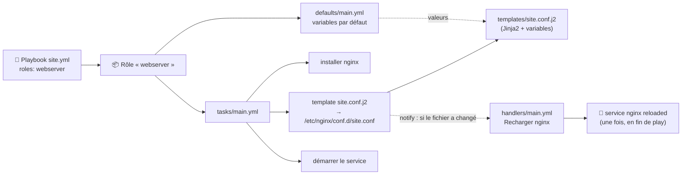

# Ansible avancé

## Pourquoi ce cours ?

Un playbook de 20 tâches se lit bien. À 300 tâches, copié-collé d'un projet à l'autre, avec des mots de passe en clair dans des variables et des changements qui doivent se faire serveur par serveur sans interruption de service, il devient **ingérable**. Ansible fournit les outils pour **organiser** (rôles, collections), **sécuriser** (Vault), **paramétrer** (templates Jinja2), **orchestrer** (`serial`, `delegate_to`, `run_once`, stratégies) et **contrôler la qualité** (`ansible-lint`). Ce cours les présente, jusqu'à la plateforme **AWX** pour industrialiser.

> Prérequis : [Ansible : les fondamentaux](04-ansible-fondamentaux.md) (inventaire, playbook, modules, handlers, idempotence).

## 1. Les rôles : l'unité de réutilisation

Un **rôle** regroupe, dans une **arborescence normalisée**, tout ce qu'il faut pour configurer **une fonction** (un serveur web, une base, un agent de supervision). On l'**appelle** depuis un playbook en une ligne, et on le **réutilise** d'un projet à l'autre.

```text
roles/
└── webserver/
    ├── tasks/main.yml        ← les tâches (point d'entrée)
    ├── handlers/main.yml     ← les handlers
    ├── templates/            ← modèles Jinja2 (*.j2)
    │   └── site.conf.j2
    ├── files/                ← fichiers copiés tels quels
    ├── defaults/main.yml     ← variables par défaut (priorité la PLUS BASSE : faciles à surcharger)
    ├── vars/main.yml         ← variables internes (priorité haute : à éviter de surcharger)
    ├── meta/main.yml         ← métadonnées, dépendances vers d'autres rôles
    └── README.md             ← documentation : variables, exemple d'usage
```

```bash
ansible-galaxy init roles/webserver          # génère l'arborescence vide
```

```yaml
# roles/webserver/defaults/main.yml
webserver_port: 8080
webserver_nom: "Mon site"

# roles/webserver/tasks/main.yml
---
- name: Installer nginx
  ansible.builtin.package:
    name: nginx
    state: present

- name: Générer la configuration depuis le modèle
  ansible.builtin.template:
    src: site.conf.j2                       # cherché automatiquement dans templates/
    dest: /etc/nginx/conf.d/site.conf
    mode: "0644"
  notify: Recharger nginx

- name: Démarrer nginx
  ansible.builtin.service:
    name: nginx
    state: started
    enabled: true

# roles/webserver/handlers/main.yml
---
- name: Recharger nginx
  ansible.builtin.service:
    name: nginx
    state: reloaded
```

```yaml
# site.yml : le playbook devient minuscule
---
- name: Serveurs web
  hosts: web
  become: true
  roles:
    - role: webserver
      vars:
        webserver_port: 9090                # surcharge d'une valeur par défaut
```



> 💡 **Conseil** : préfixe **toutes les variables d'un rôle** par son nom (`webserver_port`, pas `port`) : les variables d'Ansible sont **globales**, et un nom générique entre en collision avec un autre rôle. Mets les variables destinées à être personnalisées dans `defaults/`, jamais dans `vars/`.

## 2. Les templates Jinja2

Un **template** est un fichier de configuration avec des **trous** que Ansible remplit à partir des variables et des facts, en **Jinja2**.

```jinja
# {{ ansible_managed }}
{# templates/site.conf.j2 : ce commentaire Jinja2 n'apparaît pas dans le fichier généré #}
server {
    listen {{ webserver_port }};
    server_name {{ inventory_hostname }};
    root /var/www/{{ webserver_nom | lower | replace(' ', '-') }};


    location {{ emplacement.chemin }} {
        proxy_pass {{ emplacement.cible }};
    }


    listen 443 ssl;

}
```

| Syntaxe | Rôle |
|---|---|
| `{{ variable }}` | Insère une valeur |
| `{{ x \| filtre }}` | Applique un **filtre** : `default('x')`, `lower`, `upper`, `join(',')`, `to_json`, `replace(...)` |
| ` … ` | Boucle |
| ` … ` | Condition |
| `{# … #}` | Commentaire (absent du résultat) |
| `{{ ansible_managed }}` | Marque « fichier géré par Ansible » : évite que quelqu'un l'édite à la main |

Un template est **idempotent** tant que le résultat ne change pas : évite d'y mettre une **date du jour** ou une valeur aléatoire, qui provoqueraient un `changed` à chaque exécution.

## 3. Les collections

Depuis Ansible 2.10, les modules sont distribués dans des **collections** (`espace_de_noms.collection`), installables séparément :

```bash
ansible-galaxy collection install community.general ansible.posix
ansible-galaxy collection list
```

```yaml
# requirements.yml : les dépendances du projet, versionnées dans Git
---
collections:
  - name: community.general
    version: ">=9.0.0"
  - name: ansible.posix
roles:
  - name: geerlingguy.nginx
    version: 3.2.0
```

```bash
ansible-galaxy install -r requirements.yml        # rôles ET collections listés
```

> ⚠️ **Attention** : un rôle ou une collection téléchargé depuis **Galaxy** est du **code qui s'exécute avec tes privilèges** sur toutes tes machines. Épingle la version, relis les tâches des rôles tiers avant de les adopter, et privilégie ceux qui sont maintenus et très utilisés.

## 4. Ansible Vault : protéger les secrets

**Vault** chiffre des **fichiers ou des valeurs** pour pouvoir les **commiter** sans exposer les secrets.

```bash
ansible-vault create group_vars/prod/secrets.yml         # crée un fichier chiffré (demande un mot de passe)
ansible-vault edit   group_vars/prod/secrets.yml         # l'édite
ansible-vault view   group_vars/prod/secrets.yml
ansible-vault encrypt group_vars/prod/mots-de-passe.yml
ansible-vault encrypt_string 's3cr3t' --name 'db_password'    # chiffre UNE valeur, à coller dans un YAML
ansible-vault rekey group_vars/prod/secrets.yml          # change le mot de passe de chiffrement
```

```yaml
# group_vars/prod/secrets.yml (CHIFFRÉ dans Git : on ne voit que « $ANSIBLE_VAULT;1.1;AES256 … »)
db_password: "s3cr3t"
```

```bash
ansible-playbook site.yml --ask-vault-pass                       # saisie interactive
ansible-playbook site.yml --vault-password-file ~/.vault_pass    # fichier (hors Git, droits 0600)
```

Bonne pratique : **un fichier de variables « en clair »** qui référence des **variables chiffrées** (`db_password: "{{ vault_db_password }}"`), pour que `grep` retrouve encore les noms. En production, on remplace souvent Vault par un **gestionnaire de secrets** (HashiCorp Vault, secrets du cloud) interrogé par un *lookup* : voir les [bonnes pratiques](07-bonnes-pratiques-iac.md).

> 📌 **À retenir** : Vault protège les secrets **dans le dépôt**, pas **à l'exécution** : les valeurs apparaissent en clair dans la mémoire d'Ansible et, si on n'y prend garde, dans les journaux. Ajoute **`no_log: true`** aux tâches manipulant des secrets (`ansible.builtin.user` avec mot de passe, `uri` avec jeton…).

## 5. Orchestrer : `delegate_to`, `run_once`, `serial`, stratégies

| Mécanisme | Effet | Exemple d'usage |
|---|---|---|
| **`delegate_to: hôte`** | Exécute la tâche **sur une autre machine** que la cible courante | Retirer un serveur de l'équilibreur **depuis** l'équilibreur avant de le mettre à jour |
| **`run_once: true`** | N'exécute la tâche qu'**une seule fois** pour tout le groupe | Migration de base de données ; création d'un compte partagé |
| **`serial: 2`** (ou `25%`) | Traite les machines **par lots** | Mise à jour **sans interruption** : 2 serveurs à la fois |
| **`strategy: linear`** (défaut) | Chaque tâche est terminée sur **toutes** les machines avant la suivante | Prévisible, simple à déboguer |
| **`strategy: free`** | Chaque machine avance **à son rythme** | Gagne du temps si les machines sont indépendantes |
| **`forks`** (`ansible.cfg`) | Nombre de machines traitées **en parallèle** (défaut 5) | Accélérer sur un grand parc |
| **`max_fail_percentage`** | Arrête le play si trop de machines échouent | Ne pas propager une mise à jour défaillante |

```yaml
- name: Mise à jour progressive du parc web
  hosts: web
  serial: 1                                    # une machine à la fois
  max_fail_percentage: 0                       # la moindre erreur arrête tout
  tasks:
    - name: Sortir le serveur de l'équilibreur
      ansible.builtin.command: /usr/local/bin/lb-retirer {{ inventory_hostname }}
      delegate_to: lb01                        # la commande s'exécute SUR lb01
      changed_when: true

    - name: Mettre à jour l'application
      ansible.builtin.package:
        name: monapp
        state: latest

    - name: Migrer le schéma de la base (une seule fois pour tout le groupe)
      ansible.builtin.command: /opt/monapp/bin/migrer
      run_once: true
      changed_when: true

    - name: Remettre le serveur dans l'équilibreur
      ansible.builtin.command: /usr/local/bin/lb-ajouter {{ inventory_hostname }}
      delegate_to: lb01
      changed_when: true
```

## 6. Tags, conditions, boucles et erreurs

```yaml
- name: Installer les paquets de la liste
  ansible.builtin.package:
    name: "{{ item }}"
    state: present
  loop: [git, curl, tmux]                      # ou : name: [git, curl, tmux] directement (plus rapide)
  tags: [paquets]

- name: Configuration spécifique à Rocky
  ansible.builtin.dnf:
    name: epel-release
  when: ansible_facts['os_family'] == "RedHat"

- name: Tâche qui peut échouer sans bloquer
  ansible.builtin.command: /usr/bin/test-facultatif
  register: resultat
  failed_when: resultat.rc not in [0, 3]       # définit soi-même ce qu'est un échec
  changed_when: false

- block:                                        # regroupe des tâches, avec gestion d'erreur
    - ansible.builtin.command: /opt/deploiement.sh
  rescue:
    - ansible.builtin.debug: { msg: "Échec : retour arrière" }
  always:
    - ansible.builtin.debug: { msg: "Toujours exécuté" }
```

```bash
ansible-playbook site.yml --tags paquets            # seulement les tâches taguées « paquets »
ansible-playbook site.yml --skip-tags paquets       # tout sauf celles-ci
ansible-playbook site.yml --list-tags
```

## 7. Qualité : `ansible-lint` et Molecule

```bash
pip install ansible-lint            # ou : sudo dnf install ansible-lint (selon le dépôt)
ansible-lint site.yml roles/        # détecte : noms de modules non qualifiés, tâches sans nom, command au lieu d'un module,
                                    # permissions manquantes, variables non préfixées…
```

| Outil | Rôle |
|---|---|
| **`ansible-lint`** | Analyse statique : **bonnes pratiques**, erreurs fréquentes. À mettre dans la CI (profil `production`) |
| **`yamllint`** | Syntaxe et style YAML |
| **Molecule** | **Teste un rôle** : crée une machine éphémère (conteneur, VM), applique le rôle, **vérifie** (idempotence : un 2ᵉ passage doit renvoyer `changed=0`), détruit |
| `ansible-playbook --check --diff` | Simulation avant application |

## 8. AWX et la plateforme d'automatisation

Ansible en ligne de commande suffit pour une équipe réduite. Quand il faut **partager, contrôler et auditer**, on passe à une **interface** qui lance les playbooks pour le compte des utilisateurs :

| Produit | Description |
|---|---|
| **AWX** | Projet **libre** (upstream) : interface web, **API REST**, planification, **droits par équipe** (RBAC), **identifiants chiffrés** (l'utilisateur lance un job sans voir la clé SSH), journal d'audit, notifications |
| **Red Hat Ansible Automation Platform** (successeur d'**Ansible Tower**) | Version **supportée** commercialement, construite sur AWX |
| **Ansible Semaphore** | Alternative légère |

Les concepts : **projet** (dépôt Git de playbooks), **inventaire**, **identifiants**, **modèle de job** (*job template* : playbook + inventaire + identifiants), **workflow** (enchaînement de jobs), **environnement d'exécution** (image de conteneur contenant Ansible et ses dépendances).

> 📌 **À retenir** : AWX/AAP ne change **pas** le langage (ce sont les **mêmes playbooks**) ; il ajoute le **contrôle d'accès, l'audit et l'automatisation** autour. C'est le passage de « mon poste lance Ansible » à « la plateforme lance Ansible, tout le monde voit ce qui a été fait ».

## Résumé

- **Rôles** : structure normalisée (`tasks`, `handlers`, `templates`, `files`, `defaults`, `vars`, `meta`) ; **`defaults/`** pour les variables à surcharger, **préfixées** par le nom du rôle ; `ansible-galaxy init`.
- **Templates Jinja2** : `{{ }}`, filtres, ``, `` ; ne rien y mettre de variable à chaque exécution (idempotence).
- **Collections et `requirements.yml`** : dépendances **épinglées** et versionnées ; le code tiers s'exécute avec vos privilèges.
- **Vault** : chiffre les secrets **dans le dépôt** (`--ask-vault-pass`, `--vault-password-file`) ; ajouter `no_log: true`.
- **Orchestration** : `delegate_to`, `run_once`, `serial` (lots), `strategy` (`linear` / `free`), `forks`, `max_fail_percentage`.
- **Qualité** : `ansible-lint`, `yamllint`, **Molecule** (test d'idempotence d'un rôle), `--check --diff`.
- **AWX / AAP** : mêmes playbooks, avec **droits, identifiants protégés, planification et audit**.

## Pour aller plus loin

- Documentation : <https://docs.ansible.com/ansible/latest/playbook_guide/> ; Galaxy : <https://galaxy.ansible.com/> ; Molecule : <https://ansible.readthedocs.io/projects/molecule/>.
- *Ansible: Up and Running* (Lorin Hochstein, René Moser) ; *Ansible for DevOps* (Jeff Geerling).
- Cours suivant : [Terraform ou Ansible ?](06-terraform-vs-ansible.md).
- Pratique : [Modules et rôles](../ateliers-killercoda/atelier-03-modules-et-roles/intro.md).
