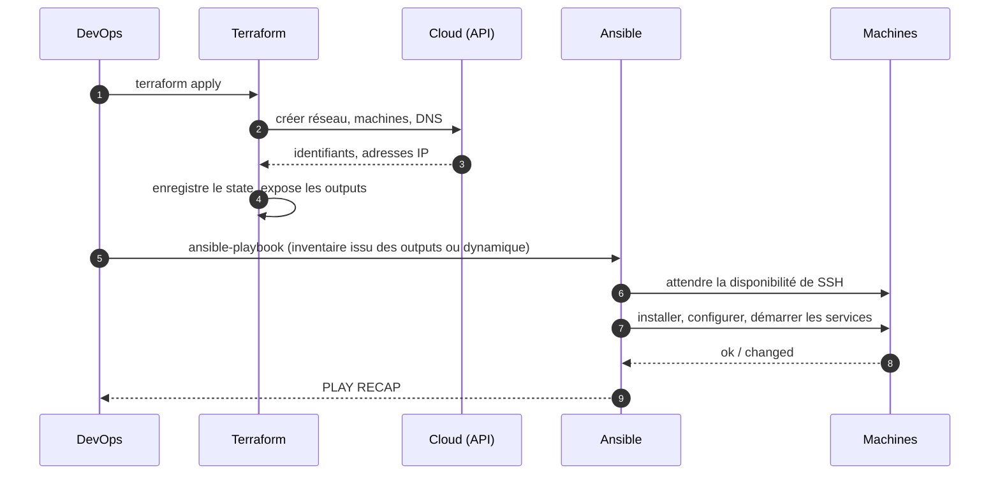
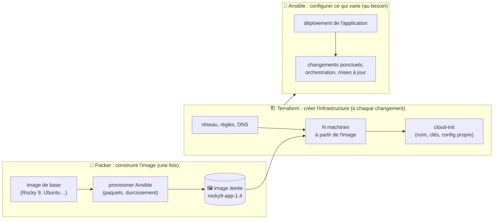
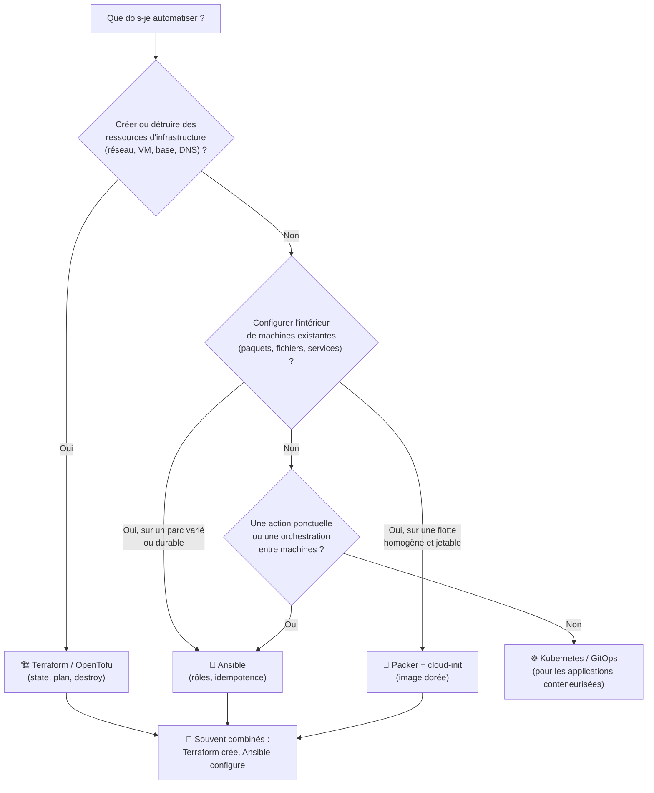

# Terraform ou Ansible ?

## Pourquoi ce cours ?

« Terraform ou Ansible ? » est l'une des questions les plus posées par les débutants… et la réponse est presque toujours **« les deux, mais pas pour la même chose »**. Les deux outils font de l'IaC, ils se recouvrent partiellement (Ansible sait créer une VM chez un cloud, Terraform sait lancer des commandes sur une machine), et les utiliser à contre-emploi produit des projets **fragiles et difficiles à maintenir**. Ce cours donne un critère simple pour **choisir**, montre le **schéma hybride** le plus courant, présente l'alternative **Packer + cloud-init** et liste les **pièges classiques**.

> Prérequis : [Terraform : les fondamentaux](02-terraform-fondamentaux.md), [Terraform avancé](03-terraform-avance.md), [Ansible : les fondamentaux](04-ansible-fondamentaux.md) et [Ansible avancé](05-ansible-avance.md).

## 1. Deux problèmes différents

| Question | Réponse d'un outil de… |
|---|---|
| « Quelles **machines, réseaux, bases, DNS, comptes** doivent **exister** ? » | **Provisioning** : Terraform, OpenTofu, Pulumi, CloudFormation |
| « Que doit-il y avoir **dans** chaque machine : paquets, fichiers, services, utilisateurs ? » | **Gestion de configuration** : Ansible, Puppet, Chef, Salt |

```text
   Provisioning (Terraform)                  Configuration (Ansible)
┌────────────────────────────┐          ┌─────────────────────────────┐
│ réseau, sous-réseaux       │          │ paquets, services           │
│ machines virtuelles        │  ─────►  │ fichiers de configuration   │
│ disques, base managée      │  l'IP,   │ utilisateurs, clés SSH      │
│ DNS, équilibreur, IAM      │  le nom  │ déploiement de l'application│
└────────────────────────────┘          └─────────────────────────────┘
        « le décor »                            « l'intérieur »
```

## 2. Comparaison

| Critère | **Terraform / OpenTofu** | **Ansible** |
|---|---|---|
| Rôle principal | **Créer et détruire** de l'infrastructure | **Configurer** des systèmes existants |
| Modèle | **Déclaratif** : état final voulu | **Procédural par tâches**, mais avec des modules **idempotents** |
| **Mémoire de l'état** | ✅ Oui : le **state** (sait ce qu'il a créé) | ❌ Non : interroge chaque machine à chaque passage |
| **Détruire** proprement | ✅ `terraform destroy` : il sait quoi supprimer | ❌ Pas de notion de « tout supprimer » |
| Prévisualisation | ✅ **`plan`** précis | ⚠️ `--check` : approximatif |
| Connexion | Appelle des **API** (cloud, SaaS) | **SSH** (ou WinRM) vers les machines |
| Agent sur les machines | Sans objet | **Aucun** (agentless) |
| Langage | **HCL** | **YAML** (+ Jinja2) |
| Points forts | Multi-cloud, dépendances automatiques, état partagé | Simplicité, parc hétérogène, orchestration, **actions ponctuelles** |
| Points faibles | State à protéger ; peu adapté à la configuration **interne** d'une machine | Pas de **suivi d'état** : la dérive ne se détecte que si on rejoue |
| Dérive | **Détectée** (refresh + plan) | Détectée seulement en **rejouant** (`--check`) |

> 📌 **À retenir** : Terraform sait **ce qui existe** (il a un état) et **gère le cycle de vie** (créer, modifier, détruire). Ansible sait **faire converger** une machine vers une configuration. **Terraform construit la maison, Ansible l'aménage.**

## 3. Le schéma hybride

Le pattern le plus courant en entreprise :

1. **Terraform** crée l'infrastructure (réseau, VM, disques) et **publie des sorties** (adresses IP, noms) ;
2. ces informations alimentent l'**inventaire** d'Ansible ;
3. **Ansible** configure les machines (paquets, services, application) ;
4. un changement d'infrastructure repasse par Terraform, un changement de configuration par Ansible.

```hcl
# Terraform : créer les machines et exposer leurs adresses
output "serveurs_web" {
  value = { for nom, vm in cloud_vm.web : nom => vm.ip_privee }
}
```

```bash
terraform output -json serveurs_web > serveurs.json
```

Plusieurs façons de **transmettre** ces données à Ansible, de la plus simple à la plus propre :

| Méthode | Principe | Remarque |
|---|---|---|
| **Script** qui génère l'inventaire depuis `terraform output -json` | Un petit script `jq` écrit `inventaire.ini` | Simple, suffisant pour démarrer |
| **Inventaire dynamique** du cloud | Un plugin Ansible (`amazon.aws.aws_ec2`, `azure_rm`, `google.cloud.gcp_compute`) interroge **directement l'API** du cloud, par étiquettes | **Recommandé** : pas de fichier intermédiaire, toujours à jour |
| Plugin **`cloud.terraform`** | Lit **l'état Terraform** comme inventaire | Pratique si un seul state couvre tout |
| **cloud-init** / *user data* | Terraform passe un petit script de démarrage à la VM qui se configure seule | Pour une configuration **simple** ; au-delà, Ansible |



> ⚠️ **Attention** : une machine **créée** n'est pas une machine **prête**. Entre la fin de `terraform apply` et la première connexion SSH réussie, il se passe quelques dizaines de secondes. Un playbook qui se lance **trop tôt** échoue en `unreachable`. Ajoute en tête de play `ansible.builtin.wait_for_connection` (ou `wait_for` sur le port 22) ; ne compte pas sur des `sleep`.

## 4. L'alternative : images pré-construites (Packer + cloud-init)

Au lieu de configurer les machines **après** leur création, on peut **préparer une image** déjà configurée et créer des machines **à partir d'elle** : c'est l'approche **immuable** (voir [introduction](01-introduction-iac.md)).

| Outil | Rôle |
|---|---|
| **Packer** | **Construit** une image de machine (AMI, image de VM, box Vagrant) à partir d'une description ; il peut **lancer Ansible** pour la configurer pendant la construction |
| **cloud-init** | Programme présent dans les images cloud : **personnalise la machine à son premier démarrage** (utilisateurs, clés SSH, paquets, petits scripts) via le *user data* fourni par Terraform |
| **Terraform** | Crée les machines **à partir de l'image** produite |



| | **Configurer après coup** (Ansible seul) | **Image pré-construite** (Packer) |
|---|---|---|
| Démarrage d'une machine | Lent (installation au premier boot) | **Rapide** (tout est déjà dans l'image) |
| Dérive | Possible dans le temps | Faible (on remplace plutôt qu'on modifie) |
| Reproductibilité | Dépend des dépôts à l'instant T | **Figée** dans l'image |
| Complexité | Simple | Un pipeline de plus à entretenir |
| Convient à | Parcs hétérogènes, machines durables | **Flottes homogènes**, autoscaling |

Dans ce cursus, la VM de l'[environnement de travail](../../GUIDE-ENVIRONNEMENT.md) suit l'approche **« configuration après coup »** (box publique + scripts shell de provisioning, sur le modèle d'Ansible) ; l'option **Packer** (image pré-construite) y est décrite dans `environnement/packer-avance/`. Les deux sont des illustrations de ces deux philosophies.

## 5. Choisir : un arbre de décision



> 💡 **Conseil** : en cas de doute, pose-toi **trois questions**. (1) *Est-ce que ça se crée et se détruit via une API ?* → Terraform. (2) *Est-ce que ça se passe à l'intérieur d'un système d'exploitation ?* → Ansible. (3) *Est-ce que je veux des machines identiques et jetables ?* → image (Packer) plutôt que configuration après coup.

## 6. Pièges classiques

| Piège | Pourquoi c'est un problème | Que faire |
|---|---|---|
| Lancer **Ansible depuis un `provisioner` Terraform** (`local-exec`) | Mélange les deux cycles de vie, pas de dérive détectée, échecs partiels qui rendent la ressource *tainted* | **Deux étapes séparées** dans la CI : `terraform apply` puis `ansible-playbook` |
| **Créer des VM avec Ansible** (modules cloud) | Aucun state : impossible de savoir ce qui a été créé, de le **détruire** proprement, de **planifier** | Laisser **Terraform** gérer le cycle de vie de l'infrastructure |
| Configurer de gros **fichiers de configuration avec Terraform** | Terraform n'est pas fait pour décrire l'intérieur d'une machine | Ansible ou cloud-init |
| **Inventaire statique à la main** pour un parc qui change | Dérive : l'inventaire ment | Inventaire **dynamique** (API du cloud) |
| Playbook qui démarre **avant que SSH soit prêt** | `unreachable` intermittents | `wait_for_connection` |
| Secrets en clair dans les variables Terraform / Ansible | Fuite via Git, state ou journaux | Vault, SOPS, gestionnaire de secrets ([bonnes pratiques](07-bonnes-pratiques-iac.md)) |
| Deux outils qui gèrent **la même ressource** (Terraform et Ansible modifient le même pare-feu) | **Guerre de configurations** : chacun défait le travail de l'autre | **Un seul propriétaire** par ressource |
| Modifier **à la main** « juste pour tester » | Dérive silencieuse | Tout passe par le code ; sinon, reporter dans le code immédiatement |

> ⚠️ **Attention** : la règle d'or est **un seul propriétaire par ressource**. Si Terraform crée un groupe de sécurité, ne le modifie pas depuis Ansible, et inversement : au prochain passage, l'un des deux annulera l'autre sans prévenir.

## Résumé

- **Terraform / OpenTofu** : **provisionne** (créer, modifier, détruire) avec un **state** et un **plan** ; **Ansible** : **configure** l'intérieur des machines, sans agent ; **Packer** : **construit des images**.
- Image mentale : **Terraform construit la maison, Ansible l'aménage, Packer prépare les meubles à l'avance.**
- **Schéma hybride** : Terraform crée et publie des *outputs* → **inventaire** (dynamique de préférence) → Ansible configure ; deux étapes distinctes dans la CI.
- **Packer + cloud-init** : approche **immuable**, démarrage rapide, flottes homogènes ; **Ansible** : parcs variés et durables.
- Pièges : Ansible lancé depuis un `provisioner`, VM créées par Ansible, SSH pas prêt, inventaire statique, **deux propriétaires** pour une même ressource, secrets en clair.

## Pour aller plus loin

- Documentation : <https://developer.hashicorp.com/packer/docs> ; <https://cloudinit.readthedocs.io/> ; plugins d'inventaire : <https://docs.ansible.com/ansible/latest/plugins/inventory.html>.
- Alternatives : **Pulumi** (code dans un langage généraliste), **Crossplane** (infrastructure pilotée depuis Kubernetes), **NixOS** (système entièrement déclaratif).
- Cours suivant : [Bonnes pratiques IaC](07-bonnes-pratiques-iac.md).
