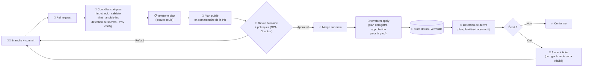

# Bonnes pratiques IaC

## Pourquoi ce cours ?

Écrire un `main.tf` ou un playbook qui marche sur son poste est facile. Le **faire vivre pendant des années, à plusieurs, sur plusieurs environnements**, sans qu'un `apply` malheureux supprime la production, sans qu'un secret finisse dans Git, sans que le dépôt devienne un labyrinthe : c'est un autre métier. Ce cours rassemble les pratiques qui séparent un **projet d'IaC fragile** d'un projet **maintenable** : structure du dépôt, environnements, secrets, pipeline CI/CD, détection de dérive, tests et documentation.

> Prérequis : les cours [Terraform](03-terraform-avance.md) et [Ansible](05-ansible-avance.md) avancés, et le module [CI/CD](../../12-cicd/cours/01-introduction-cicd.md) (pipelines, sécurité dans la CI, GitOps).

## 1. Structurer le dépôt

### Monorepo ou multi-repo ?

| | **Monorepo** (tout dans un dépôt) | **Multi-repo** (un dépôt par composant ou équipe) |
|---|---|---|
| Visibilité | ✅ Tout est au même endroit, refactorings transverses simples | ❌ Il faut chercher dans plusieurs dépôts |
| Versions | ✅ Une seule version cohérente de l'ensemble | ⚠️ Compatibilités entre dépôts à gérer |
| Droits | ❌ Difficile de limiter l'accès par équipe | ✅ Droits **par dépôt** |
| CI | ⚠️ Doit savoir **quoi** a changé pour ne pas tout rejouer | ✅ Pipelines indépendants |
| Taille | ⚠️ Grossit ; builds plus longs | ✅ Petits dépôts |
| Convient à | Petite et moyenne équipe, un projet cohérent | Grandes organisations, équipes autonomes, **modules partagés** versionnés |

Une règle fréquente : **un monorepo pour l'infrastructure d'un produit**, des **dépôts séparés pour les modules réutilisables** (versionnés par tags Git : `?ref=v1.4.0`).

### Une organisation type

```text
infra/
├── README.md                    # comment démarrer, qui contacter, schéma
├── .gitignore                   # *.tfstate*, .terraform/, *.tfvars secrets, vault_pass
├── .pre-commit-config.yaml      # fmt, validate, tflint, gitleaks avant chaque commit
├── modules/                     # code réutilisable (Terraform)
│   ├── reseau/
│   └── application/
├── envs/                        # UN dossier par environnement : state et droits séparés
│   ├── dev/       main.tf  backend.tf  terraform.tfvars
│   ├── staging/   main.tf  backend.tf  terraform.tfvars
│   └── prod/      main.tf  backend.tf  terraform.tfvars
├── ansible/
│   ├── ansible.cfg
│   ├── requirements.yml         # collections et rôles épinglés
│   ├── inventories/{dev,staging,prod}/   (hosts + group_vars/)
│   ├── roles/
│   └── playbooks/site.yml
└── .github/workflows/           # pipeline IaC (ou .gitlab-ci.yml)
```

## 2. Environnements : dev, staging, prod

- **Même code, paramètres différents** : les trois environnements appellent **les mêmes modules** ; seules les **valeurs** changent (taille, nombre d'instances, noms).
- **State et backend séparés** par environnement, avec des **droits distincts** (la CI de `dev` ne doit pas pouvoir écrire dans le state de `prod`).
- **Comptes ou projets cloud séparés** pour la production : l'isolation la plus solide.
- **Promotion** : un changement est validé en `dev`, puis `staging`, puis `prod` (par version de module ou par PR vers un dossier).
- **Parité** : `staging` doit **ressembler** à `prod` (mêmes versions, topologie réduite) ; sinon, il ne prouve rien.
- **Éphémère** : les environnements de test ou de revue se **créent et se détruisent** automatiquement (workspace ou dossier généré par PR).

> 💡 **Conseil** : réduis le **rayon d'explosion** (*blast radius*) : découpe en **plusieurs states** (réseau, données, applications) plutôt qu'un state unique pour toute l'entreprise. Une erreur dans le state « application » ne peut alors pas toucher le réseau.

## 3. Gérer les secrets

| À éviter | Pourquoi |
|---|---|
| Mot de passe dans un `.tf`, un `.tfvars` ou un `vars.yml` **en clair** dans Git | Il reste à jamais dans l'historique |
| Secret passé en variable d'environnement dans un journal de CI | Fuite dans les logs |
| Secret dans le **state** Terraform | Lisible par quiconque accède au state |

| Solution | Principe | Convient à |
|---|---|---|
| **HashiCorp Vault** (ou OpenBao) | Gestionnaire de secrets : les valeurs sont **lues à l'exécution** ; secrets **dynamiques** à durée de vie courte | Équipes avec un besoin fort de sécurité |
| **Gestionnaires du cloud** | AWS Secrets Manager, Azure Key Vault, GCP Secret Manager : le code ne contient qu'une **référence** | Infrastructure déjà dans un cloud |
| **SOPS** (+ age ou KMS) | **Chiffre les valeurs** dans des fichiers YAML/JSON **commités** ; seule la clé permet de lire | Secrets versionnés dans Git |
| **Ansible Vault** | Chiffre des fichiers/valeurs Ansible | Projets purement Ansible |
| **External Secrets Operator** | Synchronise des secrets **dans Kubernetes** depuis un coffre ([GitOps](../../12-cicd/cours/08-gitops-et-deploiement-declaratif.md)) | Clusters |
| **Identités de charge de travail** (OIDC) | La CI s'authentifie au cloud **sans clé longue durée** | Toute CI moderne |

```hcl
# Lire un secret À L'EXÉCUTION plutôt que de le stocker dans le code
data "vault_kv_secret_v2" "db" {
  mount = "secret"
  name  = "prod/db"
}
# … attention : la valeur lue se retrouve dans le state ; le mieux est que l'application la lise elle-même.
```

> ⚠️ **Attention** : même avec un coffre, **Terraform écrit dans son state** toute valeur qu'il lit ou génère (`random_password`…). Restreins donc l'accès au state, chiffre-le et, quand c'est possible, laisse l'**application** récupérer le secret directement dans le coffre plutôt que de le faire transiter par l'IaC.

## 4. Un pipeline CI/CD pour l'IaC

Le principe : **personne n'applique à la main**. Le dépôt est la **source de vérité** et un pipeline exécute `plan` puis `apply`.



```yaml
# Extrait de pipeline (GitHub Actions) : plan en PR, apply au merge
name: iac
on:
  pull_request:
    paths: ["envs/**", "modules/**"]
  push:
    branches: [main]
permissions:
  contents: read
  id-token: write                          # OIDC vers le cloud : pas de clé longue durée
  pull-requests: write                     # commentaire du plan
jobs:
  plan:
    if: github.event_name == 'pull_request'
    runs-on: ubuntu-latest
    steps:
      - uses: actions/checkout@v4
      - uses: hashicorp/setup-terraform@v3
      - run: terraform -chdir=envs/dev fmt -check -recursive
      - run: terraform -chdir=envs/dev init -input=false
      - run: terraform -chdir=envs/dev validate
      - run: terraform -chdir=envs/dev plan -input=false -out=plan.tfplan
  apply:
    if: github.event_name == 'push'
    runs-on: ubuntu-latest
    environment: production                # approbation manuelle exigée par l'environnement
    steps:
      - uses: actions/checkout@v4
      - uses: hashicorp/setup-terraform@v3
      - run: terraform -chdir=envs/prod init -input=false
      - run: terraform -chdir=envs/prod apply -input=false -auto-approve
```

Pratiques essentielles :

- **Plan en PR, apply au merge** : on relit ce qui va changer avant que cela change.
- **Appliquer le plan relu** (`plan -out`, puis `apply plan.tfplan`) pour garantir qu'on applique exactement ce qui a été validé.
- **Une seule exécution à la fois** par state (verrouillage) ; `concurrency` dans la CI.
- **Droits minimaux** : le pipeline `plan` n'a que la **lecture** ; seul `apply` a l'écriture, avec approbation pour la production.
- **Outils dédiés** : **Atlantis** (commandes `atlantis plan` dans la PR), **HCP Terraform**, Spacelift, Terragrunt pour le DRY.
- **Politique en tant que code** : **OPA/Conftest**, **Checkov**, **Sentinel** : « pas de bucket public », « étiquettes obligatoires », « pas de port 22 ouvert à tous ».

## 5. Détecter la dérive

La dérive est inévitable : un incident à 3 h, un collègue pressé, un service qui modifie ses propres réglages. Il faut la **chercher activement**.

```bash
terraform plan -detailed-exitcode -input=false
# code 0 : aucun changement   · code 1 : erreur   · code 2 : des changements sont prévus (DÉRIVE ou code modifié)
```

```bash
ansible-playbook site.yml --check --diff       # Ansible : montre ce qui serait modifié (dérive de configuration)
```

- Planifie un `plan -detailed-exitcode` **chaque nuit** sur chaque environnement ; un code `2` ouvre une **alerte ou un ticket**.
- Décide pour chaque écart : **le code a raison** (on réapplique) ou **la réalité a raison** (on corrige le code).
- Pour les **applications Kubernetes**, l'équivalent est fourni par **GitOps** (`selfHeal` d'Argo CD : voir le [cours GitOps](../../12-cicd/cours/08-gitops-et-deploiement-declaratif.md)).

> 📌 **À retenir** : le but n'est pas que la dérive n'arrive **jamais**, mais qu'elle soit **détectée vite** et **tracée**. Une dérive découverte six mois plus tard, pendant un `apply` d'urgence, est une panne en puissance.

## 6. Tester l'infrastructure

| Niveau | Outil | Ce qu'il apporte | Quand |
|---|---|---|---|
| Format et syntaxe | `terraform fmt -check`, `validate`, `ansible-playbook --syntax-check`, `yamllint` | Détecte les erreurs triviales | **À chaque commit** (pre-commit) |
| Analyse statique | **`tflint`**, **`ansible-lint`**, **Checkov**, **`trivy config`** | Bonnes pratiques et **failles de configuration** | Chaque PR |
| Tests unitaires de modules | **`terraform test`** (natif, `*.tftest.hcl`), `mock_provider` | Un module fait ce qu'il promet, sans cloud | Chaque PR |
| Tests d'intégration | **Terratest** (Go) : déploie **réellement**, vérifie (HTTP, SSH), détruit | La vraie infrastructure fonctionne | Planifié ou avant release (**coûte** du temps et de l'argent) |
| Test des rôles Ansible | **Molecule** : machine éphémère, application du rôle, **2ᵉ passage = `changed=0`**, vérifications | Un rôle est correct **et idempotent** | Chaque PR touchant un rôle |
| Test d'idempotence | Rejouer deux fois | Le second passage ne change rien | Toujours |

> 💡 **Conseil** : applique la **pyramide des tests** (voir le [cours sur les tests en CI](../../12-cicd/cours/05-tests-automatises-dans-la-pipeline.md)) : beaucoup de contrôles statiques (rapides, gratuits), quelques tests de modules, **peu** de tests d'intégration (lents, coûteux). Détruis **toujours** les ressources de test (`defer terraform.Destroy` dans Terratest) pour ne pas laisser une facture.

## 7. Documentation et lisibilité

- **README par module** : rôle, variables, sorties, exemple d'appel. Génère-le avec **`terraform-docs`** (à lancer en pre-commit pour qu'il ne soit jamais périmé) ; pour Ansible, documente les variables dans `defaults/main.yml` et le `README.md` du rôle (`ansible-doc` pour les modules personnalisés).
- **Noms parlants** et cohérents : `reseau_prive`, pas `res1` ; préfixe par environnement et par application.
- **Commentaires sur le POURQUOI**, pas sur le comment (le code dit déjà comment).
- **Étiquettes (*tags*)** obligatoires sur les ressources cloud : propriétaire, environnement, centre de coût, gérée par Terraform.
- **ADR** (*Architecture Decision Records*) : pourquoi ce backend, pourquoi ce découpage en states.
- **Schéma d'architecture** à jour (généré ou revu à chaque changement structurant).
- **Versions épinglées** partout : `required_version`, versions des providers et modules, `.terraform.lock.hcl` commité, `requirements.yml` d'Ansible.

## 8. Check-list de fin

| Domaine | Vérification |
|---|---|
| Dépôt | Structure claire, `.gitignore` (state, `.terraform/`, secrets), hooks pre-commit |
| Environnements | Dossiers/states séparés, droits distincts, parité staging/prod |
| Secrets | Aucun secret en clair dans Git ni dans les journaux ; OIDC pour la CI |
| State | Backend distant, chiffré, verrouillé, accès restreint, versionné |
| Pipeline | Plan en PR, relu ; apply au merge, **plan enregistré** ; approbation pour la prod |
| Qualité | `fmt`, `validate`, `tflint`, `ansible-lint`, analyse de sécurité, tests |
| Dérive | Plan planifié, alerte, procédure de décision |
| Documentation | README, `terraform-docs`, ADR, étiquettes |
| Sécurité | Droits minimaux, versions épinglées, revue obligatoire |

## Résumé

- **Structure** : monorepo pour un produit, modules partagés versionnés ; **un dossier et un state par environnement**, droits séparés ; petits states pour limiter le *blast radius*.
- **Secrets** : jamais en clair dans Git ; **Vault / gestionnaire du cloud / SOPS** ; OIDC pour la CI ; attention, le **state** peut contenir des secrets.
- **Pipeline** : contrôles statiques → **`plan` en PR** → revue + politiques → **`apply` au merge** (plan enregistré, approbation pour la prod) → **détection de dérive planifiée**.
- **Dérive** : `plan -detailed-exitcode` (0, 1, 2), `ansible --check --diff` ; décider : le code ou la réalité a raison.
- **Tests** : statiques d'abord, `terraform test`, Terratest (intégration), **Molecule** (rôles, idempotence).
- **Documentation** : README, `terraform-docs`, ADR, étiquettes, versions épinglées.

## Pour aller plus loin

- Atlantis : <https://www.runatlantis.io/> ; Terratest : <https://terratest.gruntwork.io/> ; `terraform-docs` : <https://terraform-docs.io/> ; OPA/Conftest : <https://www.conftest.dev/> ; SOPS : <https://github.com/getsops/sops>.
- Suites logiques du cursus : [GitOps et déploiement déclaratif](../../12-cicd/cours/08-gitops-et-deploiement-declaratif.md), puis l'[observabilité](../../10-monitoring-observabilite/README.md) et la [fiabilité (SRE)](../../11-sre-pratiques/README.md) de l'infrastructure que vous venez de décrire.
- Retour au [sommaire du module 13](../README.md).
