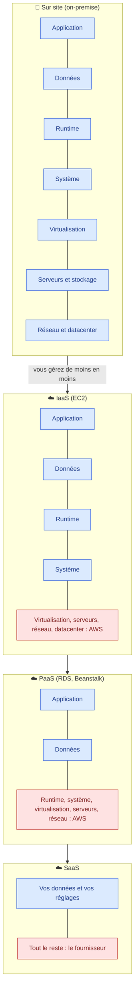

# Fondamentaux du cloud

## Pourquoi ce cours ?

« Le cloud, c'est l'ordinateur de quelqu'un d'autre » : la formule est exacte, mais elle cache ce qui change vraiment. Avec le cloud, une machine ne s'**achète** plus (des semaines de délai, un investissement), elle se **loue à la seconde** via une API ; une base de données ne s'**installe** plus, elle se **commande** ; et une partie de la responsabilité (électricité, matériel, parfois système et sécurité) passe au fournisseur. Pour un DevOps, comprendre **ce qui est géré par qui**, **où vivent les ressources** et **comment elles sont facturées** est le socle de tout le reste : sans lui, on construit des architectures fragiles, dangereuses ou ruineuses.

Ce module présente **AWS** (*Amazon Web Services*), le premier fournisseur cloud mondial, mais les notions de ce cours (modèles de service, régions, responsabilité partagée) valent pour **tous** les fournisseurs. Les ateliers n'utilisent **aucun compte AWS réel** : ils s'exécutent sur **LocalStack**, un émulateur local.

> Prérequis : [Réseaux pour DevOps](../../06-reseaux-devops/README.md), [Docker](../../08-docker-approfondi/README.md), [Kubernetes](../../09-kubernetes-approfondi/README.md) et [Infrastructure as Code](../../13-iac/README.md) (on décrit le cloud avec du code).

## 1. Qu'est-ce que le cloud ?

Le NIST définit cinq caractéristiques essentielles du cloud :

| Caractéristique | Signification concrète |
|---|---|
| **Libre-service à la demande** | On crée une ressource soi-même, en quelques secondes, sans ouvrir de ticket |
| **Accès réseau étendu** | Tout passe par Internet : console web, ligne de commande, **API** |
| **Mutualisation des ressources** | Le fournisseur partage son matériel entre de nombreux clients (*multi-tenant*), de façon isolée |
| **Élasticité rapide** | On monte et on descend en charge **automatiquement**, de 1 à 1 000 serveurs et retour |
| **Service mesuré** | On paie **ce qu'on consomme** (à la seconde, à la requête, au Go-mois) |

> 📌 **À retenir** : tout, dans le cloud, est une **API**. Cliquer dans la console, lancer `aws ...` ou appliquer du Terraform reviennent à appeler la **même API**. C'est ce qui rend possible l'[Infrastructure as Code](../../13-iac/cours/01-introduction-iac.md).

## 2. IaaS, PaaS, SaaS : qui gère quoi ?

On distingue trois grands **modèles de service**, selon la part de la pile gérée par le fournisseur :

| Modèle | Vous gérez | Le fournisseur gère | Exemples AWS | Analogie (le repas) |
|---|---|---|---|---|
| **IaaS** — *Infrastructure as a Service* | Système, runtime, application, données | Matériel, réseau, virtualisation | **EC2**, EBS, VPC | Vous cuisinez chez vous (le fournisseur livre la cuisine équipée) |
| **PaaS** — *Platform as a Service* | Application et données | Tout le reste, y compris système et runtime | **Elastic Beanstalk**, RDS, App Runner | Vous apportez la recette, le restaurant cuisine |
| **SaaS** — *Software as a Service* | Seulement l'**usage** (et vos données) | Tout | Gmail, Microsoft 365, **Amazon WorkMail**, Chime | Vous commandez un plat |
| **FaaS** — *Function as a Service* (serverless) | Le **code** d'une fonction | Tout, y compris la mise à l'échelle | **Lambda** | Vous donnez une étape de recette, facturée à la minute de cuisson |
| **CaaS** — *Containers as a Service* | Vos images de conteneurs | Les serveurs sous-jacents (selon l'offre) | **ECS Fargate**, EKS | Vous apportez vos plats déjà préparés |

> 💡 **Conseil** : plus on monte vers le SaaS, **moins on a de travail et de contrôle** ; plus on descend vers l'IaaS, **plus on a de contrôle et de responsabilités**. Il n'y a pas de « meilleur » niveau : on choisit selon le besoin (une base PostgreSQL gérée **RDS** évite la maintenance, mais impose ses limites de configuration).

## 3. Régions, zones de disponibilité et edge

L'infrastructure d'AWS est organisée géographiquement :

| Niveau | Définition | Exemple |
|---|---|---|
| **Région** | Zone **géographique** indépendante, composée de plusieurs datacenters. Les régions **n'échangent rien automatiquement** | `eu-west-3` (Paris), `eu-west-1` (Irlande), `af-south-1` (Le Cap), `us-east-1` (Virginie) |
| **Zone de disponibilité (AZ)** | Un ou plusieurs datacenters **physiquement séparés** d'une région, reliés par un réseau à très faible latence | `eu-west-3a`, `eu-west-3b`, `eu-west-3c` |
| **Edge location / Point de présence** | Sites proches des utilisateurs, pour le **CDN** (CloudFront) et le DNS (Route 53) | Dizaines de villes dans le monde |

Pourquoi c'est important :

- **Haute disponibilité** : on répartit une application sur **au moins deux AZ** ; si un datacenter tombe, l'autre prend le relais.
- **Latence** : on choisit la région **proche des utilisateurs**.
- **Réglementation et souveraineté** : certaines données ne doivent pas quitter un pays ou un continent (RGPD en Europe).
- **Prix et services** : les tarifs varient d'une région à l'autre, et tous les services ne sont pas disponibles partout.
- **Résilience** : une panne de **région** entière est rare mais possible ; la reprise après sinistre se prépare **entre régions**.

> ⚠️ **Attention** : une ressource vit dans **une région** (et souvent une AZ). Si vous ne trouvez pas votre serveur dans la console, vérifiez d'abord la **région sélectionnée** : c'est l'erreur n°1 des débutants. En ligne de commande, `AWS_DEFAULT_REGION` ou `--region` joue le même rôle.

## 4. Le modèle de responsabilité partagée

C'est le concept de sécurité **fondamental** du cloud : le fournisseur et le client **se partagent** la responsabilité.

| | **AWS est responsable de la sécurité DU cloud** | **Vous êtes responsable de la sécurité DANS le cloud** |
|---|---|---|
| **Périmètre** | Datacenters, matériel, réseau mondial, hyperviseur, logiciels des services gérés | **Vos données**, vos identités et accès (IAM), la configuration de vos ressources, votre système et vos applications, le chiffrement, le pare-feu (*security groups*) |
| **Exemple EC2** (IaaS) | Serveur physique, hyperviseur | **Système d'exploitation, correctifs**, applications, security groups, données |
| **Exemple S3** (service géré) | Durabilité et disponibilité du stockage | **Qui peut lire vos buckets** (politiques, accès public), chiffrement, versioning |
| **Exemple RDS** (PaaS) | Système, moteur de base, sauvegardes automatiques | Utilisateurs de la base, accès réseau, **paramètres**, mots de passe |
| **Exemple Lambda** (FaaS) | Tout sauf le code | **Votre code**, ses permissions, ses secrets |

> 📌 **À retenir** : la grande majorité des fuites de données dans le cloud ne viennent **pas** d'une faille chez le fournisseur mais d'une **erreur de configuration du client** : un bucket S3 public, une clé d'accès dans un dépôt Git, un security group ouvert à `0.0.0.0/0`. *« AWS sécurise le coffre-fort, mais c'est vous qui décidez de qui a la clé. »*

## 5. Panorama des services AWS

AWS propose plus de **200 services**. Une trentaine suffisent à la plupart des projets :

| Catégorie | Service | Rôle (équivalent « classique ») |
|---|---|---|
| **Calcul** | **EC2** | Machines virtuelles |
| | **Lambda** | Fonctions serverless |
| | **ECS / Fargate**, **EKS** | Conteneurs / Kubernetes managé |
| **Stockage** | **S3** | Stockage d'objets (fichiers, sauvegardes, sites statiques) |
| | **EBS** / **EFS** | Disque d'une VM / système de fichiers partagé (NFS) |
| **Réseau** | **VPC** | Réseau privé virtuel |
| | **Route 53**, **CloudFront**, **ELB** | DNS, CDN, équilibreur de charge |
| **Bases de données** | **RDS** / **Aurora** | Bases relationnelles managées (PostgreSQL, MySQL…) |
| | **DynamoDB**, **ElastiCache** | NoSQL clé-valeur, cache (Redis, Memcached) |
| **Sécurité** | **IAM**, **KMS**, **Secrets Manager** | Identités et droits, clés de chiffrement, secrets |
| **Observabilité** | **CloudWatch**, **CloudTrail** | Métriques, journaux, alarmes ; **audit** de toutes les actions API |
| **Messagerie** | **SQS**, **SNS**, **EventBridge** | Files, notifications, bus d'événements |
| **IaC / DevOps** | **CloudFormation**, CodePipeline | Infrastructure as Code natif, pipelines |
| **Gestion** | **Organizations**, **Cost Explorer** | Comptes multiples, coûts |

Ce module couvre les **fondations** : **IAM** (qui peut faire quoi), **calcul** (EC2, EKS, ECS, Lambda), **réseau** (VPC), **stockage** (S3, EBS, EFS) et **coûts**.

## 6. Pourquoi AWS domine

| Facteur | Détail |
|---|---|
| **Précurseur** | Lancé en **2006** (S3, EC2) : plusieurs années d'avance sur la concurrence |
| **Étendue du catalogue** | Plus de services, plus d'options que tout concurrent |
| **Écosystème** | Énorme communauté, documentation, formations, certifications, offres d'emploi, outils tiers (Terraform y a d'abord été pensé) |
| **Maturité** | Années de retour d'expérience sur la fiabilité et la sécurité |
| **Présence mondiale** | Nombreuses régions, dont l'**Afrique** (Le Cap) et l'**Europe** (Paris, Irlande, Francfort…) |

Les alternatives principales : **Microsoft Azure** (fort en entreprise, intégration Microsoft), **Google Cloud (GCP)** (données, Kubernetes, IA) et, pour la souveraineté et des tarifs plus lisibles, des acteurs européens (**OVHcloud**, **Scaleway**…). Le **multi-cloud** existe mais complique tout ; les concepts de ce cours se **transposent** presque à l'identique (VPC ≈ VNet ≈ VPC GCP, S3 ≈ Blob Storage ≈ Cloud Storage).

## 7. Cloud contre on-premise : le coût

| | **On-premise** (matériel à soi) | **Cloud** |
|---|---|---|
| Modèle financier | **CapEx** : gros achat initial, amorti sur 3 à 5 ans | **OpEx** : paiement à l'usage, mensuel |
| Délai de mise en service | Semaines à mois (commande, livraison, installation) | **Minutes** |
| Dimensionnement | Pour le **pic** attendu : gaspillage le reste du temps | **Élastique** : on paie ce qu'on utilise |
| Charge de travail ops | Matériel, électricité, climatisation, remplacement des pièces | Réduite pour les services gérés |
| Risque | Sous-dimensionner (panne) ou sur-dimensionner (gaspillage) | **Facture imprévue** si on ne surveille pas |
| Charge **stable et prévisible** | Souvent **moins cher** sur la durée | Peut coûter **plus cher** sans engagement (instances réservées) |
| Charge **variable ou incertaine** | Difficile | **Très avantageux** |

Le **coût total de possession** (TCO) doit tout compter : matériel, personnel, énergie, local, remplacement, **mais aussi** dans le cloud : sortie de données (*egress*), support, formation. Le cloud n'est **pas automatiquement moins cher** : il est **plus flexible**. Les [coûts](06-aws-couts-finops-intro.md) se maîtrisent avec de la discipline (étiquettes, budgets, dimensionnement).

> 💡 **Conseil** : avant d'ouvrir un compte AWS pour s'entraîner, **configure une alerte de budget** et vérifie les conditions actuelles du **Free Tier** : c'est le meilleur moyen d'éviter une mauvaise surprise.

## Résumé

- Le cloud : libre-service, élasticité, mutualisation, **paiement à l'usage**, tout passe par des **API**.
- **IaaS** (EC2 : vous gérez le système), **PaaS** (RDS, Beanstalk : vous gérez l'app et les données), **SaaS** (vous utilisez), **FaaS** (Lambda), **CaaS** (ECS/EKS) : plus on monte, moins on gère, moins on contrôle.
- **Région** (zone géographique), **AZ** (datacenters séparés d'une région), **edge** (CDN). Répartir sur **≥ 2 AZ** pour la haute disponibilité ; une ressource vit **dans une région**.
- **Responsabilité partagée** : AWS sécurise **le cloud**, vous sécurisez **ce que vous y mettez** (données, accès, configuration). La plupart des incidents viennent d'une **mauvaise configuration**.
- AWS domine par son **ancienneté**, son **catalogue**, son **écosystème** ; les concepts se transposent à Azure, GCP et aux acteurs européens.
- Cloud ≠ forcément moins cher : **CapEx → OpEx**, flexible pour les charges variables, à maîtriser pour les charges stables.

## Pour aller plus loin

- Documentation : <https://docs.aws.amazon.com/> ; *AWS Well-Architected Framework* : <https://aws.amazon.com/architecture/well-architected/> ; modèle de responsabilité partagée : <https://aws.amazon.com/compliance/shared-responsibility-model/>.
- Certification d'entrée : **AWS Certified Cloud Practitioner**.
- Cours suivant : [IAM et sécurité](02-aws-iam-et-securite.md).
- Pratique : [LocalStack : premiers pas](../ateliers-killercoda/atelier-01-localstack-premiers-pas/intro.md).
