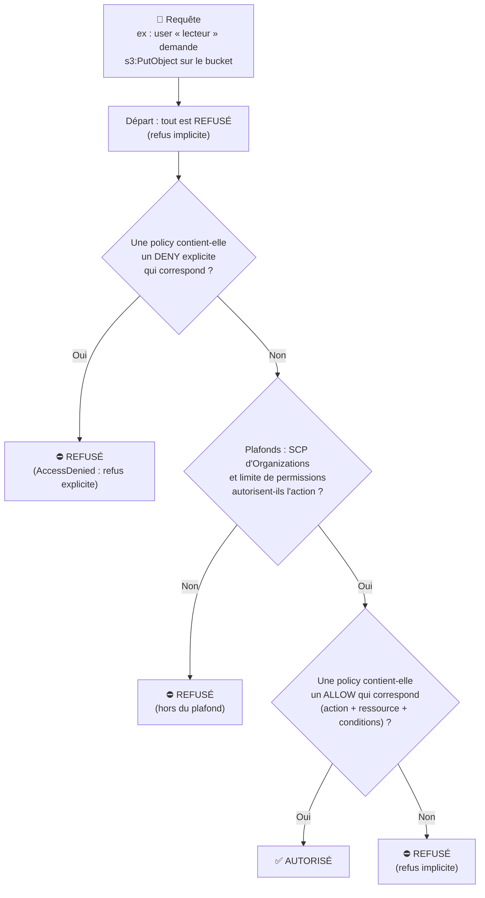
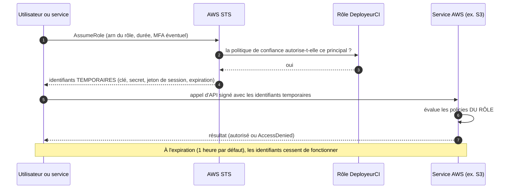

# AWS IAM et sécurité

## Pourquoi ce cours ?

**IAM** (*Identity and Access Management*) est le service qui décide, pour **chaque appel d'API AWS**, **qui** a le droit de faire **quoi** sur **quelle ressource**. Rien ne s'exécute dans AWS sans passer par lui : créer une VM, lire un fichier S3, supprimer une base. C'est aussi le premier endroit où se jouent les incidents de sécurité : une clé d'accès publiée sur GitHub, un utilisateur avec `AdministratorAccess` « pour que ça marche », un compte *root* sans MFA. Comprendre IAM, c'est comprendre **le périmètre de sécurité** de tout ce que vous construirez, et le principe qui le gouverne : le **moindre privilège**.

> Prérequis : [Fondamentaux du cloud](01-fondamentaux-cloud.md) (responsabilité partagée), notions de JSON. Vous pratiquerez dans l'[atelier IAM](../ateliers-killercoda/atelier-03-iam-policies/intro.md), sur LocalStack.

## 1. Les briques d'IAM

| Brique | Rôle | À retenir |
|---|---|---|
| **Compte AWS** | Conteneur de ressources et de facturation | Identifié par un numéro à **12 chiffres** |
| **Utilisateur racine** (*root*) | L'identité créée avec le compte : **tous les droits**, impossible à restreindre | **À ne jamais utiliser** au quotidien |
| **Utilisateur IAM** (*user*) | Une **personne ou une application** avec des identifiants **durables** (mot de passe de console, clés d'accès) | Évite les clés longue durée quand c'est possible |
| **Groupe** (*group*) | Ensemble d'utilisateurs auxquels on attache des policies | Pratique pour les **équipes** (développeurs, auditeurs) |
| **Rôle** (*role*) | Une identité **sans identifiants permanents**, qu'on **endosse** temporairement | **À privilégier** : EC2, Lambda, pods, CI, comptes tiers |
| **Policy** (*politique*) | Un document **JSON** qui liste des autorisations (*Allow*) et des refus (*Deny*) | C'est **elle** qui accorde les droits ; les identités n'en ont aucun par défaut |

> 📌 **À retenir** : un **nouvel utilisateur IAM n'a aucun droit**. Tout ce qui n'est pas **explicitement autorisé** est **refusé** (*refus implicite*).

## 2. Anatomie d'une policy JSON

```json
{
  "Version": "2012-10-17",
  "Statement": [
    {
      "Sid": "LireLeBucketDeRapports",
      "Effect": "Allow",
      "Action": ["s3:GetObject", "s3:ListBucket"],
      "Resource": [
        "arn:aws:s3:::rapports-worketyamo",
        "arn:aws:s3:::rapports-worketyamo/*"
      ],
      "Condition": {
        "Bool": { "aws:SecureTransport": "true" }
      }
    }
  ]
}
```

| Champ | Signification |
|---|---|
| **`Version`** | Version du langage de policy : **toujours** `"2012-10-17"` |
| **`Statement`** | La liste des règles |
| **`Sid`** | Identifiant libre de la règle (documentation) |
| **`Effect`** | **`Allow`** ou **`Deny`** |
| **`Action`** | Le ou les appels d'API visés : `service:Opération` (`s3:GetObject`, `ec2:RunInstances`) ; jokers `*` autorisés (`s3:Get*`, `s3:*`) |
| **`Resource`** | Les ressources visées, par leur **ARN** |
| **`Condition`** | Restreint la règle : adresse IP, MFA présent, balise, heure, chiffrement… |
| `Principal` | **Qui** (uniquement dans les policies **attachées à une ressource** : bucket, rôle…) |

### Les ARN

Un **ARN** (*Amazon Resource Name*) identifie une ressource de façon **unique** :

```text
arn:aws:s3:::rapports-worketyamo/2025/bilan.pdf
│   │   │  │ │                   └ chemin de la ressource
│   │   │  │ └ identifiant du compte (vide pour S3 : les noms de buckets sont mondiaux)
│   │   │  └ région (vide pour les services mondiaux)
│   │   └ service
│   └ partition (aws, aws-cn, aws-us-gov)
└ préfixe
arn:aws:iam::123456789012:role/DeployeurCI
arn:aws:ec2:eu-west-3:123456789012:instance/i-0abc123def456
```

> ⚠️ **Attention** : pour S3, les droits portent sur **deux ARN différents** : le **bucket** (`arn:aws:s3:::bucket` : `s3:ListBucket`) et ses **objets** (`arn:aws:s3:::bucket/*` : `s3:GetObject`, `s3:PutObject`). Oublier l'un des deux est la cause la plus fréquente d'un `AccessDenied` incompréhensible.

## 3. Les types de policies

| Type | Attachée à | Usage |
|---|---|---|
| **Policy gérée par AWS** | Utilisateur, groupe, rôle | Prêtes à l'emploi (`ReadOnlyAccess`, `AmazonS3ReadOnlyAccess`) : pratiques mais **souvent trop larges** |
| **Policy gérée par le client** | Utilisateur, groupe, rôle | **Les vôtres**, réutilisables, versionnées (jusqu'à 5 versions) |
| **Policy en ligne** (*inline*) | **Une seule** identité | Cas très particuliers : suit la vie de l'identité |
| **Policy basée sur la ressource** | Un bucket, une file SQS, une clé KMS… | Autorise des **identités extérieures** ou précise l'accès à la ressource (`Principal` obligatoire) |
| **Politique de confiance** (*trust policy*) | Un **rôle** | Dit **qui a le droit d'endosser** ce rôle |
| **Limite de permissions** (*permissions boundary*) | Utilisateur ou rôle | Plafond : **le maximum** que l'identité peut obtenir |
| **SCP** (*Service Control Policy*) | Un compte ou une unité d'**Organizations** | Plafond **pour tous les comptes** d'une organisation |

## 4. Comment AWS décide : la logique d'évaluation

Quand une requête arrive, IAM l'évalue ainsi :

1. Par **défaut, tout est refusé** (refus implicite).
2. Toutes les policies applicables sont examinées.
3. **Un `Deny` explicite l'emporte toujours**, quoi qu'il y ait ailleurs.
4. Sinon, il faut **au moins un `Allow`** (et que les plafonds éventuels — SCP, limite de permissions — l'autorisent aussi).



Pour une action entre **deux comptes**, il faut que **les deux** autorisent : la policy d'identité du compte appelant **et** la policy de la ressource du compte propriétaire.

> 💡 **Conseil** : en cas de `AccessDenied`, le message dit parfois « *explicit deny in a service control policy* » ou « *no identity-based policy allows* » : **lis-le**, il indique **quelle couche** refuse. L'outil **IAM Policy Simulator** (et l'API `iam:SimulatePrincipalPolicy`) permet de **tester** une policy sans l'appliquer.

## 5. Rôles, STS et identifiants temporaires

Les **clés d'accès longue durée** (`AKIA…`) sont le risque n°1 : elles sont copiées, commitées dans Git, oubliées. La bonne pratique est d'utiliser des **identifiants temporaires**, fournis par **STS** (*Security Token Service*) lorsqu'on **endosse un rôle** (*assume role*).



```bash
aws sts get-caller-identity                              # QUI suis-je ? (compte, ARN)
aws sts assume-role --role-arn arn:aws:iam::123456789012:role/DeployeurCI \
    --role-session-name test-session                     # renvoie des identifiants temporaires
aws iam list-attached-user-policies --user-name lecteur
aws iam get-policy-version --policy-arn <arn> --version-id v1
```

Un rôle a **deux** policies de nature différente :

| Policy du rôle | Question à laquelle elle répond |
|---|---|
| **Politique de confiance** (*trust policy*) | **Qui** peut endosser ce rôle ? (un utilisateur, un autre compte, le service EC2, un fournisseur OIDC comme GitHub Actions) |
| **Policies de permissions** | **Que peut faire** celui qui l'endosse ? |

Usages typiques :

- **Rôle d'instance EC2 / profil d'instance** : une VM obtient des droits **sans aucune clé** à stocker (identifiants fournis par le service de métadonnées).
- **Rôle d'exécution Lambda**, **rôle de tâche ECS**, **IRSA / EKS Pod Identity** pour les pods Kubernetes.
- **CI/CD** : GitHub Actions ou GitLab CI s'authentifient **par OIDC** et endossent un rôle, sans clé durable (voir [sécurité dans la CI](../../12-cicd/cours/06-securite-dans-la-ci.md)).
- **Accès inter-comptes** : un compte « sécurité » endosse un rôle d'audit dans les autres comptes.
- **IAM Identity Center** (anciennement AWS SSO) : connexion unique des humains à plusieurs comptes, avec des identifiants temporaires.

## 6. Bonnes pratiques

| Pratique | Pourquoi |
|---|---|
| **Sécuriser le compte root** : MFA, mot de passe fort, **aucune clé d'accès**, usage seulement pour les rares tâches qui l'exigent | Il a tous les droits et ne peut pas être bridé |
| **MFA** pour tous les humains (clé FIDO2, application TOTP) | Un mot de passe volé ne suffit plus |
| **Moindre privilège** : n'accorder que les actions et ressources nécessaires, **élargir au besoin** | Réduit le dégât d'une fuite ou d'une erreur |
| **Rôles et identifiants temporaires** plutôt que clés longue durée | Pas de secret durable à perdre |
| **Groupes** pour les humains, **rôles** pour les machines | Gestion à l'échelle |
| **Pas de `*` sur `Action` et `Resource`** (`"Action": "*", "Resource": "*"`) | C'est un accès administrateur total |
| **Conditions** : MFA obligatoire, IP source, `aws:SecureTransport`, balises | Défense en profondeur |
| **Rotation et audit** des clés ; supprimer les identifiants inutilisés | Les comptes oubliés sont des portes ouvertes |
| **Un compte par environnement** (dev, prod) + **AWS Organizations** et SCP | Isolation forte |
| **CloudTrail** activé sur tous les comptes | Journal de **toutes** les actions API : indispensable à l'investigation |
| **IAM Access Analyzer** | Détecte les ressources **partagées hors du compte** (buckets publics, rôles accessibles à l'extérieur) et aide à **générer des policies** à partir de l'activité réelle |
| **Aucun secret dans le code** : AWS Secrets Manager, Parameter Store | Évite les fuites dans Git |

> ⚠️ **Attention** : une clé d'accès publiée sur un dépôt public est détectée par des robots **en quelques minutes** et utilisée pour miner de la cryptomonnaie à vos frais. Si cela arrive : **désactivez et supprimez la clé immédiatement**, vérifiez CloudTrail, puis contactez le support AWS. Des outils comme `gitleaks` ou `git-secrets` en pré-commit réduisent le risque.

## 7. Une démarche pour écrire une bonne policy

1. **Partir de zéro** (aucun droit) et **lister** précisément ce que l'identité doit faire (« lire les objets du bucket `rapports-*` »).
2. **Écrire** les actions nécessaires, **pas** `s3:*`.
3. **Cibler** les ressources par leur ARN, **pas** `*`.
4. **Ajouter des conditions** si pertinent (MFA, réseau).
5. **Tester** avec le Policy Simulator ou en environnement de test.
6. **Auditer** ensuite avec **Access Analyzer** (génération de policy depuis les journaux CloudTrail) pour **retirer** ce qui n'est jamais utilisé.

## Résumé

- **IAM** décide pour **chaque appel d'API** : *qui* peut faire *quoi* sur *quelle ressource* (et sous quelles conditions).
- Identités : **utilisateurs**, **groupes**, **rôles** ; droits : **policies JSON** (`Effect`, `Action`, `Resource`, `Condition`). Un nouvel utilisateur n'a **aucun droit**.
- **Évaluation** : refus par défaut → **`Deny` explicite l'emporte** → sinon il faut un `Allow` (et le respect des plafonds SCP / limite de permissions).
- Pour S3, distinguer l'ARN du **bucket** (`ListBucket`) et celui des **objets** (`GetObject`, `PutObject`, avec `/*`).
- **STS / `AssumeRole`** : identifiants **temporaires** ; rôles pour EC2, Lambda, pods, CI (OIDC) ; une politique de **confiance** (qui) et des policies de **permissions** (quoi).
- Bonnes pratiques : **root verrouillé + MFA**, **moindre privilège**, **pas de clés longue durée**, **CloudTrail**, **Access Analyzer**.

## Pour aller plus loin

- Documentation : <https://docs.aws.amazon.com/IAM/latest/UserGuide/> ; *IAM best practices* ; *Policy evaluation logic*.
- Outils : IAM Policy Simulator, IAM Access Analyzer, `aws-vault`, `gitleaks`.
- Cours suivant : [Calcul : EC2, EKS, ECS et Lambda](03-aws-compute-ec2-et-eks.md).
- Pratique : [Atelier IAM et policies](../ateliers-killercoda/atelier-03-iam-policies/intro.md).
