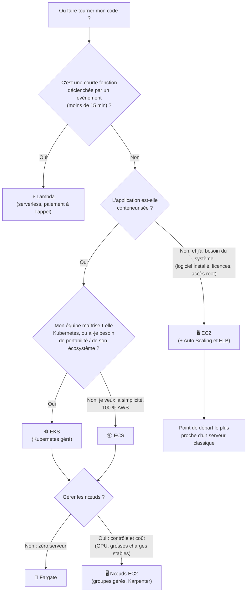

# AWS : le calcul (EC2, EKS, ECS, Lambda)

## Pourquoi ce cours ?

« Où mon code va-t-il tourner ? » est la première question d'une architecture cloud, et AWS y répond de quatre façons très différentes : une **machine virtuelle** que vous administrez (EC2), des **conteneurs** orchestrés par Kubernetes (EKS) ou par AWS (ECS), ou une **fonction** qui n'existe que le temps d'une requête (Lambda). Chacune déplace la frontière de responsabilité vue au [premier cours](01-fondamentaux-cloud.md) : plus on s'éloigne de la machine, moins on administre, plus on s'adapte au modèle du service. Choisir le mauvais service, c'est payer trop cher, administrer trop, ou se heurter à une limite en production.

> Prérequis : [Fondamentaux du cloud](01-fondamentaux-cloud.md), [IAM](02-aws-iam-et-securite.md), [Docker](../../08-docker-approfondi/README.md) et [Kubernetes](../../09-kubernetes-approfondi/README.md).

## 1. EC2 : les machines virtuelles

**EC2** (*Elastic Compute Cloud*) loue des **machines virtuelles** facturées à la seconde. C'est de l'**IaaS** : vous choisissez le système, vous le mettez à jour, vous le sécurisez.

### Les éléments d'une instance

| Élément | Rôle |
|---|---|
| **AMI** (*Amazon Machine Image*) | **L'image** de départ : système d'exploitation + logiciels (Amazon Linux, Ubuntu, **Rocky Linux**, Windows, ou vos propres images). Propre à une **région** |
| **Type d'instance** | Taille et famille (CPU, RAM, réseau) : `t3.micro`, `m6i.large`, `c7g.xlarge`… |
| **Disque** | **EBS** (persistant) ou *instance store* (éphémère, très rapide) : voir le [cours stockage](05-aws-stockage-s3-ebs-efs.md) |
| **Security group** | Pare-feu **à état** de l'instance (voir [VPC](04-aws-reseau-vpc.md)) |
| **Paire de clés** (*key pair*) | Clé SSH publique installée dans l'instance ; la privée reste chez vous (Linux) |
| **Rôle IAM (profil d'instance)** | Droits de l'instance pour appeler d'autres services **sans clé** ([IAM](02-aws-iam-et-securite.md)) |
| **User data** | Script **exécuté au premier démarrage** (via `cloud-init`) : installer, configurer |
| **Sous-réseau / AZ** | Où vit l'instance ; une instance reste **dans une AZ** |
| **Balises** (*tags*) | Étiquettes : propriétaire, environnement, coût ([FinOps](06-aws-couts-finops-intro.md)) |

### Les familles de types

Le nom se lit : **famille + génération + options + taille** (`m6i.large` = famille *m*, génération 6, processeur Intel, taille *large*).

| Famille | Usage | Exemples |
|---|---|---|
| **T** (*burstable*) | Usage **général à faible charge moyenne** (crédits CPU) : dev, petits sites | `t3.micro`, `t4g.small` |
| **M** (*general purpose*) | **Équilibré** CPU/mémoire : serveurs d'applications | `m6i.large`, `m7g.xlarge` |
| **C** (*compute*) | **CPU** intensif : calcul, encodage, jeux | `c6i.xlarge` |
| **R / X** (*memory*) | **Mémoire** : bases en mémoire, caches, analytique | `r6i.large` |
| **I / D** (*storage*) | **Disques rapides** locaux : bases NoSQL, entrepôts | `i4i.large` |
| **G / P** (*accelerated*) | **GPU** : IA, rendu | `g5.xlarge` |

La lettre **`g`** (`t4g`, `m7g`) désigne les processeurs **Graviton** (ARM, conçus par AWS) : jusqu'à environ 20 % moins chers à performance comparable, **mais** il faut des logiciels et des images **ARM64**.

### Lancer une instance

```bash
aws ec2 run-instances \
  --image-id ami-0abcdef1234567890 \
  --instance-type t3.micro \
  --key-name ma-cle \
  --security-group-ids sg-0123456789abcdef0 \
  --subnet-id subnet-0123456789abcdef0 \
  --iam-instance-profile Name=profil-app \
  --user-data file://install.sh \
  --tag-specifications 'ResourceType=instance,Tags=[{Key=Name,Value=web01},{Key=env,Value=dev}]'

aws ec2 describe-instances --filters "Name=tag:env,Values=dev" \
  --query 'Reservations[].Instances[].[InstanceId,State.Name,PrivateIpAddress]' --output table
aws ec2 stop-instances --instance-ids i-0abc...      # on ne paie plus le calcul (mais toujours le disque EBS)
aws ec2 terminate-instances --instance-ids i-0abc... # suppression définitive
```

> ⚠️ **Attention** : une instance **arrêtée** ne coûte plus de calcul, mais ses **volumes EBS** et ses **adresses IP élastiques** continuent d'être facturés. Une instance **terminée** disparaît (et son disque racine par défaut). Les identifiants d'AMI, de sous-réseau, etc. de l'exemple sont **fictifs** : ils sont propres à chaque compte et région.

> 💡 **Conseil** : utilise **IMDSv2** (jeton de session obligatoire pour lire le service de métadonnées) : `--metadata-options HttpTokens=required`. IMDSv1 est vulnérable à des attaques de type SSRF, utilisées pour voler les identifiants du rôle de l'instance.

### Modèles de lancement et Auto Scaling

Une machine unique n'est ni élastique ni résiliente. On décrit un **modèle de lancement** (*launch template* : AMI, type, groupes de sécurité, user data) et on confie les instances à un **groupe Auto Scaling** (ASG) placé derrière un **équilibreur de charge**.

| Composant | Rôle |
|---|---|
| **Launch template** | Le « moule » des instances |
| **Auto Scaling Group** | Maintient un **nombre d'instances** (min / désiré / max), **réparti sur plusieurs AZ**, remplace celles qui tombent en panne |
| **Politiques de mise à l'échelle** | **Suivi de cible** (garder le CPU à 50 %), planifiée, par file d'attente |
| **ELB** (*Elastic Load Balancing*) : **ALB** (HTTP/HTTPS, niveau 7), **NLB** (TCP/UDP, niveau 4) | Répartit le trafic, vérifie la santé des instances |

## 2. Les conteneurs : ECS et EKS

Quand l'application est conteneurisée ([Docker](../../08-docker-approfondi/README.md)), AWS propose deux orchestrateurs.

| | **ECS** (*Elastic Container Service*) | **EKS** (*Elastic Kubernetes Service*) |
|---|---|---|
| Orchestrateur | **Propriétaire AWS** | **Kubernetes** standard |
| Concepts | *Task definition*, *service*, *cluster* | Pods, Deployments, Services (voir [module 09](../../09-kubernetes-approfondi/README.md)) |
| Courbe d'apprentissage | **Plus simple** | Plus raide, très riche |
| Portabilité | Liée à AWS | **Portable** (mêmes manifestes ailleurs) |
| Coût du plan de contrôle | **Gratuit** | Facturé par cluster et par heure (de l'ordre de **0,10 $/h**, soit ~70 $/mois) |
| Écosystème | AWS | Immense (Helm, opérateurs, GitOps…) |

Les deux peuvent exécuter les conteneurs sur deux types de capacité :

| Capacité | Principe | Vous gérez |
|---|---|---|
| **EC2** (groupes de nœuds) | Vos conteneurs tournent sur **vos instances** EC2 | Les nœuds (système, mises à jour, dimensionnement) |
| **Fargate** (*serverless*) | Vous indiquez CPU/mémoire **par tâche ou pod** ; AWS fournit la capacité | **Rien** côté serveurs ; facturation à la ressource demandée |

**EKS** : le **plan de contrôle** (API server, etcd, scheduler) est **géré par AWS** ; vous gérez les **nœuds** (groupes de nœuds gérés, **Karpenter** pour l'auto-scaling intelligent, ou Fargate). Les identifiants des pods s'obtiennent par **IRSA** ou **EKS Pod Identity** (un rôle IAM par compte de service Kubernetes), jamais en mettant des clés dans les pods.

```bash
# Créer un cluster EKS avec l'outil de référence eksctl, puis l'utiliser avec kubectl
eksctl create cluster --name demo --region eu-west-3 --nodes 2 --node-type t3.medium
aws eks update-kubeconfig --name demo --region eu-west-3
kubectl get nodes
```

> 📌 **À retenir** : **ECS** est le choix le plus simple si vous êtes **100 % AWS** et voulez des conteneurs sans la complexité de Kubernetes ; **EKS** est le choix de la **portabilité** et de l'écosystème Kubernetes (équipes qui le maîtrisent déjà, multi-cloud, outils standard). **Fargate** supprime l'administration des nœuds, au prix d'un coût unitaire plus élevé et de quelques limites (pas d'accès au système hôte).

## 3. Lambda : le serverless

**AWS Lambda** exécute une **fonction** en réponse à un **événement** (requête HTTP via API Gateway, dépôt d'un fichier S3, message SQS, tâche planifiée). Vous livrez le **code**, AWS gère les serveurs, la mise à l'échelle (de zéro à des milliers d'exécutions parallèles) et la haute disponibilité. On paie **à l'exécution** (nombre d'appels × durée × mémoire), **rien** quand rien ne tourne.

```python
# lambda_function.py
def lambda_handler(event, context):
    nom = event.get("nom", "monde")
    return {"statusCode": 200, "body": f"Bonjour {nom} !"}
```

| Atouts | Limites |
|---|---|
| **Aucun serveur** à gérer, mise à l'échelle automatique | Durée maximale par exécution : **15 minutes** |
| Paiement **à l'usage**, **gratuit à l'arrêt** | **Démarrage à froid** (*cold start*) : latence ajoutée à la première exécution après inactivité |
| Idéal pour l'**événementiel**, l'**automatisation**, les API à trafic irrégulier | Mémoire (jusqu'à ~10 Go), taille du paquet, **pas d'état** local durable |
| Intégration native avec S3, SQS, EventBridge… | Architecture **orientée événements** : débogage et tests plus difficiles ; risque de dépendance au fournisseur |

> ⚠️ **Attention** : « serverless » ne veut pas dire « sans coût à grande échelle ». Une fonction très sollicitée, ou qui reste longtemps en attente, peut coûter **plus cher** qu'un conteneur ou une instance en continu. Calcule avec la **calculatrice de prix AWS** avant de trancher, et surveille la **concurrence** pour ne pas surcharger vos bases de données en aval.

## 4. Choisir : EC2, ECS, EKS ou Lambda ?



| Besoin | Service conseillé |
|---|---|
| Migrer un serveur existant « tel quel » (*lift and shift*) | **EC2** |
| Logiciel spécifique, licence liée à une machine, accès bas niveau | **EC2** |
| Application web conteneurisée, équipe petite, 100 % AWS | **ECS sur Fargate** |
| Plateforme Kubernetes, multi-cloud, outillage standard (Helm, GitOps) | **EKS** |
| Traitement événementiel, glue entre services, tâches planifiées | **Lambda** |
| Charge très variable ou nulle la nuit | Lambda ou Fargate (échelle jusqu'à zéro) |
| Charge **stable et élevée** en continu | EC2 / nœuds avec **engagement** (Savings Plans), souvent le moins cher |

## 5. Décrire le calcul avec du code

Le calcul se décrit avec l'[IaC](../../13-iac/README.md) (Terraform) plutôt que par clics :

```hcl
resource "aws_instance" "web" {
  ami                    = data.aws_ami.rocky9.id
  instance_type          = "t3.micro"
  subnet_id              = aws_subnet.prive_a.id
  vpc_security_group_ids = [aws_security_group.web.id]
  iam_instance_profile   = aws_iam_instance_profile.web.name
  user_data              = file("${path.module}/install.sh")

  metadata_options {
    http_tokens = "required"            # IMDSv2 obligatoire
  }

  tags = { Name = "web01", env = "dev", gere_par = "terraform" }
}
```

## Résumé

- **EC2** : machines virtuelles (IaaS) ; **AMI** (image), **type** (famille T/M/C/R/G, suffixe `g` = Graviton ARM), **security group**, **clé SSH**, **rôle IAM**, **user data** ; arrêter ne supprime pas le disque (EBS facturé).
- **Auto Scaling + ELB** : élasticité et résilience sur **plusieurs AZ** ; **launch template** pour décrire les instances.
- **ECS** (simple, AWS) et **EKS** (Kubernetes, portable, plan de contrôle facturé) ; capacité sur **EC2** ou **Fargate** (serverless) ; pods EKS : **IRSA / Pod Identity**, jamais de clés.
- **Lambda** : fonctions événementielles, **15 min max**, *cold start*, paiement à l'appel ; excellent pour l'irrégulier, pas toujours le moins cher en charge continue.
- **Choix** : fonction événementielle → Lambda ; système sur mesure → EC2 ; conteneurs simples → ECS (Fargate) ; Kubernetes → EKS.
- Toujours décrire l'infrastructure avec du **code** et activer **IMDSv2**.

## Pour aller plus loin

- Documentation : <https://docs.aws.amazon.com/ec2/>, <https://docs.aws.amazon.com/eks/>, <https://docs.aws.amazon.com/lambda/> ; calculatrice : <https://calculator.aws/>.
- Outils : `eksctl`, **Karpenter**, **AWS Copilot**, **Serverless Framework**, **AWS SAM**.
- Cours suivant : [Le réseau : VPC](04-aws-reseau-vpc.md).
