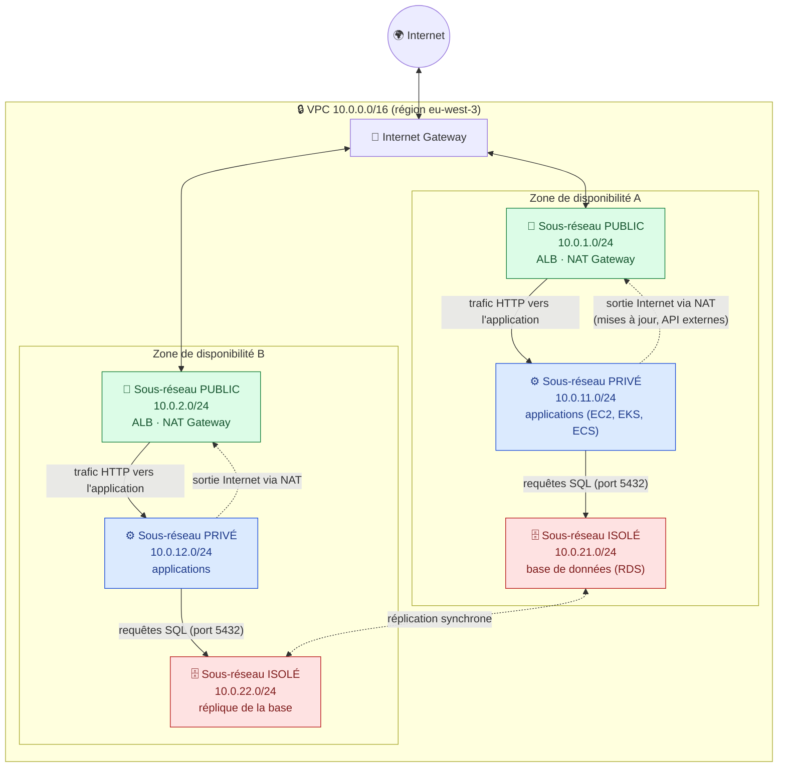
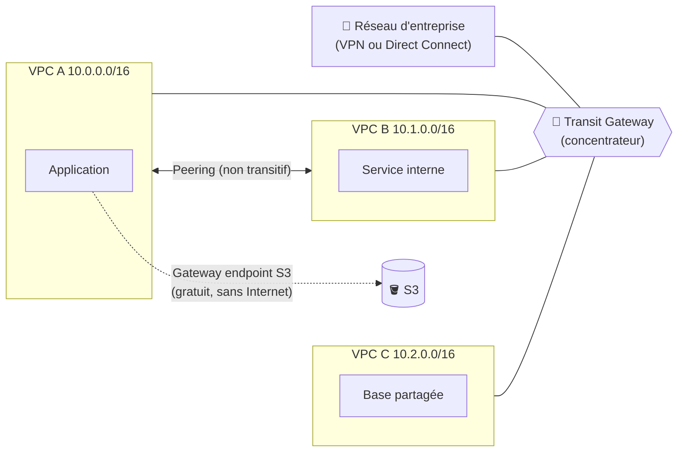

# AWS : le réseau (VPC)

## Pourquoi ce cours ?

Toute ressource AWS qui « tourne » (une instance EC2, un pod EKS, une base RDS) vit dans un **réseau virtuel** : le **VPC**. C'est lui qui décide **qui peut parler à qui**, **qui est visible d'Internet** et **par où sortent** les connexions. Une base de données accessible depuis Internet par erreur, une application qui ne peut plus joindre son API parce qu'une route manque, une facture qui explose à cause d'une *NAT Gateway* : ces incidents naissent presque tous d'un VPC mal compris. Ce cours reprend les notions du [module Réseaux](../../06-reseaux-devops/README.md) (adresses, CIDR, routage, NAT, pare-feu) et montre **comment AWS les implémente**.

> Prérequis : [Réseaux pour DevOps](../../06-reseaux-devops/README.md) (CIDR, routage, NAT), [IAM](02-aws-iam-et-securite.md) et [calcul](03-aws-compute-ec2-et-eks.md).

## 1. Le VPC et ses sous-réseaux

Un **VPC** (*Virtual Private Cloud*) est **votre réseau privé** dans une **région** AWS. Vous choisissez sa plage d'adresses (**CIDR**), par exemple `10.0.0.0/16` (65 536 adresses). Vous le découpez en **sous-réseaux** (*subnets*), **chacun dans une seule zone de disponibilité**.

| Notion | Détail |
|---|---|
| **CIDR du VPC** | De `/16` (grand) à `/28` (très petit) ; **plages privées** RFC 1918 (`10.0.0.0/8`, `172.16.0.0/12`, `192.168.0.0/16`) |
| **Sous-réseau** | Une portion du VPC, dans **une AZ** ; l'application est répartie sur **plusieurs sous-réseaux, donc plusieurs AZ** |
| **Adresses réservées** | AWS réserve **5 adresses** par sous-réseau (réseau, routeur, DNS, futur, diffusion) : un `/28` n'offre que 11 adresses utilisables |
| **VPC par défaut** | Chaque région en a un, pratique pour tester (sous-réseaux publics), **inadapté à la production** |

> ⚠️ **Attention** : **choisis un CIDR qui ne chevauche pas** ceux de tes autres VPC, de ton réseau d'entreprise ni de tes partenaires. Un chevauchement interdit ensuite l'appairage (*peering*) et les VPN, et **le CIDR d'un VPC ne se change pas facilement**. Prévois large (`/16`) dès le départ.

## 2. Public, privé, isolé : une question de table de routage

Rien n'est « public » ou « privé » en soi : c'est la **table de routage** associée au sous-réseau qui en décide.

| Type de sous-réseau | Route par défaut (`0.0.0.0/0`) | Accessible depuis Internet ? | Peut sortir vers Internet ? | Usage |
|---|---|---|---|---|
| **Public** | Vers l'**Internet Gateway** (IGW) | Oui (si l'instance a une IP publique et que le security group l'autorise) | Oui, directement | Équilibreurs de charge, bastions, NAT Gateway |
| **Privé** | Vers une **NAT Gateway** | **Non** | Oui, **via le NAT** (mises à jour, API externes) | Applications, conteneurs |
| **Isolé** (*isolated*) | **Aucune** | Non | **Non** | Bases de données, données sensibles |

### Les composants

| Composant | Rôle |
|---|---|
| **Internet Gateway (IGW)** | Porte **bidirectionnelle** entre le VPC et Internet ; **gratuite**, hautement disponible. Nécessaire pour qu'un sous-réseau soit public |
| **NAT Gateway** | Permet aux ressources **privées** de **sortir** vers Internet **sans être joignables** de l'extérieur. Placée dans un sous-réseau **public**, avec une IP élastique. **Facturée** à l'heure **et** au volume de données |
| **Table de routage** (*route table*) | Liste de règles « destination → cible » (`10.0.0.0/16 → local`, `0.0.0.0/0 → igw-xxx` ou `nat-xxx`) ; **chaque sous-réseau** en a une |
| **Adresse IP élastique (EIP)** | IP publique **fixe** ; facturée si **non attachée** |
| **VPC Endpoint** | Accès privé à un service AWS (S3, DynamoDB…) **sans passer par Internet** (voir §5) |

> 💡 **Conseil** : une **NAT Gateway est dans une AZ** : pour la haute disponibilité, on en place **une par AZ** (donc 3 pour trois AZ), ce qui augmente le coût. Pour un environnement de développement, **une seule** suffit. Et pour que les instances privées atteignent S3, un **gateway endpoint S3** (gratuit) évite de faire transiter ce trafic par le NAT (et de le payer).

## 3. L'architecture trois tiers

Le schéma classique : trois niveaux **répartis sur deux ou trois AZ**.



Les **règles de circulation** suivent le moindre privilège, **de niveau à niveau** :

| Source | Destination | Autorisé par |
|---|---|---|
| Internet | **ALB** (public) | Security group de l'ALB : `443` depuis `0.0.0.0/0` |
| ALB | **Application** (privée) | Security group de l'application : `8080` **depuis le security group de l'ALB** |
| Application | **Base de données** (isolée) | Security group de la base : `5432` **depuis le security group de l'application** |
| Internet → application ou base | **Interdit** | Aucune route ni règle |

> 📌 **À retenir** : on **référence des security groups plutôt que des adresses IP** (« autorise le groupe de l'application »). Les instances changent d'IP à chaque remplacement, pas de groupe.

## 4. Security groups et NACL : deux niveaux de filtrage

| | **Security group** (SG) | **Network ACL** (NACL) |
|---|---|---|
| Niveau | **Interface réseau** (instance, ALB, base) | **Sous-réseau** (toutes les ressources qu'il contient) |
| **À état** (*stateful*) | ✅ **Oui** : la réponse à une requête autorisée est **automatiquement** autorisée | ❌ **Non** (*stateless*) : il faut autoriser **aller et retour** (ports éphémères 1024-65535) |
| Types de règles | **Autorisation uniquement** (*allow*) | **Autorisation et refus** (*allow* / *deny*) |
| Évaluation | **Toutes** les règles sont évaluées | Règles **numérotées**, dans l'ordre ; la **première qui correspond** s'applique |
| Par défaut | Tout le **trafic entrant est refusé**, tout le sortant autorisé | Le NACL par défaut **autorise tout** |
| Références | Peut référencer **un autre SG** | Seulement des **CIDR** |
| Usage | **Le filtrage principal**, fin | Garde-fou **grossier** : bloquer une plage d'adresses abusives |

```bash
aws ec2 create-security-group --group-name app-sg --description "Application" --vpc-id vpc-0abc...
# Autoriser le port 8080 UNIQUEMENT depuis le groupe de l'équilibreur de charge
aws ec2 authorize-security-group-ingress --group-id sg-app --protocol tcp --port 8080 --source-group sg-alb
aws ec2 describe-security-groups --group-ids sg-app
```

> ⚠️ **Attention** : une règle `0.0.0.0/0` sur le port **22** (SSH) ou **3389** (RDP) ou sur un port de base de données expose la ressource à **tout Internet**. Les robots scannent en permanence. Pour administrer, préfère **AWS Systems Manager Session Manager** (aucun port ouvert, accès journalisé) ou un bastion restreint à votre adresse IP.

## 5. Relier des réseaux

| Besoin | Solution | À retenir |
|---|---|---|
| Relier **deux VPC** | **VPC Peering** | Liaison **un à un**, **non transitive** (A↔B et B↔C n'implique **pas** A↔C) ; **CIDR sans chevauchement** ; routes à ajouter des deux côtés |
| Relier **de nombreux VPC** et réseaux sur site | **Transit Gateway** | **Concentrateur central** (hub and spoke) : un seul point d'interconnexion, routage transitif, plus coûteux |
| Relier le **réseau d'entreprise** | **Site-to-Site VPN** (chiffré via Internet) ou **Direct Connect** (liaison dédiée) | VPN : rapide et pas cher ; Direct Connect : débit et latence stables, délai de mise en place |
| Accéder à un **service AWS ou SaaS** **sans Internet** | **VPC Endpoint** : *gateway endpoint* (S3, DynamoDB : **gratuit**) ou *interface endpoint* (**PrivateLink** : la majorité des services, facturé) | Le trafic reste **dans le réseau AWS** : plus sûr, et évite les frais de NAT |
| Exposer **votre** service à d'autres comptes | **PrivateLink** (*endpoint service*) | Accès privé à un seul service, **sans** ouvrir tout le réseau |



## 6. Observer et dépanner

| Symptôme | Vérifications |
|---|---|
| L'instance **n'est pas joignable** depuis Internet | IP publique ? sous-réseau **public** (route vers l'IGW) ? **security group** (entrée) ? **NACL** (aller **et** retour) ? pare-feu du système ? |
| L'instance privée **ne sort pas** vers Internet | Route `0.0.0.0/0` vers une **NAT Gateway** ? NAT Gateway dans un sous-réseau **public** avec **IP élastique** ? security group (sortie) ? |
| Deux VPC appairés **ne communiquent pas** | Routes dans **les deux** tables ? **security groups** autorisant l'autre CIDR ? **pas de chevauchement** ? |
| Une facture réseau **explose** | **NAT Gateway** (volume traité), **transferts entre AZ**, **sortie Internet** : voir [coûts](06-aws-couts-finops-intro.md) |

- **VPC Flow Logs** : journalise le trafic accepté (`ACCEPT`) ou refusé (`REJECT`) d'un VPC, d'un sous-réseau ou d'une interface : l'outil n°1 pour comprendre *pourquoi* un paquet est bloqué.
- **VPC Reachability Analyzer** : vérifie **sans trafic réel** si une source atteint une destination, et indique le composant qui bloque.
- **Session Manager** : accéder à une instance sans SSH ni IP publique.

## 7. Le VPC avec du code

Un VPC se compose de nombreuses ressources interdépendantes ; on le décrit avec l'[IaC](../../13-iac/README.md), de préférence par un **module éprouvé** (par exemple `terraform-aws-modules/vpc/aws`) plutôt que de tout réécrire :

```hcl
module "vpc" {
  source  = "terraform-aws-modules/vpc/aws"
  version = "~> 5.0"

  name = "worketyamo"
  cidr = "10.0.0.0/16"
  azs              = ["eu-west-3a", "eu-west-3b"]
  public_subnets   = ["10.0.1.0/24", "10.0.2.0/24"]
  private_subnets  = ["10.0.11.0/24", "10.0.12.0/24"]
  database_subnets = ["10.0.21.0/24", "10.0.22.0/24"]

  enable_nat_gateway = true
  single_nat_gateway = true            # une seule NAT : économique pour le développement
}
```

## Résumé

- Un **VPC** est un réseau privé **par région** (CIDR choisi, sans chevauchement) découpé en **sous-réseaux**, chacun dans **une AZ**.
- **Public** = route vers l'**IGW** ; **privé** = route vers une **NAT Gateway** (sortie sans entrée) ; **isolé** = aucune route vers Internet.
- **Trois tiers** sur **≥ 2 AZ** : ALB (public) → application (privé) → base (isolé) ; les **security groups se référencent entre eux**.
- **Security group** : à état, autorisations seules, niveau interface, **filtrage principal** ; **NACL** : sans état, allow/deny numérotés, niveau sous-réseau.
- **Peering** (un à un, non transitif), **Transit Gateway** (hub), **VPN / Direct Connect**, **VPC Endpoints / PrivateLink** (accès privé aux services).
- **NAT Gateway** et **transferts** sont des **postes de coût** classiques ; diagnostics : **Flow Logs**, **Reachability Analyzer**.

## Pour aller plus loin

- Documentation : <https://docs.aws.amazon.com/vpc/> ; *Building a scalable and secure multi-VPC AWS network infrastructure* (livre blanc).
- Outils : VPC Flow Logs + Athena, Reachability Analyzer, `terraform-aws-modules/vpc`.
- Cours suivant : [Stockage : S3, EBS et EFS](05-aws-stockage-s3-ebs-efs.md).
