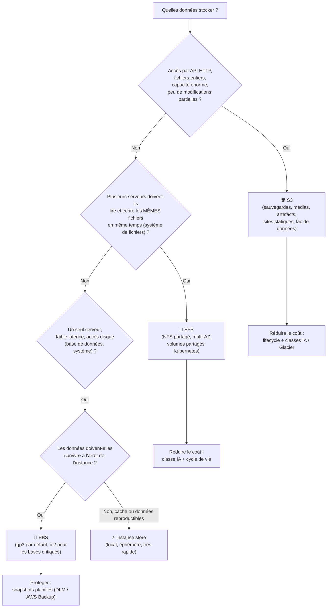

# AWS : le stockage (S3, EBS, EFS)

## Pourquoi ce cours ?

Un serveur sans données n'a aucun intérêt, et AWS propose **trois façons très différentes** de les stocker, qui ne s'échangent pas : un **stockage d'objets** quasi infini accessible par HTTP (**S3**), un **disque** attaché à une machine (**EBS**), un **système de fichiers partagé** monté par plusieurs machines (**EFS**). Se tromper de service, c'est payer plusieurs fois plus cher, perdre des données à l'arrêt d'une instance, ou découvrir qu'un disque ne peut pas être monté sur deux serveurs. Ce cours explique leurs **modèles**, leurs **options clés** (classes, versioning, cycle de vie, chiffrement, instantanés) et **comment choisir**. Vous pratiquerez S3 dans l'[atelier dédié](../ateliers-killercoda/atelier-02-s3-avec-awscli/intro.md), sur LocalStack.

> Prérequis : [Fondamentaux du cloud](01-fondamentaux-cloud.md), [IAM](02-aws-iam-et-securite.md) (les droits S3), [calcul](03-aws-compute-ec2-et-eks.md) et [stockage Linux (LVM, systèmes de fichiers)](../../03-linux-avance/cours/03-stockage-lvm.md).

## 1. S3 : le stockage d'objets

**S3** (*Simple Storage Service*) stocke des **objets** (un fichier + ses métadonnées) dans des **buckets** (« seaux »). Il n'y a **pas de vrais dossiers** : un espace de noms **plat**, où `rapports/2025/bilan.pdf` est simplement le **nom complet** (la *clé*) d'un objet ; la console et `aws s3 ls` affichent des « dossiers » en regroupant les clés par préfixe.

| Notion | Détail |
|---|---|
| **Bucket** | Conteneur ; son **nom est unique dans le monde entier** (tous comptes confondus), il vit dans **une région** |
| **Objet** | Données (jusqu'à **5 To**) + clé + métadonnées + étiquettes ; un *upload* simple va jusqu'à **5 Go** ; au-delà, **envoi multipart** (conseillé dès ~100 Mo) |
| **Durabilité** | **99,999999999 %** (« 11 neuf ») : les données sont répliquées sur plusieurs AZ |
| **Disponibilité** | Selon la classe de stockage (de 99,9 % à 99,99 %) |
| **Cohérence** | **Lecture forte après écriture** pour tous les objets (depuis fin 2020) : plus de délai de propagation |
| **Accès** | API HTTP(S), `aws s3`, SDK, URL **présignées** ; **pas** monté comme un disque (sauf outils tiers) |
| **Tarification** | **Au Go stocké par mois**, **aux requêtes**, et **au transfert sortant** vers Internet (le transfert **entrant** est gratuit) |

```bash
aws s3 mb s3://rapports-worketyamo --region eu-west-3          # créer un bucket
aws s3 cp bilan.pdf s3://rapports-worketyamo/2025/bilan.pdf   # envoyer
aws s3 ls s3://rapports-worketyamo/2025/                       # lister
aws s3 sync ./site s3://rapports-worketyamo/site --delete      # synchroniser un dossier
aws s3 presign s3://rapports-worketyamo/2025/bilan.pdf --expires-in 3600   # URL temporaire (1 heure)
aws s3 rm s3://rapports-worketyamo/2025/bilan.pdf
```

> ⚠️ **Attention** : « bucket S3 public » est l'une des causes de fuite de données les plus fréquentes. Garde activée la fonction **S3 Block Public Access** (active par défaut sur les nouveaux buckets), n'utilise **pas** les **ACL** (désactivées par défaut depuis 2023, *Bucket owner enforced*) et partage un fichier avec une **URL présignée** plutôt qu'en rendant un bucket public.

### Les classes de stockage

On choisit la classe selon la **fréquence d'accès** ; plus on accède rarement, moins le Go stocké coûte, mais plus les **frais de récupération** et le **délai** augmentent.

| Classe | Pour | Récupération | Remarque |
|---|---|---|---|
| **S3 Standard** | Données **très consultées** | Immédiate | Par défaut |
| **S3 Intelligent-Tiering** | Accès **imprévisibles** | Immédiate | Déplace seul les objets entre niveaux ; petit frais de supervision |
| **S3 Standard-IA** (*Infrequent Access*) | Accès **rares**, mais rapides au besoin | Immédiate (+ frais par Go récupéré) | Durée minimale de 30 jours |
| **S3 One Zone-IA** | Données **reproductibles**, accès rares | Immédiate | **Une seule AZ** : moins cher, moins résilient |
| **Glacier Instant Retrieval** | **Archives** consultées ~1×/trimestre | Immédiate (millisecondes) | Durée minimale de 90 jours |
| **Glacier Flexible Retrieval** | Archives, sauvegardes | **Minutes à heures** | Durée minimale de 90 jours |
| **Glacier Deep Archive** | Conservation **très longue** (conformité) | **Heures** (≈ 12 h) | Le moins cher ; durée minimale de 180 jours |

### Versioning, cycle de vie, réplication

- **Versioning** : conserve **toutes les versions** d'un objet. Un écrasement **ajoute** une version ; une suppression ajoute un **marqueur de suppression** (*delete marker*) sans détruire les données : on peut **restaurer**. À activer sur les données qui comptent (protège des erreurs et de certains ransomwares). Chaque version est facturée.
- **Règles de cycle de vie** (*lifecycle*) : actions **automatiques** selon l'âge des objets : **transition** vers une classe moins chère, **expiration** (suppression), purge des **anciennes versions**, nettoyage des envois multipart incomplets.
- **Réplication** : copie automatique vers un autre bucket, une autre région (**CRR**) ou la même (**SRR**) : reprise après sinistre, conformité.
- **Notifications d'événements** : un objet créé peut déclencher une **Lambda**, un message **SQS/SNS** ou EventBridge.

```json
{
  "Rules": [
    {
      "ID": "archiver-les-journaux",
      "Status": "Enabled",
      "Filter": { "Prefix": "logs/" },
      "Transitions": [
        { "Days": 30, "StorageClass": "STANDARD_IA" },
        { "Days": 90, "StorageClass": "GLACIER" }
      ],
      "Expiration": { "Days": 365 }
    },
    {
      "ID": "purger-les-anciennes-versions",
      "Status": "Enabled",
      "Filter": { "Prefix": "" },
      "NoncurrentVersionExpiration": { "NoncurrentDays": 30 }
    }
  ]
}
```

```bash
aws s3api put-bucket-versioning --bucket rapports-worketyamo --versioning-configuration Status=Enabled
aws s3api put-bucket-lifecycle-configuration --bucket rapports-worketyamo --lifecycle-configuration file://cycle.json
aws s3api list-object-versions --bucket rapports-worketyamo --prefix 2025/bilan.pdf
```

### Sécurité de S3

| Mesure | Détail |
|---|---|
| **Chiffrement au repos** | **SSE-S3** (clés gérées par S3, **activé par défaut** pour tout nouvel objet depuis 2023), **SSE-KMS** (vos clés KMS : audit, contrôle d'accès, rotation), **SSE-C** (votre clé fournie à chaque requête) |
| **Chiffrement en transit** | HTTPS ; exiger-le avec une condition `aws:SecureTransport` dans la *bucket policy* |
| **Block Public Access** | Interrupteurs au niveau du **compte** et du **bucket** |
| **Policies** | **IAM** (identités) et **bucket policy** (ressource) : voir [IAM](02-aws-iam-et-securite.md) ; la plus restrictive gagne |
| **Journalisation et audit** | **CloudTrail** (événements de données), journaux d'accès S3, **Access Analyzer** |
| **Verrouillage d'objets** (*Object Lock*) | WORM : empêche la suppression/modification pendant une durée (conformité, ransomware) |
| **MFA Delete** | Exige un MFA pour supprimer une version |

## 2. EBS : le disque de la machine

**EBS** (*Elastic Block Store*) fournit des **volumes de blocs** : l'équivalent d'un **disque dur** que vous attachez à **une instance EC2**, formatez (XFS, ext4) et montez. Le volume est **indépendant** de l'instance : il survit à son arrêt (selon l'option « supprimer à la terminaison »).

| Notion | Détail |
|---|---|
| **Niveau** | **Bloc** : se comporte comme un disque ; vous gérez le **système de fichiers** |
| **Portée** | **Une seule AZ** : un volume ne s'attache qu'à une instance **de la même AZ** |
| **Attachement** | **Une instance** à la fois (sauf *Multi-Attach* io1/io2, cas spécialisé) |
| **Types** | **gp3** (SSD, usage général, **par défaut recommandé**, 3 000 IOPS de base), gp2 (ancien), **io2 / io1** (SSD à **IOPS provisionnées**, bases critiques), **st1 / sc1** (disques HDD pour gros débits séquentiels ou archives) |
| **Taille** | Extensible **à chaud** (on agrandit puis on étend le système de fichiers avec `growpart` / `xfs_growfs`) ; **on ne peut pas réduire** |
| **Instantanés** (*snapshots*) | **Sauvegardes incrémentales** stockées dans S3 (géré par AWS) ; copiables entre régions et comptes ; restaurables en un nouveau volume |
| **Chiffrement** | Par **KMS**, activable par défaut pour la région : transparent, sans impact sensible |
| **Tarification** | Au **Go provisionné** (utilisé ou non) et, selon le type, aux IOPS/débit ; instantanés au Go stocké |

```bash
aws ec2 create-volume --availability-zone eu-west-3a --size 50 --volume-type gp3 --encrypted
aws ec2 attach-volume --volume-id vol-0abc... --instance-id i-0abc... --device /dev/sdf
# Dans l'instance :
lsblk -f ; sudo mkfs.xfs /dev/nvme1n1 ; sudo mkdir -p /donnees ; sudo mount /dev/nvme1n1 /donnees
aws ec2 create-snapshot --volume-id vol-0abc... --description "avant mise à jour"
```

> 💡 **Conseil** : planifie les **instantanés automatiquement** (**Amazon Data Lifecycle Manager** ou **AWS Backup**), plutôt qu'à la main. Un disque sans sauvegarde testée est un disque que vous perdrez un jour. Et supprime les **volumes non attachés** (« disques orphelins ») : ils continuent d'être facturés.

Il existe aussi le **stockage d'instance** (*instance store*) : disque local très rapide, mais **éphémère** (perdu à l'arrêt ou en cas de panne de l'hôte). À réserver aux caches et aux données reproductibles.

## 3. EFS : le système de fichiers partagé

**EFS** (*Elastic File System*) est un **système de fichiers NFS managé** (NFSv4), **monté simultanément** par **des centaines d'instances ou de pods** dans **plusieurs AZ**. Il grandit et rétrécit **automatiquement** : pas de taille à provisionner.

| Notion | Détail |
|---|---|
| **Protocole** | **NFS** ; **Linux uniquement** (pour Windows : **FSx for Windows**) ; semantique **POSIX** (droits, propriétaires) |
| **Portée** | **Multi-AZ** par défaut (ou **One Zone** moins cher) ; accessible depuis les sous-réseaux grâce à des **cibles de montage** (*mount targets*) |
| **Capacité** | **Élastique** (jusqu'au pétaoctet) ; on paie **ce qui est stocké** |
| **Classes** | **Standard** et **Infrequent Access (IA)** avec règles de cycle de vie automatiques |
| **Débit** | Modes *elastic*, *provisioned*, *bursting* ; plus lent et plus cher que l'EBS pour un seul client |
| **Chiffrement** | Au repos (KMS) et en transit |
| **Usage** | Contenu partagé (CMS), répertoires personnels, outils de CI, **volumes persistants partagés** Kubernetes (pilote EFS CSI) |

```bash
sudo dnf install -y amazon-efs-utils            # (Amazon Linux : le paquet est préinstallé)
sudo mount -t efs -o tls fs-0123456789abcdef0:/ /mnt/partage
```

## 4. Comparer et choisir

| | **S3** (objets) | **EBS** (blocs) | **EFS** (fichiers) |
|---|---|---|---|
| Modèle | Objets + clés dans des buckets | **Disque** | **NFS** partagé |
| Accès | **API HTTP**, SDK | Monté dans **une** instance | Monté par **plusieurs** instances |
| Portée | **Région** (multi-AZ) | **Une AZ** | **Région** (multi-AZ) |
| Capacité | **Illimitée** | Provisionnée, extensible | **Élastique** |
| Latence | Plus élevée (requêtes réseau) | **Très faible** | Faible à moyenne |
| Durabilité | **11 neuf** | Très haute (réplication dans l'AZ) + snapshots | Très haute (multi-AZ) |
| Coût par Go | **Le plus bas** | Moyen (provisionné) | **Le plus élevé** |
| Usage typique | **Sauvegardes, médias, sites statiques, lacs de données, artefacts** | **Système et bases de données** d'une instance | **Contenu partagé**, volumes partagés de conteneurs |



> 📌 **À retenir** : règle pratique : **S3 par défaut** pour tout ce qui est fichier ou sauvegarde ; **EBS** pour le disque d'une instance (système, base) ; **EFS** seulement quand **plusieurs** machines ont réellement besoin d'un **système de fichiers partagé**. Pour des bases de données, préfère un service managé (**RDS**, **DynamoDB**) plutôt que de gérer une base sur EBS.

## Résumé

- **S3** : objets dans des **buckets** (noms mondiaux, par région), **11 neuf** de durabilité, **classes** (Standard → IA → Glacier), **versioning**, **règles de cycle de vie**, **réplication**, chiffrement **SSE-S3 par défaut** ; **Block Public Access** à garder actif, **URL présignées** pour partager.
- **EBS** : **disque** attaché à **une instance d'une AZ** ; types **gp3** (défaut), io2, st1/sc1 ; **instantanés incrémentaux** (à planifier) ; agrandissement à chaud, pas de réduction ; **facturé tel que provisionné**.
- **EFS** : **NFS partagé** multi-AZ, capacité **élastique**, plus cher au Go, pour des fichiers **partagés**.
- Choix : **S3** par défaut, **EBS** pour un disque d'instance, **EFS** pour un partage ; **instance store** pour l'éphémère.
- Coûts : classes et **lifecycle** (S3), **volumes orphelins** et **snapshots** (EBS), **sortie de données** (S3).

## Pour aller plus loin

- Documentation : <https://docs.aws.amazon.com/s3/>, <https://docs.aws.amazon.com/ebs/>, <https://docs.aws.amazon.com/efs/> ; *S3 best practices*.
- Outils : **AWS Backup**, **S3 Storage Lens**, `rclone`, `s5cmd`.
- Cours suivant : [Coûts et FinOps](06-aws-couts-finops-intro.md).
- Pratique : [S3 avec awscli](../ateliers-killercoda/atelier-02-s3-avec-awscli/intro.md).
