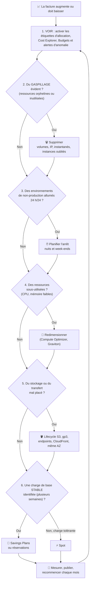

# AWS : coûts et introduction au FinOps

## Pourquoi ce cours ?

Le cloud se facture **à l'usage, à la seconde, au Go, à la requête**, ce qui est sa force… et son piège. Une instance oubliée un week-end, une *NAT Gateway* qui traite des téraoctets, un bucket qui accumule des versions, une base de test jamais éteinte : chacune est minuscule seule, mais la facture mensuelle se compte vite en milliers d'euros. À l'inverse, un compte bien géré réalise **30 à 60 %** d'économies sans rien sacrifier. Le **FinOps** (*Cloud Financial Operations*) est la pratique qui réunit **ingénierie, finance et métier** pour comprendre, optimiser et piloter ces coûts. Ce cours en donne les bases : modèles de tarification, outils de suivi, étiquetage, dimensionnement et un plan de réduction des coûts. Un module FinOps dédié viendra les approfondir.

> Prérequis : [Fondamentaux du cloud](01-fondamentaux-cloud.md), [calcul](03-aws-compute-ec2-et-eks.md), [réseau](04-aws-reseau-vpc.md) et [stockage](05-aws-stockage-s3-ebs-efs.md) : on ne maîtrise le coût que d'un service que l'on comprend.

## 1. Comment AWS facture

Presque tout se résume à **trois leviers** :

| Levier | Exemples |
|---|---|
| **Calcul** (temps d'exécution) | Instance EC2 à la seconde, tâche Fargate (CPU × mémoire × durée), appel Lambda (durée × mémoire), nœud EKS |
| **Stockage** (volume × durée) | Go-mois S3, volumes EBS **provisionnés**, instantanés, EFS, sauvegardes |
| **Transfert de données** | **Sortie vers Internet** (facturée), **entre régions**, **entre AZ** (facturée), **NAT Gateway** (volume traité) ; l'**entrée** depuis Internet est gratuite |

À cela s'ajoutent les **requêtes** (S3, DynamoDB, API Gateway), les **adresses IP publiques** (facturées à l'heure depuis 2024), les **équilibreurs de charge**, les **journaux CloudWatch** (ingestion et rétention) et les **services managés** (RDS, EKS, plan de contrôle…).

> ⚠️ **Attention** : les **coûts cachés** classiques sont : **NAT Gateway** (heure + Go traité), **transferts inter-AZ** et **sortie Internet**, **journaux CloudWatch** très verbeux, **IP élastiques non attachées**, **volumes et instantanés orphelins**, **bases de test oubliées**, **plan de contrôle EKS** (≈ 70 $/mois par cluster même sans charge).

## 2. Les modèles de tarification (calcul)

| Modèle | Principe | Remise typique* | Engagement | Pour qui |
|---|---|---|---|---|
| **À la demande** (*On-Demand*) | On paie à la seconde, **sans engagement** | 0 % (référence) | Aucun | Charges **imprévisibles**, tests, démarrage |
| **Savings Plans** | **Engagement de dépense** (en $/heure) sur 1 ou 3 ans, **flexible** (*Compute* : EC2, Fargate, Lambda ; *EC2 Instance* : famille + région) | jusqu'à ~**70 %** | 1 ou 3 ans | Charge **stable** et durable, **le choix par défaut** aujourd'hui |
| **Instances réservées** (*Reserved Instances*) | Engagement sur **un type d'instance** précis, 1 ou 3 ans | jusqu'à ~**70 %** | 1 ou 3 ans | Charge stable, services comme RDS |
| **Instances Spot** | On utilise la capacité **excédentaire** d'AWS ; AWS peut **reprendre l'instance avec un préavis de 2 minutes** | jusqu'à ~**90 %** | Aucun | Traitements **tolérants aux interruptions** : CI, calcul par lots, workers Kubernetes sans état |
| **Hôtes dédiés** (*Dedicated Hosts*) | Un serveur physique **pour vous** | — | Au choix | Licences logicielles par socket, conformité |

\* Les remises varient selon le service, la région et la durée : ce sont des **ordres de grandeur** ; consultez la tarification officielle.

```text
Dépense stable (plancher)  →  Savings Plans / Réservations      (économie importante, engagement)
Dépense variable (pics)    →  À la demande                       (flexibilité)
Charge tolérante           →  Spot                               (économie maximale, interruptions)
```

> 💡 **Conseil** : n'achète **jamais** d'engagement **avant** d'avoir **dimensionné** correctement (*rightsizing*, §5) : une réservation sur une instance trop grosse fige le gaspillage pour un ou trois ans. Couvre d'abord la **charge de base** observée sur plusieurs semaines, pas le pic.

### Le Free Tier

AWS propose une offre gratuite pour **apprendre** : des services **toujours gratuits** (quota mensuel limité, par exemple Lambda ou DynamoDB), des offres **gratuites pendant 12 mois** et des **essais**. Le programme **évolue** (notamment des crédits pour les nouveaux comptes) : **lis toujours les conditions actuelles** sur la page officielle du Free Tier avant de te lancer.

> ⚠️ **Attention** : le Free Tier n'est **pas un plafond** : au-delà du quota, **tu paies**. Et une ressource **hors du périmètre gratuit** (une NAT Gateway, un cluster EKS, une adresse IP publique) est facturée **dès la première heure**. Active une **alerte de budget** **avant** toute expérience, et **détruis** (`terraform destroy`, suppression de la pile) tout ce que tu as créé.

## 3. Voir et suivre ses coûts

| Outil | Rôle |
|---|---|
| **AWS Cost Explorer** | Graphiques de coûts **par service, compte, région, étiquette**, avec historique (jusqu'à 13 mois) et **prévisions** |
| **AWS Budgets** | Fixe un **budget** (coût, usage, couverture des engagements) et **alerte** (e-mail, SNS) à 80 % / 100 % — voire **déclenche une action** (restreindre des droits, arrêter des instances) |
| **Cost and Usage Report (CUR)** | Le relevé **le plus détaillé** (ligne par ressource et par heure), analysable avec **Athena** |
| **Cost Anomaly Detection** | Détecte automatiquement les **dépenses inhabituelles** (un service qui triple) |
| **Compute Optimizer** | Recommandations de **redimensionnement** (EC2, EBS, Lambda, ASG) fondées sur l'usage réel |
| **Trusted Advisor** | Contrôles de bonnes pratiques (coûts, sécurité, performance) |
| **Calculatrice de prix AWS** | **Estimer** avant de construire : <https://calculator.aws/> |
| **Infracost** (outil tiers) | Affiche le **coût d'un changement Terraform** dans la *pull request* ([IaC](../../13-iac/cours/07-bonnes-pratiques-iac.md)) |

```bash
aws ce get-cost-and-usage --time-period Start=2025-11-01,End=2025-12-01 \
  --granularity MONTHLY --metrics UnblendedCost --group-by Type=DIMENSION,Key=SERVICE
aws budgets describe-budgets --account-id 123456789012
```

> 📌 **À retenir** : **la première chose à faire dans un nouveau compte** est de créer un **budget avec alertes** et d'activer **Cost Anomaly Detection**. Cela prend cinq minutes et évite l'essentiel des mauvaises surprises.

## 4. Les étiquettes (*tags*) : savoir qui dépense quoi

Sans étiquettes, la facture est un **bloc opaque** : on sait *combien*, pas *qui* ni *pourquoi*. Les **étiquettes** (paires clé/valeur) rattachent chaque ressource à une **équipe, un projet, un environnement**.

| Étiquette | Exemple | Usage |
|---|---|---|
| `Environnement` | `dev`, `staging`, `prod` | Éteindre les non-production la nuit |
| `Equipe` ou `Proprietaire` | `plateforme`, `awa@exemple.org` | Responsabilité et refacturation interne |
| `Projet` / `Application` | `boutique-en-ligne` | Coût **par produit** |
| `CentreDeCout` | `CC-4021` | Rapprochement comptable |
| `GerePar` | `terraform` | Savoir **quoi** peut être modifié à la main |
| `DateExpiration` | `2026-03-31` | Nettoyer les ressources temporaires |

- Les étiquettes doivent être **activées comme « étiquettes d'allocation des coûts »** dans la console de facturation pour apparaître dans Cost Explorer.
- On les **impose** par le code (`default_tags` du provider Terraform), par des **politiques d'étiquetage** (AWS Organizations) ou des règles **AWS Config**, et par des **SCP** qui refusent les ressources non étiquetées.
- Mesure de réussite : **le pourcentage de coûts attribués** à une équipe (objectif > 90 %).

```hcl
provider "aws" {
  region = "eu-west-3"
  default_tags {
    tags = { Environnement = "dev", Equipe = "plateforme", GerePar = "terraform" }
  }
}
```

## 5. Réduire les coûts : une stratégie

Les leviers, classés **du plus rentable au plus délicat** :

| Levier | Principe | Exemples concrets |
|---|---|---|
| **1. Supprimer le gaspillage** | Éteindre ou détruire ce qui n'est **pas utilisé** | Instances et bases oubliées, **volumes EBS non attachés**, **IP élastiques** inutilisées, vieux **instantanés**, équilibreurs sans trafic |
| **2. Éteindre en dehors des heures** | Les environnements de **non-production** n'ont pas besoin de tourner la nuit et le week-end | Planification (Instance Scheduler, EventBridge + Lambda) : **jusqu'à 65 %** d'économie sur ces environnements |
| **3. Dimensionner juste** (*rightsizing*) | Choisir la **taille adaptée à l'usage réel** | Instance à 5 % de CPU → taille inférieure ; **Compute Optimizer** ; passer à **Graviton** (ARM) |
| **4. Choisir le bon stockage** | Mettre les données **froides** sur des classes moins chères | **Lifecycle S3** (Standard-IA, Glacier) ; **gp3** à la place de gp2/io1 ; purger les anciennes versions |
| **5. Réduire le transfert** | Garder le trafic **dans la même AZ / région** et **hors NAT** | **Endpoints** S3/DynamoDB (gateway : gratuits), **CloudFront** (CDN), regrouper les composants bavards dans une même AZ |
| **6. Automatiser l'élasticité** | Payer la **charge réelle**, pas le pic | **Auto Scaling**, Fargate, Lambda ; **Karpenter** pour EKS |
| **7. S'engager** | **Savings Plans** / réservations sur la **charge de base** | Après dimensionnement, couvrir 60 à 80 % de la charge stable |
| **8. Utiliser Spot** | Charges **tolérantes** aux interruptions | CI/CD, traitements par lots, nœuds Kubernetes sans état |
| **9. Architecture** | Services **managés** ou **serverless** pour supprimer de l'exploitation, ou l'inverse quand la charge est stable et élevée | Lambda pour l'événementiel ; conteneurs ou EC2 réservés pour le trafic continu |



> 💡 **Conseil** : commence par le **gaspillage** et l'**extinction hors heures** : ils demandent **aucun engagement** et **peu d'ingénierie**, pour des économies souvent supérieures à celles d'une optimisation fine. L'ordre compte : **supprimer, dimensionner, puis s'engager**.

## 6. L'état d'esprit FinOps

Le **FinOps** est avant tout **une culture** : les ingénieurs, qui prennent les décisions techniques, doivent **voir et comprendre** le coût de leurs choix.

| Phase | Question | Actions |
|---|---|---|
| **Informer** (*Inform*) | « Combien dépense-t-on, et qui ? » | Étiquettes, tableaux de bord, allocation des coûts, **showback** (montrer à chaque équipe sa part) |
| **Optimiser** (*Optimize*) | « Comment dépenser moins pour le même service ? » | Les leviers du §5 |
| **Opérer** (*Operate*) | « Comment rester efficaces dans la durée ? » | Budgets, alertes, revues mensuelles, **objectifs de coût par produit** (coût par utilisateur, par transaction) |

Principes : **tout le monde est responsable** de son coût, les décisions sont **fondées sur la valeur** (pas seulement la réduction), les données sont **accessibles et à jour**, et on **automatise**. Le coût devient une **métrique d'ingénierie** comme la latence ou le taux d'erreur ([SRE](../../11-sre-pratiques/README.md)).

## Résumé

- AWS facture le **calcul** (temps), le **stockage** (volume × durée) et le **transfert** (sortie, entre AZ, NAT) ; les coûts cachés viennent surtout du **réseau**, des **ressources oubliées** et des **journaux**.
- **Modèles** : **à la demande** (flexible), **Savings Plans / réservations** (charge stable, jusqu'à ~70 %), **Spot** (jusqu'à ~90 %, interruptible) ; ne s'engager **qu'après dimensionnement**.
- **Free Tier** : utile pour apprendre, mais **pas un plafond** ; budget et alertes **avant** d'expérimenter, détruire ensuite.
- **Outils** : **Cost Explorer**, **Budgets**, **CUR**, **Cost Anomaly Detection**, **Compute Optimizer**, calculatrice de prix, **Infracost**.
- **Étiquettes** (`Environnement`, `Equipe`, `Projet`…), activées pour l'allocation des coûts et **imposées par le code**.
- **Stratégie** : **voir** → supprimer le gaspillage → éteindre hors heures → **dimensionner** → optimiser stockage et transfert → **s'engager** → Spot ; **FinOps** = informer, optimiser, opérer, en continu.

## Pour aller plus loin

- FinOps Foundation : <https://www.finops.org/> ; *AWS Well-Architected, pilier Optimisation des coûts* ; <https://calculator.aws/> ; page officielle du **Free Tier**.
- Outils : **Infracost**, **OpenCost** / **Kubecost** (Kubernetes), **Cloud Custodian** (politiques d'automatisation).
- Retour au [sommaire du module 14](../README.md), puis le module [Monitoring et observabilité](../../10-monitoring-observabilite/README.md) pour observer ce que vous avez construit.
- Pratique : refaites les [ateliers](../ateliers-killercoda/README.md) en vous demandant, pour chaque ressource créée, **combien elle coûterait** sur un vrai compte.
