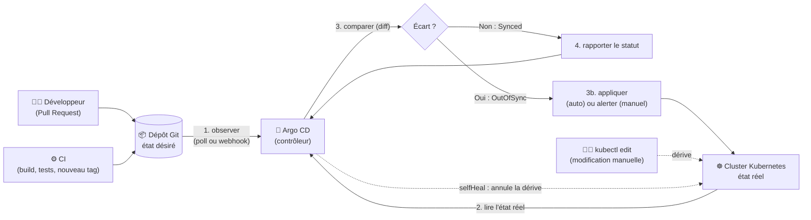

# Principes GitOps avancés

## Pourquoi ce cours ?

Le [cours GitOps du module 12](../../12-cicd/cours/08-gitops-et-deploiement-declaratif.md) a posé l'idée : **Git décrit ce qui doit tourner, un agent dans le cluster le fait tourner**. Ce module va plus loin, et avant d'ouvrir Argo CD il faut **comprendre ce qui rend GitOps robuste** : quels sont ses principes (pas seulement ses outils), pourquoi le modèle *pull* change la sécurité, comment fonctionne la **boucle de réconciliation**, et ce qui distingue un GitOps « de façade » (un `kubectl apply` lancé par une pipeline) d'un GitOps **mature**. Sans cela, on installe Argo CD et on reproduit les anciens défauts avec un nouvel outil.

> Prérequis : [CI/CD](../../12-cicd/README.md) (surtout le cours GitOps), [Kubernetes](../../09-kubernetes-approfondi/README.md) et [IaC](../../13-iac/README.md) (état désiré, dérive, idempotence).

## 1. Les quatre principes OpenGitOps

Le groupe de travail **OpenGitOps** (CNCF) a défini GitOps par **quatre principes**, indépendants de tout outil :

| # | Principe | Ce que cela signifie en pratique |
|---|---|---|
| 1 | **Déclaratif** | Le système est décrit par son **état désiré** (manifestes YAML, charts, overlays), pas par une suite de commandes |
| 2 | **Versionné et immuable** | L'état désiré est stocké dans un système qui garde **l'historique complet**, rend les versions **immuables** (un commit ne change pas) et permet l'audit et le retour arrière : typiquement **Git** |
| 3 | **Tiré automatiquement** (*pulled*) | Un **agent** logiciel **récupère** l'état désiré depuis la source ; ce n'est pas la source ou la CI qui « pousse » vers le cluster |
| 4 | **Réconcilié en continu** | L'agent **compare en permanence** l'état réel à l'état désiré et **corrige** l'écart, sans intervention humaine |

> 📌 **À retenir** : un outil n'est « GitOps » que s'il respecte ces quatre principes. Une pipeline qui exécute `kubectl apply` à chaque merge est **déclarative et versionnée**, mais **pas tirée** ni **réconciliée en continu** : c'est du **push** classique, même si l'état est dans Git.

## 2. Pull contre push

| | **Push** (CI/CD classique) | **Pull** (GitOps) |
|---|---|---|
| Qui déploie ? | La **pipeline** externe, avec ses identifiants | Un **agent dans le cluster** |
| Identifiants du cluster | **Hors** du cluster (secrets de CI : `kubeconfig`, jeton) | **Restent dans** le cluster ; aucun accès entrant nécessaire |
| Surface d'attaque | Une CI compromise = **accès au cluster** | Le cluster n'**ouvre aucun accès** à la CI ; l'agent lit Git en lecture seule |
| Dérive | Détectée **seulement** au prochain déploiement | Détectée et corrigée **en continu** |
| Retour arrière | Relancer une ancienne pipeline | **`git revert`** : la réconciliation fait le reste |
| Plusieurs clusters | Une pipeline doit connaître **chacun** | Chaque cluster (ou un contrôleur central) tire sa configuration |
| Visibilité | Dans les journaux de la pipeline | **Statut de synchronisation** en permanence |

> ⚠️ **Attention** : « pull » ne supprime pas le besoin de **confiance** : l'agent a des droits **élevés** dans le cluster (souvent `cluster-admin` par défaut). Qui peut **fusionner dans le dépôt** de configuration peut déployer n'importe quoi. La sécurité de GitOps **est** celle du dépôt : branches protégées, revues obligatoires, commits signés, droits minimaux de l'agent (voir [cours 2](02-argo-cd-architecture.md)).

## 3. Git comme source de vérité

Git devient **le seul endroit** où l'on change la production. Conséquences :

- **Tout changement passe par une *pull request*** : revue, tests de politique (Kyverno, OPA/Conftest, `kubeconform`), approbation, historique.
- **L'audit est gratuit** : `git log` répond à « qui a changé quoi, quand, pourquoi » ; la revue de PR répond à « qui l'a validé ».
- **Le retour arrière est un commit** : `git revert` est plus sûr que toute procédure manuelle.
- **Reconstruire un cluster** devient reproductible : on pointe un cluster vide vers le dépôt et il converge (voir [reprise après sinistre](#6-gitops-et-reprise-après-sinistre)).
- **Le cluster n'est plus modifié à la main** : `kubectl edit` en production est une **anomalie** que l'agent corrigera ou signalera.

### Deux dépôts, pas un

On sépare généralement :

| Dépôt | Contenu | Rythme |
|---|---|---|
| **Code applicatif** | Sources, tests, `Dockerfile` | Très fréquent (chaque commit) |
| **Configuration** (*config repo*) | Manifestes, charts, overlays par environnement | À chaque **déploiement ou changement de config** |

La CI construit l'image, la pousse et **ouvre une PR (ou commite) dans le dépôt de configuration** avec le nouveau tag ; GitOps fait le reste. Cela évite les boucles (un commit de déploiement ne relance pas le build) et sépare les droits (développeurs sur le code, plateforme et revue sur la configuration).

## 4. La boucle de réconciliation

Le cœur de GitOps est un **contrôleur** qui exécute en boucle :

```text
1. OBSERVER   : lire l'état désiré (Git, à un commit précis) et l'état réel (API Kubernetes)
2. COMPARER   : calculer la différence (diff) après rendu des manifestes
3. AGIR       : si automatique, appliquer ; sinon, signaler « OutOfSync »
4. RAPPORTER  : publier le statut (Synced / OutOfSync, Healthy / Degraded…)
5. RECOMMENCER
```



### La dérive (*drift*)

La **dérive** est l'écart entre l'état réel et l'état désiré. Elle a trois origines :

| Origine | Exemple | Réaction souhaitée |
|---|---|---|
| **Humaine** | `kubectl scale`, `kubectl edit` en urgence | Annuler (*self-heal*) ou alerter, puis **reporter dans Git** si légitime |
| **Contrôleurs légitimes** | Un HPA change `replicas`, un webhook injecte un *sidecar*, un opérateur ajoute des champs | **Ignorer** ces champs (`ignoreDifferences`), sinon l'outil « se bat » contre eux |
| **Source modifiée** | Nouveau commit dans Git | **Normal** : c'est le déploiement |

> ⚠️ **Attention** : le piège classique est le **combat sans fin** : un HPA fixe 5 réplicas, Argo CD remet `replicas: 2` (valeur de Git), le HPA remonte à 5, etc. La solution : retirer `replicas` du manifeste quand un HPA existe, ou l'ignorer explicitement (voir [cours 3](03-application-et-sync-policies.md)).

### Pas seulement « Synced »

Deux notions distinctes dans Argo CD, souvent confondues :

| Notion | Question | Valeurs |
|---|---|---|
| **Synchronisation** (*sync status*) | « L'état réel **correspond-il** à Git ? » | `Synced`, `OutOfSync`, `Unknown` |
| **Santé** (*health status*) | « Les ressources **fonctionnent-elles** ? » | `Healthy`, `Progressing`, `Degraded`, `Suspended`, `Missing` |

Une application peut être **Synced mais Degraded** (le manifeste est bien appliqué, mais le pod plante) : Git ne garantit pas que ça marche, seulement que c'est **ce qui a été demandé**.

## 5. GitOps et CI/CD classique

GitOps **ne remplace pas** la CI : il remplace la partie **livraison** (CD).

| Étape | CI/CD classique (push) | GitOps (pull) |
|---|---|---|
| Build, tests, analyse de sécurité | **CI** | **CI** (inchangé) |
| Publication de l'artefact | CI → registre | CI → registre |
| Décision de déployer | La pipeline lance `kubectl`/`helm` | La CI **modifie Git** (nouveau tag) |
| Déploiement | Depuis la pipeline | **L'agent du cluster** |
| Vérification | Étape de la pipeline | **Statut de santé** de l'agent ; alertes (voir [notifications](02-argo-cd-architecture.md)) |
| Promotion dev → prod | Pipeline paramétrée | **PR** entre dossiers/branches de l'environnement |
| Retour arrière | Relancer une ancienne pipeline | **`git revert`** |

## 6. GitOps et reprise après sinistre

Parce que l'état désiré est dans Git, **recréer un cluster** consiste à : (1) créer le cluster (avec [Terraform](../../13-iac/README.md)), (2) installer l'agent, (3) lui indiquer **un seul dépôt racine**. Le motif **app of apps** (ou un **ApplicationSet**, voir [cours 4](04-applicationsets-multi-env.md)) déclare alors **toutes** les applications. Il reste à restaurer les **données** (volumes, bases) et les **secrets**, qui ne vivent pas (ou pas en clair) dans Git : voir le [cours 6](06-secrets-dans-gitops.md).

## 7. Niveaux de maturité GitOps

Grille pédagogique (propre à ce cours, pas un standard) pour situer une équipe et choisir la prochaine étape :

| Niveau | Description | Signes |
|---|---|---|
| **1. Déclaratif dans Git** | Les manifestes sont dans Git, mais le déploiement reste **manuel ou poussé** par la CI | `kubectl apply -f` depuis un poste ou une pipeline ; dérive non détectée |
| **2. Réconciliation automatique** | Un agent **tire** et **synchronise** ; la dérive est visible ; un environnement par dossier | Argo CD/Flux en place ; `automated` sur dev, manuel sur prod ; PR pour toute modification |
| **3. GitOps de plateforme** | **Multi-environnements et multi-clusters** gérés par `ApplicationSet`/Kustomize ; secrets chiffrés ou externalisés ; politiques et **promotion automatisée** ; observabilité du déploiement | Aucun accès `kubectl` en écriture en production ; tout cluster reconstructible depuis Git ; métriques DORA suivies |

> 💡 **Conseil** : n'essayez pas de sauter au niveau 3. Passez au niveau 2 sur **un** environnement non critique, **apprenez** ce que la réconciliation change (dérive, ordre de synchronisation, secrets), puis étendez.

## 8. Quand GitOps n'est pas la bonne réponse

| Situation | Pourquoi c'est difficile | Alternative |
|---|---|---|
| **Données** et migrations de schéma | GitOps réconcilie des ressources, pas des données | Jobs/hooks dédiés, [Terraform](../../13-iac/README.md), procédures de migration versionnées |
| **Ressources hors Kubernetes** (VM, réseaux, SaaS) | Les agents standard ciblent l'API Kubernetes | Terraform/OpenTofu (éventuellement piloté par un contrôleur type Crossplane ou Flux Terraform) |
| **Très petite équipe, un seul environnement** | Le coût de mise en place dépasse le bénéfice | Pipeline simple, avec revue de PR |
| **Changements impératifs** (redémarrer un pod, vider un cache) | Pas un état désiré | Opération manuelle tracée |

## Résumé

- **OpenGitOps** : état **déclaratif**, **versionné et immuable**, **tiré** par un agent, **réconcilié en continu**.
- **Pull** : les identifiants restent **dans** le cluster, la dérive est corrigée en continu ; la sécurité repose sur **le dépôt de configuration** (revues, droits, signatures).
- **Boucle de réconciliation** : observer, comparer, agir, rapporter ; distinguer **Synced** (conforme à Git) et **Healthy** (fonctionne).
- **Dérive** : humaine, légitime (HPA, webhooks) ou due à un commit ; éviter les **combats** avec les contrôleurs légitimes.
- GitOps **complète** la CI (build, tests) et remplace la **livraison** ; deux dépôts (code, configuration) ; retour arrière = **`git revert`**.
- **Maturité** : 1 (déclaratif), 2 (réconciliation), 3 (plateforme multi-cluster, secrets, politiques) ; limites : données, ressources hors Kubernetes.

## Pour aller plus loin

- OpenGitOps : <https://opengitops.dev/> ; Argo CD : <https://argo-cd.readthedocs.io/> ; Flux : <https://fluxcd.io/docs/>.
- Livre *GitOps and Kubernetes* (Manning) ; la page « *Best Practices* » d'Argo CD (organisation des dépôts).
- Cours suivant : [Argo CD : architecture](02-argo-cd-architecture.md).
