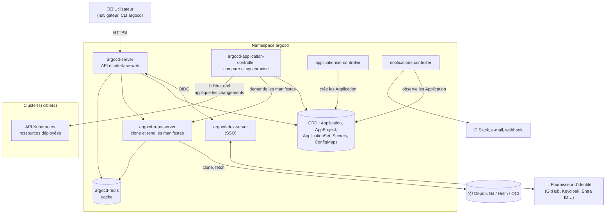

# Argo CD : architecture

## Pourquoi ce cours ?

Argo CD est le contrôleur GitOps le plus répandu pour Kubernetes. Pour l'**installer proprement**, le **dépanner** (« pourquoi mon application reste en `Unknown` ? », « pourquoi le rendu est lent ? ») et le **sécuriser** (qui peut synchroniser quoi ?), il faut savoir **quels composants** le forment et **ce que fait chacun**. Ce cours décrit l'architecture, les modes d'installation (manifestes, Helm, haute disponibilité), le contrôle d'accès (RBAC, SSO) et les notifications.

> Prérequis : [Principes GitOps avancés](01-principes-gitops-avances.md) et [Kubernetes](../../09-kubernetes-approfondi/README.md) (Deployments, StatefulSets, RBAC, CRD).

## 1. Les composants

| Composant | Type | Rôle |
|---|---|---|
| **argocd-server** | Deployment | **API** (gRPC/REST) et **interface web** ; authentification, RBAC ; point d'entrée de l'UI et de la CLI |
| **argocd-repo-server** | Deployment | **Clone** les dépôts Git, **génère les manifestes** (Helm, Kustomize, plugins, YAML) et les met en cache ; **sans accès** à l'API du cluster |
| **argocd-application-controller** | StatefulSet | Le **cerveau** : surveille les applications et le cluster, **compare** l'état réel à l'état désiré, calcule `Synced`/`Healthy`, **déclenche les synchronisations** |
| **argocd-redis** | Deployment | **Cache** (états, manifestes rendus) ; pas de données durables |
| **argocd-dex-server** | Deployment | **Fournisseur d'identité** intégré (connecteurs vers GitHub, GitLab, LDAP, SAML, OIDC) pour le SSO |
| **argocd-applicationset-controller** | Deployment | Génère des `Application` à partir d'`ApplicationSet` ([cours 4](04-applicationsets-multi-env.md)) |
| **argocd-notifications-controller** | Deployment | Envoie des **notifications** (Slack, e-mail, webhook…) sur les événements |
| **CRD** | `Application`, `AppProject`, `ApplicationSet` | Les objets Kubernetes qui décrivent applications, projets et ensembles |

Ces objets vivent dans le namespace `argocd`. **Argo CD n'a pas de base de données** : son état est dans les **CRD** et les **Secrets/ConfigMaps** Kubernetes (donc dans l'`etcd` du cluster), Redis n'étant qu'un cache.



### Qui fait quoi dans une synchronisation

1. L'**application-controller** détecte un changement (poll Git toutes les 3 minutes par défaut, ou **webhook**) ou un écart sur le cluster.
2. Il demande au **repo-server** les manifestes rendus pour le commit visé.
3. Il **compare** avec les ressources réelles du cluster (diff « sensible » : champs par défaut, annotations ignorées…).
4. En **synchronisation**, il **applique** les ressources (client-side ou *server-side apply*) dans l'ordre des **vagues** ([cours 3](03-application-et-sync-policies.md)).
5. Il évalue la **santé** et met à jour le statut de l'`Application`.

> 💡 **Conseil** : la latence par défaut (jusqu'à ~3 minutes) vient du **polling**. Pour du quasi instantané, configurez un **webhook** Git vers `argocd-server` (`/api/webhook`) ; le polling reste un filet de sécurité.

## 2. Installer Argo CD

### Manifestes officiels

```bash
kubectl create namespace argocd
kubectl apply -n argocd --server-side --force-conflicts \
  -f https://raw.githubusercontent.com/argoproj/argo-cd/v2.13.3/manifests/install.yaml
```

| Variante | Manifeste | Usage |
|---|---|---|
| **Complète** | `manifests/install.yaml` | Argo CD gère **ce cluster et d'autres** (droits `cluster-admin`) |
| **Namespace** | `manifests/namespace-install.yaml` | Droits **limités au namespace** ; pour des clusters partagés |
| **Haute disponibilité** | `manifests/ha/install.yaml` | Plusieurs réplicas (Redis HA + HAProxy, serveurs multiples) |
| **Core** | `manifests/core-install.yaml` | Sans interface, API ni SSO : le strict minimum, via `kubectl` seul |

> ⚠️ **Attention** : `--server-side` est **nécessaire** : le CRD `ApplicationSet` est trop volumineux pour l'annotation que `kubectl apply` (client-side) utilise, et l'installation échouerait avec `metadata.annotations: Too long`. Épinglez aussi **toujours une version** (`v2.13.3`, pas `stable`) pour des installations reproductibles.

### Helm

```bash
helm repo add argo https://argoproj.github.io/argo-helm
helm install argocd argo/argo-cd --namespace argocd --create-namespace --version 7.7.0 -f values.yaml
```

| | **Manifestes** | **Chart Helm** (`argo/argo-cd`) |
|---|---|---|
| Simplicité | Une commande | Un chart, des `values` |
| Personnalisation | Patchs Kustomize | **Valeurs** (ingress, HA, RBAC, SSO, ressources) |
| Mise à jour | Réappliquer un nouveau manifeste | `helm upgrade` |
| Idéal pour | Démonstration, essai | **Production**, configuration versionnée |

> 📌 **À retenir** : la bonne pratique est qu'**Argo CD se gère lui-même par GitOps** : on l'installe une première fois, puis une `Application` (*bootstrap*) surveille le dépôt qui contient **sa propre configuration** et celle de toutes les autres applications (motif **app of apps**).

### Premier accès

```bash
# Mot de passe initial de l'utilisateur admin (à changer, puis supprimer le secret)
kubectl -n argocd get secret argocd-initial-admin-secret -o jsonpath='{.data.password}' | base64 -d; echo
kubectl -n argocd port-forward svc/argocd-server 8080:443     # interface sur https://localhost:8080
argocd login localhost:8080 --username admin --insecure
```

## 3. Haute disponibilité et passage à l'échelle

| Composant | Comment le rendre fiable ou le dimensionner |
|---|---|
| **argocd-server** | Plusieurs réplicas (sans état) derrière un Service/Ingress |
| **repo-server** | Plusieurs réplicas ; **ressources suffisantes** (le rendu Helm/Kustomize consomme CPU et mémoire) ; volume de cache |
| **application-controller** | **Sharding** : `ARGOCD_CONTROLLER_REPLICAS` > 1 répartit les **clusters** entre réplicas ; un seul actif par *shard* |
| **Redis** | Variante **Redis HA** (3 nœuds + Sentinel/HAProxy) dans `ha/install.yaml` |
| **Webhooks** | Réduisent le polling, donc la charge sur Git et sur le contrôleur |

Pour des centaines d'applications : augmenter `--status-processors` et `--operation-processors`, limiter le nombre d'applications par dépôt monolithique (annotation `argocd.argoproj.io/manifest-generate-paths`), et surveiller les métriques Prometheus du contrôleur ([module Monitoring](../../10-monitoring-observabilite/README.md)).

## 4. Projets (`AppProject`) et RBAC

Un **`AppProject`** est une **frontière de sécurité** : il limite, pour un groupe d'applications, **quels dépôts** elles peuvent utiliser, **quels clusters et namespaces** elles peuvent cibler, **quels types de ressources** elles peuvent créer.

```yaml
apiVersion: argoproj.io/v1alpha1
kind: AppProject
metadata:
  name: equipe-boutique
  namespace: argocd
spec:
  description: Applications de l'équipe boutique
  sourceRepos:
    - https://github.com/exemple/boutique-config.git
  destinations:
    - server: https://kubernetes.default.svc
      namespace: boutique-*
  clusterResourceWhitelist: []          # aucune ressource de niveau cluster (pas de ClusterRole, Namespace…)
  namespaceResourceBlacklist:
    - group: ""
      kind: ResourceQuota
```

Le **RBAC d'Argo CD** (ConfigMap `argocd-rbac-cm`) décide **qui peut faire quoi** sur les applications, indépendamment du RBAC Kubernetes :

```yaml
apiVersion: v1
kind: ConfigMap
metadata:
  name: argocd-rbac-cm
  namespace: argocd
data:
  policy.default: role:readonly           # rôle par défaut des utilisateurs connectés
  policy.csv: |
    # p, sujet, ressource, action, objet, effet
    p, role:dev-boutique, applications, get,  equipe-boutique/*, allow
    p, role:dev-boutique, applications, sync, equipe-boutique/*, allow
    p, role:dev-boutique, applications, action/*, equipe-boutique/*, deny
    # g, groupe SSO, rôle
    g, boutique-devs, role:dev-boutique
    g, plateforme,    role:admin
  scopes: '[groups, email]'
```

> ⚠️ **Attention** : par défaut, l'`AppProject` **`default`** autorise **tout** (tous dépôts, clusters, ressources). Dans une plateforme partagée, **ne laissez personne créer d'applications dans `default`** : créez un projet par équipe avec des listes blanches, et mettez `policy.default` à une valeur **non permissive**. Sans cela, un utilisateur pouvant créer une `Application` peut déployer ce qu'il veut, y compris des droits de niveau cluster.

## 5. SSO et authentification

Argo CD gère un compte local `admin` et des comptes locaux, mais en production on utilise le **SSO via OIDC** :

| Option | Principe |
|---|---|
| **Dex intégré** | Dex fait le pont vers GitHub, GitLab, LDAP, SAML… (`dex.config` dans `argocd-cm`) |
| **OIDC direct** | Argo CD parle OIDC avec Keycloak, Okta, Entra ID, Google… (`oidc.config` dans `argocd-cm`) |

```yaml
# argocd-cm (extrait) : OIDC direct avec Keycloak
data:
  url: https://argocd.exemple.org
  oidc.config: |
    name: Keycloak
    issuer: https://sso.exemple.org/realms/plateforme
    clientID: argocd
    clientSecret: $oidc.keycloak.clientSecret      # lu dans le Secret argocd-secret
    requestedScopes: ["openid", "profile", "email", "groups"]
```

Les **groupes** renvoyés par l'IdP sont ensuite reliés aux rôles par `g, <groupe>, role:…` dans `argocd-rbac-cm`. **Désactivez** le compte `admin` (`admin.enabled: "false"`) une fois le SSO opérationnel, et supprimez `argocd-initial-admin-secret`.

## 6. Notifications

Le **notifications-controller** envoie des messages quand une application change d'état, **sans que la CI ou un humain ait à surveiller** :

```yaml
# argocd-notifications-cm (extrait)
data:
  service.slack: |
    token: $slack-token
  trigger.on-sync-failed: |
    - when: app.status.operationState.phase in ['Error', 'Failed']
      send: [app-sync-failed]
  template.app-sync-failed: |
    message: |
      Échec de la synchronisation de {{.app.metadata.name}} : {{.app.status.operationState.message}}
```

On **abonne** ensuite une application (ou un projet) par **annotation** :

```bash
kubectl -n argocd annotate application boutique \
  notifications.argoproj.io/subscribe.on-sync-failed.slack=alertes-deploiement
```

Déclencheurs courants : `on-sync-succeeded`, `on-sync-failed`, `on-health-degraded`, `on-deployed`. Pour **tracer** les déploiements, on utilise aussi des webhooks vers un outil d'observabilité ou une annotation Grafana.

## 7. Sécurité : l'essentiel

| Mesure | Détail |
|---|---|
| **Droits de l'agent** | `install.yaml` donne `cluster-admin` ; en équipe, préférez `namespace-install.yaml` ou des clusters dédiés |
| **Projets** | Listes blanches de dépôts, destinations et types de ressources |
| **Secrets** | Jamais en clair dans Git ([cours 6](06-secrets-dans-gitops.md)) ; identifiants de dépôts dans des Secrets `repo-creds` |
| **TLS** | Ingress TLS ; `server.insecure` seulement derrière un terminateur TLS |
| **Compte `admin`** | Désactivé en production, SSO + RBAC |
| **Dépôts** | Branches protégées, revue obligatoire, commits signés (`signatureKeys` dans le projet) |
| **Mises à jour** | Suivre les avis de sécurité Argo CD ; épingler les versions |

## Résumé

- Composants : **server** (API/UI), **repo-server** (rend les manifestes), **application-controller** (compare et synchronise, StatefulSet), **Redis** (cache), **Dex** (SSO), **applicationset** et **notifications** controllers.
- L'état d'Argo CD vit dans des **CRD et Secrets**, pas dans une base ; Redis n'est qu'un cache.
- Installation : **manifestes** (`--server-side` obligatoire, version épinglée), **Helm** pour la production ; variantes **HA**, **namespace**, **core** ; Argo CD **se gère lui-même** par GitOps.
- **AppProject** = frontière de sécurité (dépôts, destinations, ressources) ; **RBAC** dans `argocd-rbac-cm` ; **ne pas utiliser le projet `default`** en environnement partagé.
- **SSO** par OIDC/Dex, désactiver `admin` ; **notifications** par annotations et templates.
- Passage à l'échelle : **sharding** du contrôleur, repo-server dimensionné, **webhooks**.

## Pour aller plus loin

- Documentation : <https://argo-cd.readthedocs.io/en/stable/operator-manual/architecture/> ; *Operator Manual : RBAC, SSO, High Availability*.
- Chart Helm : <https://github.com/argoproj/argo-helm> ; catalogue de notifications : <https://argo-cd.readthedocs.io/en/stable/operator-manual/notifications/>.
- Cours suivant : [Application et politiques de synchronisation](03-application-et-sync-policies.md).
