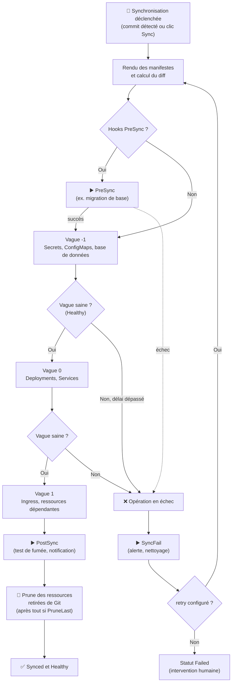

# Application et politiques de synchronisation

## Pourquoi ce cours ?

L'objet `Application` est **l'unité de travail** d'Argo CD : il dit **quoi** déployer (source), **où** (destination) et **comment** synchroniser (`syncPolicy`). Presque tous les incidents GitOps viennent d'un mauvais réglage de cette politique : un **`prune`** qui supprime un volume, un **`selfHeal`** qui lutte contre un HPA, une base qui démarre **après** l'application qui en dépend, une migration qui ne s'exécute pas au bon moment. Ce cours détaille chaque champ, les **options de synchronisation**, l'**ordre** (vagues et hooks) et les **contrôles de santé** personnalisés. Vous le pratiquerez dans l'[atelier 2 (self-heal et prune)](../ateliers-killercoda/atelier-02-selfheal-et-prune/intro.md).

> Prérequis : [Argo CD : architecture](02-argo-cd-architecture.md) et [Kubernetes](../../09-kubernetes-approfondi/README.md).

## 1. Anatomie d'une `Application`

```yaml
apiVersion: argoproj.io/v1alpha1
kind: Application
metadata:
  name: boutique-dev
  namespace: argocd
  finalizers:
    - resources-finalizer.argocd.argoproj.io      # supprimer l'app supprime aussi ses ressources
spec:
  project: equipe-boutique                        # AppProject (par défaut : default)
  source:                                         # D'OÙ viennent les manifestes
    repoURL: https://github.com/exemple/boutique-config.git
    targetRevision: main                          # branche, tag ou commit
    path: overlays/dev                            # dossier dans le dépôt
  destination:                                    # OÙ les déployer
    server: https://kubernetes.default.svc        # cluster (ou name: nom-du-cluster)
    namespace: boutique-dev
  syncPolicy:                                     # COMMENT synchroniser
    automated:
      prune: true
      selfHeal: true
    syncOptions:
      - CreateNamespace=true
    retry:
      limit: 5
      backoff: { duration: 5s, factor: 2, maxDuration: 3m }
  ignoreDifferences:                              # champs à ne pas considérer comme une dérive
    - group: apps
      kind: Deployment
      jsonPointers: [/spec/replicas]
```

| Bloc | Rôle |
|---|---|
| `project` | Rattache l'application à un **AppProject** (droits, dépôts, destinations autorisés) |
| `source` | **Dépôt, révision, chemin** (ou chart Helm) ; voir aussi `sources` (multi-source, [cours 5](05-kustomize-et-helm-avec-argo.md)) |
| `destination` | **Cluster et namespace** cibles |
| `syncPolicy` | **Automatique ou manuelle**, nettoyage, auto-correction, options, relances |
| `ignoreDifferences` | Champs gérés par d'autres contrôleurs (HPA, webhooks) à **ne pas** réconcilier |
| `finalizers` | `resources-finalizer…` : **cascade** à la suppression de l'`Application` |

> ⚠️ **Attention** : sans le finalizer `resources-finalizer.argocd.argoproj.io`, supprimer l'`Application` **laisse** ses ressources dans le cluster (orphelines) ; **avec** le finalizer, supprimer l'`Application` **supprime tout** ce qu'elle déploie. Dans les deux cas, réfléchissez avant de supprimer une application de production.

### Les statuts

| Statut | Valeurs | Signification |
|---|---|---|
| **Sync** | `Synced`, `OutOfSync`, `Unknown` | Conformité à Git |
| **Health** | `Healthy`, `Progressing`, `Degraded`, `Suspended`, `Missing`, `Unknown` | Fonctionnement des ressources |
| **Operation** | `Running`, `Succeeded`, `Failed`, `Error` | Résultat de la **dernière synchronisation** |

## 2. Synchronisation manuelle ou automatique

| Mode | `syncPolicy` | Comportement | Usage |
|---|---|---|---|
| **Manuel** | (absent) | Argo CD **détecte** l'écart (`OutOfSync`) mais **n'applique rien** tant qu'un humain ne clique pas **Sync** ou ne lance `argocd app sync` | **Production**, changements sensibles, apprentissage |
| **Automatique** | `automated: {}` | Argo CD **applique** dès que Git change | Dev, staging, souvent prod mature |

Deux options affinent le mode automatique :

| Option | Valeur | Effet |
|---|---|---|
| **`prune`** | `true` | **Supprime** du cluster les ressources **retirées de Git**. Sans `prune`, une ressource supprimée de Git **reste** dans le cluster (état `OutOfSync` signalé) |
| **`selfHeal`** | `true` | **Annule** toute modification **manuelle** du cluster (`kubectl scale`, `edit`, `delete`) pour revenir à Git. Sans `selfHeal`, Argo CD ne réagit **qu'à un changement dans Git** |
| `allowEmpty` | `false` (défaut) | Refuse de tout supprimer si Git renvoie **zéro** ressource (protection contre un dépôt mal configuré) |

```bash
argocd app sync boutique-dev                  # synchronisation manuelle
argocd app diff boutique-dev                  # différence entre Git et le cluster
argocd app sync boutique-dev --prune --dry-run
argocd app rollback boutique-dev <ID>         # impossible si automated actif (désactiver d'abord)
argocd app history boutique-dev
```

> 📌 **À retenir** : avec `automated`, **le retour arrière se fait dans Git** (`git revert`). `argocd app rollback` n'est possible que sur une application en mode **manuel** : sinon la synchronisation automatique réappliquerait aussitôt Git.

> 💡 **Conseil** : activez d'abord **`automated` sans `prune`** sur un nouvel environnement, observez ce qui serait supprimé (`argocd app diff`, état `OutOfSync`), puis ajoutez `prune: true`. Un `prune` sur un mauvais `path` peut **supprimer toute une application**.

## 3. Options de synchronisation (`syncOptions`)

| Option | Effet | Quand l'utiliser |
|---|---|---|
| `CreateNamespace=true` | Crée le namespace de destination s'il n'existe pas | Presque toujours en dev |
| `ApplyOutOfSyncOnly=true` | N'applique que les ressources **hors synchronisation** (pas toutes) | **Grosses** applications : moins d'appels API |
| `PruneLast=true` | La suppression des ressources orphelines a lieu **après** la synchronisation et la santé des nouvelles | Éviter une coupure pendant une migration |
| `PrunePropagationPolicy=foreground` | Suppression en cascade (`foreground`, `background`, `orphan`) | Contrôler le sort des enfants |
| `ServerSideApply=true` | **Server-side apply** (propriété des champs, gros objets, CRD) | CRD volumineux, cohabitation avec d'autres gestionnaires |
| `Replace=true` | `kubectl replace` au lieu de `apply` | Ressources que `apply` ne sait pas mettre à jour (à éviter sinon : destructif) |
| `Validate=false` | Désactive la validation du schéma | CRD non encore installé (rare) |
| `RespectIgnoreDifferences=true` | Applique aussi `ignoreDifferences` **pendant** la synchronisation | HPA : ne pas écraser `replicas` |
| `FailOnSharedResource=true` | Échoue si une ressource appartient déjà à une autre application | Éviter le **partage** accidentel |

Ces options existent aussi **par ressource**, par annotation :

```yaml
metadata:
  annotations:
    argocd.argoproj.io/sync-options: Prune=false      # ne JAMAIS supprimer cette ressource (ex. PVC)
    # argocd.argoproj.io/compare-options: IgnoreExtraneous
```

> ⚠️ **Attention** : mettez **`Prune=false`** sur les ressources dont la perte est **irréversible** (PersistentVolumeClaim, Secret manuel, base). Un `prune` réussi qui supprime un PVC supprime **les données**.

## 4. Vagues de synchronisation (*sync waves*)

Par défaut, Argo CD applique les ressources dans un ordre **par type** (Namespaces, CRD, ConfigMaps… puis Deployments) mais **n'attend pas** qu'une ressource soit saine avant la suivante. Pour imposer un ordre, on utilise les **vagues** :

```yaml
metadata:
  annotations:
    argocd.argoproj.io/sync-wave: "-1"      # vague négative : plus tôt ; défaut : 0
```

Règles : les vagues sont traitées **par numéro croissant** ; Argo CD **attend que toutes les ressources d'une vague soient saines** (`Healthy`) avant de passer à la suivante, avec un petit délai entre vagues.

| Vague | Contenu typique |
|---|---|
| `-5` | Namespace, CRD, **opérateurs** |
| `-1` | Secrets et ConfigMaps, **base de données** |
| `0` | Application principale |
| `1` | Ressources dépendantes de l'application (Ingress, jobs de seed) |
| `5` | Vérifications finales |

## 5. Hooks de synchronisation

Un **hook** est une ressource (souvent un `Job`) exécutée à un **moment précis** du cycle de synchronisation :

| Hook | Moment | Exemples |
|---|---|---|
| **`PreSync`** | **Avant** l'application des ressources | Migration de schéma, sauvegarde, vérification |
| **`Sync`** | **Pendant**, avec les vagues | Étapes à ordonnancer finement |
| **`PostSync`** | **Après** que tout est sain | Test de fumée, notification, ouverture du trafic |
| **`SyncFail`** | Si la synchronisation **échoue** | Alerte, nettoyage, retour arrière applicatif |
| **`PostDelete`** | Après la suppression de l'application | Nettoyage externe |
| `Skip` | Ressource **ignorée** par la synchronisation | Fichiers présents dans le dossier mais à ne pas déployer |

```yaml
apiVersion: batch/v1
kind: Job
metadata:
  generateName: migration-bdd-
  annotations:
    argocd.argoproj.io/hook: PreSync
    argocd.argoproj.io/hook-delete-policy: HookSucceeded     # supprime le Job après succès
    argocd.argoproj.io/sync-wave: "-1"
spec:
  backoffLimit: 0
  template:
    spec:
      restartPolicy: Never
      containers:
        - name: migrer
          image: registre.exemple.org/boutique-migrations:1.4.2
          command: ["./migrer", "--vers-derniere"]
```

Politiques de suppression : `HookSucceeded`, `HookFailed`, `BeforeHookCreation` (recrée le hook à chaque synchronisation : nécessaire car un `Job` est **immuable**).



> 💡 **Conseil** : ne faites **pas** de la logique métier lourde dans un hook. Un `PreSync` qui échoue **bloque tout le déploiement**. Rendez les migrations **rétrocompatibles** (ancienne et nouvelle version de l'application doivent fonctionner avec le nouveau schéma) pour pouvoir revenir en arrière.

## 6. Santé personnalisée (*health checks*)

Argo CD sait évaluer la santé des ressources standard (Deployment : réplicas disponibles ; StatefulSet, Ingress, PVC, Job…). Pour une **CRD** (Certificate, un opérateur maison), il ne sait pas quoi regarder, et la ressource reste `Healthy` ou `Progressing` à tort. On fournit alors un **script Lua** dans `argocd-cm` :

```yaml
data:
  resource.customizations.health.cert-manager.io_Certificate: |
    hs = {}
    if obj.status ~= nil and obj.status.conditions ~= nil then
      for _, c in ipairs(obj.status.conditions) do
        if c.type == "Ready" and c.status == "False" then
          hs.status = "Degraded"
          hs.message = c.message
          return hs
        end
        if c.type == "Ready" and c.status == "True" then
          hs.status = "Healthy"
          hs.message = c.message
          return hs
        end
      end
    end
    hs.status = "Progressing"
    hs.message = "Certificat en cours d'émission"
    return hs
```

Une bonne définition de santé rend les **vagues** utiles (on n'avance que quand le certificat est prêt) et les **notifications** fiables.

## 7. Cas d'usage : HPA et réplicas

Le piège le plus fréquent : un `Deployment` avec `replicas: 2` **et** un `HorizontalPodAutoscaler`. Le HPA monte à 5, `selfHeal` redescend à 2, et ainsi de suite.

| Solution | Comment |
|---|---|
| **Retirer `replicas`** du manifeste | Le HPA est seul propriétaire (Kustomize : patch qui supprime le champ) |
| **Ignorer le champ** | `ignoreDifferences` sur `/spec/replicas` **et** `RespectIgnoreDifferences=true` |

## Résumé

- Une **`Application`** = **source** (dépôt, révision, chemin), **destination** (cluster, namespace), **syncPolicy**, `ignoreDifferences`, finalizer de cascade, rattachée à un **AppProject**.
- **Manuel** (détecte seulement) ou **`automated`** ; **`prune`** supprime ce qui n'est plus dans Git, **`selfHeal`** annule les modifications manuelles ; protéger les données avec `Prune=false`.
- **`syncOptions`** : `CreateNamespace`, `ApplyOutOfSyncOnly`, `PruneLast`, `ServerSideApply`, `RespectIgnoreDifferences`…
- **Vagues** (`sync-wave`) : ordre croissant, attente de santé entre vagues ; **hooks** : `PreSync`, `Sync`, `PostSync`, `SyncFail`, `PostDelete` avec politiques de suppression.
- **Santé personnalisée** en Lua pour les CRD ; **HPA** : retirer ou ignorer `replicas`.
- Avec `automated`, le **retour arrière** se fait par **Git**.

## Pour aller plus loin

- Documentation : <https://argo-cd.readthedocs.io/en/stable/user-guide/sync-waves/>, `…/resource_hooks/`, `…/sync-options/`, `…/diffing/`.
- Santé personnalisée : <https://argo-cd.readthedocs.io/en/stable/operator-manual/health/>.
- Pratique : [Atelier 2 — self-heal et prune](../ateliers-killercoda/atelier-02-selfheal-et-prune/intro.md).
- Cours suivant : [ApplicationSets et multi-environnements](04-applicationsets-multi-env.md).
