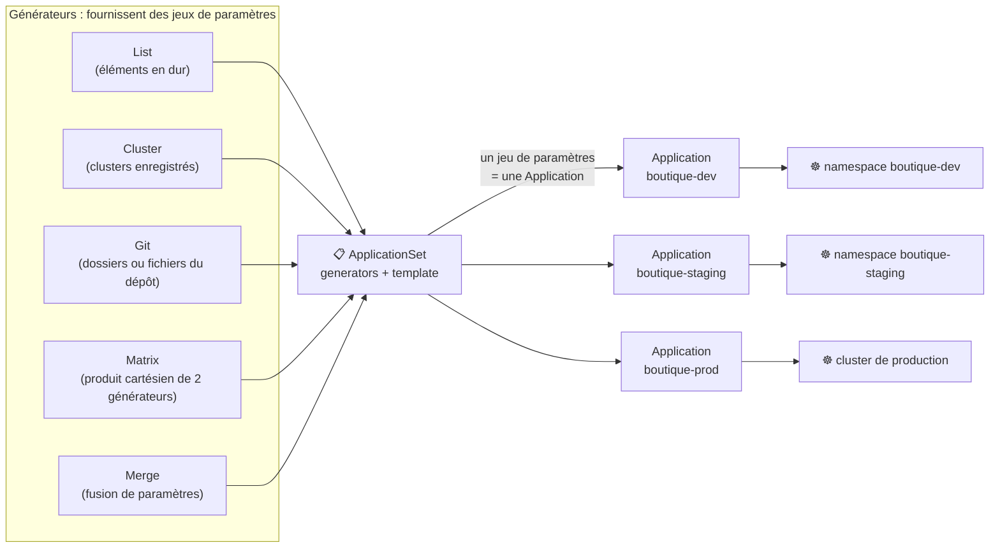

# ApplicationSets et multi-environnements

## Pourquoi ce cours ?

Écrire **une** `Application` à la main est simple. En écrire **trente** (dix applications × trois environnements) ou **cent** (une par cluster client) est une corvée sujette aux erreurs : un copier-coller oublié, un environnement qui diverge. L'**`ApplicationSet`** est une **usine à `Application`** : on décrit **un gabarit** et **une source de paramètres** (« les générateurs »), et Argo CD **crée, met à jour et supprime** les applications correspondantes. Ce cours explique les générateurs (List, Cluster, Git, Matrix, Merge), le gabarit, le multi-environnement et le multi-cluster, et la synchronisation **progressive**. L'[atelier 3](../ateliers-killercoda/atelier-03-applicationset-multi-env/intro.md) vous fait générer dev, staging et prod.

> Prérequis : [Application et politiques de synchronisation](03-application-et-sync-policies.md).

## 1. Le principe

```yaml
apiVersion: argoproj.io/v1alpha1
kind: ApplicationSet
metadata:
  name: boutique
  namespace: argocd
spec:
  generators:                       # QUOI générer : une liste de jeux de paramètres
    - list:
        elements:
          - env: dev
          - env: staging
          - env: prod
  template:                         # COMMENT : un gabarit d'Application
    metadata:
      name: 'boutique-{{env}}'
    spec:
      project: default
      source:
        repoURL: https://github.com/exemple/boutique-config.git
        targetRevision: main
        path: 'overlays/{{env}}'
      destination:
        server: https://kubernetes.default.svc
        namespace: 'boutique-{{env}}'
      syncPolicy:
        automated: { prune: true, selfHeal: true }
        syncOptions: [CreateNamespace=true]
```

Chaque **élément** produit par un générateur fournit des **paramètres** (ici `env`) qui remplacent `{{env}}` dans le gabarit : trois éléments, **trois `Application`**. L'`ApplicationSet` en est **propriétaire** : si on retire un élément, l'`Application` correspondante est **supprimée** ; si on la modifie à la main, elle est **ramenée** à l'état du gabarit.



> 📌 **À retenir** : l'ApplicationSet **ne déploie rien lui-même** : il crée des objets `Application`, que le contrôleur habituel synchronise. Tout ce qui s'applique aux `Application` ([cours 3](03-application-et-sync-policies.md)) s'applique à son gabarit.

## 2. Les générateurs

### List : éléments explicites

Le plus simple : on écrit les paramètres. Idéal pour peu d'environnements stables, ou pour apprendre.

```yaml
generators:
  - list:
      elements:
        - env: dev
          replicas: "1"
        - env: prod
          replicas: "3"
          cluster: https://prod.exemple.org
```

### Cluster : un déploiement par cluster enregistré

Génère **un jeu de paramètres par cluster** connu d'Argo CD (`name`, `server`, étiquettes). Un **sélecteur d'étiquettes** limite aux clusters voulus :

```yaml
generators:
  - clusters:
      selector:
        matchLabels:
          environnement: production
template:
  metadata:
    name: 'supervision-{{name}}'
  spec:
    destination:
      server: '{{server}}'
      namespace: monitoring
```

Usage type : **déployer une pile commune** (supervision, ingress, cert-manager) sur **tous** les clusters, y compris ceux qu'on ajoutera demain.

### Git : le dépôt décrit les applications

| Variante | Principe | Exemple |
|---|---|---|
| **`directories`** | Un jeu de paramètres **par dossier** correspondant à un motif | `apps/*` : chaque sous-dossier devient une application |
| **`files`** | Un jeu de paramètres **par fichier** JSON/YAML correspondant au motif | `envs/*/config.json` : les valeurs viennent du fichier |

```yaml
generators:
  - git:
      repoURL: https://github.com/exemple/plateforme-config.git
      revision: main
      directories:
        - path: apps/*
        - path: apps/experimental
          exclude: true
template:
  metadata:
    name: '{{path.basename}}'
  spec:
    source:
      repoURL: https://github.com/exemple/plateforme-config.git
      targetRevision: main
      path: '{{path}}'
    destination: { server: https://kubernetes.default.svc, namespace: '{{path.basename}}' }
```

**Ajouter une application = ajouter un dossier** dans Git : aucun YAML d'`Application` à écrire. C'est le moteur du **self-service** pour les équipes.

### Matrix et Merge : composer

| Générateur | Rôle | Exemple |
|---|---|---|
| **Matrix** | **Produit cartésien** de deux générateurs | `clusters` × `git/directories` : **chaque application sur chaque cluster** |
| **Merge** | **Fusionne** les paramètres de plusieurs générateurs selon une clé | Valeurs par défaut (List) surchargées par cluster (Cluster) |

```yaml
generators:
  - matrix:
      generators:
        - clusters:
            selector: { matchLabels: { gerer: "oui" } }
        - git:
            repoURL: https://github.com/exemple/plateforme-config.git
            revision: main
            directories: [{ path: 'composants/*' }]
template:
  metadata:
    name: '{{path.basename}}-{{name}}'
```

Autres générateurs : **SCM Provider** (tous les dépôts d'une organisation GitHub/GitLab), **Pull Request** (un **environnement éphémère par PR**), **Cluster Decision Resource**, **Plugin**.

> ⚠️ **Attention** : une `Matrix` ou un générateur `Git` qui **s'élargit** (un nouveau dossier, un nouveau cluster) **crée immédiatement** des applications, éventuellement en `automated` + `prune`. Testez avec `argocd appset` en simulation, **limitez par sélecteurs**, et préférez l'option `preserveResourcesOnDeletion: true` en production : supprimer par erreur un élément **n'effacera pas** les ressources déployées.

## 3. Gabarits : syntaxe et `goTemplate`

Deux syntaxes de gabarit :

| Syntaxe | Exemple | Caractéristiques |
|---|---|---|
| **Fasttemplate** (défaut) | `{{env}}`, `{{path.basename}}` | Simple, remplacement de chaînes |
| **Go template** (`goTemplate: true`) | `{{ .env }}`, `{{ .path.basename \| lower }}` | **Conditions, fonctions Sprig**, valeurs manquantes en erreur (`missingkey=error`) |

```yaml
spec:
  goTemplate: true
  goTemplateOptions: ["missingkey=error"]
  template:
    metadata:
      name: '{{ .env }}-{{ .appli }}'
    spec:
      source:
        helm:
          valuesObject:
            replicaCount: '{{ .replicas | int }}'
```

> 💡 **Conseil** : activez `goTemplate: true` avec `missingkey=error` dès le départ : une faute de frappe dans un paramètre **échoue bruyamment** au lieu de générer une application silencieusement fausse.

## 4. Multi-environnement

Un environnement peut différer par **la configuration**, **le cluster**, **la révision** ou **la politique de synchronisation**.

| Dimension | Dev | Staging | Production |
|---|---|---|---|
| **Cluster** | Partagé (namespace) | Dédié ou partagé | **Cluster dédié** |
| **Source** | `overlays/dev`, branche `main` | `overlays/staging` | `overlays/prod`, **tag** ou commit |
| **Réplicas** | 1 | 2 | 3 ou plus (HPA) |
| **Sync** | `automated`, `prune`, `selfHeal` | `automated` | **Manuelle** ou automatique après approbation |
| **Promotion** | Merge sur `main` | PR depuis dev | **PR** (revue, approbation) |

Deux stratégies de promotion :

| Stratégie | Principe | Avantage | Inconvénient |
|---|---|---|---|
| **Dossiers** (`overlays/dev|staging|prod` sur `main`) | Chaque environnement est un dossier ; promouvoir = copier la version dans le dossier suivant (PR) | Visible, un seul dépôt, **diffs lisibles** | Peut diverger si on oublie de promouvoir |
| **Branches** (`dev`, `staging`, `prod`) | `targetRevision` par environnement | Modèle familier | Fusions pénibles, conflits, dérive entre branches |

> 📌 **À retenir** : la recommandation courante est **« dossiers sur une seule branche »**, avec un **paramètre de version** (tag d'image) par environnement, modifié par la CI ou un outil de promotion (Kargo, Argo CD Image Updater, scripts de PR). Les branches par environnement deviennent vite ingérables.

## 5. Multi-cluster

Argo CD peut gérer **d'autres clusters** que celui où il tourne :

```bash
argocd cluster add contexte-prod --name prod-eu --label environnement=production
argocd cluster list
```

Cela crée un **Secret** (étiqueté `argocd.argoproj.io/secret-type: cluster`) contenant l'URL de l'API et des identifiants (jeton d'un `ServiceAccount` créé dans le cluster cible). Deux topologies :

| Topologie | Principe | Avantages | Limites |
|---|---|---|---|
| **Centralisée** (« hub and spoke ») | **Un** Argo CD gère **tous** les clusters | Vue unique, un seul outil à opérer | Point central critique ; Argo CD détient des **identifiants de tous** les clusters ; charge |
| **Un Argo CD par cluster** | Chaque cluster a son agent | Isolation, pas de secrets partagés, autonomie en cas de panne du hub | Plus d'instances à gérer ; vue répartie |

L'`ApplicationSet` avec générateur `clusters` rend la topologie centralisée **déclarative** : un nouveau cluster étiqueté reçoit automatiquement sa pile de base.

## 6. Synchronisation progressive (*progressive sync*)

Par défaut, toutes les applications générées se synchronisent **en même temps**. La **synchronisation progressive** (`strategy.type: RollingSync`) les déploie **par étapes** : d'abord des clusters de test, puis, **si tout est sain**, la production.

```yaml
spec:
  strategy:
    type: RollingSync
    rollingSync:
      steps:
        - matchExpressions:
            - { key: env, operator: In, values: [dev] }
        - matchExpressions:
            - { key: env, operator: In, values: [staging] }
          maxUpdate: 100%
        - matchExpressions:
            - { key: env, operator: In, values: [prod] }
          maxUpdate: 25%                  # un quart des applications de production à la fois
```

> ⚠️ **Attention** : cette fonction est **expérimentale** (alpha) selon les versions : elle doit être **activée explicitement** sur l'`applicationset-controller` (`--enable-progressive-syncs` ou `applicationsetcontroller.enable.progressive.syncs: "true"`), et les applications doivent être **étiquetées** (via le gabarit) pour que les étapes les sélectionnent. Vérifiez l'état de la fonction dans la documentation de **votre** version avant de la baser en production. Un outil de **promotion** dédié (Kargo) est l'alternative.

## 7. Bonnes pratiques

- **Un `ApplicationSet` par « famille »** (applications métiers, composants de plateforme) ; ne mettez pas tout dans un seul.
- Nommez clairement les `Application` générées (`<appli>-<env>-<cluster>`).
- **Projets** distincts par équipe (voir [cours 2](02-argo-cd-architecture.md)) ; un `ApplicationSet` ne doit pas pouvoir créer d'applications dans un projet trop permissif (`applicationsetcontroller.policy` : `sync`, `create-only`, `create-update`, `create-delete`).
- **Aucune dérive manuelle** des `Application` générées : toute modification passe par l'`ApplicationSet`.
- Documentez la **convention** (arborescence du dépôt, étiquettes de cluster).

## Résumé

- **`ApplicationSet`** = **générateurs** (paramètres) + **gabarit** (`Application`) ; il **crée, met à jour et supprime** les `Application`.
- Générateurs : **List** (éléments explicites), **Cluster** (clusters enregistrés), **Git** (dossiers ou fichiers), **Matrix** (produit), **Merge** (fusion), SCM/Pull Request pour des environnements éphémères.
- Gabarit : `{{param}}` ou **`goTemplate`** (conditions, fonctions) avec `missingkey=error`.
- **Multi-environnement** : dossiers sur une branche + version par environnement ; production en revue/approbation ; **multi-cluster** : `argocd cluster add`, topologie centralisée ou un agent par cluster.
- **Progressive sync** (`RollingSync`) : déploiement par étapes, fonction **à activer** et parfois expérimentale.
- Prudence : un générateur qui s'élargit crée des applications immédiatement ; protéger avec sélecteurs, politique de l'ApplicationSet, `preserveResourcesOnDeletion`.

## Pour aller plus loin

- Documentation : <https://argo-cd.readthedocs.io/en/stable/operator-manual/applicationset/> ; *Generators*, *Go Template*, *Progressive Syncs*.
- Promotion : **Kargo** (<https://kargo.io/>), **Argo CD Image Updater**.
- Pratique : [Atelier 3 — ApplicationSet multi-environnements](../ateliers-killercoda/atelier-03-applicationset-multi-env/intro.md).
- Cours suivant : [Kustomize et Helm avec Argo CD](05-kustomize-et-helm-avec-argo.md).
