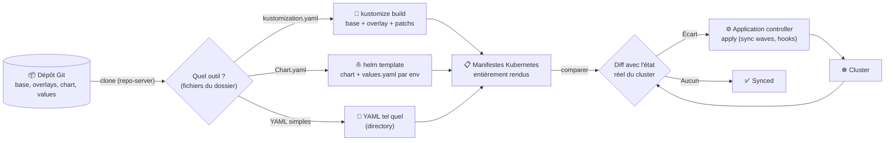

# Kustomize et Helm avec Argo CD

## Pourquoi ce cours ?

Un dépôt GitOps ne contient presque jamais des manifestes **tous écrits à la main** pour chaque environnement : on aurait trois copies presque identiques de chaque fichier, qui divergent. On sépare donc **ce qui est commun** de **ce qui change** avec deux outils : **Kustomize** (on part de YAML valide et on le **patche**) et **Helm** (on **génère** le YAML à partir d'un gabarit et de valeurs). Argo CD sait **rendre** les deux **lui-même** : comprendre ce rendu, ses différences avec un `helm install` et les choix de structure (base/overlays, valeurs par environnement, multi-source) évite des surprises coûteuses.

> Prérequis : [Application et politiques de synchronisation](03-application-et-sync-policies.md) et [Kubernetes](../../09-kubernetes-approfondi/README.md). Le cours [GitOps du module 12](../../12-cicd/cours/08-gitops-et-deploiement-declaratif.md) en donne un premier aperçu.

## 1. Kustomize : base, overlays et patchs

**Kustomize** (intégré à `kubectl -k`) transforme des manifestes existants **sans gabarit** : on déclare une **base** et des **surcouches** (*overlays*) qui la modifient.

```text
boutique-config/
├── base/
│   ├── kustomization.yaml
│   ├── deployment.yaml
│   └── service.yaml
└── overlays/
    ├── dev/
    │   └── kustomization.yaml
    ├── staging/
    │   └── kustomization.yaml
    └── prod/
        ├── kustomization.yaml
        └── patch-ressources.yaml
```

```yaml
# base/kustomization.yaml
apiVersion: kustomize.config.k8s.io/v1beta1
kind: Kustomization
resources:
  - deployment.yaml
  - service.yaml
```

```yaml
# overlays/prod/kustomization.yaml
apiVersion: kustomize.config.k8s.io/v1beta1
kind: Kustomization
namespace: boutique-prod                 # force le namespace de toutes les ressources
resources:
  - ../../base
namePrefix: prod-                        # préfixe les noms
labels:
  - pairs: { environnement: prod }
    includeSelectors: false
images:
  - name: registre.exemple.org/boutique
    newTag: "1.4.2"                      # LE réglage que la CI/promotion met à jour
replicas:
  - name: boutique
    count: 3
patches:
  - path: patch-ressources.yaml          # patch « strategic merge »
  - target: { kind: Deployment, name: boutique }
    patch: |-                            # patch JSON 6902
      - op: add
        path: /spec/template/spec/containers/0/env/-
        value: { name: NIVEAU_LOG, value: warn }
```

| Mécanisme | Usage |
|---|---|
| `resources` | Liste de fichiers, dossiers ou **bases** à inclure |
| `namespace`, `namePrefix`/`nameSuffix`, `labels` | Transformations **globales** |
| `images` | Change **nom et tag** d'image **sans toucher** au Deployment : idéal pour la promotion |
| `replicas` | Fixe le nombre de réplicas |
| `patches` | **Strategic merge** (fragment YAML fusionné) ou **JSON 6902** (opérations précises) |
| `configMapGenerator` / `secretGenerator` | Génère des ConfigMaps/Secrets avec **suffixe de hachage** : un changement de contenu **redémarre** les pods |
| `components` | Fonctionnalités optionnelles réutilisables |

```bash
kubectl kustomize overlays/prod          # affiche le YAML final
kubectl apply -k overlays/prod
```

> 💡 **Conseil** : gardez les overlays **minces** (quelques lignes : namespace, image, réplicas, un patch). Si un overlay réécrit la moitié de la base, c'est que la base est mal conçue ou qu'il faut un gabarit (Helm).

## 2. Helm : valeurs et gabarits

**Helm** génère les manifestes à partir d'un **chart** (gabarits Go) et de **valeurs** (`values.yaml`). On ne duplique pas les manifestes : on **fournit des valeurs par environnement**.

```text
boutique-config/
└── chart/
    ├── Chart.yaml
    ├── values.yaml              # valeurs par défaut
    ├── templates/ …
    └── envs/
        ├── values-dev.yaml
        ├── values-staging.yaml
        └── values-prod.yaml
```

```yaml
# envs/values-prod.yaml
replicaCount: 3
image:
  tag: "1.4.2"
resources:
  requests: { cpu: 500m, memory: 512Mi }
ingress:
  enabled: true
  host: boutique.exemple.org
```

Les valeurs se **superposent** : `values.yaml` du chart, puis les fichiers listés, puis les paramètres explicites (le dernier gagne).

## 3. Argo CD rend lui-même Kustomize et Helm

Le **repo-server** détecte l'outil selon les fichiers du dossier (`kustomization.yaml` : Kustomize ; `Chart.yaml` : Helm ; sinon YAML « plain »/dossier de manifestes) et **génère** les manifestes ; l'application-controller applique le **résultat**.



### Kustomize dans une `Application`

```yaml
spec:
  source:
    repoURL: https://github.com/exemple/boutique-config.git
    targetRevision: main
    path: overlays/prod
    kustomize:                        # surcharges facultatives, sans modifier Git
      images:
        - registre.exemple.org/boutique:1.4.3
```

### Helm dans une `Application`

```yaml
spec:
  source:
    repoURL: https://github.com/exemple/boutique-config.git
    targetRevision: main
    path: chart
    helm:
      releaseName: boutique
      valueFiles:
        - envs/values-prod.yaml
      parameters:
        - name: image.tag
          value: "1.4.3"
      valuesObject:                   # valeurs en ligne (YAML)
        replicaCount: 3
```

Un chart peut aussi venir d'un **dépôt Helm** ou d'un **registre OCI** :

```yaml
spec:
  source:
    repoURL: https://charts.bitnami.com/bitnami   # ou oci://registre.exemple.org/charts
    chart: nginx
    targetRevision: 18.2.0                         # version du chart, TOUJOURS épinglée
    helm:
      valuesObject: { replicaCount: 2 }
```

## 4. Multi-source : chart externe, valeurs dans votre dépôt

Cas fréquent : le **chart** est publié ailleurs (un éditeur), mais **vos valeurs** par environnement vivent dans **votre** dépôt. Argo CD supporte plusieurs **sources** et une **référence** :

```yaml
spec:
  sources:
    - repoURL: https://charts.bitnami.com/bitnami
      chart: nginx
      targetRevision: 18.2.0
      helm:
        valueFiles:
          - $valeurs/envs/prod/nginx-values.yaml     # fichier de l'autre source
    - repoURL: https://github.com/exemple/boutique-config.git
      targetRevision: main
      ref: valeurs                                    # nom de la référence
  destination:
    server: https://kubernetes.default.svc
    namespace: boutique-prod
```

> 📌 **À retenir** : la **version du chart** (épinglée) et les **valeurs** (versionnées dans Git) évoluent **indépendamment**, chacune avec son historique. C'est le motif recommandé pour consommer des charts tiers (ingress, cert-manager, Prometheus) en GitOps.

## 5. `helm template` contre Argo CD : les différences qui piègent

Argo CD n'exécute **pas** `helm install` : il fait un **`helm template`** puis applique le résultat **lui-même**. Conséquences :

| Sujet | `helm install` / `upgrade` | Argo CD |
|---|---|---|
| **Release Helm** | Stockée dans un Secret (`helm list` la voit) | **Aucune release** : `helm list` ne montre rien |
| **Hooks Helm** (`helm.sh/hook`) | Gérés par Helm | **Traduits** en hooks Argo CD (`pre-install` → `PreSync`, `post-install` → `PostSync`, etc.) ; certains n'ont pas d'équivalent |
| **`lookup`**, `.Release.IsUpgrade` | Interrogent le cluster/la release | `lookup` **renvoie vide** ; `IsUpgrade` toujours faux : charts écrits pour `install` à adapter |
| **Valeurs aléatoires** (`randAlphaNum`) | Générées une fois, conservées dans la release | **Régénérées à chaque rendu** : l'application reste `OutOfSync` (ou change à chaque sync) |
| **Ordre** | Helm gère un ordre par type | Ordre par type **plus vagues** Argo CD |
| **Rollback** | `helm rollback` | `git revert` (ou `argocd app rollback` en mode manuel) |
| **Diff** | `helm diff` (plugin) | **Intégré**, par ressource |

```bash
# Reproduire localement ce que voit Argo CD
helm template boutique ./chart -f envs/values-prod.yaml --namespace boutique-prod > rendu.yaml
kubectl kustomize overlays/prod > rendu.yaml
argocd app manifests boutique-prod                # manifestes tels que rendus par le repo-server
argocd app diff boutique-prod --local ./chart     # comparer des fichiers locaux au cluster
```

> ⚠️ **Attention** : un chart qui génère des **valeurs aléatoires** (mot de passe, certificat) à chaque rendu rend l'application **perpétuellement `OutOfSync`** et peut **changer un secret à chaque synchronisation**. Fournissez ces valeurs depuis un secret géré ([cours 6](06-secrets-dans-gitops.md)) ou utilisez `ignoreDifferences`.

## 6. Kustomize + Helm ensemble

On peut **inflater** un chart Helm **dans** Kustomize, pour le patcher ensuite :

```yaml
# kustomization.yaml
helmCharts:
  - name: nginx
    repo: https://charts.bitnami.com/bitnami
    version: 18.2.0
    releaseName: web
    valuesFile: values.yaml
patches:
  - path: patch-securite.yaml
```

Argo CD doit alors lancer Kustomize avec `--enable-helm` (option `kustomize.buildOptions` dans `argocd-cm`). C'est un outil puissant pour **corriger** un chart tiers sans le forker, mais il ajoute de la complexité : à utiliser avec parcimonie.

## 7. Choisir : plain YAML, Kustomize ou Helm

| Critère | **YAML simples** | **Kustomize** | **Helm** |
|---|---|---|---|
| Courbe d'apprentissage | La plus **faible** | Faible | Moyenne (gabarits Go) |
| Réutilisation entre environnements | Copies (divergent) | **Base + overlays** | **Gabarit + valeurs** |
| Lisibilité du dépôt | **Excellente** | **Très bonne** (YAML valide) | Moyenne (gabarits illisibles sans rendu) |
| Variabilité forte (conditions, boucles) | Impossible | Limitée | **Excellente** |
| Distribution à des tiers | — | Dossier Git | **Charts versionnés**, registres |
| Consommer un logiciel tiers | — | Via `helmCharts` | **Standard de fait** |
| Contrôle des changements (diff) | Direct | Direct | Via rendu |

Règle pratique : **vos propres applications** simples → **Kustomize** (base + overlays) ; **logiciels tiers** et **applications très paramétrables** → **Helm** (valeurs par environnement, multi-source) ; **n'hésitez pas à mélanger** (Helm pour les composants de plateforme, Kustomize pour vos applications).

## 8. Bonnes pratiques

- **Épinglez** versions de chart, d'images (**tag ou digest**, jamais `latest`) et `targetRevision`.
- Gardez **un seul endroit** où se change la version d'image par environnement (`images:` Kustomize ou `image.tag` Helm).
- **Validez avant la PR** : `kubeconform`, `kustomize build`, `helm lint`/`helm template`, politiques Kyverno/Conftest ([CI](../../12-cicd/README.md)).
- Argo CD **met en cache** les rendus : si vous changez un chart sans changer de version, forcez un **rafraîchissement dur** (`argocd app get --hard-refresh`).
- Séparez **code applicatif** et **dépôt de configuration** ([cours 1](01-principes-gitops-avances.md)).

## Résumé

- **Kustomize** : `base` + `overlays`, `images`, `replicas`, `patches` (strategic merge, JSON 6902), générateurs avec hachage ; YAML valide, sans gabarit.
- **Helm** : chart + **`values` par environnement** ; Argo CD le rend avec **`helm template`** (pas de release Helm, `lookup` vide, valeurs aléatoires régénérées).
- Argo CD **détecte l'outil** et rend les manifestes dans le **repo-server** ; `Application.source.kustomize` / `helm` permettent des surcharges.
- **Multi-source** : chart tiers **épinglé** + valeurs dans **votre** dépôt (`ref`, `$valeurs/…`).
- Choix : YAML (très simple), **Kustomize** (vos applications), **Helm** (tiers, variabilité) ; combinables.
- Toujours **épingler** versions et **valider** le rendu avant fusion.

## Pour aller plus loin

- Documentation : <https://argo-cd.readthedocs.io/en/stable/user-guide/kustomize/>, `…/helm/`, `…/multiple_sources/` ; <https://kubectl.docs.kubernetes.io/references/kustomize/>.
- Outils : `kubeconform`, `helm diff`, `kustomize`, Kargo (promotion).
- Cours suivant : [Secrets dans GitOps](06-secrets-dans-gitops.md).
