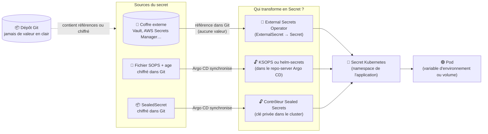

# Secrets dans GitOps

## Pourquoi ce cours ?

GitOps repose sur une règle : **tout ce qui définit le système est dans Git**. Mais un **secret** (mot de passe de base, clé d'API, certificat privé) **ne doit jamais** être commité en clair : Git garde **tout l'historique**, le dépôt est cloné partout, et un secret commité est un secret **compromis** même si on le supprime ensuite. Un `Secret` Kubernetes n'est d'ailleurs qu'un encodage **base64**, pas un chiffrement. Il faut donc **résoudre la contradiction** : garder la logique GitOps (déclaratif, versionné, réconcilié) **sans** exposer les valeurs. Ce cours présente les trois grandes familles de solutions et leurs outils (**Sealed Secrets**, **SOPS + age**, **External Secrets Operator**, **Vault**), puis aide à choisir.

> Prérequis : [Argo CD : architecture](02-argo-cd-architecture.md), [Kustomize et Helm](05-kustomize-et-helm-avec-argo.md) et [Sécurité dans la CI](../../12-cicd/cours/06-securite-dans-la-ci.md).

## 1. Le problème

| Mauvaise idée | Pourquoi c'est un problème |
|---|---|
| Secret en **clair** dans Git | Visible de quiconque lit le dépôt ; **historique permanent** ; fuite par fork, clone, journaux de CI |
| Secret **base64** dans un manifeste | Le base64 est de l'**encodage**, trivial à inverser |
| Secret créé **à la main** avec `kubectl` | **Hors Git** : non reproductible, non audité ; un cluster reconstruit n'a plus ses secrets |
| Secret dans une **variable de pipeline** poussé vers le cluster | Retour au modèle *push*, la CI détient les secrets de production |

> ⚠️ **Attention** : un secret **déjà commité** est à considérer comme **compromis**. Le **révoquer et le remplacer** est obligatoire ; réécrire l'historique (`git filter-repo`) ne suffit pas, car des copies (clones, caches, forks) peuvent exister.

## 2. Les trois familles de solutions

| Famille | Principe | Dans Git | Outils |
|---|---|---|---|
| **A. Chiffrer dans Git** | Le secret est **chiffré** puis commité ; il est **déchiffré dans le cluster** (ou à la synchronisation) | Le secret **chiffré** | **Sealed Secrets**, **SOPS** (+ age, KMS) |
| **B. Référencer un coffre externe** | Git ne contient qu'une **référence** (« le secret `bdd/prod` du coffre ») ; un opérateur **récupère** la valeur et crée le `Secret` | Une **référence** | **External Secrets Operator**, Secrets Store CSI Driver, Vault Agent / injecteur |
| **C. Injecter au rendu** | Un plugin Argo CD remplace des **marqueurs** par les valeurs au moment du rendu | Un **marqueur** | Argo CD Vault Plugin (**déconseillé** sur les versions récentes : le plugin « sidecar » est déprécié), `helm-secrets` |

> 📌 **À retenir** : les familles **A** et **B** gardent **toute la valeur du GitOps** (le cluster tire sa configuration). La famille **C** fait passer les valeurs en clair par le **repo-server** d'Argo CD, qui devient un point sensible.

## 3. Sealed Secrets (Bitnami)

Un **contrôleur** dans le cluster détient une **paire de clés**. L'outil `kubeseal` **chiffre** un `Secret` avec la clé **publique** en un objet **`SealedSecret`**, que seul **ce cluster** peut déchiffrer.

```bash
# Chiffrer : on produit un SealedSecret commitable
kubectl create secret generic bdd --from-literal=motdepasse='S3cr3t!' --dry-run=client -o yaml \
  | kubeseal --controller-namespace sealed-secrets --format yaml > bdd-sealed.yaml
git add bdd-sealed.yaml && git commit -m "Ajout du secret de la base (chiffré)"
```

```yaml
apiVersion: bitnami.com/v1alpha1
kind: SealedSecret
metadata:
  name: bdd
  namespace: boutique
spec:
  encryptedData:
    motdepasse: AgBy3i4OJSWK+PiTySYZZA9rO43cGDEq...   # illisible sans la clé privée du contrôleur
  template:
    metadata: { name: bdd, namespace: boutique }
```

| Avantages | Limites |
|---|---|
| **Très simple** : aucun service externe | Un `SealedSecret` est **lié à un cluster** (et par défaut à un nom et un namespace) |
| Pur GitOps : Argo CD applique le `SealedSecret`, le contrôleur crée le `Secret` | **Rotation et gestion de la clé du contrôleur** à votre charge : **sauvegardez-la** (perdue, tous les secrets sont indéchiffrables) |
| Gratuit, léger | Pas de **secret partagé** entre clusters sans astuces ; pas de valeur dynamique ; pas d'audit d'accès |

## 4. SOPS et age

**SOPS** (*Secrets OPerationS*) chiffre **les valeurs** d'un fichier YAML/JSON en gardant les **clés lisibles** (diffs et revues utiles). Il chiffre avec **age** (clés simples), **PGP** ou un **KMS cloud** (AWS KMS, GCP KMS, Azure Key Vault, Vault).

```bash
age-keygen -o cle.txt                         # génère la clé ; la clé publique commence par « age1… »
cat > .sops.yaml <<'EOF'
creation_rules:
  - path_regex: .*\.enc\.yaml$
    encrypted_regex: ^(data|stringData)$      # ne chiffre que les valeurs sensibles
    age: age1exemplecleSPubliqueXXXXXXXXXXXXXXXXXXXXXXXXXXXXXXXXXXXXXXXXXXXXXXX
EOF
sops --encrypt --in-place secret.enc.yaml     # chiffre
sops secret.enc.yaml                          # édite (déchiffre, ouvre l'éditeur, rechiffre)
```

Pour qu'Argo CD **déchiffre** à la synchronisation, il faut un **mécanisme** : le plugin **KSOPS** (Kustomize), le plugin **`helm-secrets`**, ou, avec **Flux**, la prise en charge **native** de SOPS (voir [cours 7](07-flux-cd-et-alternatives.md)). La **clé privée** age est fournie au `repo-server` (via un Secret ou un KMS).

| Avantages | Limites |
|---|---|
| **Fichiers lisibles** (noms de clés visibles) : revues de PR possibles | Argo CD ne déchiffre pas **nativement** : plugin ou outil supplémentaire à maintenir |
| Pas de contrôleur dans le cluster (côté déchiffrement par outil) | La clé privée est un **point sensible** ; la valeur déchiffrée transite par le repo-server |
| **Multi-clusters** simple (une clé, des destinataires multiples) | Rotation : rechiffrer les fichiers ; pas d'audit d'accès centralisé |

## 5. External Secrets Operator (ESO)

L'**External Secrets Operator** relie le cluster à un **coffre externe** (AWS Secrets Manager, GCP Secret Manager, Azure Key Vault, **HashiCorp Vault**, 1Password…). Git ne contient **aucune valeur** : seulement une **description** de ce qu'il faut récupérer.

```yaml
apiVersion: external-secrets.io/v1beta1
kind: ClusterSecretStore
metadata:
  name: vault
spec:
  provider:
    vault:
      server: https://vault.exemple.org
      path: secret
      version: v2
      auth:
        kubernetes:
          mountPath: kubernetes
          role: eso
          serviceAccountRef: { name: external-secrets, namespace: external-secrets }
---
apiVersion: external-secrets.io/v1beta1
kind: ExternalSecret
metadata:
  name: bdd
  namespace: boutique
spec:
  refreshInterval: 1h                       # relit le coffre régulièrement : la rotation se propage
  secretStoreRef: { kind: ClusterSecretStore, name: vault }
  target: { name: bdd, creationPolicy: Owner }
  data:
    - secretKey: motdepasse
      remoteRef: { key: boutique/prod/bdd, property: motdepasse }
```

| Avantages | Limites |
|---|---|
| **Aucune valeur** (même chiffrée) dans Git | **Dépend d'un coffre** disponible : s'il tombe, les nouveaux secrets ne se créent pas |
| **Rotation** automatique, **audit** centralisé, droits fins | Un composant de plus à exploiter (opérateur + coffre) |
| Cohérent avec les coffres déjà utilisés par l'entreprise | Le `Secret` Kubernetes final reste en base64 dans `etcd` (**chiffrer `etcd`** au repos) |

> 💡 **Conseil** : avec Argo CD, ajoutez une **vague** ([cours 3](03-application-et-sync-policies.md)) pour que l'`ExternalSecret` soit appliqué **avant** le Deployment, et une **santé personnalisée** : l'`ExternalSecret` n'est « sain » que s'il a bien créé le `Secret`. Ignorez aussi les champs que l'opérateur renseigne (`ignoreDifferences`), sinon l'application reste `OutOfSync`.

## 6. Vault et Argo CD

**HashiCorp Vault** (ou son fork **OpenBao**) est le coffre de référence : **politiques fines**, **secrets dynamiques** (identifiants de base de données générés à la demande et à durée limitée), PKI, audit complet. Trois façons de l'utiliser avec Argo CD :

| Méthode | Principe | Commentaire |
|---|---|---|
| **External Secrets Operator** → Vault | ESO lit Vault et crée des `Secret` | **La plus répandue** ; Argo CD ne voit jamais les valeurs |
| **Vault Agent Injector / CSI** | Le **pod** récupère lui-même ses secrets (sidecar ou volume) | Les secrets n'apparaissent **pas** comme `Secret` Kubernetes ; très sûr |
| **Argo CD Vault Plugin** | Le repo-server remplace des marqueurs `<path:…>` au rendu | Valeurs **en clair dans le repo-server** ; projet déprécié sur les versions récentes d'Argo CD : **à éviter pour du neuf** |

L'authentification des pods ou d'ESO à Vault se fait par la **méthode Kubernetes** (jeton du `ServiceAccount`) : **aucun secret statique** à distribuer.

## 7. Le flux d'un secret



## 8. Comparaison et choix

| Critère | **Sealed Secrets** | **SOPS + age/KMS** | **External Secrets + coffre** |
|---|---|---|---|
| **Valeur dans Git** | Chiffrée | Chiffrée | **Aucune** (référence) |
| **Mise en place** | **Très simple** | Moyenne (plugin Argo CD) | Plus lourde (opérateur + coffre) |
| **Rotation** | Manuelle (re-chiffrer) | Manuelle | **Automatique** (`refreshInterval`) |
| **Audit d'accès** | Non | Via KMS (si utilisé) | **Oui** (coffre) |
| **Multi-cluster** | Une clé par cluster | **Aisé** | **Aisé** (même coffre) |
| **Secrets dynamiques** | Non | Non | **Oui** (Vault) |
| **Dépendance externe** | Aucune | Clé/KMS | **Coffre** disponible |
| **Idéal pour** | Petites équipes, un cluster, démarrage | Équipes avec Flux, fichiers lisibles, multi-clusters | **Entreprises**, conformité, rotation, secrets dynamiques |

Règle pratique : **démarrer** avec Sealed Secrets (ou SOPS avec Flux) ; **évoluer** vers External Secrets + coffre dès que la **rotation**, l'**audit** ou le nombre de clusters l'exigent.

## 9. Bonnes pratiques

- **Aucune valeur sensible en clair** dans Git, y compris dans les `values.yaml` Helm et les variables d'environnement des `Deployment`.
- **Chiffrer `etcd`** au repos (`EncryptionConfiguration` ou KMS du cloud) : un `Secret` Kubernetes reste en base64.
- **Droits minimaux** : un `ServiceAccount` d'application ne lit que **ses** secrets ; l'accès aux `Secret` est restreint par RBAC (et, pour Argo CD, par projets).
- **Détection de fuite** : `gitleaks`, `trufflehog`, *push protection* du forge, en pré-commit et en CI.
- **Rotation planifiée** et **procédure de fuite** documentée (révoquer, remplacer, redéployer).
- **Sauvegarder les clés** (contrôleur Sealed Secrets, clé age) dans un endroit **hors cluster** et **testé**.
- Ne jamais afficher un secret dans les journaux ou les diffs (Argo CD **masque** les `Secret` dans l'interface, vérifiez néanmoins les ressources personnalisées).

## Résumé

- Un secret **ne va jamais en clair dans Git** (historique permanent) ; le base64 n'est **pas** du chiffrement ; un secret commité est **compromis**.
- Trois familles : **chiffrer dans Git** (Sealed Secrets, SOPS), **référencer un coffre** (External Secrets Operator, CSI, Vault Agent), **injecter au rendu** (plugin, à éviter).
- **Sealed Secrets** : simple, lié au cluster, **sauvegarder la clé** ; **SOPS + age** : fichiers lisibles, plugin Argo CD ou Flux natif ; **ESO + Vault** : aucune valeur dans Git, **rotation** et **audit**.
- **Argo CD** : vagues pour l'ordre, santé personnalisée, `ignoreDifferences` pour les champs gérés par l'opérateur.
- Commencer **simple**, évoluer vers un **coffre** avec la taille ; toujours **chiffrer etcd**, détecter les fuites et planifier la rotation.

## Pour aller plus loin

- Documentation : <https://argo-cd.readthedocs.io/en/stable/operator-manual/secret-management/> ; <https://external-secrets.io/> ; <https://github.com/bitnami-labs/sealed-secrets> ; <https://github.com/getsops/sops> ; <https://developer.hashicorp.com/vault>.
- Outils : `gitleaks`, `trufflehog`, `kubeseal`, `age`, OpenBao.
- Cours suivant : [Flux CD et alternatives](07-flux-cd-et-alternatives.md).
