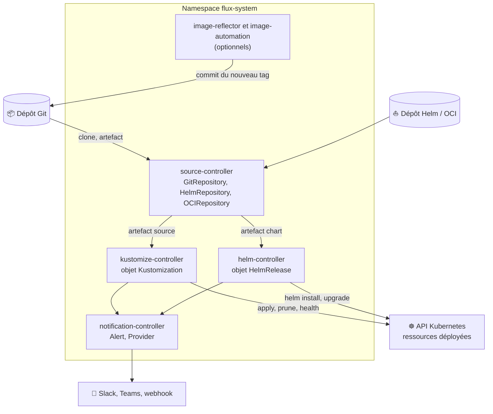
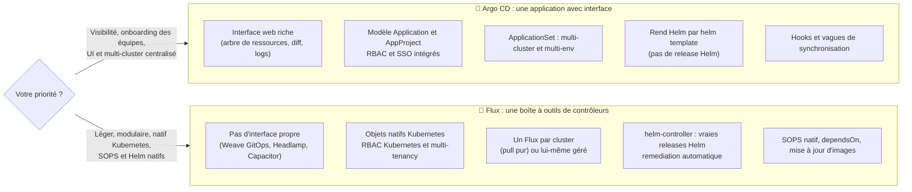

# Flux CD et alternatives

## Pourquoi ce cours ?

Argo CD n'est pas le seul outil GitOps, ni toujours le meilleur choix. **Flux CD** (lui aussi projet **CNCF diplômé**) respecte les mêmes principes mais avec une **philosophie différente** : une **boîte à outils de contrôleurs** composables, sans interface propre, très orientée « tout est une ressource Kubernetes ». Connaître Flux permet de **choisir en connaissance de cause**, de **lire** les dépôts d'autres équipes, et de savoir ce qui existe autour (Rancher Fleet, Jenkins X). Ce cours présente l'architecture de Flux, ses objets (`GitRepository`, `Kustomization`, `HelmRelease`), une **comparaison Argo CD / Flux** et le paysage des alternatives.

> Prérequis : [Principes GitOps avancés](01-principes-gitops-avances.md), [Argo CD : architecture](02-argo-cd-architecture.md) et [Kustomize et Helm](05-kustomize-et-helm-avec-argo.md).

## 1. Flux CD : l'architecture « GitOps Toolkit »

Flux est un ensemble de **contrôleurs spécialisés**, chacun gérant un type d'objet, installés dans le namespace `flux-system` :

| Contrôleur | Rôle | Objets (CRD) |
|---|---|---|
| **source-controller** | **Récupère** les sources : Git, dépôts Helm, registres OCI, buckets S3 ; produit des **artefacts** | `GitRepository`, `HelmRepository`, `OCIRepository`, `Bucket` |
| **kustomize-controller** | **Rend et applique** un chemin (Kustomize ou YAML simples) ; déchiffre **SOPS** ; supprime (*prune*) | `Kustomization` |
| **helm-controller** | **Installe et met à jour** des releases Helm (de vraies releases) | `HelmRelease` |
| **notification-controller** | Reçoit des **événements/webhooks** et en envoie (Slack, Teams…) | `Provider`, `Alert`, `Receiver` |
| **image-reflector** / **image-automation** (optionnels) | Surveillent un **registre** d'images et **commitent** les nouveaux tags dans Git | `ImageRepository`, `ImagePolicy`, `ImageUpdateAutomation` |

```bash
# Amorçage : installe Flux dans le cluster ET le fait se gérer lui-même depuis un dépôt
flux bootstrap github --owner=exemple --repository=plateforme-config \
  --branch=main --path=clusters/prod --personal=false

flux get all                       # état de toutes les ressources
flux reconcile kustomization applications --with-source
flux logs --follow
```

`flux bootstrap` **commite** les manifestes de Flux dans le dépôt et le configure pour **surveiller ce dépôt** : Flux se gère lui-même par GitOps dès le départ.

## 2. Les objets de base

### `GitRepository` : où lire

```yaml
apiVersion: source.toolkit.fluxcd.io/v1
kind: GitRepository
metadata:
  name: boutique-config
  namespace: flux-system
spec:
  interval: 1m                          # fréquence d'interrogation de Git
  url: https://github.com/exemple/boutique-config.git
  ref: { branch: main }
  secretRef: { name: git-credentials }  # dépôt privé
```

### `Kustomization` : quoi appliquer

> ⚠️ **Attention** : le `Kustomization` de **Flux** (`kustomize.toolkit.fluxcd.io`) **n'est pas** le fichier `kustomization.yaml` de Kustomize (`kustomize.config.k8s.io`). Le premier est un **objet Kubernetes** qui dit à Flux quoi appliquer ; il peut pointer un dossier qui contient (ou non) un `kustomization.yaml`.

```yaml
apiVersion: kustomize.toolkit.fluxcd.io/v1
kind: Kustomization
metadata:
  name: boutique-prod
  namespace: flux-system
spec:
  interval: 10m                  # réconciliation périodique (corrige la dérive)
  sourceRef: { kind: GitRepository, name: boutique-config }
  path: ./overlays/prod
  prune: true                    # supprime ce qui disparaît de Git
  wait: true                     # attend que les ressources soient prêtes
  timeout: 5m
  targetNamespace: boutique-prod
  dependsOn:
    - name: infrastructure       # ordre entre Kustomizations (équivalent des vagues)
  decryption:                    # SOPS natif
    provider: sops
    secretRef: { name: sops-age }
  healthChecks:
    - { apiVersion: apps/v1, kind: Deployment, name: boutique, namespace: boutique-prod }
```

### `HelmRepository` et `HelmRelease` : Helm

```yaml
apiVersion: source.toolkit.fluxcd.io/v1
kind: HelmRepository
metadata: { name: bitnami, namespace: flux-system }
spec:
  interval: 1h
  url: https://charts.bitnami.com/bitnami
---
apiVersion: helm.toolkit.fluxcd.io/v2
kind: HelmRelease
metadata: { name: nginx, namespace: boutique-prod }
spec:
  interval: 10m
  chart:
    spec:
      chart: nginx
      version: 18.2.x                   # plage semver : mises à jour automatiques mineures
      sourceRef: { kind: HelmRepository, name: bitnami, namespace: flux-system }
  values:
    replicaCount: 3
  valuesFrom:
    - kind: Secret
      name: nginx-secrets               # valeurs sensibles
  install: { remediation: { retries: 3 } }
  upgrade: { remediation: { retries: 3, remediateLastFailure: true } }   # retour arrière automatique
```

Différence importante avec Argo CD : **Flux utilise Helm lui-même** (`helm install/upgrade`) et **crée de vraies releases** : `helm list` les voit, les hooks Helm et `lookup` fonctionnent comme d'habitude, et Flux peut **revenir en arrière automatiquement** (`remediation`).



## 3. Argo CD ou Flux ?



| Critère | **Argo CD** | **Flux CD** |
|---|---|---|
| **Interface** | **Web riche** et CLI | Pas d'UI native (outils tiers) ; CLI `flux` |
| **Modèle** | `Application`, `AppProject`, `ApplicationSet` | Sources + `Kustomization` + `HelmRelease` |
| **Architecture** | Plus **monolithique**, serveur central possible | **Modulaire** (toolkit), un Flux **par cluster** typiquement |
| **Multi-cluster** | **Hub centralisé** (clusters enregistrés) ou un par cluster | Surtout **un Flux par cluster** ; gestion distante possible (`kubeConfig`) |
| **Multi-tenancy** | `AppProject` + RBAC Argo CD | RBAC Kubernetes (comptes de service par `Kustomization`) |
| **Helm** | `helm template` (pas de release) | **Vraies releases** Helm, remédiation automatique |
| **Secrets** | Plugins (KSOPS, helm-secrets) ou ESO/Sealed Secrets | **SOPS natif**, ESO, Sealed Secrets |
| **Ordre** | **Vagues** et hooks | `dependsOn`, `wait`, `healthChecks` |
| **Mise à jour d'images** | Argo CD Image Updater (projet à part) | **Intégrée** (`image-automation`) |
| **Notifications** | `argocd-notifications` | `notification-controller` |
| **Prise en main** | Rapide (l'UI aide) | Plus « kube-natif », courbe un peu plus raide |
| **Adoption** | **Très large**, grande communauté | Large, forte chez les équipes plateforme |

> 📌 **À retenir** : il n'y a **pas** de mauvais choix. **Argo CD** séduit quand on veut une **interface** partagée, une **vue multi-cluster** et un onboarding simple des équipes ; **Flux** quand on veut un outillage **léger, modulaire, 100 % déclaratif**, avec des **vraies releases Helm** et **SOPS natif**. Les principes ([cours 1](01-principes-gitops-avances.md)) et les dépôts (Kustomize, Helm) sont **portables** de l'un à l'autre.

> 💡 **Conseil** : ne choisissez pas sur un tableau : faites un **pilote d'une semaine** avec **un** service réel, de l'installation à un retour arrière et à un secret. Ce que vous détestez ou adorez à l'usage dépend de votre équipe.

## 4. Autres outils et approches

| Outil | Principe | Positionnement |
|---|---|---|
| **Rancher Fleet** | GitOps **à grande échelle** (milliers de clusters), partie de l'écosystème **Rancher/SUSE** ; objets `GitRepo`, `Bundle`, `ClusterGroup` | Très adapté si vous gérez une **flotte** de clusters avec Rancher |
| **Jenkins X** | Plateforme CI/CD **cloud-native** fondée sur Tekton + GitOps, avec environnements et promotion par PR | **Historique / legacy** : popularité et activité en recul, **peu recommandé pour de nouveaux projets** ; connaître pour lire d'anciens dépôts |
| **Kargo** | **Promotion** progressive d'artefacts entre environnements (complète Argo CD) | Orchestration de promotion (dev → staging → prod) |
| **Argo Rollouts** | **Déploiements progressifs** (canary, blue/green) avec analyse | Complément de livraison ([cours stratégies](../../12-cicd/cours/07-strategies-de-deploiement.md)), utilisable avec Argo CD ou Flux |
| **Flagger** | Déploiements progressifs (canary) pour Flux et autres | Équivalent « côté Flux » d'Argo Rollouts |
| **Crossplane** | Gérer des **ressources cloud** comme des objets Kubernetes, ensuite réconciliés par GitOps | Étend GitOps **au-delà de Kubernetes** (bases, réseaux, buckets) |
| **Terraform controllers** (Flux tf-controller, Atlantis) | Appliquer du **Terraform** selon une logique GitOps | Voir le [module IaC](../../13-iac/README.md) |
| **Outils de plateforme** (Backstage, Port) | Portails développeur qui **créent des PR** vers le dépôt GitOps | Couche **self-service** au-dessus de GitOps |

> ⚠️ **Attention** : le paysage évolue vite (fusions, abandons, changements de licence). Avant d'adopter un outil, vérifiez **l'activité du projet**, sa **gouvernance** (CNCF, éditeur unique) et sa **compatibilité** avec vos versions de Kubernetes.

## 5. Migrer ou cohabiter

- **Argo CD → Flux (ou l'inverse)** : les **manifestes** (Kustomize, Helm) sont **portables**, seuls les objets de pilotage (`Application` ↔ `Kustomization`/`HelmRelease`) changent. Migrez **application par application**, en désactivant le *prune* de l'ancien outil pour éviter une suppression au moment du transfert de propriété.
- **Cohabitation** : possible, à condition qu'**une ressource n'ait qu'un seul propriétaire** (sinon les deux outils se battent). Séparez par namespaces ou par clusters.
- **Fonction « découverte »** : commencez par **observer** (Argo CD en mode manuel, Flux avec `suspend: true`) pour comparer le résultat attendu avec la réalité avant de laisser l'outil agir.

## Résumé

- **Flux CD** = **GitOps Toolkit** : `source-controller` (GitRepository, HelmRepository, OCI), `kustomize-controller` (`Kustomization`), `helm-controller` (`HelmRelease`), `notification-controller`, automatisation d'images ; amorçage par **`flux bootstrap`**.
- Le `Kustomization` de Flux **n'est pas** le `kustomization.yaml` de Kustomize ; **`dependsOn`**, **`wait`**, **SOPS natif**, **vraies releases Helm** avec remédiation.
- **Argo CD** : interface riche, `Application`/`AppProject`/`ApplicationSet`, hub multi-cluster, vagues et hooks ; **Flux** : modulaire, natif Kubernetes, un agent par cluster, SOPS et Helm natifs. Les principes et les manifestes sont **portables**.
- Autres : **Rancher Fleet** (flottes de clusters), **Jenkins X** (legacy), **Kargo** (promotion), **Argo Rollouts / Flagger** (déploiements progressifs), **Crossplane** (ressources cloud).
- Choisir par **pilote réel**, vérifier la **santé du projet**, migrer **application par application** en évitant la double propriété.

## Pour aller plus loin

- Flux : <https://fluxcd.io/docs/> ; guide *Flux for Helm Users* et *Migrate from Argo CD* ; Rancher Fleet : <https://fleet.rancher.io/> ; Kargo : <https://kargo.io/>.
- Comparatif de la CNCF : <https://landscape.cncf.io/> (catégorie « Continuous Integration & Delivery »).
- Retour au [sommaire du module 15](../README.md), puis le module [Monitoring et observabilité](../../10-monitoring-observabilite/README.md) pour observer ce que vous déployez.
- Pratique : refaites les [ateliers](../ateliers-killercoda/README.md) en vous demandant, pour chaque étape, **quel serait l'équivalent dans Flux**.
