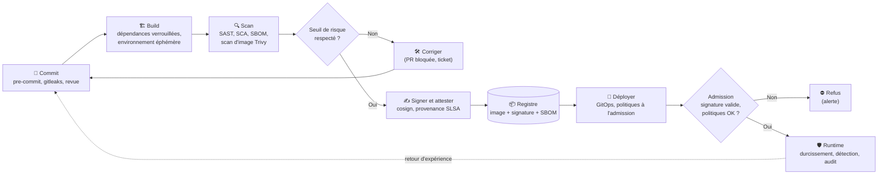

# Introduction au DevSecOps

## Pourquoi ce cours ?

Pendant longtemps, la sécurité intervenait **à la fin** : une équipe dédiée auditait l'application la veille de la mise en production, trouvait des dizaines de failles, et le projet était retardé ou livré « avec des risques acceptés ». À l'heure du déploiement continu (plusieurs livraisons par jour, voir le [module CI/CD](../../12-cicd/README.md)), ce modèle **ne tient plus** : on ne peut pas auditer à la main ce qui change toutes les heures. Le **DevSecOps** intègre la sécurité **dans** le cycle de développement et de livraison, **automatisée**, **continue** et **partagée** entre toutes les équipes. Ce cours pose le vocabulaire, les quatre piliers et la culture ; les suivants détaillent la chaîne d'approvisionnement logicielle, la signature, les politiques Kubernetes, les secrets et le durcissement.

> Prérequis : [Docker](../../08-docker-approfondi/README.md), [Kubernetes](../../09-kubernetes-approfondi/README.md), [CI/CD](../../12-cicd/README.md) (notamment [Sécurité dans la CI](../../12-cicd/cours/06-securite-dans-la-ci.md)) et [GitOps](../../15-gitops-argocd/README.md).

## 1. De DevOps à DevSecOps

| Modèle | Quand intervient la sécurité ? | Conséquence |
|---|---|---|
| **Cascade classique** | Audit **final** avant la mise en production | Failles découvertes tard, **coûteuses** à corriger, conflits avec les équipes |
| **DevOps sans sécurité** | Quand un incident survient | Vitesse maximale, **risque** maximal |
| **DevSecOps** | **À chaque étape**, automatiquement | Failles détectées **tôt**, corrigées par ceux qui ont écrit le code, vitesse conservée |

> 📌 **À retenir** : le DevSecOps n'est **ni un outil ni une équipe** : c'est une **pratique** qui rend la sécurité **responsabilité de tous**, avec des **garde-fous automatisés** dans la chaîne de livraison. Le but n'est pas de ralentir, mais de **livrer vite ET en sécurité**.

## 2. Le *shift left*

Le **coût de correction d'une faille croît** à mesure qu'elle avance dans le cycle : une erreur détectée à l'écriture du code se corrige en minutes ; la même faille découverte en production implique incident, correctif d'urgence, communication, parfois notification aux autorités et aux clients.

```text
Conception → Code → Build → Test → Déploiement → Production
  ◄──── décaler les contrôles vers la gauche (shift left) ────
 coût de correction :  faible ───────────────────────────► élevé
```

*Shift left* signifie **déplacer les contrôles le plus tôt possible** : revue de menaces à la conception, analyse du code dans l'éditeur et à chaque *pull request*, tests dans la CI, politiques avant le déploiement. **Sans renoncer** aux contrôles de droite (*shift right*) : on surveille aussi la production, car ce qu'on n'a pas prévu arrive.

> ⚠️ **Attention** : *shift left* ne veut pas dire **« tout faire peser sur les développeurs »**. Si l'on ajoute dix scanners bruyants qui bloquent chaque PR avec des centaines de faux positifs, les développeurs les **contournent**. Il faut **réduire le bruit** (seuils de gravité, exceptions justifiées, correctifs automatiques) et **faciliter la correction** (messages clairs, suggestions).

## 3. Les quatre piliers

Une chaîne sécurisée couvre **quatre domaines**, du premier commit à la production :

| Pilier | Question | Pratiques et outils (ce module) |
|---|---|---|
| **Code** | Le code que nous écrivons est-il sûr ? | Revue de code, **SAST** (analyse statique), détection de **secrets** (gitleaks), modélisation des menaces, hooks de pré-commit |
| **Build** | Ce que nous assemblons est-il fiable ? | **SCA** (dépendances), **SBOM**, analyse d'images (Trivy), **signature** et **provenance** (cosign), CI durcie ([cours 2](02-supply-chain-security.md), [cours 3](03-signature-et-provenance.md)) |
| **Deploy** | Ce que nous déployons est-il conforme ? | **Policy as code** (Kyverno, Gatekeeper), **vérification de signature** à l'admission, secrets gérés, IaC scannée (Checkov, tfsec) ([cours 4](04-policy-as-code-kubernetes.md), [cours 5](05-secrets-management.md)) |
| **Runtime** | Que se passe-t-il pendant l'exécution ? | **Durcissement** (CIS, Pod Security), détection de comportement (Falco), journalisation, réponse à incident ([cours 6](06-hardening-et-cis-benchmarks.md)) |



## 4. La sécurité comme code

Pour qu'un contrôle tienne dans une livraison continue, il doit être **décrit dans des fichiers**, **versionné**, **testé** et **exécuté automatiquement** : c'est la même logique que l'[IaC](../../13-iac/README.md) et le [GitOps](../../15-gitops-argocd/README.md).

| Domaine | « Sécurité comme code » | Exemple |
|---|---|---|
| Politiques de cluster | **Policy as code** | `ClusterPolicy` Kyverno interdisant `:latest` |
| Conformité | **Compliance as code** | Profils OpenSCAP, règles InSpec, CIS automatisés |
| Infrastructure | **IaC scannée** | Checkov, tfsec, Trivy sur Terraform |
| Pipeline | **CI as code** avec étapes de sécurité | Workflow avec Trivy, cosign, SBOM |
| Réponse | **Runbooks versionnés** | Procédures de rotation de secrets dans Git |
| Exceptions | **Dérogations traçables** | Fichier `.trivyignore` avec justification et date d'expiration |

> 💡 **Conseil** : toute exception doit avoir un **responsable**, une **justification** et une **date d'expiration**. Une exception sans date devient permanente et invisible.

## 5. Culture et rôles

La technique ne suffit pas : sans **culture**, les outils sont contournés.

| Pratique culturelle | Description |
|---|---|
| **Responsabilité partagée** | Les développeurs possèdent la sécurité de **leur** code et de **leurs** images ; l'équipe sécurité fournit **outils, conseils et garde-fous** |
| **Security champion** | Un développeur **volontaire** par équipe, formé à la sécurité : relais, premier avis, remontée des besoins. Pas un « mini-auditeur » |
| **Modélisation des menaces** | Atelier court (STRIDE, « qu'est-ce qui peut mal tourner ? ») sur les changements importants |
| **Culture sans blâme** | Un incident est une occasion d'apprendre ([postmortem blameless du module SRE](../../11-sre-pratiques/README.md)) |
| **Formation continue** | OWASP Top 10, exercices de type CTF, revues d'incidents publics |
| **Mesure** | Délai de correction des vulnérabilités, % d'images signées, couverture des politiques |

| Rôle | Responsabilités typiques |
|---|---|
| **Développeur** | Écrire du code sûr, corriger les alertes de son périmètre |
| **Ingénieur plateforme / DevOps** | Intégrer les contrôles à la chaîne, maintenir les garde-fous |
| **Security champion** | Relais dans l'équipe, revue de sécurité des changements sensibles |
| **Équipe sécurité (AppSec / SecOps)** | Définir la politique, outiller, auditer, répondre aux incidents |
| **Direction** | Arbitrer les risques, financer, **accepter explicitement** les exceptions |

## 6. Menaces et référentiels

Quelques repères à connaître :

| Référentiel | Contenu |
|---|---|
| **OWASP Top 10** | Les dix risques majeurs des applications web (contrôle d'accès, injection, composants vulnérables…) |
| **OWASP Top 10 CI/CD Security Risks** | Risques propres aux pipelines (secrets, dépendances, contrôle de flux) |
| **MITRE ATT&CK** (dont matrice conteneurs/Kubernetes) | Techniques d'attaquants, pour la détection |
| **CIS Benchmarks** | Configurations sécurisées de référence ([cours 6](06-hardening-et-cis-benchmarks.md)) |
| **NIST SSDF / SP 800-218** | Pratiques de développement logiciel sécurisé |
| **SLSA** | Niveaux d'assurance de la chaîne de build ([cours 2](02-supply-chain-security.md)) |

Les incidents marquants de la chaîne d'approvisionnement (SolarWinds en 2020, la fuite d'un script de CI chez Codecov en 2021, Log4Shell fin 2021, la porte dérobée dans `xz` en 2024) ont montré que **l'attaquant vise de plus en plus ce que vous *consommez*, pas ce que vous *écrivez***.

## 7. Par où commencer ?

Un parcours réaliste, par ordre de **rapport efficacité / effort** :

1. **Secrets** : détecter (gitleaks) et cesser d'en commiter ; passer à un gestionnaire ([cours 5](05-secrets-management.md)).
2. **Dépendances et images** : scanner (Trivy) à chaque build, avec un seuil (`HIGH`/`CRITICAL` avec correctif disponible).
3. **Images minimales et non-root** : bases `distroless` ou `alpine`, utilisateur non privilégié.
4. **Politiques de base** à l'admission : pas de `:latest`, pas de privilégié, limites de ressources ([cours 4](04-policy-as-code-kubernetes.md)).
5. **SBOM et signature** des images publiées ([cours 3](03-signature-et-provenance.md)).
6. **Durcissement** des nœuds et **Pod Security Standards** ([cours 6](06-hardening-et-cis-benchmarks.md)).

## Résumé

- **DevSecOps** : sécurité **intégrée, automatisée et partagée** dans le cycle de livraison ; *shift left* sans oublier la surveillance en production.
- **Quatre piliers** : **code**, **build**, **deploy**, **runtime** ; un pipeline sécurisé enchaîne commit → build → scan → **signature** → déploiement avec **politiques** → surveillance.
- **Sécurité comme code** : politiques, conformité, IaC et exceptions sont **versionnées et testées**.
- **Culture** : responsabilité partagée, **security champions**, modélisation des menaces, mesures ; éviter le bruit qui pousse à contourner.
- Les attaques ciblent de plus en plus la **chaîne d'approvisionnement** (dépendances, build, registres).
- Commencer par les **secrets**, les **scans**, les **images minimales** et quelques **politiques** simples.

## Pour aller plus loin

- OWASP : <https://owasp.org/> ; NIST SSDF : <https://csrc.nist.gov/projects/ssdf> ; MITRE ATT&CK : <https://attack.mitre.org/>.
- Livre *Container Security* (Liz Rice, O'Reilly) ; *OWASP DevSecOps Guideline*.
- Cours suivant : [Sécurité de la chaîne d'approvisionnement](02-supply-chain-security.md).
