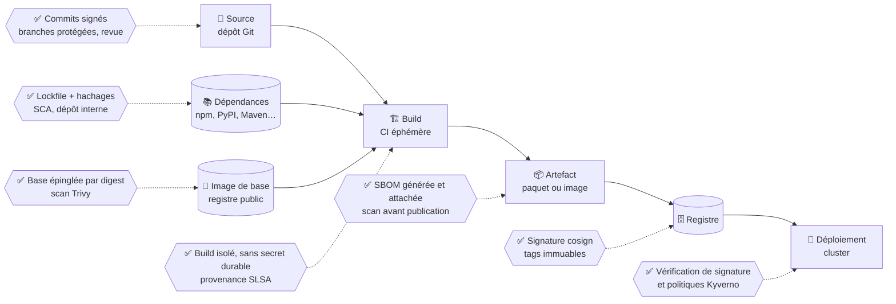

# Sécurité de la chaîne d'approvisionnement logicielle

## Pourquoi ce cours ?

Une application moderne est composée à **80 à 90 % de code que vous n'avez pas écrit** : bibliothèques open source, image de base, outils de build, actions de CI. Chacun de ces maillons peut être **vulnérable** (une faille connue, comme Log4Shell) ou **malveillant** (un paquet piégé, un compte de mainteneur détourné, une porte dérobée comme celle découverte dans `xz` en 2024). Sécuriser « son » code ne suffit donc plus : il faut **connaître, vérifier et contrôler toute la chaîne**, de la source au déploiement. Ce cours présente le cadre **SLSA**, les **SBOM**, l'analyse des dépendances (**SCA**), les attaques classiques (confusion de dépendances, typosquatting) et leurs parades (verrouillage, reproductibilité). Vous pratiquerez dans l'[atelier 1 (SBOM et scan)](../ateliers-killercoda/atelier-01-sbom-et-scan-vulnerabilites/intro.md).

> Prérequis : [Introduction au DevSecOps](01-introduction-devsecops.md) et [Sécurité dans la CI](../../12-cicd/cours/06-securite-dans-la-ci.md) (SAST, SCA, SBOM, secrets).

## 1. Où se situent les attaques ?

Chaque étape de la chaîne a ses risques :

| Étape | Exemples d'attaque | Parade principale |
|---|---|---|
| **Source** | Commit malveillant, compte détourné, dépôt usurpé | Branches protégées, revues, **commits signés**, 2FA |
| **Dépendances** | Paquet piégé, **typosquatting**, **confusion de dépendances**, mainteneur compromis | Verrouillage, dépôt interne, **SCA**, délai avant adoption |
| **Build** | Pipeline détourné, secrets volés, cache empoisonné | CI **éphémère et durcie**, droits minimaux, **provenance** |
| **Paquet / image** | Image de base compromise, couche malveillante, mauvaise version | Bases **épinglées par digest**, scan, **SBOM** |
| **Registre** | Remplacement d'un tag, dépôt public usurpé | **Signature**, tags immuables, accès restreint |
| **Déploiement** | Image non vérifiée, configuration dangereuse | **Vérification de signature**, politiques à l'admission |



## 2. SLSA : des niveaux d'assurance

**SLSA** (*Supply-chain Levels for Software Artifacts*, prononcé « salsa ») est un cadre issu de Google et de l'OpenSSF qui définit des **niveaux de garantie** sur **comment** un artefact a été produit.

| Niveau (SLSA v1.0, piste *Build*) | Ce qu'il garantit | En pratique |
|---|---|---|
| **Build L0** | Aucune garantie | Build sur un poste de développeur |
| **Build L1** | La **provenance existe** (un document dit comment l'artefact a été construit) | Le build est scripté et produit une provenance, même non signée |
| **Build L2** | Provenance **signée**, générée par une **plateforme de build hébergée** | Build dans GitHub Actions / GitLab CI, provenance signée par la plateforme |
| **Build L3** | Build **durci** : exécutions **isolées**, la provenance **ne peut pas être falsifiée** par le build lui-même | Générateur de provenance **réutilisable et isolé** (ex. `slsa-github-generator`) |

> 📌 **À retenir** : la version **1.0** de SLSA (2023) a retenu **trois niveaux de build (L1 à L3)**. L'ancienne version **0.1** décrivait **quatre niveaux** (L1 à L4, le niveau 4 ajoutant revue à deux personnes et build hermétique et reproductible) : on la trouve encore dans beaucoup de documents. Ces exigences ne sont pas perdues : elles sont reprises dans d'autres pistes (source) en cours de définition.

Principe commun à tous les niveaux : on ne **fait pas confiance** à un artefact parce qu'il « vient de chez nous », mais parce qu'on peut **prouver** d'où il vient (source, build, builder) avec une **attestation** vérifiable ([cours 3](03-signature-et-provenance.md)).

## 3. SBOM : la nomenclature logicielle

Une **SBOM** (*Software Bill of Materials*) est l'**inventaire** des composants d'un logiciel : nom, version, licence, origine, parfois hachage et relations de dépendance. Quand une faille comme Log4Shell est annoncée, la question « **sommes-nous concernés ?** » devient une **recherche dans les SBOM** au lieu d'une enquête de plusieurs jours.

| | **SPDX** | **CycloneDX** |
|---|---|---|
| Origine | Linux Foundation | **OWASP** |
| Normalisation | **ISO/IEC 5962** | **ECMA-424** |
| Point fort historique | **Licences** et conformité juridique | **Sécurité** : vulnérabilités, VEX, services, dépendances |
| Formats | JSON, YAML, tag-value, RDF | JSON, XML, protobuf |
| Usage courant | Conformité, exigences réglementaires (certains marchés publics) | Analyse de vulnérabilités, outils DevSecOps |

Les deux sont **largement supportés** (Syft, Trivy, cdxgen…) et **convertibles** ; l'essentiel est d'**en produire une**, à chaque build, et de la **conserver** avec l'artefact (registre, artefacts de release).

```bash
syft alpine:3.20 -o cyclonedx-json=sbom.cdx.json -o spdx-json=sbom.spdx.json
trivy image --format cyclonedx --output sbom.cdx.json alpine:3.20
jq '.components | length' sbom.cdx.json              # nombre de composants
trivy sbom sbom.cdx.json                             # scanner la SBOM (sans l'image)
```

Une SBOM **seule** ne protège de rien : elle devient utile quand on la **croise** avec les bases de vulnérabilités (scan continu des SBOM stockées), et quand on la complète d'un **VEX** (*Vulnerability Exploitability eXchange*, ex. OpenVEX) qui dit « cette CVE présente dans le composant **n'est pas exploitable** dans ce produit » pour réduire le bruit.

> 💡 **Conseil** : générez la SBOM **à partir de l'artefact final** (l'image construite), pas seulement du dépôt : elle inclut alors les paquets du système de base, qui sont souvent la majorité des vulnérabilités.

## 4. SCA : analyser les dépendances

L'**analyse de composition logicielle** (*SCA*) compare vos dépendances à des bases de **vulnérabilités connues** (CVE, GitHub Advisory, OSV, NVD).

| Outil | Type | Particularités |
|---|---|---|
| **Trivy** | Open source (Aqua) | Images, dépôts, IaC, SBOM, secrets ; très utilisé en CI |
| **Grype** | Open source (Anchore) | Pairé avec Syft ; scan d'images et de SBOM |
| **OSV-Scanner** | Open source (Google) | Base **OSV**, précis sur les versions de paquets |
| **Dependabot** | Intégré à GitHub | **Ouvre des PR** de mise à jour automatiquement |
| **Renovate** | Open source | Mises à jour automatiques, très configurable, multi-forge |
| **Snyk** | Commercial (offre gratuite) | Base propriétaire riche, suggestions de correctifs, IDE |
| **OWASP Dependency-Check** | Open source | Surtout Java/.NET |

Lire un résultat de scan :

| Information | Utilité |
|---|---|
| **CVE** | Identifiant public de la faille (`CVE-2021-44228`) |
| **Gravité / CVSS** | Score **théorique** de 0 à 10 (`LOW` à `CRITICAL`) |
| **Version corrigée** (*fixed version*) | Si elle existe, la mise à jour est **actionnable** |
| **EPSS** | Probabilité d'**exploitation réelle** dans les 30 jours |
| **KEV** (catalogue CISA) | Failles **déjà exploitées** dans la nature : à traiter en priorité |
| **Chemin d'inclusion** | Dépendance **directe** ou **transitive** ? |

> ⚠️ **Attention** : **la gravité CVSS n'est pas le risque**. Une `CRITICAL` dans une bibliothèque que votre code **n'appelle pas** (ou dans un binaire absent du conteneur d'exécution) est moins urgente qu'une `MEDIUM` activement exploitée et exposée. Priorisez avec **l'exploitabilité (EPSS, KEV), l'exposition et la disponibilité d'un correctif**, pas seulement le score. Bloquez les builds sur `CRITICAL/HIGH` **avec correctif disponible** (`--ignore-unfixed`), sinon l'équipe est bloquée sur des failles sans solution.

## 5. Attaques classiques sur les dépendances

| Attaque | Principe | Parades |
|---|---|---|
| **Confusion de dépendances** (*dependency confusion*, démontrée par A. Birsan en 2021) | Un paquet **interne** `mon-lib-interne` existe dans votre dépôt privé ; l'attaquant publie **le même nom** avec un numéro de version **supérieur** sur le dépôt **public** ; le gestionnaire installe le public | **Un seul dépôt source** par nom (proxy qui résout l'interne d'abord), **espaces de noms réservés** (`@organisation/…`), `--index-url` unique, verrouillage |
| **Typosquatting** | Paquet au nom **presque identique** à un populaire (`reqeusts`) qui contient un code malveillant | Relecture des ajouts, **allow-list**, outils d'analyse de comportement (Socket), `pip install` depuis un miroir validé |
| **Compte de mainteneur détourné** | Un attaquant publie une version piégée d'un paquet légitime | **Verrouillage + délai** avant d'adopter une nouvelle version, 2FA (côté éditeurs), surveillance des changements |
| **Mainteneur malveillant / porte dérobée** | Un contributeur gagne la confiance puis insère du code piégé (cas `xz`) | Revue des mises à jour critiques, **SBOM**, détection d'anomalies, réduction de la surface (moins de dépendances) |
| **Scripts d'installation** | `postinstall` npm ou `setup.py` exécutent du code à l'installation | `npm ci --ignore-scripts` lorsque c'est possible, builds sans accès réseau secret |
| **Actions de CI tierces** | Une action GitHub `@v1` est modifiée après coup | Épingler par **SHA de commit**, limiter les permissions du jeton |

## 6. Verrouillage et reproductibilité

| Pratique | Détail |
|---|---|
| **Fichiers de verrouillage** (*lockfiles*) | `package-lock.json`, `poetry.lock`, `go.sum`, `Cargo.lock` : versions **exactes** de toutes les dépendances, **transitives** comprises |
| **Installation stricte** | `npm ci`, `pip install --require-hashes -r requirements.txt`, `go mod verify` : **échec** si le lockfile ne correspond pas |
| **Hachages** | Vérifier l'**intégrité** de chaque paquet téléchargé (`integrity` dans npm, `--hash=sha256:…` en pip) |
| **Images par digest** | `FROM alpine@sha256:…` au lieu de `FROM alpine:3.20` (un tag peut être **réécrit**) |
| **Dépôt interne / proxy** | Artifactory, Nexus, Harbor en proxy : un point de contrôle, du **cache**, une résilience aux retraits |
| **Mises à jour contrôlées** | Dependabot/Renovate ouvrent une **PR** avec les tests, au lieu d'un `latest` implicite |
| **Builds reproductibles** | Mêmes entrées ⇒ **mêmes octets** : permet à un tiers de **revérifier** que l'artefact correspond bien au source |

Un build est **reproductible** quand on contrôle les entrées (versions, horodatages, ordre des fichiers, chemins). Outils et jalons : Bazel, Nix, `SOURCE_DATE_EPOCH`, **Reproducible Builds** (projet Debian) ; **distroless** et **Chainguard** fournissent des bases minimales et vérifiables.

```dockerfile
# Dockerfile durci : base épinglée par digest, utilisateur non-root, dépendances verrouillées
FROM python:3.12-slim@sha256:0000000000000000000000000000000000000000000000000000000000000000
WORKDIR /app
COPY requirements.txt .
RUN pip install --no-cache-dir --require-hashes -r requirements.txt
COPY . .
USER 10001:10001
ENTRYPOINT ["python", "app.py"]
```

*(Le digest ci-dessus est un exemple à remplacer par celui obtenu avec `docker buildx imagetools inspect python:3.12-slim`.)*

## 7. Mettre en place dans la CI

```yaml
# Extrait GitHub Actions : scan, SBOM, seuil de blocage
- name: Scan de vulnérabilités (bloque si CRITICAL ou HIGH avec correctif)
  run: trivy image --exit-code 1 --severity CRITICAL,HIGH --ignore-unfixed mon-app:${{ github.sha }}
- name: Générer la SBOM
  run: trivy image --format cyclonedx --output sbom.cdx.json mon-app:${{ github.sha }}
- uses: actions/upload-artifact@v4
  with: { name: sbom, path: sbom.cdx.json }
```

Le scan **ne se fait pas qu'au build** : de nouvelles CVE sont publiées **après** la livraison. Il faut donc **re-scanner régulièrement** les images **déjà déployées** (Trivy Operator dans le cluster, scan planifié du registre, scan des SBOM stockées).

## Résumé

- La chaîne d'approvisionnement (source, dépendances, build, artefact, registre, déploiement) est une **surface d'attaque** : chaque maillon a **un contrôle**.
- **SLSA** : niveaux d'assurance sur le build (**v1.0 : L1 à L3** ; v0.1 : L1 à L4) fondés sur la **provenance** vérifiable.
- **SBOM** (SPDX ou CycloneDX) : inventaire des composants, générée **depuis l'artefact final** et conservée ; **VEX** pour réduire le bruit.
- **SCA** (Trivy, Grype, OSV-Scanner, Dependabot, Renovate, Snyk) : prioriser par **exploitabilité et correctif disponible**, pas par le seul score CVSS ; **re-scanner** après livraison.
- Attaques : **confusion de dépendances**, **typosquatting**, comptes détournés, scripts d'installation ; parades : **lockfiles + hachages**, dépôt interne, **images par digest**, actions épinglées par SHA.
- Viser des **builds reproductibles** et une **provenance** vérifiable.

## Pour aller plus loin

- SLSA : <https://slsa.dev/> ; OpenSSF Scorecard : <https://scorecard.dev/> ; OSV : <https://osv.dev/> ; CISA KEV : <https://www.cisa.gov/known-exploited-vulnerabilities-catalog>.
- SPDX : <https://spdx.dev/> ; CycloneDX : <https://cyclonedx.org/> ; Syft : <https://github.com/anchore/syft> ; Trivy : <https://trivy.dev/>.
- Pratique : [Atelier 1 — SBOM et scan de vulnérabilités](../ateliers-killercoda/atelier-01-sbom-et-scan-vulnerabilites/intro.md).
- Cours suivant : [Signature et provenance](03-signature-et-provenance.md).
