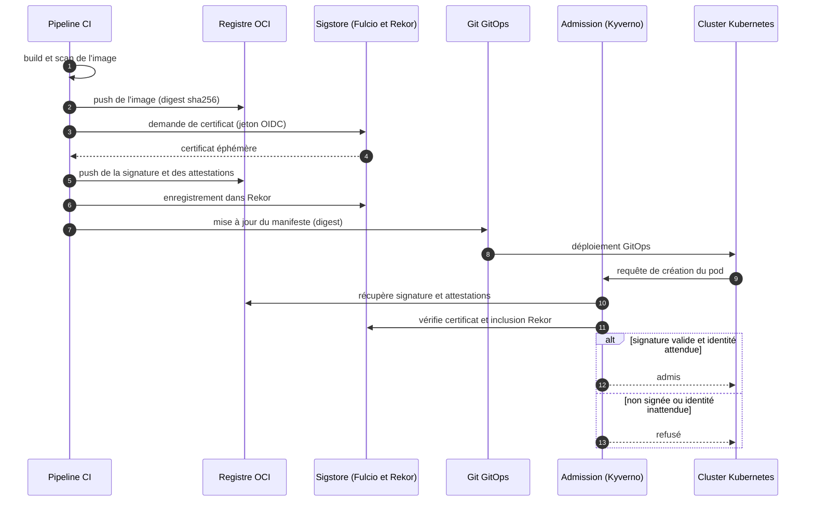

# Signature et provenance

## Pourquoi ce cours ?

Un scan dit **ce que contient** une image ; il ne dit pas **d'où elle vient** ni **si elle a été modifiée** depuis. Un tag de registre (`mon-app:1.4.2`) est un **pointeur modifiable** : un attaquant (ou une erreur) peut le faire pointer vers une autre image. La **signature** prouve que **tel acteur** a produit **tel artefact précis** (identifié par son **digest**), et la **provenance** (attestation) prouve **comment** il a été construit. Ajoutées à un **contrôleur d'admission** qui les vérifie, elles garantissent que **seul ce que votre chaîne a produit tourne dans votre cluster**. Ce cours présente **cosign / Sigstore**, **Notation**, les attestations **in-toto** et la vérification à l'admission. Vous pratiquerez dans l'[atelier 2 (signature avec cosign)](../ateliers-killercoda/atelier-02-signature-image-cosign/intro.md).

> Prérequis : [Sécurité de la chaîne d'approvisionnement](02-supply-chain-security.md), [Docker](../../08-docker-approfondi/README.md) (registres, digests) et [Kubernetes](../../09-kubernetes-approfondi/README.md).

## 1. Pourquoi signer ?

| Problème | Sans signature | Avec signature vérifiée |
|---|---|---|
| **Tag réécrit** | `app:1.4.2` peut pointer vers n'importe quoi | La signature est liée au **digest** : un autre contenu = signature invalide |
| **Registre compromis** | L'attaquant remplace l'image | L'image remplacée **n'est pas signée** (ou pas par la bonne identité) |
| **Image « sauvage »** | Un développeur déploie une image construite sur son poste | L'admission **refuse** : pas signée par la CI |
| **Preuve d'origine** | « Elle vient de la CI, je crois » | Signature **vérifiable** par n'importe qui, avec l'identité du signataire |

> 📌 **À retenir** : on signe le **digest** (`sha256:…`), pas le tag. Un tag signé peut être déplacé ; un digest est le **contenu lui-même**. Les bons usages référencent les images par digest (ou vérifient la signature avant de résoudre le tag).

## 2. Sigstore et cosign

**Sigstore** (projet OpenSSF) est un ensemble de services **publics et gratuits** pour signer et vérifier les logiciels ; **cosign** en est l'outil en ligne de commande pour les **images de conteneur** (et tout artefact OCI).

| Composant | Rôle |
|---|---|
| **cosign** | Signe, vérifie et attache des attestations aux artefacts OCI ; la signature est **stockée dans le registre** à côté de l'image (`sha256-<digest>.sig`) |
| **Fulcio** | **Autorité de certification** : émet un **certificat de très courte durée** (~10 minutes) lié à une **identité OIDC** (compte GitHub Actions, Google, etc.) |
| **Rekor** | **Journal de transparence** public et **infalsifiable** : enregistre chaque signature (preuve horodatée, auditable) |
| **Identité OIDC** | Le fournisseur d'identité (GitHub, GitLab, Google, Microsoft) atteste « ce jeton appartient à tel workflow/compte » |

### Deux modes de signature

| | **Avec clé** (*key-based*) | **Sans clé** (*keyless*) |
|---|---|---|
| Principe | Vous générez une **paire de clés** (`cosign generate-keypair`) et gardez la clé privée | **Aucune clé durable** : une clé **éphémère** est créée, Fulcio la certifie d'après votre identité OIDC, la signature est inscrite dans Rekor, puis la clé est **détruite** |
| Secret à protéger | **La clé privée** (stockage, rotation, KMS/HSM) | **Aucun** ; l'identité est celle du workflow CI |
| Vérification | `cosign verify --key cosign.pub IMAGE` | `cosign verify --certificate-identity … --certificate-oidc-issuer … IMAGE` |
| Idéal pour | Environnements **isolés / hors ligne**, clés dans un KMS | **CI/CD publique ou cloud** : zéro gestion de clé |
| Limites | Rotation, fuite, perte de clé | Dépend des services Sigstore (ou d'une instance **privée** à héberger) ; l'identité doit être bien **contrainte** |

```bash
# --- Avec clé (utilisé dans l'atelier) ---
cosign generate-keypair                              # cosign.key (privée, chiffrée) et cosign.pub
cosign sign --key cosign.key registre.exemple.org/app@sha256:ab12...
cosign verify --key cosign.pub registre.exemple.org/app@sha256:ab12...

# --- Sans clé (dans une CI GitHub Actions, avec permissions id-token: write) ---
cosign sign --yes registre.exemple.org/app@sha256:ab12...
cosign verify registre.exemple.org/app@sha256:ab12... \
  --certificate-identity "https://github.com/exemple/app/.github/workflows/release.yml@refs/heads/main" \
  --certificate-oidc-issuer "https://token.actions.githubusercontent.com"
```

> ⚠️ **Attention** : en mode sans clé, **la vérification est ce qui donne la sécurité** : vérifiez **toujours** `--certificate-identity` (**qui** a signé : tel workflow, telle branche) **et** `--certificate-oidc-issuer` (**quel** fournisseur). Une vérification qui accepte « n'importe quelle identité valide » prouve seulement que **quelqu'un** a signé, pas que c'est **votre CI**.

> 💡 **Conseil** : les clés privées n'ont rien à faire dans le dépôt. Si vous gardez le mode avec clé, utilisez un **KMS** (`cosign sign --key awskms://…`, `gcpkms://`, `hashivault://`) : la clé ne quitte jamais le service, et les droits de signature s'accordent par IAM ([cours IAM AWS](../../14-cloud-aws/cours/02-aws-iam-et-securite.md)).

## 3. Le cycle signer, publier, vérifier, admettre



## 4. Attestations et provenance (in-toto, SLSA)

Une **attestation** est une **déclaration signée** sur un artefact : « *cette image a été construite par ce workflow, depuis ce commit* » (provenance), « *voici sa SBOM* », « *elle a passé ces tests* ». Le format est **in-toto** : un *statement* (sujet = digest, type de prédicat, prédicat) enveloppé et signé (DSSE).

| Type d'attestation | Contenu (prédicat) | Usage |
|---|---|---|
| **Provenance SLSA** | Dépôt source, commit, workflow, builder, paramètres | Prouver **comment** et **où** l'image a été construite (SLSA L2/L3) |
| **SBOM** (`cyclonedx`, `spdx`) | Inventaire des composants | Lier l'inventaire à **cet** artefact précis |
| **Résultat de scan / VEX** | Vulnérabilités connues, exploitabilité | Décider à l'admission selon l'état de sécurité |
| **Tests / revue** | Résultat de tests, approbations | Politiques « n'est déployable que ce qui a passé les tests » |

```bash
# Attacher et vérifier une SBOM comme attestation signée
cosign attest --yes --key cosign.key --type cyclonedx --predicate sbom.cdx.json IMAGE@sha256:ab12...
cosign verify-attestation --key cosign.pub --type cyclonedx IMAGE@sha256:ab12... | jq -r '.payload' | base64 -d | jq '.predicate.metadata'

# Provenance SLSA générée par la plateforme (GitHub) : vérifier avec slsa-verifier
slsa-verifier verify-image IMAGE@sha256:ab12... --source-uri github.com/exemple/app --source-branch main
```

Dans GitHub Actions, le **générateur de provenance réutilisable** (`slsa-framework/slsa-github-generator`) ou les **attestations d'artefact natives** (`actions/attest-build-provenance`) produisent une provenance **non falsifiable par le job de build** (objectif SLSA Build L3).

## 5. Notation et autres outils

| Outil | Description | Particularités |
|---|---|---|
| **cosign** (Sigstore) | Signature d'images et d'artefacts OCI, keyless ou avec clé | Le plus répandu ; écosystème riche (Kyverno, policy-controller) |
| **Notation** (Notary Project, CNCF) | Signature selon la spécification **Notary v2** ; initiée par Microsoft, soutenue par AWS (*AWS Signer*) et Azure | Modèle **PKI classique** (certificats X.509, **magasins de confiance**) ; bien intégré à ACR/ECR |
| **Docker Content Trust / Notary v1** | Ancien système de signature de Docker | **Hérité** : à éviter pour de nouveaux projets |
| **GPG** | Signature de fichiers, de tags Git et de paquets | Pas adapté aux images de conteneur |
| **gitsign** | Signature de **commits Git** avec Sigstore (keyless) | Étend la chaîne à la **source** |

```bash
# Notation : modèle à base de certificats et de magasins de confiance
notation cert add --type ca --store exemple-ca ca.crt
notation sign registre.exemple.org/app@sha256:ab12...
notation verify registre.exemple.org/app@sha256:ab12...
```

## 6. Vérifier à l'admission

Signer **n'a d'effet que si on vérifie**. La vérification se place à **l'entrée du cluster**, via un **contrôleur d'admission** qui **intercepte** la création des pods (voir [cours 4](04-policy-as-code-kubernetes.md)).

| Outil | Principe |
|---|---|
| **Kyverno** (`verifyImages`) | Règle dans une `ClusterPolicy` : vérifie signatures et attestations cosign/Notation, **mute l'image vers son digest** |
| **Sigstore policy-controller** | Contrôleur dédié du projet Sigstore (`ClusterImagePolicy`) |
| **Connaisseur** | Contrôleur d'admission léger centré sur la **vérification de signatures** (cosign, Notary) |
| **Ratify** (avec Gatekeeper) | Cadre de vérification d'artefacts (signatures, SBOM) pour OPA Gatekeeper |
| **Admission cloud** (Binary Authorization GKE, AWS Signer + Kyverno/Ratify) | Intégrations managées |

```yaml
apiVersion: kyverno.io/v1
kind: ClusterPolicy
metadata:
  name: verifier-signature-images
spec:
  validationFailureAction: Enforce
  webhookTimeoutSeconds: 30
  rules:
    - name: signature-cosign
      match:
        any:
          - resources:
              kinds: [Pod]
      verifyImages:
        - imageReferences:
            - "registre.exemple.org/equipe/*"
          mutateDigest: true                     # remplace le tag par le digest vérifié
          verifyDigest: true
          required: true
          attestors:
            - entries:
                - keyless:
                    subject: "https://github.com/exemple/*/.github/workflows/release.yml@refs/heads/main"
                    issuer: "https://token.actions.githubusercontent.com"
                    rekor:
                      url: https://rekor.sigstore.dev
```

> ⚠️ **Attention** : une politique de signature **ne protège que les images qu'elle couvre** (`imageReferences`). Si elle ne vise que `registre.exemple.org/equipe/*`, une image `docker.io/inconnu/malware` **passe**. Combinez-la avec une règle « **seuls les registres autorisés** » et déployez en `Audit` d'abord pour mesurer ce qui serait refusé, avant de passer en `Enforce`.

## 7. Bonnes pratiques

- **Signer dans la CI**, jamais à la main sur un poste ; l'identité de signature = **le workflow de release**.
- **Signer le digest**, publier la signature **et** la SBOM/provenance **comme attestations**.
- **Vérifier à l'admission** ET lors des déploiements GitOps ([Argo CD](../../15-gitops-argocd/README.md) déploie ce qui est dans Git ; l'admission est le dernier verrou).
- **Contraindre l'identité** (dépôt, workflow, branche), pas seulement « signé ».
- **Rotation et révocation** : en mode avec clé, prévoir la rotation ; en keyless, s'appuyer sur la **courte durée** des certificats.
- **Environnements isolés** : héberger une instance **privée** de Sigstore (Fulcio, Rekor) ou utiliser des clés KMS.
- **Journaliser** les refus d'admission et alerter.

## Résumé

- Un **tag n'est pas une identité** : on signe et on vérifie le **digest** ; la signature prouve **qui** a produit **quoi**.
- **Sigstore** : **cosign** (outil), **Fulcio** (certificats éphémères liés à une identité OIDC), **Rekor** (journal de transparence) ; modes **avec clé** (KMS recommandé) ou **keyless** (CI).
- En keyless, **toujours vérifier l'identité et l'émetteur** (`--certificate-identity`, `--certificate-oidc-issuer`).
- **Attestations in-toto** : provenance SLSA, SBOM, résultats de scan, attachées et signées ; vérifiées avec `verify-attestation` ou `slsa-verifier`.
- **Notation** (Notary v2, PKI) est l'alternative à cosign ; Docker Content Trust est hérité.
- La **vérification à l'admission** (Kyverno `verifyImages`, policy-controller, Connaisseur) donne tout son sens à la signature ; couvrir **tous** les registres et commencer en **Audit**.

## Pour aller plus loin

- Sigstore : <https://docs.sigstore.dev/> ; cosign : <https://github.com/sigstore/cosign> ; Notation : <https://notaryproject.dev/> ; in-toto : <https://in-toto.io/>.
- Kyverno `verifyImages` : <https://kyverno.io/docs/writing-policies/verify-images/> ; SLSA GitHub generator : <https://github.com/slsa-framework/slsa-github-generator>.
- Pratique : [Atelier 2 — signature d'une image avec cosign](../ateliers-killercoda/atelier-02-signature-image-cosign/intro.md).
- Cours suivant : [Policy as code pour Kubernetes](04-policy-as-code-kubernetes.md).
