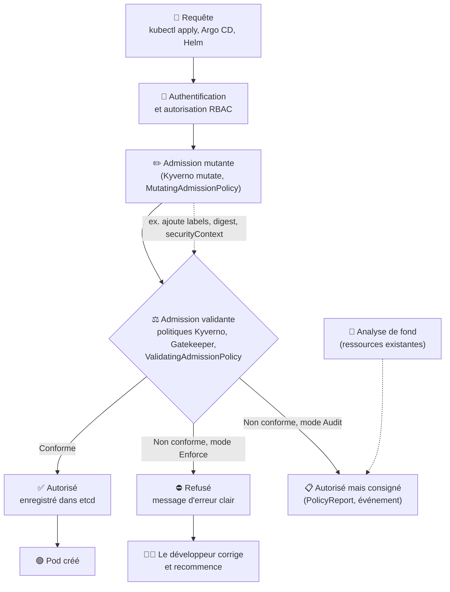

# Policy as code pour Kubernetes

## Pourquoi ce cours ?

Kubernetes accepte **par défaut** presque tout ce qu'un utilisateur autorisé lui envoie : un pod privilégié qui monte le disque du nœud, une image `:latest` impossible à auditer, un conteneur sans limite de mémoire qui peut affamer le nœud. Le RBAC dit **qui** peut créer un pod, pas **à quoi il doit ressembler**. Les **politiques d'admission** comblent ce manque : elles inspectent chaque requête **avant** qu'elle soit enregistrée, et l'**acceptent, la refusent ou la corrigent**. Écrites comme du **code** (versionné, testé, relu), elles deviennent des règles de sécurité **automatiques, uniformes et traçables**. Ce cours compare **Kyverno**, **OPA Gatekeeper** et les **ValidatingAdmissionPolicy** natives, donne les politiques courantes et la façon de les **tester** et de les **déployer sans casser la production**. Vous pratiquerez dans l'[atelier 3 (Kyverno)](../ateliers-killercoda/atelier-03-kyverno-policies/intro.md).

> Prérequis : [Kubernetes](../../09-kubernetes-approfondi/README.md) (RBAC, Pods, API), [Signature et provenance](03-signature-et-provenance.md) et [Introduction au DevSecOps](01-introduction-devsecops.md).

## 1. Les contrôleurs d'admission

Quand on exécute `kubectl apply`, la requête traverse l'**API server** :

```text
Requête → Authentification → Autorisation (RBAC) → Admission (mutante, puis validante) → Enregistrement dans etcd
```

| Phase d'admission | Rôle | Exemples |
|---|---|---|
| **Mutante** (*mutating*) | **Modifie** l'objet avant validation | Ajouter des labels, injecter un *sidecar*, remplacer un tag par un digest, imposer `runAsNonRoot` |
| **Validante** (*validating*) | **Accepte ou refuse** l'objet (sans le modifier) | Refuser `privileged: true`, exiger des limites de ressources |

Les moteurs de politique sont des **webhooks d'admission** (le serveur d'API les appelle) ou des **règles intégrées** (CEL). Ils s'appliquent à **toute création ou modification**, quel que soit le chemin (`kubectl`, Helm, [Argo CD](../../15-gitops-argocd/README.md)).



> 📌 **À retenir** : l'admission ne contrôle **que les requêtes à venir**. Les ressources **déjà présentes** doivent être scannées par une **analyse de fond** (*background scan*, audit Gatekeeper) ; sinon, une politique nouvelle laisse en place les violations existantes.

## 2. Trois approches

| | **Kyverno** | **OPA Gatekeeper** | **ValidatingAdmissionPolicy** |
|---|---|---|---|
| Nature | Moteur **natif Kubernetes** (CRD YAML) | **OPA** adapté à Kubernetes | **Intégré à l'API server** (aucun webhook) |
| Langage | **YAML** (patterns, JMESPath, CEL) | **Rego** (langage de politiques) | **CEL** (*Common Expression Language*) |
| Capacités | Valider, **muter**, **générer** des ressources, **vérifier les signatures** d'images, nettoyer | Valider (mutation limitée), contraintes réutilisables, audit | **Valider** (la mutation arrive avec `MutatingAdmissionPolicy`) |
| Courbe d'apprentissage | **Douce** (on écrit du YAML Kubernetes) | **Raide** (apprendre Rego) | Moyenne (apprendre CEL) |
| Composants à exploiter | Contrôleurs dans le cluster | Contrôleur + audit | **Aucun** |
| Hors Kubernetes | Non (CLI pour CI) | **Oui** (OPA/Conftest pour Terraform, API, CI…) | Non |
| Maturité | CNCF (incubation → diplômé) | CNCF (OPA diplômé) | **GA en Kubernetes 1.30** |

**Quand choisir quoi ?**

| Situation | Choix |
|---|---|
| Plateforme Kubernetes, équipes sans expertise Rego, besoin de **muter, générer, vérifier des signatures** | **Kyverno** |
| Organisation déjà investie dans **OPA/Rego** pour d'autres usages (API, Terraform) | **Gatekeeper** (+ Conftest en CI) |
| Règles **simples** de validation, **aucune dépendance** à installer | **ValidatingAdmissionPolicy** |
| Plateforme mature | **Combinaison** : VAP pour le socle, Kyverno pour muter, signer et générer |

## 3. Kyverno : une politique concrète

Une **`ClusterPolicy`** (toutes les namespaces) ou **`Policy`** (un namespace) contient des **règles** : `match` (quelles ressources), éventuellement `exclude`, et **un** type d'action : `validate`, `mutate`, `generate` ou `verifyImages`.

```yaml
apiVersion: kyverno.io/v1
kind: ClusterPolicy
metadata:
  name: interdire-latest
  annotations:
    policies.kyverno.io/title: Interdire le tag latest
    policies.kyverno.io/severity: medium
spec:
  validationFailureAction: Enforce        # Audit pour observer sans bloquer
  background: true                        # contrôle aussi les ressources existantes
  rules:
    - name: tag-obligatoire
      match:
        any:
          - resources:
              kinds: [Pod]
      validate:
        message: "Une image sans tag est interdite : indiquez un tag précis."
        pattern:
          spec:
            containers:
              - image: "*:*"
    - name: pas-de-latest
      match:
        any:
          - resources:
              kinds: [Pod]
      validate:
        message: "Le tag ':latest' est interdit : utilisez une version précise ou un digest."
        pattern:
          spec:
            containers:
              - image: "!*:latest"
```

### Mutation et génération

```yaml
# Mutation : ajouter un contexte de sécurité par défaut (ne s'applique que si absent)
rules:
  - name: non-root-par-defaut
    match: { any: [{ resources: { kinds: [Pod] } }] }
    mutate:
      patchStrategicMerge:
        spec:
          securityContext:
            +(runAsNonRoot): true               # le + signifie « ajouter seulement si absent »
---
# Génération : créer un NetworkPolicy « deny all » dans chaque nouveau namespace
rules:
  - name: reseau-ferme
    match: { any: [{ resources: { kinds: [Namespace] } }] }
    generate:
      apiVersion: networking.k8s.io/v1
      kind: NetworkPolicy
      name: deny-all
      namespace: "{{request.object.metadata.name}}"
      synchronize: true
      data:
        spec:
          podSelector: {}
          policyTypes: [Ingress, Egress]
```

## 4. Gatekeeper : modèles et contraintes

Gatekeeper sépare le **modèle** (la logique Rego, réutilisable) de la **contrainte** (son instanciation avec des paramètres).

```yaml
apiVersion: templates.gatekeeper.sh/v1
kind: ConstraintTemplate
metadata:
  name: k8srequiredlabels
spec:
  crd:
    spec:
      names: { kind: K8sRequiredLabels }
      validation:
        openAPIV3Schema:
          type: object
          properties:
            labels: { type: array, items: { type: string } }
  targets:
    - target: admission.k8s.gatekeeper.sh
      rego: |
        package k8srequiredlabels
        violation[{"msg": msg}] {
          requis := {l | l := input.parameters.labels[_]}
          presents := {l | input.review.object.metadata.labels[l]}
          manquants := requis - presents
          count(manquants) > 0
          msg := sprintf("Labels obligatoires manquants : %v", [manquants])
        }
---
apiVersion: constraints.gatekeeper.sh/v1beta1
kind: K8sRequiredLabels
metadata:
  name: labels-equipe-obligatoires
spec:
  enforcementAction: deny                 # ou warn, dryrun
  match:
    kinds:
      - apiGroups: ["apps"]
        kinds: ["Deployment"]
  parameters:
    labels: ["equipe", "environnement"]
```

## 5. ValidatingAdmissionPolicy : le natif

Depuis **Kubernetes 1.30 (GA)**, on peut écrire des règles **CEL** exécutées directement par l'API server, **sans installer de webhook** :

```yaml
apiVersion: admissionregistration.k8s.io/v1
kind: ValidatingAdmissionPolicy
metadata:
  name: limites-obligatoires
spec:
  failurePolicy: Fail
  matchConstraints:
    resourceRules:
      - apiGroups: [""]
        apiVersions: ["v1"]
        operations: ["CREATE", "UPDATE"]
        resources: ["pods"]
  validations:
    - expression: "object.spec.containers.all(c, has(c.resources.limits) && 'memory' in c.resources.limits)"
      message: "Chaque conteneur doit déclarer une limite de mémoire."
---
apiVersion: admissionregistration.k8s.io/v1
kind: ValidatingAdmissionPolicyBinding
metadata:
  name: limites-obligatoires-prod
spec:
  policyName: limites-obligatoires
  validationActions: [Deny]               # ou [Warn], [Audit]
  matchResources:
    namespaceSelector:
      matchLabels: { environnement: prod }
```

> 💡 **Conseil** : la VAP est excellente pour les **règles simples et critiques** (aucune dépendance, aucune panne de webhook possible). Pour muter, générer ou vérifier des signatures, il faut un moteur complet (Kyverno).

## 6. Les politiques courantes

| Politique | Pourquoi | Détail |
|---|---|---|
| **Pas de `:latest`** (tag précis ou digest) | Reproductibilité, audit, retour arrière | Refuser les images sans tag ou avec `:latest` |
| **Pas de conteneur privilégié** | Un conteneur `privileged` a presque les droits de l'hôte | Refuser `privileged: true`, `hostPID`, `hostNetwork`, `hostPath` |
| **Utilisateur non-root** | Limiter les dégâts d'une compromission | `runAsNonRoot: true`, `allowPrivilegeEscalation: false`, `capabilities.drop: [ALL]` |
| **Requests et limits obligatoires** | Éviter qu'un pod affame le nœud | `resources.requests` et `limits` sur chaque conteneur |
| **Labels obligatoires** | Propriété, coûts, observabilité | `equipe`, `environnement`, `application` |
| **Registres autorisés** | Éviter les images inconnues | Images uniquement depuis `registre.exemple.org/*` |
| **Images signées** | Origine vérifiée | `verifyImages` ([cours 3](03-signature-et-provenance.md)) |
| **Sondes de santé** | Disponibilité | `readinessProbe` / `livenessProbe` requises |
| **Pas de `NodePort` / `LoadBalancer` sauvages** | Exposition accidentelle | Limiter les types de Service |
| **NetworkPolicy par défaut** | Réseau « zéro confiance » | Générer un `deny-all` par namespace |
| **Pod Security Standards** | Socle de durcissement | Étiquettes `pod-security.kubernetes.io/*` ([cours 6](06-hardening-et-cis-benchmarks.md)) |

Les bibliothèques de politiques prêtes à l'emploi existent : **kyverno.io/policies**, **gatekeeper-library**.

## 7. Tester les politiques

Une politique non testée est un risque : trop laxiste (fausse sécurité) ou trop stricte (production bloquée).

| Niveau | Outil | Principe |
|---|---|---|
| **Unitaire** | `kyverno test` | Fichier `kyverno-test.yaml` : ressources attendues **passes / fails** pour chaque règle |
| **Hors cluster** | `kyverno apply policy.yaml --resource pod.yaml` ; `gator test` (Gatekeeper) ; `conftest test` (Rego) | Évaluer des manifestes **dans la CI**, avant même le cluster |
| **Serveur** | `kubectl apply --dry-run=server` | Passe par le **vrai webhook** sans rien créer |
| **Intégration** | Cluster éphémère (kind) en CI | Déployer politiques + ressources de test |

```yaml
# kyverno-test.yaml (extrait)
apiVersion: cli.kyverno.io/v1alpha1
kind: Test
metadata: { name: interdire-latest }
policies: [interdire-latest.yaml]
resources: [pod-ok.yaml, pod-latest.yaml]
results:
  - { policy: interdire-latest, rule: pas-de-latest, resources: [pod-ok], kind: Pod, result: pass }
  - { policy: interdire-latest, rule: pas-de-latest, resources: [pod-latest], kind: Pod, result: fail }
```

```bash
kyverno test .                                       # exécute les tests de politique
kubectl apply -f deploiement.yaml --dry-run=server   # teste contre le cluster réel
```

> ⚠️ **Attention** : une politique d'admission est un **point de défaillance**. Si le webhook est **indisponible** et que `failurePolicy: Fail`, **plus rien ne peut être créé** (pas même le redéploiement du webhook !). Excluez les namespaces système (`kube-system`, le namespace du moteur lui-même), prévoyez **plusieurs réplicas**, surveillez la disponibilité, et gardez une **procédure d'urgence** (supprimer la `ValidatingWebhookConfiguration`).

## 8. Audit ou Enforce : déployer sans casser

| Mode | Effet | Quand |
|---|---|---|
| **`Audit`** (Kyverno) / **`dryrun`** ou **`warn`** (Gatekeeper) / **`Audit`, `Warn`** (VAP) | **Autorise** mais **consigne** (PolicyReport, événements, avertissement `kubectl`) | **Toujours en premier** : mesurer l'impact |
| **`Enforce`** / **`deny`** / **`Deny`** | **Refuse** la requête | Après correction des violations connues |

Démarche recommandée :

1. Écrire la politique, la **tester** (`kyverno test`).
2. La déployer en **Audit** ; lire les rapports (`kubectl get policyreport -A`) ; **corriger** les ressources ou **affiner** (exclusions justifiées).
3. Informer les équipes (date de bascule, documentation d'erreurs claires).
4. Passer en **Enforce**, d'abord sur les **namespaces de développement**, puis la production.
5. Versionner les politiques dans Git et les déployer par [GitOps](../../15-gitops-argocd/README.md) ; revoir les exceptions régulièrement.

Messages d'erreur : écrivez-les **pour le développeur** (« Le tag `:latest` est interdit : utilisez une version précise, voir <lien> »), pas pour l'administrateur.

## Résumé

- L'**admission** (mutante puis validante) contrôle **ce qui entre** dans le cluster ; le RBAC dit **qui**, la politique dit **quoi**.
- **Kyverno** (YAML, valider / muter / générer / vérifier les signatures), **Gatekeeper** (Rego, modèles + contraintes), **ValidatingAdmissionPolicy** (CEL, natif, GA en 1.30) : choisir selon compétences et besoins, ou **combiner**.
- Politiques usuelles : **pas de `:latest`**, **pas de privilégié**, **non-root**, **ressources**, **labels**, **registres autorisés**, **images signées**, **NetworkPolicy**.
- **Tester** (`kyverno test`, `gator`, `conftest`, `--dry-run=server`) avant de déployer ; analyse de **fond** pour l'existant.
- Déploiement progressif : **Audit → corriger → Enforce** ; messages clairs ; **exclure les namespaces système** et surveiller la disponibilité des webhooks.
- Versionner les politiques et les livrer par **GitOps**.

## Pour aller plus loin

- Kyverno : <https://kyverno.io/docs/> et <https://kyverno.io/policies/> ; Gatekeeper : <https://open-policy-agent.github.io/gatekeeper/> et sa bibliothèque ; VAP : <https://kubernetes.io/docs/reference/access-authn-authz/validating-admission-policy/>.
- Outils : `kyverno` (CLI), `gator`, `conftest`, `kubeconform`, `polaris`.
- Pratique : [Atelier 3 — politiques Kyverno](../ateliers-killercoda/atelier-03-kyverno-policies/intro.md).
- Cours suivant : [Gestion des secrets](05-secrets-management.md).
