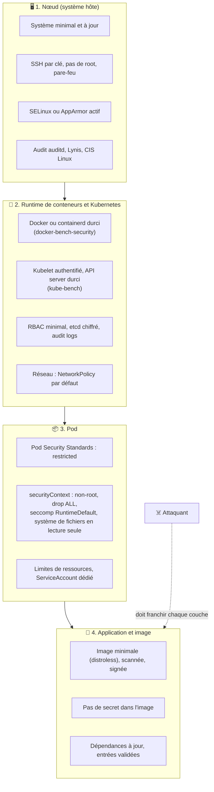

# Durcissement et CIS Benchmarks

## Pourquoi ce cours ?

Une installation « par défaut » privilégie la **facilité** : services ouverts, droits larges, options de compatibilité héritées. C'est la **surface d'attaque** que visent les intrusions : un nœud Linux avec SSH par mot de passe, un démon Docker exposé, un kubelet sans authentification, un pod qui tourne en root avec tous les droits. Le **durcissement** (*hardening*) consiste à **réduire cette surface** : désactiver ce qui est inutile, restreindre ce qui est nécessaire, et **vérifier** en continu. Les **CIS Benchmarks** donnent des **référentiels précis, consensuels et mesurables** (des centaines de recommandations vérifiables), et des outils (**kube-bench**, **docker-bench-security**, **Lynis**, **OpenSCAP**) les **auditent automatiquement**. Ce cours suit les **couches** : nœud, runtime de conteneurs, pod, application.

> Prérequis : [Linux expert](../../04-linux-expert/README.md) (SELinux, namespaces, cgroups), [Docker](../../08-docker-approfondi/README.md), [Kubernetes](../../09-kubernetes-approfondi/README.md) et [Policy as code](04-policy-as-code-kubernetes.md).

## 1. Le principe de défense en profondeur

Un seul contrôle n'est jamais suffisant : on **empile** des barrières indépendantes, de sorte que la défaillance de l'une ne livre pas tout.



## 2. Les CIS Benchmarks

Le **Center for Internet Security (CIS)** publie des **guides de configuration sécurisée**, gratuits (PDF), élaborés par des communautés d'experts. Chaque recommandation a un **identifiant**, une **description**, un **audit** (comment vérifier), une **remédiation** et un **profil**.

| Benchmark | Cible | Exemples de contrôles |
|---|---|---|
| **CIS Linux** (Rocky Linux / RHEL 9, Ubuntu, Debian…) | Le **nœud** | Partitions (`/tmp` `nodev,nosuid`), SSH sans root ni mot de passe, `auditd`, SELinux enforcing, mises à jour |
| **CIS Docker** | Le **démon et les conteneurs** | Pas d'API TCP non protégée, `userns-remap`, journalisation, conteneurs non privilégiés |
| **CIS Kubernetes** | **Plan de contrôle et nœuds** | API server (anonymous-auth désactivé), etcd chiffré et authentifié, kubelet authentifié, RBAC, audit, Pod Security |
| **CIS cloud** (AWS, GCP, Azure) | Le **compte cloud** | MFA, journalisation, chiffrement des disques, groupes de sécurité ([module Cloud AWS](../../14-cloud-aws/README.md)) |

| Profil | Signification |
|---|---|
| **Niveau 1** | Recommandations **de base**, **peu d'impact** sur l'usage : à appliquer partout |
| **Niveau 2** | Pour environnements à **sécurité renforcée** ; peut réduire la fonctionnalité ou la performance |
| **STIG** (DISA) | Référentiel du département de la Défense américain, souvent complémentaire |

> 📌 **À retenir** : un benchmark n'est **pas un dogme**. Chaque contrôle doit être **compris** puis **appliqué, adapté ou écarté avec justification** (un contrôle non applicable à votre contexte est une **exception documentée**, pas une erreur). L'objectif est un **niveau mesuré et suivi dans le temps**, pas un score de 100 %.

## 3. Les outils d'audit

| Outil | Cible | Utilisation |
|---|---|---|
| **kube-bench** (Aqua) | Kubernetes (benchmark CIS) | S'exécute comme `Job` sur un nœud ; produit `PASS`/`FAIL`/`WARN` avec la **remédiation** |
| **docker-bench-security** | Docker (benchmark CIS) | Script shell sur l'hôte Docker |
| **Lynis** | Linux/Unix (général) | Audit de l'hôte, **indice de durcissement**, suggestions |
| **OpenSCAP** (`oscap`) + SCAP Security Guide | Linux (CIS, STIG, PCI-DSS) | **Audit et remédiation** automatisés (profils prêts, scripts Ansible générés) |
| **kubescape** | Kubernetes (NSA, MITRE, CIS) | Scan des clusters **et** des manifestes (en CI) |
| **Trivy** (`trivy k8s`, `config`) | Cluster, IaC, manifestes | Mauvaises configurations + vulnérabilités |
| **Falco** | Runtime Linux/Kubernetes | **Détection de comportements** suspects (shell dans un conteneur, accès à `/etc/shadow`) |
| **Ansible / Puppet / Chef** | Application du durcissement | Rôles prêts à l'emploi (`ansible-lockdown`, DevSec Hardening Framework) |

```bash
# Hôte Linux : indice de durcissement et recommandations
sudo lynis audit system
# Hôte Docker : benchmark CIS Docker
git clone https://github.com/docker/docker-bench-security.git && cd docker-bench-security && sudo ./docker-bench-security.sh
# Kubernetes : benchmark CIS exécuté en Job sur un nœud
kubectl apply -f https://raw.githubusercontent.com/aquasecurity/kube-bench/main/job.yaml
kubectl logs job/kube-bench | grep -E "^\[(FAIL|WARN)\]" | head -n 20
# Scan OpenSCAP d'un hôte RHEL/Rocky 9 avec le profil CIS niveau 1 (paquets openscap-scanner, scap-security-guide)
sudo oscap xccdf eval --profile xccdf_org.ssgproject.content_profile_cis_server_l1 \
  --report rapport.html /usr/share/xml/scap/ssg/content/ssg-rl9-ds.xml
```

> ⚠️ **Attention** : **appliquez le durcissement automatisé sur un environnement de test d'abord**. Certaines remédiations (désactiver des services, restreindre les montages, activer des politiques strictes) **cassent des applications** légitimes. Gardez une **console de secours** hors SSH avant de modifier la configuration SSH ou le pare-feu d'une machine distante.

## 4. Durcir le nœud Linux

| Domaine | Mesures |
|---|---|
| **Système** | Installation **minimale**, paquets inutiles retirés, **mises à jour de sécurité automatiques**, noyau à jour (`dnf-automatic`, `unattended-upgrades`) |
| **Accès** | **SSH par clé uniquement** (`PasswordAuthentication no`, `PermitRootLogin no`), `AllowGroups`, MFA/bastion, `sudo` journalisé ([module Linux](../../04-linux-expert/README.md)) |
| **Réseau** | Pare-feu **deny par défaut** (`firewalld`, nftables) ; ne laisser ouverts que les ports nécessaires ; désactiver IPv6 inutile |
| **Contrôle d'accès obligatoire** | **SELinux en `enforcing`** (Rocky/RHEL) ou **AppArmor** (Ubuntu/Debian) |
| **Noyau** | `sysctl` durcis (`kernel.kptr_restrict`, `net.ipv4.conf.all.rp_filter`, `kernel.unprivileged_userns_clone` selon besoin), modules inutiles blacklistés |
| **Journalisation** | `auditd` (règles sur `/etc/passwd`, `sudo`, appels sensibles), envoi des journaux **hors de la machine** |
| **Système de fichiers** | `/tmp`, `/var/tmp` en `nodev,nosuid,noexec`, droits de `/etc` ; **disques chiffrés** (LUKS) |
| **Intégrité** | AIDE / `rpm -V`, démarrage sécurisé (Secure Boot) |

### SELinux, AppArmor et seccomp

| Mécanisme | Principe | Dans les conteneurs |
|---|---|---|
| **SELinux** | Contrôle d'accès **obligatoire** par étiquettes (`container_t`) : un conteneur compromis ne peut pas lire les fichiers de l'hôte même en root | Activé avec Podman/containerd sur Rocky/RHEL ; **ne pas désactiver** (`setenforce 0`) pour « faire marcher » : corriger l'étiquette (`:Z`) |
| **AppArmor** | Profils **par programme** (chemins autorisés) | Profil `docker-default` ; profils personnalisés |
| **seccomp** | **Filtre des appels système** autorisés | Profil **`RuntimeDefault`** (bloque ~44 appels dangereux) ou profil personnalisé |
| **Capabilities Linux** | Divise les droits de root | `drop: [ALL]` puis ajouter le strict nécessaire |
| **User namespaces** | `root` du conteneur = utilisateur sans privilège de l'hôte | `userns-remap` (Docker), pods avec `hostUsers: false` |

> 💡 **Conseil** : si SELinux bloque quelque chose, **ne le désactivez pas** : lisez le refus (`ausearch -m avc -ts recent`, `sealert`) et corrigez l'étiquette ou la politique (voir le [cours Linux](../../04-linux-expert/README.md)). Désactiver SELinux supprime une couche de défense que vous n'avez pas à abandonner.

## 5. Durcir le runtime et Kubernetes

| Composant | Mesures essentielles |
|---|---|
| **Docker / containerd** | Pas d'API **TCP** non authentifiée ; socket Docker **jamais** monté dans un conteneur ; `userns-remap` ; journalisation configurée ; images signées |
| **API server** | `--anonymous-auth=false`, autorisation `Node,RBAC`, **journal d'audit** activé, TLS, admission (Pod Security, **politiques** : [cours 4](04-policy-as-code-kubernetes.md)) |
| **etcd** | Authentification client par certificat, accès restreint, **chiffrement des `Secret` au repos** |
| **Kubelet** | `--anonymous-auth=false`, `--authorization-mode=Webhook`, `--read-only-port=0`, `protectKernelDefaults` |
| **RBAC** | Pas de `cluster-admin` pour les applications ; pas de jokers (`*`) ; revues périodiques |
| **ServiceAccounts** | Un compte **par application**, `automountServiceAccountToken: false` si l'API n'est pas utilisée |
| **Réseau** | **NetworkPolicy** par défaut `deny-all` + autorisations explicites ; CNI qui les applique |
| **Cloud managé** (EKS, GKE, AKS) | Le **plan de contrôle** est durci par le fournisseur (**responsabilité partagée** : [cours 1 AWS](../../14-cloud-aws/cours/01-fondamentaux-cloud.md)) ; **vous** durcissez nœuds, RBAC, réseau, charges |

## 6. Pod Security Standards (PSS)

Les **Pod Security Standards** définissent **trois profils** cumulatifs, appliqués par le contrôleur d'admission **Pod Security Admission** (intégré à Kubernetes, remplaçant des anciennes `PodSecurityPolicy`, supprimées en 1.25).

| Profil | Intention | Interdit notamment |
|---|---|---|
| **`privileged`** | **Aucune restriction** (charges système de confiance : CNI, stockage) | — |
| **`baseline`** | Empêche les **escalades de privilèges connues**, compatible avec la plupart des applications | `privileged: true`, `hostNetwork/hostPID/hostIPC`, `hostPath`, capabilities dangereuses, ports hôte |
| **`restricted`** | **Bonnes pratiques actuelles** de durcissement, quitte à adapter l'application | Tout `baseline` + **obligation** de `runAsNonRoot`, `allowPrivilegeEscalation: false`, `capabilities.drop: [ALL]`, seccomp `RuntimeDefault` ou `Localhost` |

Application **par namespace**, avec trois modes indépendants :

| Mode | Effet |
|---|---|
| `enforce` | **Refuse** les pods non conformes |
| `audit` | **Consigne** la violation dans le journal d'audit |
| `warn` | **Avertit** l'utilisateur (`kubectl`) |

```bash
kubectl label namespace boutique \
  pod-security.kubernetes.io/enforce=baseline \
  pod-security.kubernetes.io/warn=restricted \
  pod-security.kubernetes.io/audit=restricted
kubectl label namespace boutique --dry-run=server --overwrite pod-security.kubernetes.io/enforce=restricted   # impact ?
```

Un pod **conforme `restricted`** :

```yaml
apiVersion: v1
kind: Pod
metadata:
  name: web-durci
spec:
  automountServiceAccountToken: false
  securityContext:
    runAsNonRoot: true
    runAsUser: 10001
    seccompProfile: { type: RuntimeDefault }
  containers:
    - name: web
      image: registre.exemple.org/boutique/web:1.4.2@sha256:ab12...   # exemple : digest à remplacer
      securityContext:
        allowPrivilegeEscalation: false
        readOnlyRootFilesystem: true
        capabilities: { drop: ["ALL"] }
      resources:
        requests: { cpu: 100m, memory: 128Mi }
        limits: { memory: 256Mi }
      volumeMounts:
        - { name: tmp, mountPath: /tmp }                # espace inscriptible nécessaire
  volumes:
    - { name: tmp, emptyDir: {} }
```

> ⚠️ **Attention** : le profil `restricted` **casse** les images qui tournent en root ou écoutent sur un port < 1024 sans capacité. Migrez progressivement : **`warn` et `audit` d'abord**, corrigez les images (`USER 10001`, port 8080), puis **`enforce`**. Les PSS sont un **socle** : pour des règles plus fines (registres, labels, ressources), ajoutez Kyverno ou Gatekeeper.

## 7. Durcir l'application et l'image

- **Image minimale** : `distroless`, `alpine` ou images **Chainguard** : peu de paquets = peu de vulnérabilités, pas de shell pour l'attaquant ([cours 2](02-supply-chain-security.md)).
- **Utilisateur non-root** (`USER 10001`), système de fichiers **en lecture seule**, **aucun secret** dans l'image.
- **Construction en plusieurs étapes** (*multi-stage*) : outils de build absents de l'image finale.
- **Entrées validées**, dépendances à jour, en-têtes de sécurité HTTP, journaux sans données sensibles.
- **Détection au runtime** : **Falco** (règles « shell dans un conteneur », écriture dans `/etc`), alertes vers l'astreinte ([module SRE](../../11-sre-pratiques/README.md)).

## 8. Un cycle continu

Le durcissement n'est **pas un projet ponctuel** mais une boucle :

1. **Définir** la référence (CIS niveau 1, adaptations documentées).
2. **Appliquer** par le code (Ansible, images dorées Packer, Terraform, politiques).
3. **Mesurer** (kube-bench, Lynis, OpenSCAP, kubescape) **régulièrement** et en **CI**.
4. **Corriger ou justifier** chaque écart ; suivre les **exceptions**.
5. **Surveiller** les dérives (un nœud modifié à la main) et recommencer.

## Résumé

- **Défense en profondeur** : nœud → runtime/Kubernetes → pod → application ; chaque couche limite les dégâts de la précédente défaillante.
- **CIS Benchmarks** (Linux, Docker, Kubernetes, cloud) : référentiels **mesurables** ; **niveau 1** partout, **niveau 2** selon le risque ; exceptions **justifiées**.
- Outils : **kube-bench**, **docker-bench-security**, **Lynis**, **OpenSCAP**, **kubescape**, **Trivy**, **Falco** ; durcissement **testé** avant production.
- Nœud : SSH par clé, pare-feu, **SELinux/AppArmor actifs**, `auditd`, mises à jour ; **seccomp `RuntimeDefault`**, capabilities **drop ALL**, user namespaces.
- Kubernetes : API/kubelet/etcd durcis, **RBAC minimal**, **NetworkPolicy** par défaut, **etcd chiffré**.
- **Pod Security Standards** : `privileged` / `baseline` / `restricted` appliqués par namespace en `enforce`, `audit`, `warn` ; migrer par `warn` puis `enforce`.
- Le durcissement est une **boucle continue** : définir, appliquer par le code, mesurer, corriger, surveiller.

## Pour aller plus loin

- CIS Benchmarks : <https://www.cisecurity.org/cis-benchmarks> ; kube-bench : <https://github.com/aquasecurity/kube-bench> ; Pod Security Standards : <https://kubernetes.io/docs/concepts/security/pod-security-standards/>.
- Lynis : <https://cisofy.com/lynis/> ; OpenSCAP : <https://www.open-scap.org/> ; Falco : <https://falco.org/> ; *Kubernetes Hardening Guide* (NSA/CISA).
- Retour au [sommaire du module 16](../README.md), puis le module [Monitoring et observabilité](../../10-monitoring-observabilite/README.md) pour observer et détecter ce que vous avez durci.
