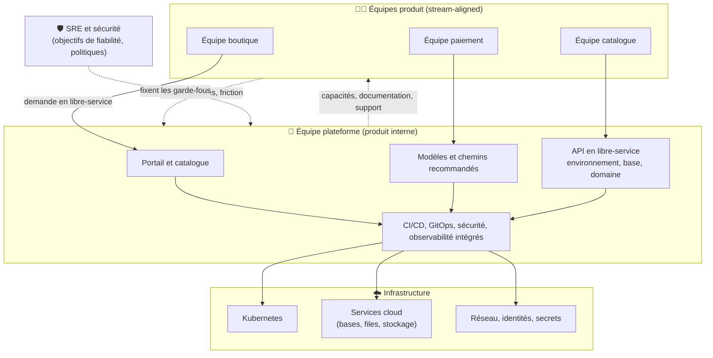

# Introduction au Platform Engineering

## Pourquoi ce cours ?

Vous avez appris, module après module, à conteneuriser, orchestrer, livrer, provisionner, sécuriser. Chaque compétence est utile, mais **leur somme devient écrasante** : pour mettre un service en production, un développeur doit aujourd'hui maîtriser Docker, Kubernetes, un pipeline de CI, Terraform, le GitOps, les politiques de sécurité, les secrets, l'observabilité… C'est la **charge cognitive** qui explose, et avec elle le délai de livraison, les incohérences entre équipes et la fatigue. Le **Platform Engineering** répond à cette dérive : une équipe construit et opère une **plateforme interne** qui offre aux développeurs des **capacités en libre-service**, avec les bonnes pratiques **déjà intégrées**. Ce cours définit la discipline, la distingue de DevOps et du SRE, et pose le principe central : **la plateforme est un produit**, dont les développeurs sont les clients.

> Prérequis : [Kubernetes](../../09-kubernetes-approfondi/README.md), [CI/CD](../../12-cicd/README.md), [GitOps](../../15-gitops-argocd/README.md) et [DevSecOps](../../16-devsecops/README.md). Ce module s'adresse à des profils **DevOps confirmés** qui évoluent vers la conception de plateformes.

## 1. Définition

> Le **Platform Engineering** est la discipline qui **conçoit, construit et exploite des plateformes internes** (*Internal Developer Platforms*, IDP) qui **réduisent la charge cognitive** des équipes de développement en leur fournissant des **services en libre-service**, **cohérents, sûrs et documentés**.

Trois mots clés : **interne** (les clients sont les équipes de l'entreprise), **libre-service** (pas de ticket ni d'attente), **abstraction choisie** (cacher la complexité inutile, pas toute la complexité).

| Sans plateforme | Avec plateforme |
|---|---|
| Chaque équipe assemble **sa** chaîne (CI, déploiement, monitoring) | Une chaîne **commune**, personnalisable à la marge |
| Un ticket à l'équipe infra pour une base de données (3 jours) | Une **demande en libre-service** (quelques minutes) |
| Dix façons de faire du déploiement | **Un chemin recommandé** |
| La sécurité est une revue manuelle en fin de projet | La sécurité est **intégrée** dans les modèles et les garde-fous |
| Les nouveaux arrivants mettent des semaines à livrer | Un premier déploiement **le premier jour** |

> 📌 **À retenir** : le but n'est **pas** de cacher Kubernetes aux développeurs ni de leur retirer le contrôle, c'est de leur offrir un **chemin simple et sûr pour le cas courant**, tout en laissant la porte ouverte aux cas particuliers.

## 2. DevOps, SRE et Platform Engineering

Ces trois approches ne s'opposent pas : elles **se complètent**, à des niveaux différents.

| | **DevOps** | **SRE** | **Platform Engineering** |
|---|---|---|---|
| **Nature** | **Culture** et pratiques (« you build it, you run it ») | **Discipline d'ingénierie** de la fiabilité | **Discipline produit** : construire des plateformes internes |
| **Question centrale** | Comment livrer plus vite en travaillant ensemble ? | Comment garantir un niveau de fiabilité mesuré ? | Comment rendre les équipes **autonomes sans qu'elles soient submergées** ? |
| **Moyens** | Automatisation, CI/CD, collaboration | SLO, budget d'erreur, astreinte, réduction du *toil* ([module SRE](../../11-sre-pratiques/README.md)) | **Plateforme**, portail, modèles, API en libre-service |
| **Clients** | Le produit et ses utilisateurs | Les utilisateurs du service | **Les développeurs** de l'entreprise |
| **Piège** | Devenir une équipe « DevOps » qui reprend le rôle de l'exploitation | Devenir une équipe d'astreinte sans levier | Construire une plateforme **que personne n'utilise** |

Le **DevOps** a dit *« les développeurs doivent posséder la production »*. Mais l'application littérale (« chacun gère toute sa chaîne ») épuise les équipes. Le **Platform Engineering** est la **suite logique** : **industrialiser** les pratiques DevOps dans un produit réutilisable. Le **SRE** fournit les objectifs de fiabilité de cette plateforme et les pratiques d'exploitation (incidents, SLO) pour la faire fonctionner.

## 3. Pourquoi les entreprises créent des plateformes

| Facteur | Effet |
|---|---|
| **Complexité du cloud native** | Des dizaines d'outils (Kubernetes, service mesh, CI, secrets, observabilité) : personne ne peut tout maîtriser |
| **Charge cognitive** | Les développeurs passent plus de temps à comprendre l'outillage qu'à écrire de la valeur |
| **Dérive et duplication** | Chaque équipe réinvente sa pipeline, ses scripts, ses conventions |
| **Exigences de sécurité et conformité** | Impossible à imposer par des revues manuelles sur des centaines de services |
| **Embauche et intégration** | Un environnement uniforme réduit le temps avant la première livraison |
| **Coûts du cloud** | Une plateforme impose des tailles, des étiquettes, des extinctions ([FinOps](../../14-cloud-aws/cours/06-aws-couts-finops-intro.md)) |

Les rapports de la communauté (par exemple les enquêtes **DORA** et le **CNCF Platforms White Paper**) associent la présence d'une plateforme interne bien conçue à de meilleures **performances de livraison** et à une meilleure **expérience développeur**, avec une **condition forte** : que la plateforme soit **bien conçue et réellement adoptée**.

## 4. Projet ou produit ?

C'est **la** distinction qui sépare les plateformes qui réussissent de celles qui échouent.

| | **Plateforme comme projet** | **Plateforme comme produit** |
|---|---|---|
| **Objectif** | Livrer un périmètre à une date | **Créer de la valeur durable** pour des utilisateurs |
| **Vision** | « Voici l'outillage choisi par l'architecture » | « Voici **le problème** des développeurs que nous résolvons » |
| **Utilisateurs** | **Imposés** (« vous devez l'utiliser ») | **Clients** qui doivent **vouloir** l'utiliser |
| **Pilotage** | Livrables, planning | **Retours utilisateurs**, métriques d'adoption, feuille de route |
| **Équipe** | Dissoute après livraison | **Pérenne** : un *product manager*, de l'exploitation, du support |
| **Documentation et support** | Après coup | Fait **partie** du produit |
| **Fin de vie** | Oubliée | **Retrait planifié** des fonctions peu utilisées |

> ⚠️ **Attention** : la tentation est de **construire d'abord** (« un portail ! un opérateur ! »), puis de chercher des utilisateurs. Une plateforme **imposée par la hiérarchie** mais détestée par les développeurs finit **contournée** (« shadow IT », équipes qui reconstruisent leur propre chaîne). **Commencez par les points de friction réels** (entretiens, observation, enquêtes), et ne construisez que ce qui les réduit.

Les pratiques d'un produit s'appliquent : **découverte** (entretiens), **hypothèses**, **version minimale** (MVP) testée avec une équipe pilote, **feuille de route**, **recueil de retours**, **communication des nouveautés**, **mesure d'impact**.

## 5. Mesurer le succès

Ce qui n'est pas mesuré ne s'améliore pas, et ce qui est mal mesuré dévie. Trois familles de métriques :

| Famille | Exemples | Ce que cela révèle |
|---|---|---|
| **Adoption** | % d'équipes / de services sur la plateforme ; utilisation **volontaire** des modèles ; nombre de demandes en libre-service | Les développeurs **choisissent-ils** la plateforme ? |
| **Efficacité de livraison** (métriques **DORA**) | **Délai de livraison** (*lead time for changes*), fréquence de déploiement, taux d'échec des changements, **temps de rétablissement** | La plateforme **accélère-t-elle** et **fiabilise-t-elle** ? |
| **Expérience développeur** | **Temps jusqu'au premier déploiement** d'un nouveau service ou d'un nouvel arrivant ; satisfaction (NPS, enquête trimestrielle) ; **temps passé à attendre** ; nombre de tickets de support | La plateforme **réduit-elle la friction** ? |
| **Efficience et coût** | Coût par service, utilisation des ressources, temps d'équipe plateforme par demande | La plateforme est-elle **soutenable** ? |
| **Sécurité et conformité** | % de services conformes aux politiques, délai de correction des vulnérabilités | Les garde-fous **fonctionnent-ils** ? |

> 💡 **Conseil** : choisissez **peu** de métriques, **comprises et suivies par tous**. Une bonne combinaison de départ : **temps jusqu'au premier déploiement** (nouveau service), **% d'adoption volontaire** et **satisfaction** des développeurs. Évitez les métriques de vanité (nombre de fonctionnalités livrées, nombre de composants).

## 6. Les premiers pas

1. **Comprendre** les développeurs : entretiens, cartographie du parcours « idée → production », identification des **trois plus grandes frictions**.
2. **Choisir un premier cas d'usage** à forte valeur (créer un service, obtenir un environnement) et une **équipe pilote** volontaire.
3. Livrer la **plateforme minimale viable** ([cours 2](02-internal-developer-platform.md)) : le moins de composants possible pour résoudre ce cas.
4. **Mesurer** (avant / après), **recueillir des retours**, itérer.
5. **Étendre** par cas d'usage, en retirant ce qui n'est pas utilisé.
6. Construire la **culture** ([cours 6](06-team-topologies-et-culture.md)) : équipe produit, support, communication.

## Résumé

- **Platform Engineering** : construire une **plateforme interne** en libre-service pour **réduire la charge cognitive** des équipes ; c'est l'**industrialisation** des pratiques DevOps.
- Complémentaire de **DevOps** (culture) et du **SRE** (fiabilité) ; ses clients sont **les développeurs**.
- Les entreprises y viennent par la **complexité du cloud native**, la **duplication**, la **sécurité à l'échelle**, l'**intégration** des nouveaux et les **coûts**.
- **Plateforme comme produit, pas comme projet** : clients, retours, feuille de route, équipe pérenne ; une plateforme imposée mais détestée est contournée.
- **Mesurer** : **adoption**, **DORA**, **expérience développeur**, coût, conformité ; peu de métriques bien choisies.
- Démarrer petit : **frictions réelles → cas d'usage pilote → plateforme minimale → itération**.

## Pour aller plus loin

- CNCF Platforms White Paper : <https://tag-app-delivery.cncf.io/whitepapers/platforms/> ; *Platform Engineering Maturity Model* (CNCF) ; DORA : <https://dora.dev/>.
- Site de la communauté : <https://platformengineering.org/> ; livre *Team Topologies* (Skelton, Pais).
- Cours suivant : [La plateforme interne (IDP)](02-internal-developer-platform.md).
