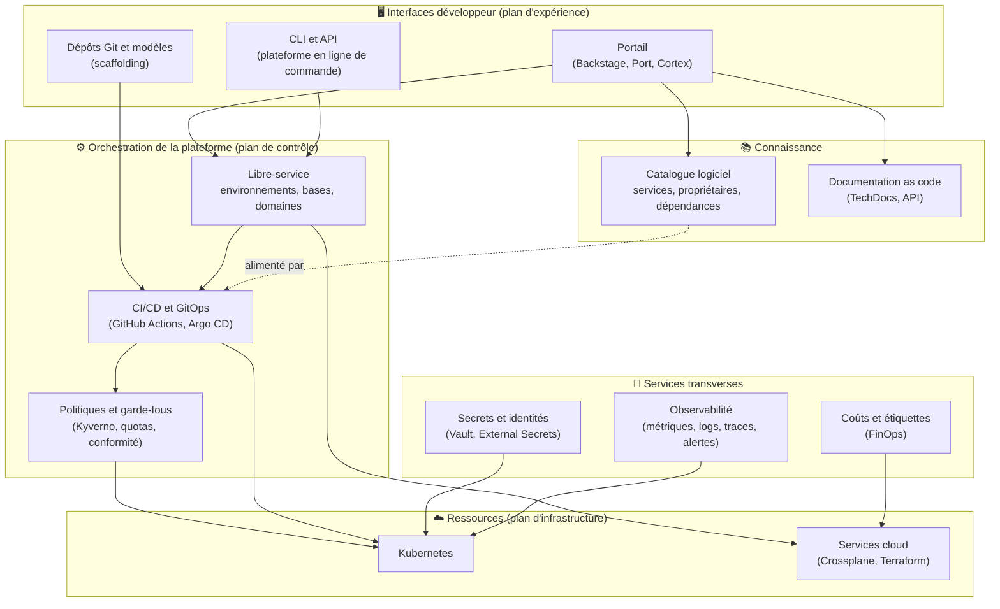

# La plateforme interne de développement (IDP)

## Pourquoi ce cours ?

Le [cours précédent](01-introduction-platform-engineering.md) a posé le **pourquoi**. Reste le **quoi** : de quoi se compose concrètement une **Internal Developer Platform** (IDP) ? Beaucoup d'équipes confondent plateforme et portail (« nous avons installé Backstage, donc nous avons une plateforme »), ou construisent un empilement de scripts que personne n'ose toucher. Une IDP est un **ensemble cohérent de capacités** : un **catalogue** pour savoir ce qui existe, des **interfaces en libre-service** pour créer et changer des choses, une **chaîne de livraison**, des **services d'infrastructure** à la demande, de l'**observabilité** et des **secrets**, le tout avec des **garde-fous**. Ce cours décrit ces composants, la décision **construire ou acheter**, les **anti-patterns** (la plateforme qui devient un goulot) et la notion de **plateforme minimale viable**.

> Prérequis : [Introduction au Platform Engineering](01-introduction-platform-engineering.md), [GitOps](../../15-gitops-argocd/README.md) et [DevSecOps](../../16-devsecops/README.md).

## 1. Les composants d'une IDP

Le *CNCF Platforms White Paper* décrit des **capacités** plutôt que des outils. On peut les regrouper en couches :

| Composant | Rôle | Exemples d'outils |
|---|---|---|
| **Portail** | Point d'entrée unique : trouver, créer, comprendre | Backstage ([cours 3](03-backstage-portal.md)), Port, Cortex, OpsLevel, Red Hat Developer Hub |
| **Catalogue logiciel** | Qui possède quoi, qui dépend de quoi, état de santé et conformité | Backstage Catalog, Port |
| **Libre-service** | Demander un environnement, une base, un bucket **sans ticket** | Formulaires du portail, **Crossplane** ([cours 4](04-crossplane-control-plane.md)), Terraform piloté par API, Kratix |
| **Modèles et chemins recommandés** | Créer un service conforme en quelques minutes | Modèles du portail, `cookiecutter`, Copier ([cours 5](05-golden-paths-et-templates.md)) |
| **CI/CD et GitOps** | Construire, tester, signer, livrer | GitHub Actions, GitLab CI, Argo CD, Flux |
| **Politiques et garde-fous** | Imposer sécurité, coûts, bonnes pratiques **automatiquement** | Kyverno, Gatekeeper, quotas |
| **Secrets** | Distribuer des secrets sans les exposer | Vault, External Secrets Operator |
| **Observabilité** | Métriques, journaux, traces, alertes **préconfigurées** | Prometheus, Grafana, OpenTelemetry |
| **Gestion des coûts** | Visibilité et attribution des coûts | Étiquettes, OpenCost, Kubecost |
| **Identité et accès** | Qui peut faire quoi, SSO | OIDC, groupes d'équipes |

> 📌 **À retenir** : une IDP n'est **pas un outil** que l'on installe, mais un **assemblage** de capacités dont **vous** choisissez les composants et surtout **l'expérience**. La **valeur** est dans l'**intégration** (le développeur ne voit **qu'un** parcours cohérent), pas dans la liste d'outils.

### Les plans d'une plateforme

| Plan | Contenu | Qui l'utilise |
|---|---|---|
| **Plan d'expérience développeur** | Portail, CLI, modèles, documentation | Développeurs (au quotidien) |
| **Plan d'intégration et de livraison** | CI/CD, GitOps, politiques, registre | Pipelines, plateforme |
| **Plan de ressources** | Cluster, bases, réseau, files | Plateforme, via API |
| **Plan de supervision et de sécurité** | Observabilité, secrets, conformité, coûts | Tous |

## 2. Construire, acheter ou assembler ?

| Option | Description | Atouts | Risques |
|---|---|---|---|
| **Construire** (sur mesure) | Développer ses propres outils et interfaces | Adapté exactement au contexte ; maîtrise totale | **Coût d'ingénierie et d'exploitation** élevé ; réinvente des roues ; dépend de quelques personnes |
| **Assembler** (open source) | Combiner Backstage, Argo CD, Crossplane, Kyverno… | Flexibilité, pas de licence, communauté | Beaucoup d'**intégration** ; une équipe doit **l'exploiter** (mises à jour, plugins) |
| **Acheter** (produit commercial / PaaS interne) | Port, Humanitec, Cortex, OpenShift, offres managées des clouds | Rapide à démarrer ; support ; fonctions riches | **Coût de licence**, dépendance au fournisseur, personnalisation limitée |

| Critère | Penche vers **acheter** | Penche vers **construire / assembler** |
|---|---|---|
| Taille de l'équipe plateforme | **Petite** (2 à 3 personnes) | **Étoffée** (5 personnes ou plus) |
| Besoins | Standards, courants | **Très spécifiques**, réglementés |
| Rapidité attendue | Résultats en **semaines** | **Investissement long** acceptable |
| Compétences internes | Limitées en développement | **Fortes** (Go, TypeScript, Kubernetes) |
| Sensibilité à la dépendance | Faible | **Forte** (souveraineté, coûts à long terme) |

> 💡 **Conseil** : **n'écrivez pas ce qu'un produit éprouvé fait déjà**. Réservez le développement sur mesure à ce qui fait **votre spécificité** (vos modèles, vos intégrations métier) et **assemblez ou achetez le reste**. Le piège inverse (« not invented here ») consomme des années d'équipe pour réinventer un portail ou un moteur de politiques.

Question de coût totale : **comptez l'exploitation**, pas seulement la mise en place. Backstage est « gratuit », mais il faut des **développeurs TypeScript** pour le personnaliser, des mises à jour régulières, un hébergement et du support : une équipe d'une à deux personnes minimum.

## 3. La plateforme minimale viable

La **Thinnest Viable Platform** (TVP, terme popularisé par *Team Topologies*) rappelle qu'une plateforme est « **aussi mince que possible** » pour **servir ses clients**.

| Étape | Capacité | Outils possibles |
|---|---|---|
| **0 — Documentation** | Une page claire : « comment mettre un service en production chez nous » | Wiki / dépôt de docs, **sans aucun outil à écrire** |
| **1 — Un modèle de dépôt** | Un dépôt gabarit avec Dockerfile, CI, manifestes | Modèle de dépôt GitHub / `cookiecutter` |
| **2 — Livraison standard** | CI commune et déploiement GitOps | Workflows réutilisables, Argo CD |
| **3 — Catalogue** | Liste des services et de leurs propriétaires | `catalog-info.yaml` + Backstage, ou simple fichier |
| **4 — Libre-service** | Création d'environnements et de ressources par API / formulaire | Crossplane, portail |
| **5 — Garde-fous** | Politiques, quotas, conformité automatiques | Kyverno, Pod Security |
| **6 — Observabilité par défaut** | Tableaux de bord et alertes préconfigurés pour chaque service | Prometheus / Grafana |

On avance **dans cet ordre de valeur**, et on **s'arrête** quand les frictions principales disparaissent. Beaucoup d'organisations tirent déjà un bénéfice majeur des **étapes 0 à 2**, sans portail.

> ⚠️ **Attention** : **ne démarrez pas par le portail**. Un portail magnifique devant des processus manuels ne **résout rien** : le développeur clique sur « créer », et un ticket part à une équipe humaine. Automatisez **d'abord** le processus, puis exposez-le dans le portail.

## 4. Les anti-patterns

| Anti-pattern | Symptômes | Remède |
|---|---|---|
| **La plateforme goulot** | Tout passe par l'équipe plateforme ; files d'attente de demandes ; l'équipe devient un *ticket desk* | **Libre-service** et **automatisation** ; contributions externes (inner source) ; mesurer le temps d'attente |
| **Le portail sans substance** | Belles pages, mais rien d'automatisé | Automatiser d'abord, exposer ensuite |
| **La plateforme imposée** | Obligation d'usage décrétée, développeurs frustrés, contournements | **Produit** : chemin si simple qu'on le **choisit** ; sortie possible documentée |
| **Le « ticket ops » rebaptisé** | Les formulaires créent des tickets pour des humains | Chaque capacité doit être **entièrement automatisée** de bout en bout |
| **Abstraction trop épaisse** | Les développeurs ne comprennent plus ce qui tourne ; impossible de déboguer | Abstraire **sans masquer** : exposer logs, événements, manifestes générés |
| **Abstraction trop fine** | La plateforme n'est qu'un alias de Kubernetes | Offrir de **vraies simplifications** sur les cas courants |
| **Big bang** | Années de développement avant la première utilisation | **Pilote** puis itérations ([cours 1](01-introduction-platform-engineering.md)) |
| **Plateforme sans équipe pérenne** | Projet livré puis abandonné ; dette ; outils obsolètes | **Équipe produit** stable, feuille de route, maintenance |
| **Tout est sur mesure** | Coût énorme, dépendance à quelques personnes | Assembler / acheter l'ordinaire |
| **Verrou involontaire** | Impossible de sortir du chemin recommandé pour un cas légitime | **Échappatoires** (*escape hatches*) : sortir du chemin avec un coût assumé |

> 📌 **À retenir** : la plateforme n'est **pas un goulot** si elle est conçue pour que **la plupart des demandes ne nécessitent aucun humain** de l'équipe plateforme. Si votre équipe voit le **nombre de demandes en attente** augmenter, c'est le signal d'**automatiser davantage**, pas d'embaucher davantage.

## 5. Principes de conception

| Principe | Signification |
|---|---|
| **Libre-service d'abord** | Toute capacité courante est demandable **sans intervention humaine** |
| **Par défaut, sûr et conforme** | Le chemin par défaut applique sécurité, observabilité, coûts |
| **Abstraction réversible** | On peut **voir et comprendre** ce que la plateforme a créé |
| **Échappatoires documentées** | Les cas particuliers ne sont pas bloqués, mais plus coûteux |
| **API avant interface** | Tout ce que le portail fait, **une API** le fait aussi (automatisation, CLI) |
| **Déclaratif et GitOps** | L'état désiré est dans Git ; la plateforme **réconcilie** |
| **Observer la plateforme elle-même** | SLO de la plateforme (disponibilité, temps de création d'un service) |
| **Documenter comme un produit** | Guides, exemples, nouveautés, support identifié |

## Résumé

- Une **IDP** est un **assemblage cohérent** de capacités : **portail**, **catalogue**, **libre-service**, **modèles**, **CI/CD et GitOps**, **politiques**, **secrets**, **observabilité**, **coûts** ; la valeur est dans l'**intégration** et l'**expérience**.
- Plans : **expérience développeur**, **livraison**, **ressources**, **supervision et sécurité**.
- **Construire, assembler ou acheter** selon la taille de l'équipe, la spécificité des besoins et la rapidité ; ne pas réécrire ce qu'un produit éprouvé fait ; **compter l'exploitation**.
- **Plateforme minimale viable** : documentation → modèle de dépôt → livraison standard → catalogue → libre-service → garde-fous → observabilité ; **ne pas commencer par le portail**.
- **Anti-patterns** : la plateforme **goulot**, le portail vide, la plateforme **imposée**, les tickets déguisés, l'abstraction mal dosée, le *big bang*.
- **Principes** : libre-service, défauts sûrs, abstraction réversible, échappatoires, API d'abord, déclaratif.

## Pour aller plus loin

- CNCF Platforms White Paper : <https://tag-app-delivery.cncf.io/whitepapers/platforms/> ; *Platform Engineering Maturity Model* ; <https://platformengineering.org/>.
- Outils à explorer : Backstage, Port, Humanitec, Kratix, Crossplane, Argo CD.
- Cours suivant : [Backstage, le portail développeur](03-backstage-portal.md).
