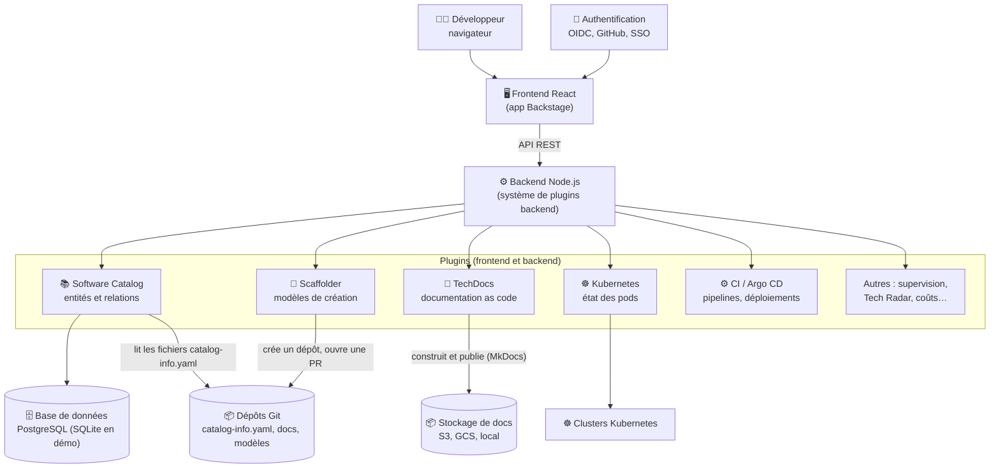

# Backstage, le portail développeur

## Pourquoi ce cours ?

Dans une organisation de quelques dizaines de services, la question « **qui s'occupe de ce service ? où est sa documentation ? de quoi dépend-il ? comment en créer un nouveau ?** » devient vite un casse-tête : les réponses sont dispersées dans des wikis, des dépôts, des tableurs et la tête de quelques personnes. **Backstage**, créé par Spotify et donné à la CNCF (projet **incubating**), est un **cadre de portail développeur** : il fournit un **catalogue logiciel** (source unique de vérité sur les services), un **moteur de modèles** (*scaffolder*) pour créer des projets conformes, une **documentation as code** (TechDocs) et un **système de plugins** pour intégrer vos outils (Kubernetes, CI, Argo CD, supervision). Ce cours décrit son architecture, le catalogue, les modèles et les plugins essentiels. Vous le déploierez dans l'[atelier 1](../ateliers-killercoda/atelier-01-backstage-catalogue/intro.md).

> Prérequis : [La plateforme interne (IDP)](02-internal-developer-platform.md), [Kubernetes](../../09-kubernetes-approfondi/README.md) et [GitOps](../../15-gitops-argocd/README.md).

## 1. Ce que Backstage est… et n'est pas

| Backstage **est** | Backstage **n'est pas** |
|---|---|
| Un **cadre** (framework) pour construire **votre** portail (TypeScript, React, Node.js) | Un produit **prêt à l'emploi** : il se **personnalise** et s'**exploite** |
| Un **catalogue** de logiciels et de leurs relations | Un outil de CI/CD, de déploiement ou de supervision (il **intègre** ceux-ci) |
| Un **point d'entrée unique** vers vos outils | Une plateforme complète : c'est la **vitrine**, pas le moteur |
| Open source, extensible par **plugins** | Une solution sans coût : demande une **équipe** pour les mises à jour et plugins |

> ⚠️ **Attention** : Backstage est puissant mais **exigeant** : il faut des compétences **TypeScript / React / Node.js** pour le personnaliser, un **hébergement** (base PostgreSQL en production, authentification, TLS) et un **suivi des versions** (il évolue vite). Des alternatives plus légères ou commerciales existent (**Port**, **Cortex**, **OpsLevel**, **Red Hat Developer Hub**, basé sur Backstage). Choisissez en connaissance de cause ([cours 2](02-internal-developer-platform.md)).

## 2. Architecture



| Élément | Rôle |
|---|---|
| **Frontend (`packages/app`)** | Application React ; assemble les pages fournies par les plugins |
| **Backend (`packages/backend`)** | Serveur Node.js ; héberge les plugins backend (catalogue, scaffolder, TechDocs, auth…) ; **nouveau système de backend** modulaire |
| **Plugins** | Extensions frontend et/ou backend ; **le cœur de l'extensibilité** |
| **Base de données** | **PostgreSQL** en production ; SQLite en mémoire pour essayer |
| **Authentification** | Fournisseurs OIDC, GitHub, GitLab, Google, Microsoft… ; le fournisseur « guest » n'est que pour le développement |
| **Configuration** | Fichiers `app-config.yaml` (et variantes `production`, `local`), variables d'environnement |

On crée sa propre application Backstage avec `npx @backstage/create-app`, ce qui génère un **dépôt de code** à construire en **image de conteneur** puis à déployer (Helm, Argo CD). Il existe aussi un **chart Helm** communautaire et une image de démonstration, pratique pour essayer.

## 3. Le catalogue logiciel

Le **Software Catalog** est la fonction centrale : un **inventaire vivant** de tout ce qui constitue votre système d'information logiciel. Chaque équipe décrit ses ressources dans un fichier **`catalog-info.yaml`**, **à la racine de son dépôt** (le catalogue le **découvre** et le relit régulièrement).

```yaml
apiVersion: backstage.io/v1alpha1
kind: Component
metadata:
  name: boutique-api
  description: API de la boutique en ligne
  tags: [java, api]
  annotations:
    github.com/project-slug: exemple/boutique-api
    backstage.io/techdocs-ref: dir:.            # documentation dans le même dépôt
  links:
    - url: https://grafana.exemple.org/d/boutique
      title: Tableau de bord
spec:
  type: service                                  # service, website, library…
  lifecycle: production                          # experimental, production, deprecated
  owner: group:equipe-boutique                   # QUI en est responsable
  system: boutique                               # à quel système il appartient
  providesApis: [boutique-rest]
  dependsOn:
    - resource:boutique-db
```

### Les types d'entités

| `kind` | Représente | Exemple |
|---|---|---|
| **Component** | Une unité de logiciel déployable ou partagée | Service, site web, bibliothèque |
| **API** | Une interface exposée (OpenAPI, gRPC, AsyncAPI) | `boutique-rest` |
| **Resource** | Une ressource d'infrastructure dont dépendent les composants | Base de données, bucket, file |
| **System** | Un ensemble de composants qui forment un produit | Système « boutique » |
| **Domain** | Un regroupement de systèmes autour d'un domaine métier | « Commerce » |
| **Group** | Une équipe ou une organisation | `equipe-boutique` |
| **User** | Une personne | `awa` |
| **Template** | Un modèle de création (scaffolder) | « Nouveau service Java » |
| **Location** | Un pointeur vers d'autres fichiers de catalogue | URL d'un dépôt |

### Les relations

Le catalogue construit un **graphe** : `ownedBy` / `ownerOf` (propriétaire), `partOf` / `hasPart` (système), `dependsOn` / `dependencyOf` (dépendances), `providesApi` / `consumesApi`. Ce graphe permet de répondre à : « **qui est touché si cette base tombe ?** », « **qui possède ce service à 3 h du matin ?** », « **quels services utilisent cette API obsolète ?** ».

### Alimenter le catalogue

| Méthode | Principe |
|---|---|
| **Locations statiques** | Dans `app-config.yaml` : `catalog.locations: [{ type: url, target: https://github.com/.../catalog-info.yaml }]` |
| **Découverte automatique** | Le plugin **GitHub / GitLab discovery** scanne les dépôts d'une organisation et enregistre ceux qui ont un `catalog-info.yaml` |
| **Enregistrement manuel** | Via l'interface (« Register existing component ») |
| **Par les modèles** | Le scaffolder enregistre le nouveau composant à la fin de la création |
| **Fournisseurs d'entités** | Importation d'équipes et d'utilisateurs depuis LDAP, GitHub, Entra ID |

> 💡 **Conseil** : le catalogue n'a de valeur que s'il est **à jour**. Faites en sorte que le fichier **vive avec le code** (même dépôt, revue en PR), alimentez-le **automatiquement** (modèles, découverte), et **mesurez** la complétude (% de services avec propriétaire, documentation, lien de supervision).

## 4. Le scaffolder : des modèles de création

Un **Template** est une entité qui décrit un **formulaire** (paramètres) et des **étapes d'automatisation** (actions). Le développeur remplit le formulaire ; Backstage **génère un dépôt**, **le publie**, **crée la pipeline** et **enregistre le composant** dans le catalogue.

```yaml
apiVersion: scaffolder.backstage.io/v1beta3
kind: Template
metadata:
  name: service-web-node
  title: Nouveau service web Node.js
  description: Crée un service avec CI, Dockerfile et manifestes Kubernetes
spec:
  owner: group:equipe-plateforme
  type: service
  parameters:
    - title: Informations du service
      required: [nom, equipe]
      properties:
        nom:
          title: Nom du service
          type: string
          pattern: '^[a-z][a-z0-9-]{2,30}$'
        equipe:
          title: Équipe propriétaire
          type: string
          ui:field: OwnerPicker
          ui:options: { allowedKinds: [Group] }
  steps:
    - id: gabarit
      name: Générer le code depuis le modèle
      action: fetch:template
      input:
        url: ./squelette                 # dossier avec Dockerfile, CI, manifestes (gabarits Nunjucks)
        values: { nom: "${{ parameters.nom }}", equipe: "${{ parameters.equipe }}" }
    - id: publication
      name: Créer le dépôt
      action: publish:github
      input:
        repoUrl: github.com?owner=exemple&repo=${{ parameters.nom }}
    - id: enregistrement
      name: Enregistrer dans le catalogue
      action: catalog:register
      input:
        repoContentsUrl: ${{ steps.publication.output.repoContentsUrl }}
        catalogInfoPath: /catalog-info.yaml
  output:
    links:
      - { title: Dépôt, url: "${{ steps.publication.output.remoteUrl }}" }
```

Les **actions** disponibles (extensibles) : `fetch:template`, `publish:github` / `gitlab` / `bitbucket`, `catalog:register`, `fs:rename`, appel d'API HTTP, création de ressources via un module personnalisé. Les modèles font l'objet du [cours 5](05-golden-paths-et-templates.md).

## 5. TechDocs : la documentation comme code

**TechDocs** affiche, dans le portail, la **documentation Markdown** rédigée **dans le dépôt** du service (dossier `docs/`, configuration `mkdocs.yml`), construite avec **MkDocs**. Avantages : la documentation est **versionnée avec le code**, revue en PR, et trouvable à **un seul endroit**.

| Mode de construction | Principe |
|---|---|
| **`local`** | Backstage construit les docs à la demande (simple, pour essayer) |
| **`external`** (recommandé) | La **CI construit** les docs et les publie dans un stockage (S3, GCS) ; Backstage les **lit** |

L'annotation `backstage.io/techdocs-ref: dir:.` du composant indique où trouver les sources.

## 6. Plugins essentiels

| Plugin | Utilité |
|---|---|
| **Kubernetes** | Voir pods, déploiements et événements d'un service, **dans la page du composant** |
| **Argo CD** (ou Flux) | État de synchronisation et de santé des applications GitOps |
| **GitHub Actions / GitLab CI / Jenkins** | Dernières exécutions de la pipeline |
| **Grafana / Prometheus / PagerDuty** | Tableaux de bord et incidents liés au service |
| **SonarQube / Snyk / Trivy** | Qualité et sécurité |
| **TechDocs** | Documentation as code |
| **Tech Radar** | Cartographie des technologies recommandées / à éviter |
| **Cost Insights** | Visibilité des coûts par équipe et service |
| **Scorecards** (*Soundcheck*, Tech Insights) | Mesure de conformité de chaque service (propriétaire, doc, couverture de tests) |
| **Permissions** | Contrôle d'accès fin dans le portail |

Les plugins se trouvent sur **backstage.io/plugins** ; on peut aussi **écrire les siens** (TypeScript).

> 📌 **À retenir** : adoptez Backstage **par étapes** : (1) **catalogue** (propriétaires, dépendances) ; (2) **TechDocs** ; (3) **plugins d'intégration** (Kubernetes, CI, Argo CD) ; (4) **modèles** de création (golden paths). Un portail qui promet tout dès le premier jour déçoit ; un catalogue **exact** apporte déjà de la valeur.

## 7. Exploiter Backstage

| Sujet | Bonnes pratiques |
|---|---|
| **Base de données** | **PostgreSQL** (pas SQLite) ; sauvegardes |
| **Authentification** | OIDC / SSO (pas le fournisseur « guest ») ; groupes issus de l'annuaire |
| **Déploiement** | Image de conteneur construite par la CI, déployée par **GitOps** ; **chart Helm** |
| **Configuration** | `app-config.production.yaml` ; **secrets** par variables d'environnement ([secrets](../../16-devsecops/cours/05-secrets-management.md)) |
| **Mises à jour** | Backstage publie des versions fréquentes (`backstage-cli versions:bump`) ; prévoir un **rythme régulier** |
| **Sécurité** | Politique d'authentification des API, droits d'écriture du scaffolder restreints, **dépendances scannées** ([supply chain](../../16-devsecops/cours/02-supply-chain-security.md)) |
| **Performance** | Surveiller la charge du catalogue (nombre d'entités), délais d'ingestion |

```bash
# Essayer rapidement en local (Node.js et Yarn requis)
npx @backstage/create-app@latest      # génère une application dans un nouveau dossier
cd mon-portail && yarn dev            # frontend :3000, backend :7007
```

## Résumé

- **Backstage** (CNCF, Spotify) est un **cadre de portail développeur** : catalogue, scaffolder, TechDocs, plugins ; il **s'exploite et se personnalise** (TypeScript) ; des alternatives existent (Port, Cortex, OpsLevel).
- **Architecture** : frontend React, backend Node.js à plugins, **PostgreSQL**, authentification OIDC, configuration `app-config.yaml`.
- **Catalogue** : fichiers **`catalog-info.yaml`** vivant avec le code ; entités **Component, API, Resource, System, Domain, Group, User, Template** ; **relations** (`ownedBy`, `dependsOn`, `partOf`, `providesApi`…) ; alimentation par locations, découverte, modèles.
- **Scaffolder** : `Template` = **paramètres + étapes** (`fetch:template`, `publish:github`, `catalog:register`).
- **TechDocs** : docs Markdown dans le dépôt, construites par MkDocs (de préférence en CI).
- **Plugins essentiels** : Kubernetes, Argo CD, CI, supervision, qualité/sécurité ; adopter **par étapes** (catalogue d'abord).

## Pour aller plus loin

- Backstage : <https://backstage.io/docs/> ; catalogue : <https://backstage.io/docs/features/software-catalog/> ; scaffolder : <https://backstage.io/docs/features/software-templates/> ; chart Helm : <https://github.com/backstage/charts>.
- Alternatives : Port (<https://www.getport.io/>), Cortex, OpsLevel, Red Hat Developer Hub.
- Pratique : [Atelier 1 — catalogue Backstage](../ateliers-killercoda/atelier-01-backstage-catalogue/intro.md).
- Cours suivant : [Crossplane, le plan de contrôle](04-crossplane-control-plane.md).
