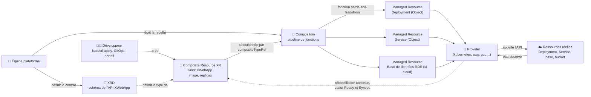

# Crossplane, le plan de contrôle d'infrastructure

## Pourquoi ce cours ?

Un portail (Backstage) permet de **demander** « une base de données PostgreSQL pour mon service ». Mais **qui la crée**, avec **quelle configuration**, et comment s'assurer qu'elle **reste conforme** ? Avec [Terraform](../../13-iac/README.md), il faut une pipeline qui exécute `terraform apply`, un état à stocker, et rien ne surveille ensuite la dérive tant qu'on ne relance pas. **Crossplane** propose une autre approche : **étendre Kubernetes lui-même** pour qu'il gère l'infrastructure. Une base de données devient un **objet Kubernetes** (`kubectl apply -f base.yaml`) que des contrôleurs **réconcilient en continu**, avec les mêmes outils que le reste (GitOps, RBAC, politiques). Surtout, Crossplane permet à l'équipe plateforme de définir **ses propres API** de plus haut niveau (« `WebApp`, `Database` »), qui **cachent la complexité** du cloud. Vous le pratiquerez dans l'[atelier 2](../ateliers-killercoda/atelier-02-crossplane-premier-composite/intro.md).

> Prérequis : [La plateforme interne (IDP)](02-internal-developer-platform.md), [Kubernetes](../../09-kubernetes-approfondi/README.md) (CRD, contrôleurs), [IaC](../../13-iac/README.md) et [GitOps](../../15-gitops-argocd/README.md).

## 1. L'idée : Kubernetes comme plan de contrôle universel

Kubernetes sait déjà faire une chose remarquable : **réconcilier** un état désiré (un objet) avec la réalité (des pods), en boucle, via des **contrôleurs** et des **CRD**. Crossplane **généralise** ce modèle : un contrôleur par type de ressource cloud.

```text
kubectl apply -f bucket.yaml  ─►  API Kubernetes  ─►  contrôleur Crossplane  ─►  API AWS / GCP / Azure
                                      ▲                                              │
                                      └──────── statut (Ready, Synced) ◄─────────────┘
```

| Concept classique | Chez Crossplane |
|---|---|
| Un `Deployment` crée des pods | Une ressource **`Bucket`** crée un **vrai bucket** S3 |
| Le contrôleur corrige la dérive des pods | Le contrôleur **corrige la dérive du bucket** (si quelqu'un le modifie à la main) |
| `kubectl get deployments` | `kubectl get buckets`, `kubectl get managed` |
| RBAC, GitOps, politiques Kyverno | **Les mêmes**, appliqués à l'infrastructure |

## 2. Les briques de Crossplane

| Brique | Rôle |
|---|---|
| **Crossplane (cœur)** | Installé dans le cluster ; gère les packages et les compositions |
| **Provider** | Package qui **ajoute des CRD et des contrôleurs** pour un système : `provider-aws` (familles par service : S3, RDS…), `provider-gcp`, `provider-azure`, **`provider-kubernetes`**, `provider-helm`, `provider-terraform` |
| **ProviderConfig** | **Comment le provider s'authentifie** (clés, rôle IAM, identité fédérée, ou identité du pod) |
| **Managed Resource (MR)** | **Une ressource externe** unique (`Bucket`, `Instance` RDS, `Object` Kubernetes) : correspondance **1 pour 1** avec l'API du fournisseur |
| **Composite Resource Definition (XRD)** | **Définit une nouvelle API** : son schéma (paramètres), son nom, sa version |
| **Composite Resource (XR)** | Une **instance** de cette API : ce que l'utilisateur crée (« une WebApp nommée `boutique` ») |
| **Composition** | **La recette** : comment transformer une XR en un ensemble de MR |
| **Function** | Programme (patch-and-transform, Go, Python, KCL…) exécuté par la Composition en **pipeline** pour construire les ressources |
| **Claim** (v1) | Version **namespacée** d'une XR, utilisée par les développeurs (comparable à un PVC vis-à-vis d'un PV) |
| **Configuration** | **Package** qui regroupe XRD + Compositions + dépendances, distribué comme une image OCI |

> 📌 **À retenir** : **XRD = le contrat** (ce que le développeur peut demander), **Composition = l'implémentation** (comment la plateforme le réalise), **XR = la demande**. Plusieurs Compositions peuvent implémenter le **même** XRD (par exemple « base de données » sur AWS, sur GCP, ou en local) : le développeur ne change rien à sa demande.



## 3. Exemple : une API « WebApp »

### La définition (XRD)

```yaml
apiVersion: apiextensions.crossplane.io/v1
kind: CompositeResourceDefinition
metadata:
  name: xwebapps.platform.worketyamo.org
spec:
  group: platform.worketyamo.org
  names:
    kind: XWebApp
    plural: xwebapps
  versions:
    - name: v1alpha1
      served: true
      referenceable: true
      schema:
        openAPIV3Schema:
          type: object
          properties:
            spec:
              type: object
              properties:
                parameters:
                  type: object
                  properties:
                    name:     { type: string }
                    image:    { type: string }
                    replicas: { type: integer, default: 1, minimum: 1, maximum: 5 }
                  required: [name, image]
              required: [parameters]
```

Le développeur ne voit **que** `name`, `image`, `replicas` (avec une **limite** à 5 imposée par la plateforme).

### La recette (Composition en pipeline)

```yaml
apiVersion: apiextensions.crossplane.io/v1
kind: Composition
metadata:
  name: webapp-kubernetes
spec:
  compositeTypeRef:
    apiVersion: platform.worketyamo.org/v1alpha1
    kind: XWebApp
  mode: Pipeline
  pipeline:
    - step: patch-and-transform
      functionRef:
        name: function-patch-and-transform
      input:
        apiVersion: pt.fn.crossplane.io/v1beta1
        kind: Resources
        resources:
          - name: deployment
            base:
              apiVersion: kubernetes.crossplane.io/v1alpha2
              kind: Object
              spec:
                providerConfigRef: { name: default }
                forProvider:
                  manifest:
                    apiVersion: apps/v1
                    kind: Deployment
                    metadata: { namespace: apps-plateforme }
                    spec:
                      selector: { matchLabels: {} }
                      template:
                        metadata: { labels: {} }
                        spec:
                          containers:
                            - { name: app, image: placeholder }
            patches:
              - type: FromCompositeFieldPath
                fromFieldPath: spec.parameters.name
                toFieldPath: spec.forProvider.manifest.metadata.name
              - type: FromCompositeFieldPath
                fromFieldPath: spec.parameters.replicas
                toFieldPath: spec.forProvider.manifest.spec.replicas
              - type: FromCompositeFieldPath
                fromFieldPath: spec.parameters.image
                toFieldPath: spec.forProvider.manifest.spec.template.spec.containers[0].image
```

### La demande (XR)

```yaml
apiVersion: platform.worketyamo.org/v1alpha1
kind: XWebApp
metadata:
  name: boutique
spec:
  parameters:
    name: boutique
    image: nginx:1.27-alpine
    replicas: 2
```

Crossplane crée le `Deployment` (et le reste de la recette) ; si quelqu'un le supprime ou le modifie à la main, **le contrôleur le recrée** ; si l'on change `replicas` dans la XR, **le Deployment suit**.

> 💡 **Conseil** : **concevez l'API comme un produit**. Peu de paramètres, **des noms métier** (`taille: petite|moyenne|grande` plutôt que `instanceClass: db.t3.medium`), des **valeurs par défaut sûres** (chiffrement, sauvegardes, étiquettes) et des **bornes**. C'est ce qui fait de Crossplane un outil de plateforme et pas seulement un « Terraform dans Kubernetes ».

## 4. Les fonctions et les modes de composition

Depuis Crossplane 1.14-1.17, les Compositions s'écrivent en **mode Pipeline** : une **suite d'étapes**, chacune appelant une **fonction** qui lit l'état observé et renvoie les ressources désirées.

| Fonction | Principe |
|---|---|
| **function-patch-and-transform** | Écriture **déclarative** : une base + des *patches* depuis le XR (ce que l'on utilise ici) |
| **function-go-templating** | Gabarits Go : boucles, conditions |
| **function-kcl**, **function-cue** | Langages de configuration typés |
| **function-python** / **function-go** | **Code** pour une logique complexe (SDK) |
| **function-auto-ready** | Marque automatiquement les ressources composées prêtes |

L'ancien mode « `resources` » (patch-and-transform intégré) est **déprécié**. Les versions récentes de Crossplane (série 2.x) **simplifient le modèle** (ressources composites namespacées, abandon des Claims), mais **l'esprit** (XRD, Composition en pipeline, providers) reste le même ; l'atelier utilise une **version 1.x épinglée**. Vérifiez toujours la documentation de **votre** version.

## 5. Les providers et l'authentification

| Provider | Gère | Authentification typique |
|---|---|---|
| **provider-aws** (familles `provider-aws-s3`, `-rds`, `-ec2`…) | Ressources AWS | **IRSA / Pod Identity** (rôle IAM du pod) ; clés en secours ([IAM](../../14-cloud-aws/cours/02-aws-iam-et-securite.md)) |
| **provider-gcp**, **provider-azure** | GCP, Azure | Workload Identity |
| **provider-kubernetes** | Des **objets Kubernetes** dans ce cluster ou un autre | Identité du pod ou kubeconfig |
| **provider-helm** | Des **releases Helm** | Idem |
| **provider-terraform** | Exécute des **modules Terraform** | Selon le module |

> ⚠️ **Attention** : un provider reçoit des **droits étendus** sur le cloud (il crée et **supprime** des ressources). Appliquez le **moindre privilège** : un `ProviderConfig` par environnement ou équipe, des **rôles IAM limités** (pas d'administrateur), et protégez la création de `ProviderConfig` (RBAC). Et **testez la suppression** : par défaut, supprimer une ressource Crossplane **supprime** la ressource réelle (`deletionPolicy: Delete`) ; utilisez `Orphan` pour les données à conserver, et ajoutez des **politiques d'admission** sur les ressources sensibles.

### Le choix du *provider-kubernetes* pour apprendre

Pour **apprendre sans compte cloud**, `provider-kubernetes` joue le rôle d'un « faux cloud » : une `Object` Crossplane **crée un objet Kubernetes** (Deployment, Service, ConfigMap) dans le cluster. Tous les mécanismes (XRD, Composition, XR, réconciliation, statut) sont **identiques** à ceux d'une base RDS ou d'un bucket S3 ; seul le provider change. C'est ce que fait l'[atelier 2](../ateliers-killercoda/atelier-02-crossplane-premier-composite/intro.md).

## 6. Crossplane et Terraform

| | **Terraform / OpenTofu** | **Crossplane** |
|---|---|---|
| **Modèle** | Exécution **à la demande** (`plan` / `apply`) | **Réconciliation continue** (contrôleurs) |
| **État** | Fichier d'état à stocker et verrouiller | **L'état est dans Kubernetes** (CRD) et le cloud |
| **Dérive** | Détectée au prochain `plan` | **Corrigée automatiquement** (ou signalée) |
| **Langage** | HCL | **YAML Kubernetes** + fonctions (Go, KCL, Python) |
| **API pour les développeurs** | Variables de modules | **Nouvelles API Kubernetes** (XRD) avec RBAC, quotas, politiques |
| **Écosystème** | **Immense** (milliers de providers et modules, **meilleure couverture**) | Plus **réduit** ; providers en croissance (générés depuis Terraform avec *Upjet*) |
| **Planification** | `terraform plan` : **aperçu** précis avant changement | Pas d'aperçu équivalent ; on s'appuie sur la revue Git et le mode *dry-run* |
| **Compétences** | HCL, cycle plan/apply | **Kubernetes** (CRD, contrôleurs, GitOps) |
| **GitOps** | Via Atlantis, pipelines | **Natif** : Argo CD synchronise des objets Crossplane comme n'importe quel autre |
| **Adapté à** | **Toute l'infrastructure**, équipes IaC | **Plateformes** exposant des API aux développeurs |

> 📌 **À retenir** : ce n'est **pas** « l'un ou l'autre ». Beaucoup de plateformes **combinent** : **Terraform** pour les fondations (réseau, comptes, clusters, [module IaC](../../13-iac/README.md)) et **Crossplane** pour les **ressources applicatives demandées en libre-service** (bases, buckets, files). Crossplane peut même **piloter Terraform** (`provider-terraform`) pour réutiliser des modules existants.

D'autres approches proches : **AWS Controllers for Kubernetes (ACK)**, **Google Config Connector**, **Azure Service Operator** (opérateurs propres à un cloud, **sans** couche de composition), **Kratix** (orchestre des « promesses » de plateforme), **Pulumi** (IaC en langages de programmation).

## 7. Crossplane dans la plateforme

- **Portail** : un modèle Backstage ([cours 3](03-backstage-portal.md)) **crée un fichier XR** dans Git (ou ouvre une PR).
- **GitOps** : Argo CD synchronise les XR comme n'importe quelle ressource ; la réconciliation de Crossplane fait le reste ([cours GitOps](../../15-gitops-argocd/README.md)).
- **Politiques** : Kyverno contrôle les XR (régions autorisées, tailles maximales) ([DevSecOps](../../16-devsecops/cours/04-policy-as-code-kubernetes.md)).
- **Secrets** : une XR peut **publier** les identifiants de connexion d'une base dans un `Secret` (`writeConnectionSecretToRef`) dans le namespace de l'application ([secrets](../../16-devsecops/cours/05-secrets-management.md)).
- **Coûts et étiquettes** : la Composition **impose** les étiquettes et les tailles ([FinOps](../../14-cloud-aws/cours/06-aws-couts-finops-intro.md)).

```bash
kubectl get providers,functions                     # packages installés et leur santé
kubectl get composite                               # toutes les XR
kubectl get managed                                 # toutes les ressources gérées
kubectl describe xwebapp boutique                   # événements, ressources composées, conditions
crossplane beta trace xwebapp boutique              # arbre XR → ressources composées (CLI crossplane)
```

## Résumé

- **Crossplane** étend Kubernetes pour **gérer l'infrastructure** par des **contrôleurs réconciliateurs** : ressources externes = objets Kubernetes, avec RBAC, GitOps et politiques.
- **Briques** : **Provider** (+ `ProviderConfig`), **Managed Resource**, **XRD** (contrat), **Composition** (recette en **pipeline de fonctions**), **XR** (demande), **Claim** (v1), **Configuration** (package).
- Concevoir **l'API comme un produit** : peu de paramètres, noms métier, défauts sûrs, bornes.
- **Providers** : AWS, GCP, Azure, **kubernetes**, helm, terraform ; **moindre privilège** et attention à `deletionPolicy`.
- **Crossplane vs Terraform** : réconciliation continue et API pour développeurs contre `plan`/`apply` et vaste écosystème ; **souvent combinés**.
- Dans la plateforme : **portail → Git → Argo CD → Crossplane**, avec **Kyverno** en garde-fou.

## Pour aller plus loin

- Crossplane : <https://docs.crossplane.io/> ; marketplace : <https://marketplace.upbound.io/> ; fonctions : <https://github.com/crossplane-contrib> ; Upjet : <https://github.com/crossplane/upjet>.
- Comparer : ACK (<https://aws-controllers-k8s.github.io/community/>), Config Connector, Kratix (<https://kratix.io/>).
- Pratique : [Atelier 2 — premier composite Crossplane](../ateliers-killercoda/atelier-02-crossplane-premier-composite/intro.md).
- Cours suivant : [Golden paths et modèles](05-golden-paths-et-templates.md).
