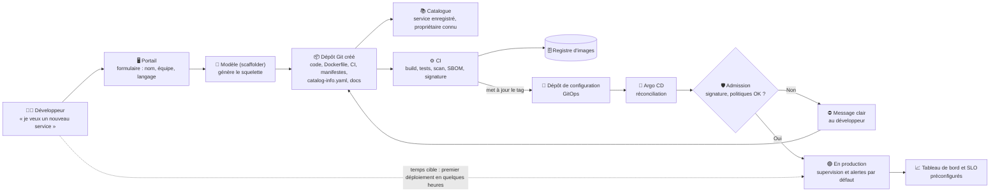

# Golden paths et modèles de services

## Pourquoi ce cours ?

Imaginez que vous arriviez dans une entreprise et deviez mettre un nouveau service en production. Sans repère, vous choisissez un langage, copiez la pipeline d'un projet voisin (qui n'est peut-être plus à jour), cherchez comment déployer, comment obtenir une base de données, comment brancher la supervision… et il vous faut **deux semaines**. Un **golden path** (chemin doré) est le **parcours recommandé, balisé et automatisé** qui vous amène à un service **conforme et en production en quelques heures**, sans que vous ayez à prendre mille décisions. C'est la **brique de plateforme la plus visible** pour les développeurs. Ce cours explique ce qu'est un golden path, ce qu'un **modèle de service** contient, comment le **fournir en libre-service** (scaffolding), comment poser des **garde-fous** (et non des barrières), et comment le **faire vivre**.

> Prérequis : [La plateforme interne (IDP)](02-internal-developer-platform.md), [Backstage](03-backstage-portal.md), [CI/CD](../../12-cicd/README.md), [GitOps](../../15-gitops-argocd/README.md) et [DevSecOps](../../16-devsecops/README.md).

## 1. Qu'est-ce qu'un golden path ?

Le terme (Spotify) désigne le **chemin recommandé et supporté** pour accomplir une tâche courante : créer un service, ajouter une base, déployer, ouvrir une alerte. Netflix parle de **paved road** (route pavée).

| Caractéristique | Détail |
|---|---|
| **Opinionated** | Il y a **un** choix par défaut pour chaque décision courante (langage supporté, CI, déploiement, supervision) |
| **Couvre ~80 % des cas** | Pas les 100 % : les cas particuliers existent et sont **possibles** hors du chemin |
| **Supporté** | La plateforme **maintient** le chemin : correctifs de sécurité, mises à jour, documentation, assistance |
| **Facultatif mais attractif** | Il n'est pas **imposé** ; il est **tellement plus simple** que les équipes le **choisissent** |
| **Automatisé** | Du formulaire à la production, **sans ticket** |
| **Évolutif** | Il s'améliore avec les retours ; versionné |

> 📌 **À retenir** : un golden path n'est pas une **cage**, c'est une **autoroute** : on peut quitter l'autoroute, mais on le fait **en connaissance de cause** (et on assume l'entretien de son propre chemin). La différence entre un golden path et un standard imposé est la **liberté de sortir**.

| Ce qu'on **ne** met **pas** dans le chemin | Pourquoi |
|---|---|
| Les cas rares (calcul GPU, bases très spécifiques) | Mieux vaut un chemin **simple** pour 80 % que un chemin **compliqué** pour 100 % |
| Les choix purement esthétiques | Ne figer que ce qui a un **bénéfice** opérationnel ou de sécurité |

## 2. Ce que contient un modèle de service

Un **modèle** (*template*) de service réunit **tout ce qu'un nouveau service doit avoir** pour être exploitable, **dès le premier commit**.

| Élément | Contenu | Valeur |
|---|---|---|
| **Code de démarrage** | Application minimale (`/healthz`, endpoint de métriques, journaux structurés) | Un service qui **tourne** dès la création |
| **`Dockerfile`** | Image minimale, non-root, multi-étape ([module Docker](../../08-docker-approfondi/README.md)) | Sécurité et reproductibilité |
| **Pipeline CI** | Build, tests, **scan** (Trivy), **SBOM**, **signature** ([DevSecOps](../../16-devsecops/README.md)) | Chaîne de livraison **sûre par défaut** |
| **Manifestes Kubernetes** | Deployment, Service, Ingress, `NetworkPolicy`, `securityContext` durci, requests / limits | Conformité avec les politiques |
| **Déploiement GitOps** | `Application` Argo CD ou entrée dans un `ApplicationSet` | Livraison continue |
| **Supervision** | `ServiceMonitor`, tableau de bord Grafana, alertes de base (SLO) | Observabilité **dès le départ** ([monitoring](../../10-monitoring-observabilite/README.md)) |
| **Secrets** | Référence à un `ExternalSecret` (pas de valeur) | Aucun secret dans Git |
| **`catalog-info.yaml`** | Propriétaire, système, dépendances, liens | Enregistrement automatique dans le catalogue |
| **Documentation** | `docs/` + `mkdocs.yml` (TechDocs), `README`, runbook minimal | Connaissance à portée |
| **Droits et protections du dépôt** | Branches protégées, revues obligatoires, CODEOWNERS | Qualité et gouvernance |
| **Étiquettes obligatoires** | `equipe`, `environnement`, `application` | Coûts et responsabilité |

Les **paramètres** (nom, équipe, langage, type de service, besoin d'une base) personnalisent le modèle ; le reste est **identique** pour tous.

## 3. Le parcours d'un développeur



> 💡 **Conseil** : la métrique reine d'un golden path est le **temps jusqu'au premier déploiement en production** d'un nouveau service (« *time to first deploy* » ou « *time to hello world* »). Mesurez-la avant et après, et affichez-la : c'est l'argument le plus convaincant pour l'adoption.

## 4. Le scaffolding

Le **scaffolding** (échafaudage) génère un projet à partir d'un modèle et de paramètres.

| Outil | Principe | Usage |
|---|---|---|
| **Scaffolder Backstage** | Modèles `Template` + actions (`fetch:template`, `publish:github`, `catalog:register`) | **Portail** ([cours 3](03-backstage-portal.md)) |
| **cookiecutter** | Modèles Jinja2 en ligne de commande | Scripts, CI |
| **Copier** | Comme cookiecutter, avec **mises à jour du modèle** propagées aux projets existants | **Évolution** des projets |
| **Dépôt gabarit GitHub** (*template repository*) | Un bouton « Use this template » | **Simple**, sans outil |
| **Yeoman**, **Nx generators**, `cargo generate` | Générateurs d'un écosystème | Spécifique à un langage |
| **Crossplane / Terraform** | Provisionnent les **ressources** (base, bucket) demandées par le modèle | Complément |

```bash
# Exemple minimal avec cookiecutter
pip install cookiecutter
cookiecutter https://github.com/exemple/modele-service-node --no-input nom=boutique equipe=equipe-boutique
```

Dans le gabarit, on référence les paramètres :

```yaml
# squelette/.github/workflows/ci.yaml (gabarit Nunjucks de Backstage)
name: ci-${{ values.nom }}
on: { push: { branches: [main] } }
jobs:
  build:
    uses: exemple/plateforme-workflows/.github/workflows/build-service.yaml@v3   # workflow RÉUTILISABLE
    with:
      nom: ${{ values.nom }}
```

### Le problème de la dérive des modèles

Un modèle **copie** des fichiers : dès qu'il évolue (nouvelle version de la CI, correctif de sécurité), les **services déjà créés** restent sur l'ancienne version. Trois parades :

| Parade | Principe |
|---|---|
| **Composants réutilisables et versionnés** | Le squelette ne contient presque rien ; il **référence** des workflows, charts et images **centraux** (`uses: …@v3`, chart Helm commun) : on met à jour **à un seul endroit** |
| **Mises à jour automatisées** | **Copier**, Renovate ou Dependabot ouvrent des PR sur les services pour appliquer les évolutions du modèle |
| **Inventaire et conformité** | Le catalogue indique **quelle version du modèle** chaque service utilise, et un score de conformité guide les migrations |

> ⚠️ **Attention** : sans stratégie de mise à jour, les modèles créent **de la dette** : des centaines de services figés sur des versions anciennes et non corrigeables en masse. **Préférez la référence à la copie** : un workflow de CI central, un chart Helm commun, une image de base maintenue.

## 5. Garde-fous, pas barrières

Le golden path rend le **bon chemin facile** ; les **garde-fous** rendent le **mauvais chemin difficile** sans bloquer les cas légitimes.

| Garde-fou | Mécanisme | Effet |
|---|---|---|
| **Politiques d'admission** | Kyverno / Gatekeeper ([cours DevSecOps](../../16-devsecops/cours/04-policy-as-code-kubernetes.md)) : pas de `:latest`, pas de privilégié, requests / limits, images signées | Refus avec **message clair** |
| **Quotas et limites** | `ResourceQuota`, `LimitRange`, bornes dans les XRD Crossplane ([cours 4](04-crossplane-control-plane.md)) | Maîtrise des coûts et des ressources |
| **Modèles contraints** | Paramètres limités à des **listes** (tailles `petite`, `moyenne`), régions autorisées | Pas de configuration dangereuse |
| **Pipelines obligatoires** | Workflows requis, scan bloquant sur `CRITICAL` corrigible | Sécurité automatique |
| **Étiquettes obligatoires** | Politique « `equipe`, `environnement` requis » | Attribution des coûts |
| **Gouvernance du dépôt** | Branches protégées, CODEOWNERS, signatures | Qualité |
| **Environnements de production** | Approbation, fenêtres de déploiement | Changements maîtrisés |

Principes d'un bon garde-fou :

1. **Informer avant de bloquer** : mode `Audit` / avertissement d'abord, puis blocage.
2. **Expliquer** : le message dit **quoi corriger** et **où lire la doc**.
3. **Prévoir une échappatoire** : exception **tracée, motivée et limitée dans le temps**.
4. **Automatiser la correction** quand c'est possible (mutation qui ajoute le label manquant, PR automatique).

> ⚠️ **Attention** : un garde-fou **sans échappatoire** bloque un cas légitime un vendredi soir et les équipes finissent par contourner la plateforme entière. Mieux vaut un **processus d'exception rapide** (une revue de 10 minutes, tracée) qu'un contournement généralisé.

## 6. Le libre-service

Un golden path ne se limite pas à « créer un service ». Les **demandes courantes** doivent toutes être en libre-service, de bout en bout, sans humain :

| Demande | Réponse de la plateforme |
|---|---|
| Nouveau service | Modèle de service |
| **Environnement** (preview, staging) | Namespace + quotas + accès, **créés par une demande** |
| **Base de données / bucket / file** | Une **XR Crossplane** : l'API `Database` choisit taille, sauvegardes, chiffrement |
| **Domaine et TLS** | Entrée `Ingress` + cert-manager automatique |
| **Secret** | Création dans le coffre + `ExternalSecret` |
| **Alerte / SLO** | Modèle de règles et de tableau de bord |
| **Accès** | Demande d'appartenance à un groupe, validée automatiquement ou par le responsable |

Le **portail** expose ces capacités, mais chacune doit aussi être appelable par **API / Git** (pour l'automatisation). Le **test d'acceptation** de chaque capacité : « un développeur peut-il l'obtenir **sans parler à personne** en moins de **15 minutes** ? »

## 7. Faire vivre le golden path

| Pratique | Détail |
|---|---|
| **Le traiter comme un produit** | Feuille de route, version, notes de version, support |
| **Mesurer l'usage** | Part des nouveaux services créés par le modèle ; durée jusqu'au premier déploiement ; nombre de sorties du chemin et **pourquoi** |
| **Écouter les sorties** | Chaque équipe qui quitte le chemin dit **ce qui manque** : c'est la feuille de route |
| **Tester les modèles** | Un modèle est du code : CI qui **génère un service d'essai** et le déploie sur un environnement jetable |
| **Plusieurs chemins** | Un par type de charge (service web, tâche planifiée, fonction, pipeline de données), pas un seul chemin pour tout |
| **Documenter** | Guide « votre premier service », tutoriels, FAQ, canaux d'aide |
| **Inner source** | Les équipes peuvent **proposer des améliorations** aux modèles |
| **Retirer** | Supprimer les chemins peu utilisés ou obsolètes |

## Résumé

- Un **golden path** est le **chemin recommandé, supporté et automatisé** pour les ~80 % de cas courants, **facultatif mais attractif** ; il vise un **premier déploiement en heures**.
- Un **modèle de service** contient : code de démarrage, `Dockerfile`, **CI sécurisée**, manifestes durcis, **GitOps**, supervision, références de secrets, **`catalog-info.yaml`**, documentation, protections du dépôt, étiquettes.
- **Scaffolding** : Backstage, cookiecutter, **Copier**, dépôts gabarits ; éviter la **dérive des modèles** en **référençant** des composants versionnés (workflows réutilisables, charts) plutôt qu'en copiant.
- **Garde-fous, pas barrières** : politiques d'admission, quotas, paramètres bornés, pipelines requis ; **informer, expliquer, prévoir une échappatoire**.
- **Libre-service de bout en bout** : service, environnement, base, domaine, secret, alerte, accès ; « sans parler à personne en 15 minutes ».
- **Faire vivre** : mesurer l'usage, écouter les sorties, tester les modèles, plusieurs chemins, inner source.

## Pour aller plus loin

- Spotify : *Golden Path* ; Backstage Software Templates : <https://backstage.io/docs/features/software-templates/> ; Copier : <https://copier.readthedocs.io/> ; cookiecutter : <https://cookiecutter.readthedocs.io/>.
- Workflows réutilisables GitHub Actions : <https://docs.github.com/actions/using-workflows/reusing-workflows>.
- Cours suivant : [Team Topologies et culture](06-team-topologies-et-culture.md).
