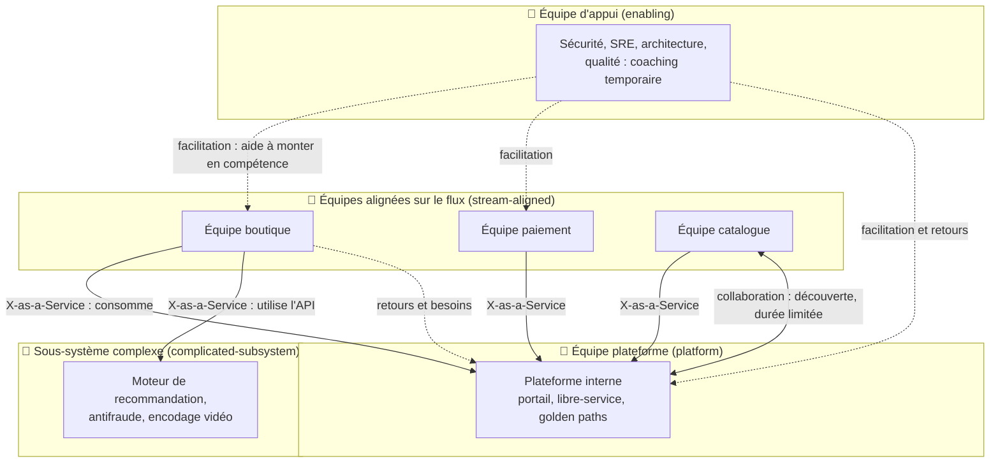

# Team Topologies, culture et expérience développeur

## Pourquoi ce cours ?

On peut maîtriser Backstage, Crossplane et Argo CD, et **échouer** : parce que l'équipe plateforme est devenue un service de tickets, parce que les équipes produit ne la **sollicitent plus** ou la **subissent**, ou parce que personne ne sait **qui est responsable de quoi**. Une plateforme est avant tout un **dispositif organisationnel** : elle réussit quand les **équipes** sont bien découpées, quand leurs **interactions** sont explicites, et quand la **charge cognitive** de chacune reste soutenable. **Team Topologies** (Matthew Skelton et Manuel Pais, 2019) donne un vocabulaire et un modèle pour cela. Ce cours présente les **quatre types d'équipes**, les **trois modes d'interaction**, la **charge cognitive**, la plateforme **comme produit** et l'**expérience développeur** (DevEx), et les mesures qui les accompagnent.

> Prérequis : [Introduction au Platform Engineering](01-introduction-platform-engineering.md) et [La plateforme interne (IDP)](02-internal-developer-platform.md). Voir aussi la culture SRE (équipes, astreinte) dans le [module SRE](../../11-sre-pratiques/README.md).

## 1. Le point de départ : la loi de Conway et la charge cognitive

- **Loi de Conway** : *« les organisations conçoivent des systèmes qui reproduisent leur structure de communication »*. Si trois équipes doivent se coordonner pour chaque livraison, l'architecture et les processus reflèteront ces dépendances. **On conçoit l'organisation pour obtenir l'architecture souhaitée** (*inverse Conway maneuver*).
- **Charge cognitive** : quantité d'effort mental demandée à une équipe. Trois formes :

| Charge | Définition | Exemple | Objectif |
|---|---|---|---|
| **Intrinsèque** | Liée à la **nature du travail** : les compétences de base du métier | Comprendre le domaine de la facturation | La **garder** (c'est la valeur) |
| **Extrinsèque** | Liée à **l'environnement**, sans valeur métier | Écrire un manifeste Kubernetes, configurer une pipeline, obtenir un accès | La **réduire** (rôle de la plateforme) |
| **Pertinente** (*germane*) | Effort d'**apprentissage utile** et de conception | Comprendre ses utilisateurs, améliorer l'architecture | La **favoriser** |

> 📌 **À retenir** : le Platform Engineering est, au fond, une **réduction de charge cognitive extrinsèque** pour les équipes produit : tout ce qui n'est pas leur métier (déployer, superviser, sécuriser) est **abstrait** par la plateforme. Une équipe saturée ne peut plus innover ; c'est aussi un **risque de fiabilité**.

## 2. Les quatre types d'équipes

| Type d'équipe | Rôle | Exemples | Finalité |
|---|---|---|---|
| **Stream-aligned** (alignée sur le flux) | Livrer de la valeur **de bout en bout** pour un **flux de travail métier** (un produit, un parcours client). C'est le **type principal** ; la majorité des équipes | Équipe « commande », équipe « abonnements » | Livrer **vite**, en autonomie |
| **Platform** (plateforme) | Fournir **en libre-service** les capacités dont les équipes alignées ont besoin ; **réduire leur charge cognitive** | Équipe plateforme interne | Rendre les équipes alignées **autonomes** |
| **Enabling** (d'appui) | **Aider** les autres à acquérir des compétences ou adopter des pratiques ; **durée limitée**, **pas de dépendance** | Coachs sécurité, SRE, architecture, données | **Faire monter en compétence**, puis se retirer |
| **Complicated-subsystem** (sous-système complexe) | Posséder une partie du système qui demande une **expertise rare** | Moteur d'IA, antifraude, codecs | Concentrer l'expertise **sans** y plier les autres |

> 💡 **Conseil** : l'équipe plateforme ne remplace **ni** les équipes produit **ni** les SRE : elle **sert** des équipes alignées sur le flux. Si vos équipes produit sont **petites** (2 à 3 services), une plateforme dédiée est probablement **prématurée** : commencez par un **modèle de dépôt** et une **documentation** (voir [la plateforme minimale](02-internal-developer-platform.md)).

### Des équipes de bonne taille

| Principe | Détail |
|---|---|
| **Équipes de 5 à 9 personnes** | Au-delà, la communication ralentit (nombre de Dunbar réduit) |
| **Propriété claire** | Chaque composant a **une** équipe responsable (catalogue : champ `owner`) |
| **Stabilité** | Garder les équipes stables ; les reconfigurer **rarement** et délibérément |
| **Cognitive load** | Limiter la quantité de domaines, de services et d'outils qu'une équipe doit maîtriser |

## 3. Les trois modes d'interaction

Les équipes interagissent de **trois manières seulement**, à choisir **explicitement** selon la situation :

| Mode | Description | Quand | Coût |
|---|---|---|---|
| **Collaboration** | Deux équipes travaillent **ensemble**, à fort contact, sur un objectif commun | **Découverte** : construire une nouvelle capacité de plateforme avec une équipe pilote ; **durée limitée** | **Élevé** (charge de coordination, périmètre flou) |
| **X-as-a-Service** | Une équipe **fournit**, l'autre **consomme** via une API, une documentation, un SLO ; peu d'échanges | Capacités **stables** et bien comprises (déployer, base de données) | **Faible** : **état cible** de la plateforme |
| **Facilitation** | Une équipe **aide** une autre à surmonter un obstacle ou acquérir une compétence | Équipe d'appui qui coache, atelier de threat modeling, revue d'architecture | Moyen, **temporaire** |

La trajectoire typique d'une capacité de plateforme : **collaboration** (on découvre avec une équipe pilote) → **X-as-a-Service** (on stabilise, documente, mesure). Une plateforme qui reste en collaboration permanente est **un goulot** ; une plateforme qui est « X-as-a-Service » **sans avoir compris** ses clients est **déconnectée**.

> ⚠️ **Attention** : le piège est de transformer l'équipe plateforme en **équipe de tickets** (une équipe « DevOps » à qui l'on délègue toute l'infrastructure). Ce n'est **pas** du X-as-a-Service (aucune API, tout passe par des humains) : on recrée le mur entre développement et exploitation que DevOps voulait abattre.

## 4. La plateforme comme produit : organisation

| Rôle / pratique | Détail |
|---|---|
| **Product manager de plateforme** | Porte la vision, priorise selon les **besoins des équipes**, communique |
| **Ingénieurs plateforme** | Construisent **et exploitent** (« you build it, you run it » appliqué à la plateforme) |
| **Support / développeur advocate** | Premiers points de contact, documentation, formations, collecte de retours |
| **Feuille de route publique** | Les équipes savent **ce qui arrive** et **pourquoi** |
| **Entretiens et enquêtes** | Trimestriels : frictions, satisfaction, besoins |
| **Contrat de service** | SLO de la plateforme (disponibilité du portail, délai de création d'un environnement), **horaires de support**, canaux |
| **Gouvernance** | Comité de pilotage léger, **conseil des utilisateurs** (représentants des équipes produit) |
| **Communication** | Notes de version, démos, canal d'annonces |
| **Inner source** | Contributions externes **acceptées et accompagnées** : l'équipe plateforme reste **gardienne** de la qualité |

La plateforme a **ses propres SLO** et une **astreinte** : si elle tombe, **toutes** les équipes sont bloquées. Appliquez-lui les pratiques du [module SRE](../../11-sre-pratiques/README.md) (SLO, postmortems, réduction du *toil*).

## 5. L'expérience développeur (DevEx)

La **DevEx** (*Developer Experience*) est la **qualité du quotidien** des développeurs : fluidité, clarté, absence de friction. Le cadre **SPACE** et les travaux sur **DevEx** (Noda, Forsgren, Storey et al.) retiennent **trois dimensions** :

| Dimension | Question | Exemples de signaux |
|---|---|---|
| **Boucle de rétroaction** (*feedback loops*) | Combien de **temps** pour obtenir un retour (tests, build, revue, déploiement) ? | Durée de la CI, temps d'attente d'une revue, durée d'un déploiement |
| **Charge cognitive** | Quelle **complexité** faut-il comprendre pour accomplir une tâche ? | Qualité de la documentation, nombre d'outils à connaître, clarté des erreurs |
| **État de flow** | Peut-on **se concentrer** sans interruption ? | Interruptions, changements de contexte, temps de travail profond |

| Mesure | Comment |
|---|---|
| **Perception** (enquêtes) | Satisfaction, facilité à déployer, confiance dans la plateforme (questionnaires courts, réguliers) |
| **Données système** | Durée du build, du pipeline, du déploiement, taux d'échec des pipelines (**DORA**) |
| **Temps jusqu'au premier déploiement** | Nouveau service, nouvel arrivant |
| **Support** | Nombre de demandes, thèmes récurrents (révèlent des lacunes de docs ou d'automatisation) |

> 💡 **Conseil** : combinez **données objectives** (durées, taux) et **ressenti** (enquête). Les chiffres disent **ce qui se passe**, les verbatims disent **pourquoi**. Et **agissez** sur les résultats : une enquête sans suite détruit la confiance.

## 6. Culture et pièges

| Piège | Symptôme | Remède |
|---|---|---|
| **Équipe plateforme = ancienne équipe infra renommée** | Même fonctionnement (tickets), nouvel intitulé | Vrai produit : **libre-service**, API, support, feuille de route |
| **Plateforme imposée par décret** | Forte résistance, contournements | Plateforme **attractive** ; adoption **volontaire** mesurée ; échappatoires |
| **Ivoire** : plateforme construite sans les utilisateurs | Fonctions inutilisées | **Co-construction** : équipes pilotes, entretiens |
| **Trop d'abstraction** | Impossible de déboguer | **Transparence** : voir ce qui a été créé |
| **Surcharge de l'équipe plateforme** | Épuisement, dette, goulot | **Périmètre clair** ; priorités ; automatiser ; inner source |
| **Culture du blâme** | Les incidents cachent les causes | **Postmortems sans blâme** ([SRE](../../11-sre-pratiques/README.md)) |
| **Pas de sponsor** | Budget coupé à la première économie | Lier la plateforme à des **résultats** (délai de livraison, coûts, sécurité) |
| **Mesures de vanité** | Succès affiché sans valeur | **Adoption volontaire, DORA, satisfaction** |

### Des compétences d'ingénieur plateforme

| Domaine | Compétences |
|---|---|
| **Techniques** | Kubernetes, GitOps, IaC, CI/CD, sécurité ([modules 09 à 16](../README.md)), programmation (Go, TypeScript, Python) |
| **Produit** | Entretiens utilisateurs, priorisation, feuille de route, métriques |
| **Communication** | Documentation, démonstrations, écoute, **empathie** pour les développeurs |
| **Organisation** | Team Topologies, gestion de la charge cognitive, collaboration |
| **Fiabilité** | SLO, incidents, astreinte, réduction du toil |

## Résumé

- La **loi de Conway** et la **charge cognitive** (intrinsèque, extrinsèque, pertinente) motivent l'organisation : la plateforme **réduit la charge extrinsèque** des équipes produit.
- **Team Topologies** : quatre types d'équipes : **stream-aligned** (principales), **platform** (libre-service), **enabling** (aide temporaire), **complicated-subsystem** (expertise rare) ; équipes de **5 à 9** personnes avec propriété claire.
- **Trois modes d'interaction** : **collaboration** (découverte, limitée), **X-as-a-Service** (cible de la plateforme), **facilitation** (coaching) ; une plateforme **de tickets** n'est pas du X-as-a-Service.
- **Plateforme comme produit** : product manager, support, feuille de route, **SLO propres**, conseil des utilisateurs, inner source.
- **DevEx** : **boucles de rétroaction**, **charge cognitive**, **flow** ; mesurer **perception et données système** ; agir sur les résultats.
- Pièges : l'équipe infra renommée, la plateforme imposée, l'abstraction opaque, la surcharge, les mesures de vanité.

## Pour aller plus loin

- *Team Topologies* (Skelton, Pais) : <https://teamtopologies.com/> ; *DevEx: What Actually Drives Productivity* (Noda, Storey, Forsgren, Greiler) ; cadre SPACE ; DORA : <https://dora.dev/>.
- Communauté : <https://platformengineering.org/> ; CNCF Platforms White Paper.
- Retour au [sommaire du module 17](../README.md), puis le module [Monitoring et observabilité](../../10-monitoring-observabilite/README.md) pour observer la plateforme que vous construisez.
