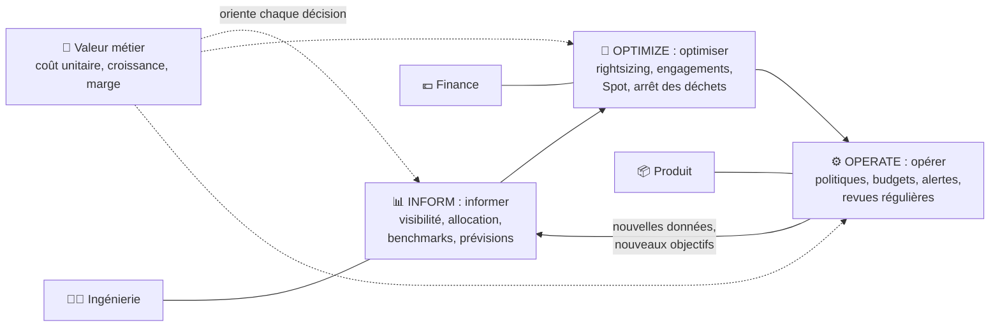

# Introduction au FinOps

## Pourquoi ce cours ?

Dans un datacenter, la dépense est **planifiée** : on achète des serveurs une fois par an, après un long arbitrage, et le coût est connu à l'avance. Dans le cloud, **chaque ingénieur dépense de l'argent à chaque `kubectl apply` ou `terraform apply`** : un cluster surdimensionné, un volume oublié, un transfert de données entre régions suffisent à ajouter des milliers d'euros à la facture du mois. La finance découvre la dépense **après coup**, l'ingénierie ne voit jamais la facture, et personne n'est vraiment responsable. Le **FinOps** (*Cloud Financial Operations*) est la pratique qui **rapproche ingénierie, finance et métier** pour que chacun comprenne, optimise et pilote les coûts du cloud **sans freiner l'innovation**. Le [cours d'introduction du module AWS](../../14-cloud-aws/cours/06-aws-couts-finops-intro.md) en a donné les premiers leviers ; ce module va plus loin, en particulier pour **Kubernetes**.

> Prérequis : [Kubernetes](../../09-kubernetes-approfondi/README.md), [Cloud AWS](../../14-cloud-aws/README.md) (tarification, étiquettes) et [Monitoring](../../10-monitoring-observabilite/README.md) (Prometheus, métriques) : le coût se mesure avec les mêmes outils que la performance.

## 1. Définition et principes

> Le **FinOps** est une **pratique opérationnelle et une culture** qui permet aux organisations d'obtenir la **valeur maximale du cloud** en faisant collaborer **ingénierie, finance, produit et direction** autour de **décisions fondées sur des données**.

Le **FinOps Framework**, publié par la **FinOps Foundation** (projet de la Linux Foundation), repose sur des **principes** que l'on peut résumer ainsi :

| Principe | Signification |
|---|---|
| **Les équipes collaborent** | Ingénierie, finance et métier travaillent ensemble, pas en silos |
| **Les décisions sont guidées par la valeur métier** | On ne cherche pas « le moins cher » mais le **meilleur rapport valeur / coût** |
| **Chacun est responsable de son usage du cloud** | Les équipes qui consomment **possèdent** leur coût |
| **Les données sont accessibles, à jour et fiables** | Visibilité **rapide** (jours, pas semaines) et partagée |
| **Une équipe centrale facilite** | Une équipe FinOps **outille et accompagne**, elle ne « police » pas |
| **On profite du modèle de coût variable** | Le cloud permet d'ajuster en continu : c'est un **avantage**, pas seulement un risque |

> 📌 **À retenir** : FinOps **n'est pas** « réduire la facture ». Un produit qui double son chiffre d'affaires en doublant sa facture cloud est **en bonne santé** ; un service qui coûte moins mais devient lent ou instable est **perdant**. On pilote le **coût unitaire** (par client, par transaction), pas seulement le total.

## 2. Pourquoi c'est devenu critique

| Facteur | Effet |
|---|---|
| **Dépenses cloud en forte croissance** | Souvent un des **premiers postes** de coût d'une entreprise numérique |
| **Dépense décentralisée** | Chaque équipe provisionne en libre-service ([plateforme interne](../../17-platform-engineering/README.md)) |
| **Gaspillage important** | Les estimations sectorielles situent le gaspillage cloud entre **20 et 35 %** de la dépense (ressources surdimensionnées, inutilisées, oubliées) : ordre de grandeur, à vérifier chez vous |
| **Complexité de la facturation** | Des milliers de lignes, des tarifs, des remises, des engagements ; Kubernetes **masque** les coûts derrière des nœuds partagés |
| **IA et GPU** | Des coûts unitaires très élevés qui peuvent exploser vite |
| **Pression économique** | Les dirigeants demandent des **comptes** : prévision, marge par produit |
| **Écoconception** | Moins de ressources gaspillées = moins d'énergie consommée |

## 3. Les trois phases : Inform, Optimize, Operate

| Phase | Objectif | Activités |
|---|---|---|
| **Inform** (informer) | **Voir et comprendre** qui dépense quoi et pourquoi | Allocation des coûts ([étiquetage](02-tagging-et-showback.md)), tableaux de bord, **showback**, prévisions, benchmarks, mesure du **coût unitaire** |
| **Optimize** (optimiser) | **Réduire le gaspillage** et améliorer l'efficience | **Rightsizing**, arrêt hors heures, **Spot**, **Savings Plans**, stockage froid, autoscaling ([cours 4](04-rightsizing-et-optimisation.md)) |
| **Operate** (opérer) | **Ancrer** les bonnes pratiques dans le fonctionnement quotidien | Budgets, alertes d'anomalie, politiques, revues mensuelles, formation, **gouvernance** ([cours 5](05-culture-finops-et-gouvernance.md)) |

C'est un **cycle**, pas une séquence : une optimisation produit de nouvelles données, qui permettent de mieux informer. Le cadre définit aussi un **niveau de maturité** par capacité : **Crawl** (on commence, processus ad hoc), **Walk** (processus définis, couverture croissante), **Run** (automatisé, intégré aux décisions).

> 💡 **Conseil** : ne cherchez pas à être « Run » partout. Commencez par **Inform** (on ne gère pas ce qu'on ne voit pas), obtenez une **allocation correcte** d'au moins 80 % des coûts, puis optimisez ce qui pèse le plus.

## 4. L'économie unitaire (*unit economics*)

La facture totale est une mauvaise métrique : elle monte quand le **succès** monte. L'**économie unitaire** rapporte le coût à une **unité de valeur métier**.

| Métrique | Calcul | Question à laquelle elle répond |
|---|---|---|
| **Coût par transaction** | Coût cloud du service ÷ nombre de transactions | Notre efficience s'améliore-t-elle avec l'échelle ? |
| **Coût par client actif** | Coût cloud ÷ clients actifs | Quelle part de l'abonnement est absorbée par l'infrastructure ? |
| **Coût par requête / par appel d'API** | Coût du service ÷ requêtes | Une optimisation a-t-elle fonctionné ? |
| **Marge brute cloud d'un produit** | (Revenu − coût cloud attribué) ÷ revenu | Ce produit est-il rentable ? |
| **Coût par environnement** | Coût dev + staging ÷ coût prod | Les environnements non productifs sont-ils maîtrisés ? |

Exemple : la facture passe de 40 000 € à 60 000 € (+50 %) pendant que le nombre de transactions passe de 2 M à 4 M (+100 %). Le **coût par transaction** est passé de **0,020 €** à **0,015 €** : l'efficience **s'est améliorée**, malgré une facture plus élevée.

> ⚠️ **Attention** : une métrique unitaire n'est fiable que si l'**allocation** l'est : si 30 % des coûts ne sont rattachés à aucun service, le coût par transaction est faux. Mesurez d'abord le **taux d'allocation** ([cours 2](02-tagging-et-showback.md)).

## 5. Modèle de coûts : cloud contre sur site

| | **Sur site** (*on-premise*) | **Cloud public** |
|---|---|---|
| **Nature de la dépense** | **CapEx** : achat de matériel amorti | **OpEx** : paiement à l'usage |
| **Décision de dépense** | Rare, centralisée (achats annuels) | **Permanente, décentralisée** (chaque déploiement) |
| **Capacité** | Dimensionnée pour le **pic** (et donc souvent sous-utilisée) | **Élastique** : on paie ce que l'on utilise |
| **Coût marginal** | Presque nul une fois le matériel acheté | **Chaque ressource facture**, y compris l'inutilisée |
| **Visibilité** | Peu de granularité, amortissements | **Très granulaire** (à la seconde, par ressource) |
| **Risque principal** | Sous-utilisation, obsolescence | **Dérive silencieuse** et surprise de facture |
| **Optimisation** | Rationalisation, consolidation | **Continue** : rightsizing, engagements, extinctions |

Dans un **cluster Kubernetes**, le problème se corse : le **nœud** (la machine que l'on paie) est partagé par des dizaines de pods de plusieurs équipes. La facture mentionne des **machines**, alors que la question est « combien coûte **l'application de l'équipe X** ? ». Il faut une **couche d'allocation** (OpenCost, Kubecost : [cours 3](03-kubecost-opencost.md)) qui répartit le coût des nœuds entre les charges **selon ce qu'elles demandent et consomment**.

## 6. Le standard FOCUS et l'écosystème

| Élément | Rôle |
|---|---|
| **FinOps Foundation** | Communauté, cadre (Framework), certifications (*FinOps Certified Practitioner*), rapport annuel *State of FinOps* |
| **FOCUS** (*FinOps Open Cost and Usage Specification*) | **Format ouvert** commun pour les données de facturation de plusieurs fournisseurs (AWS, Azure, GCP, Oracle…) : un même schéma pour comparer et agréger |
| **Outils des fournisseurs** | AWS Cost Explorer, Budgets, CUR / Data Exports ; Azure Cost Management ; GCP Billing |
| **Outils Kubernetes** | **OpenCost** (CNCF), **Kubecost**, Goldilocks, VPA |
| **Plateformes multi-cloud** | Outils commerciaux de gestion de coûts et d'optimisation |
| **Infrastructure as Code** | **Infracost** : coût d'un changement Terraform **dans la pull request** ([IaC](../../13-iac/README.md)) |

## Résumé

- **FinOps** = culture et pratique qui rapproche **ingénierie, finance et métier** pour tirer la **valeur maximale** du cloud ; ce n'est **pas** juste « baisser la facture ».
- **Principes** : collaboration, décisions par la valeur, **responsabilité** des équipes, données **rapides et fiables**, équipe centrale **facilitatrice**, tirer parti du coût variable.
- **Cycle Inform → Optimize → Operate**, avec des niveaux de maturité **Crawl, Walk, Run**.
- **Économie unitaire** (coût par transaction, par client) : la bonne métrique de pilotage ; elle exige une **allocation fiable**.
- Cloud = **dépense décentralisée et permanente** ; Kubernetes **masque** les coûts derrière des nœuds partagés, d'où l'**allocation** (OpenCost).
- **FOCUS** normalise les données de facturation ; la **FinOps Foundation** fournit cadre et certifications.

## Pour aller plus loin

- FinOps Foundation : <https://www.finops.org/> (Framework, *State of FinOps*) ; FOCUS : <https://focus.finops.org/> ; livre *Cloud FinOps* (J.R. Storment, Mike Fuller, O'Reilly).
- Précédent : [Coûts et FinOps du module AWS](../../14-cloud-aws/cours/06-aws-couts-finops-intro.md).
- Cours suivant : [Étiquetage et showback](02-tagging-et-showback.md).
