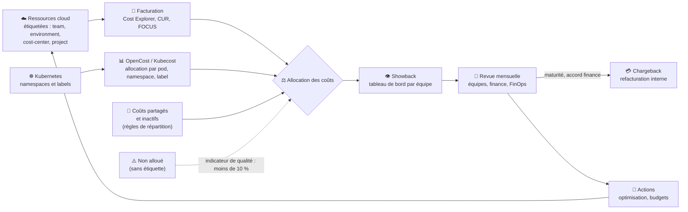

# Étiquetage, allocation des coûts et showback

## Pourquoi ce cours ?

Une facture cloud qui dit « 84 000 € en mars, dont 31 000 € pour EC2 » ne répond à **aucune** question utile : **qui** a dépensé cela, **pour quel produit**, **dans quel environnement** ? Sans cette information, personne ne se sent responsable, les optimisations sont aveugles, et la finance ne peut ni refacturer ni prévoir. La réponse tient en un mot : **l'allocation des coûts**, rendue possible par un **étiquetage** (*tagging*) rigoureux des ressources et, pour les ressources partagées, par des règles de **répartition**. Ce cours détaille la stratégie d'étiquettes, comment les **imposer** (AWS Tag Policies, Azure Policy), la différence entre **showback** et **chargeback**, et les outils de suivi (Cost Explorer, budgets). Il pose le socle de la phase **Inform** du [cycle FinOps](01-introduction-finops.md).

> Prérequis : [Introduction au FinOps](01-introduction-finops.md) et [Coûts et FinOps du module AWS](../../14-cloud-aws/cours/06-aws-couts-finops-intro.md) (étiquettes, Cost Explorer, Budgets).

## 1. Une stratégie d'étiquettes

Une **étiquette** (*tag*, ou *label* sur GCP et Kubernetes) est une paire clé / valeur rattachée à une ressource. Une bonne stratégie est **courte, imposée et automatisée**.

| Étiquette | Valeurs | Question | Utilité |
|---|---|---|---|
| `environment` | `dev`, `staging`, `prod` | Quel environnement ? | Éteindre les environnements non productifs ; comparer les coûts |
| `team` | `paiement`, `plateforme` | **Qui est responsable ?** | **Showback / chargeback** ; contact en cas d'anomalie |
| `cost-center` | `CC-4021` | À quelle ligne budgétaire ? | **Rapprochement comptable** |
| `project` (ou `application`) | `boutique`, `moteur-reco` | Pour quel produit ? | Coût **par produit** et économie unitaire |
| `owner` | adresse de l'équipe | Qui contacter ? | Réponse aux alertes |
| `managed-by` | `terraform`, `crossplane` | Comment est-elle gérée ? | Savoir ce qui peut être modifié à la main |
| `expiry` (facultatif) | `2026-03-31` | Jusqu'à quand ? | Nettoyer les ressources temporaires |
| `data-classification` (facultatif) | `public`, `confidentiel` | Quelle sensibilité ? | Sécurité et conformité |

Règles qui évitent le chaos :

| Règle | Détail |
|---|---|
| **Peu d'étiquettes obligatoires** (4 à 6) | Au-delà, la conformité s'effondre |
| **Convention unique** | Casse, séparateur, orthographe : `cost-center`, pas `CostCenter` ni `costcenter` ; **valeurs normalisées** (liste fermée) |
| **Documentée** | Un dictionnaire d'étiquettes dans le dépôt de la plateforme |
| **Posées par le code** | Terraform `default_tags`, modèles de plateforme ([golden paths](../../17-platform-engineering/cours/05-golden-paths-et-templates.md)), pas à la main |
| **Mesurée** | **% du coût couvert** par les étiquettes obligatoires (objectif > 90 %) |

> ⚠️ **Attention** : les étiquettes **ne s'appliquent pas au passé** (une ressource non étiquetée avant l'activation ne sera pas rétroactivement attribuée), et certaines ressources **ne sont pas étiquetables** ou **ne remontent pas** dans la facturation (transferts de données, certains support / taxes, ressources partagées). Prévoyez des **règles de répartition** pour cette part.

> 💡 **Conseil** : l'étiquette qui **rapporte le plus** est `team` (ou `owner`) : c'est elle qui transforme « un coût » en « **le coût de quelqu'un** ». Si vous ne devez en imposer qu'une seule au départ, prenez celle-là.

## 2. Imposer l'étiquetage

Un étiquetage **facultatif** n'est jamais respecté. Il faut **prévenir** (en amont), **corriger** (automatique) et **détecter** (en continu).

### Sur AWS

| Mécanisme | Rôle |
|---|---|
| **Tag Policies** (AWS Organizations) | Définissent les **clés, la casse et les valeurs autorisées** pour toute l'organisation ; rapport de **conformité** (elles n'empêchent pas toujours la création : à compléter) |
| **SCP** (*Service Control Policies*) | Peuvent **refuser** la création de ressources **sans** étiquette (`aws:RequestTag/team` condition) |
| **AWS Config** (règle `required-tags`) | **Détecte** les ressources non conformes, avec remédiation automatique possible |
| **Tag Editor** | Recherche et étiquetage **en masse** |
| **Terraform `default_tags`** | Pose les étiquettes sur **toutes** les ressources du fournisseur |
| **Étiquettes d'allocation de coûts** | À **activer** dans la console de facturation pour qu'elles apparaissent dans Cost Explorer et le CUR |
| **Cost Categories** | Regroupements **calculés** (« tout compte dont le nom commence par `prod-` » = produit X) sans étiquette |

```json
{
  "tags": {
    "team": {
      "tag_key": { "@@assign": "team" },
      "tag_value": { "@@assign": ["paiement", "plateforme", "catalogue"] },
      "enforced_for": { "@@assign": ["ec2:instance", "s3:bucket", "rds:db"] }
    }
  }
}
```

```hcl
provider "aws" {
  region = "eu-west-3"
  default_tags {
    tags = { team = "paiement", environment = "prod", cost-center = "CC-4021", managed-by = "terraform" }
  }
}
```

### Sur Azure et GCP

| Fournisseur | Mécanisme |
|---|---|
| **Azure** | **Azure Policy** : effets `deny` (refuser une ressource sans étiquette), `append` ou `modify` (ajouter), **héritage** de l'étiquette du groupe de ressources ; **Cost Management** pour l'analyse |
| **GCP** | **Labels** + **organisation de projets / dossiers** ; **contraintes de politique d'organisation** ; export de facturation vers **BigQuery** |

### Dans Kubernetes

Les étiquettes (*labels*) Kubernetes alimentent l'**allocation des coûts** par OpenCost et Kubecost ([cours 3](03-kubecost-opencost.md)) : un coût peut être agrégé **par namespace, par `Deployment`, par label** (`team`, `app`). On les impose par **politique d'admission** :

```yaml
apiVersion: kyverno.io/v1
kind: ClusterPolicy
metadata:
  name: labels-couts-obligatoires
spec:
  validationFailureAction: Audit            # puis Enforce (voir le module DevSecOps)
  rules:
    - name: team-et-environment
      match:
        any:
          - resources:
              kinds: [Deployment, StatefulSet, CronJob]
      validate:
        message: "Les labels 'team' et 'environment' sont obligatoires pour l'allocation des coûts."
        pattern:
          metadata:
            labels:
              team: "?*"
              environment: "?*"
```

Voir le [module DevSecOps (policy as code)](../../16-devsecops/cours/04-policy-as-code-kubernetes.md). Une organisation de **namespaces par équipe** (avec labels de namespace) est souvent la méthode d'allocation **la plus simple et la plus robuste**.

## 3. Les coûts qui ne se laissent pas étiqueter

| Type de coût | Pourquoi c'est difficile | Méthodes de répartition |
|---|---|---|
| **Ressources partagées** (cluster Kubernetes, réseau, observabilité) | Utilisées par plusieurs équipes | Proportionnel à l'**usage** (CPU, RAM demandés), au **nombre de pods**, ou **à parts égales** |
| **Coût inactif** (*idle*) | Capacité payée mais non utilisée | Réparti proportionnellement, ou affiché **à part** pour pousser à l'optimisation |
| **Support, taxes, crédits, remises** | Niveau du compte | Au **prorata** des dépenses |
| **Transferts de données** | Difficiles à rattacher | Mesure par service, ou répartition |
| **Engagements** (Savings Plans, réservations) | Bénéfice **partagé** entre comptes | Répartition **par consommation** ou garder au niveau central |
| **Ressources sans propriétaire** | Oubliées | Equipe centrale ; **campagne de nettoyage** |

Le principe : **mieux vaut une règle simple, connue et stable** qu'une répartition « exacte » mais incompréhensible. L'équité perçue importe autant que l'exactitude.

## 4. Showback et chargeback

| | **Showback** | **Chargeback** |
|---|---|---|
| **Principe** | On **montre** à chaque équipe ce qu'elle dépense | On **refacture** (internement) la dépense à l'équipe : son budget est débité |
| **Impact financier** | Aucun transfert : **information** | **Réel** : le coût est imputé au centre de coûts |
| **Effet recherché** | Prise de conscience, responsabilité | **Responsabilisation forte**, budgets décentralisés |
| **Prérequis** | Allocation correcte | Allocation **très fiable** + accord de la finance + **règles contestables** |
| **Risque** | Rapports ignorés | **Conflits** (désaccord sur les répartitions), comportements défensifs |
| **Quand** | **Point de départ** recommandé | Organisations **matures** |



> 📌 **À retenir** : commencez par le **showback**. Un tableau de bord par équipe, mis à jour **chaque semaine**, qui montre **le coût, la tendance, le coût inactif et les trois principales lignes de dépense**, change déjà les comportements. Le chargeback n'a de sens que lorsque l'allocation est **assez fiable pour être défendue** devant les équipes.

## 5. Les outils de suivi

| Outil | Rôle |
|---|---|
| **AWS Cost Explorer** | Graphiques par **service, compte, étiquette, Cost Category** ; **prévisions** ; historique 13 mois ; filtres |
| **AWS Budgets** | **Budgets** (coût, usage, couverture des engagements) avec **alertes** (e-mail, SNS) ; **actions** automatiques |
| **Cost Anomaly Detection** | Détection d'**anomalies** (pic inhabituel d'un service) |
| **Data Exports / CUR** | Données de facturation **détaillées** (ligne par ressource et par heure) analysables avec Athena |
| **Azure Cost Management / GCP Billing** | Équivalents ; export vers BigQuery |
| **Outils Kubernetes** | **OpenCost**, **Kubecost** ([cours 3](03-kubecost-opencost.md)) |
| **Infracost** | Coût d'un changement Terraform dans la PR |
| **Tableaux de bord** (Grafana, QuickSight, Looker) | Vues personnalisées par équipe |

```bash
# Coût du mois par étiquette « team » (AWS CLI)
aws ce get-cost-and-usage --time-period Start=2026-03-01,End=2026-04-01 \
  --granularity MONTHLY --metrics UnblendedCost --group-by Type=TAG,Key=team
# Les ressources non étiquetées apparaissent sous « team$ » (valeur vide)
```

### Les budgets et alertes

| Pratique | Détail |
|---|---|
| **Un budget par équipe et par produit** | Avec le **propriétaire** nommé |
| **Alertes à plusieurs seuils** | 50 %, 80 %, 100 % **du prévu** et **prévision** de dépassement |
| **Alertes d'anomalie** | Pic quotidien, nouveau service coûteux |
| **Destinataires clairs** | L'équipe responsable (canal d'équipe), pas une boîte générique |
| **Actions** | Bloquer le provisionnement de nouveaux gros services au-delà du seuil critique |

## 6. Mesurer la qualité de l'allocation

| Indicateur | Cible | Signification |
|---|---|---|
| **% du coût alloué** (rattaché à une équipe / un produit) | **> 90 %** | Base de toute analyse |
| **% de ressources étiquetables conformes** | **> 95 %** | Efficacité de l'imposition |
| **Coût « non alloué »** en valeur | Décroissant | Dette d'étiquetage |
| **Délai de rapport** (J+n) | **< 3 jours** | Fraîcheur des données |
| **Équipes qui consultent leur tableau de bord** | Croissant | Adoption du showback |

## Résumé

- Sans **allocation**, aucune responsabilité : l'étiquette `team` (propriétaire) est la plus précieuse ; **4 à 6 étiquettes obligatoires**, convention unique, **valeurs normalisées**.
- **Imposer** : **AWS Tag Policies + SCP + Config**, `default_tags` Terraform, **Azure Policy**, labels Kubernetes imposés par **Kyverno** ; activer les **étiquettes d'allocation de coûts**.
- Les **coûts partagés, inactifs, d'engagement** se répartissent par des **règles simples et stables**.
- **Showback** (montrer) d'abord, **chargeback** (refacturer) quand l'allocation est fiable et acceptée.
- Outils : **Cost Explorer**, **Budgets** (seuils, anomalies, destinataires clairs), **CUR**, **OpenCost/Kubecost** pour Kubernetes.
- Mesurer la **qualité d'allocation** : > 90 % du coût alloué, délai de rapport court.

## Pour aller plus loin

- AWS Tagging Best Practices (livre blanc) ; Tag Policies : <https://docs.aws.amazon.com/organizations/latest/userguide/orgs_manage_policies_tag-policies.html> ; Azure Policy : <https://learn.microsoft.com/azure/governance/policy/>.
- FinOps Foundation : *Cost Allocation* et *Chargeback / Showback* (capacités du Framework) : <https://www.finops.org/framework/capabilities/>.
- Cours suivant : [OpenCost et Kubecost](03-kubecost-opencost.md).
