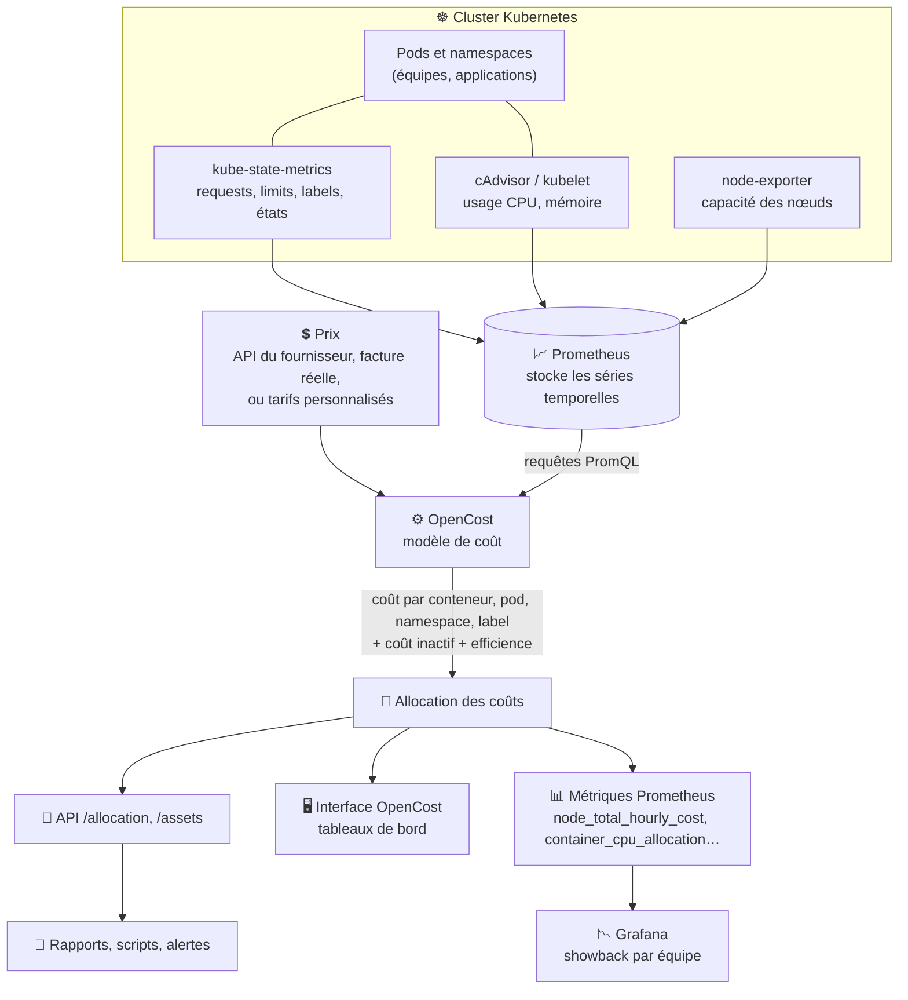

# OpenCost et Kubecost : le coût dans Kubernetes

## Pourquoi ce cours ?

La facture du fournisseur cloud parle de **machines virtuelles** et de **volumes**. Mais dans un cluster Kubernetes, ces machines (les **nœuds**) hébergent des dizaines de pods appartenant à **plusieurs équipes** : la question « combien coûte **le service de paiement** ? » n'a **aucune réponse directe** dans la facture. Il faut une couche qui **répartit le coût des nœuds entre les charges de travail**, selon ce qu'elles **réservent** (requests) et **consomment**. **OpenCost** (CNCF) et **Kubecost** font exactement cela : ils croisent les **métriques Kubernetes** (Prometheus) avec les **prix** du fournisseur pour produire un coût **par namespace, déploiement, pod ou label**, mais aussi l'**inefficience** (ce qui est réservé et inutilisé). Vous les pratiquerez dans les [ateliers](../ateliers-killercoda/README.md).

> Prérequis : [Étiquetage et showback](02-tagging-et-showback.md), [Kubernetes](../../09-kubernetes-approfondi/README.md) (requests, limits, namespaces) et [Monitoring](../../10-monitoring-observabilite/README.md) (Prometheus).

## 1. OpenCost et Kubecost : qui est qui ?

| | **OpenCost** | **Kubecost** |
|---|---|---|
| **Nature** | **Projet open source** de la **CNCF** (incubation) : **spécification** du modèle de coût + **implémentation** de référence | **Produit** commercial (édition gratuite limitée + éditions payantes), construit à l'origine par la société à l'origine d'OpenCost |
| **Gouvernance** | Neutre, communautaire | Éditeur unique (racheté par un grand acteur du logiciel en 2024) |
| **Modèle de coût** | **Le même cœur** (OpenCost en est la base) | Cœur OpenCost **plus** des fonctions propriétaires |
| **Fonctions typiques** | Allocation par namespace, contrôleur, pod, label ; actifs (nœuds, disques) ; **API** et **interface** légère ; métriques Prometheus ; intégration de prix cloud | Tout cela **plus** : **recommandations d'économie** (rightsizing, nœuds, arrêt d'objets orphelins), **alertes et budgets**, **multi-clusters** unifié, **rapports** avancés, SSO / RBAC, stockage long terme |
| **Coût** | Gratuit | Gratuit (limité) ou payant |
| **À choisir si…** | Vous voulez un **socle ouvert** et intégrer les données à vos tableaux de bord (Grafana) | Vous voulez **clé en main** : recommandations, multi-cluster, support |

> 📌 **À retenir** : les deux partagent **le même modèle d'allocation**. Apprendre OpenCost, c'est comprendre Kubecost ; migrer de l'un à l'autre est faisable. Les **recommandations d'optimisation** automatiques sont surtout dans Kubecost : avec OpenCost, on **lit l'efficience** (utilisé contre demandé) et on décide soi-même ([cours 4](04-rightsizing-et-optimisation.md)).

## 2. Comment le coût est calculé

OpenCost reconstitue, **à chaque pas de temps**, le coût de chaque conteneur en trois étapes :

| Étape | Source | Résultat |
|---|---|---|
| **1. Prix des ressources** | Tarifs du fournisseur (API de prix, facturation réelle, **ou tarifs personnalisés**) pour chaque **nœud** (type, région, Spot / à la demande), disque, IP, équilibreur | **Prix par heure** du CPU, de la RAM, du GPU, du stockage |
| **2. Consommation et réservation** | **Prometheus** : `kube_pod_container_resource_requests`, `container_cpu_usage_seconds_total`, `container_memory_working_set_bytes`, `kube_node_status_capacity`… | CPU / RAM **demandés** et **utilisés** par conteneur |
| **3. Allocation** | Modèle de coût | Coût = ressource **facturée** à la charge × **prix** |

### La règle clé : `max(demandé, utilisé)`

Pour chaque ressource, OpenCost facture la charge sur **le plus grand** de :

- ce qu'elle a **demandé** (`requests`) : parce que Kubernetes **réserve** cette capacité, personne d'autre ne peut l'utiliser ;
- ce qu'elle a **réellement utilisé** : si elle dépasse sa demande.

> 💡 **Conseil** : c'est ce qui fait des **`requests` un levier de coût direct** : un pod qui demande 2 CPU et en utilise 0,1 est facturé **2 CPU**. Réduire les requests (en restant sûr) fait baisser **immédiatement** la part de coût attribuée, et libère de la place pour d'autres pods (et à terme des nœuds).

### Les composantes du coût

| Composante | Définition |
|---|---|
| **Coût CPU / RAM / GPU** | Capacité facturée × prix par heure |
| **Coût de stockage** | Volumes persistants (PVC) attachés |
| **Coût réseau** | Trafic sortant (estimé) |
| **Coût inactif** (*idle*) | **Capacité des nœuds non réservée** par aucun pod : payée mais inutilisée ; répartie ou affichée à part (`__idle__`) |
| **Coûts partagés** | Namespaces système, supervision : répartis ou affectés à une équipe centrale |
| **Coûts externes** | Services hors cluster (bases managées, buckets) via les intégrations de facturation |

### Efficience

| Indicateur | Formule | Lecture |
|---|---|---|
| **Efficience CPU** | CPU **utilisé** ÷ CPU **facturé** (demandé) | 10 % = on **réserve dix fois** trop |
| **Efficience RAM** | RAM utilisée ÷ RAM facturée | Idem |
| **Efficience totale** | Coût « utilisé » ÷ coût total | Synthèse |

Une efficience **très basse** (< 30 %) signale un **gaspillage de requests** ; une efficience **proche de 100 %** voire supérieure signale un risque (**requests trop bas** : OOM, throttling).

## 3. Architecture et installation



### Installation d'OpenCost

OpenCost a besoin de **Prometheus** (qui collecte les métriques) et, idéalement, d'une **configuration de prix** :

```bash
# 1. Prometheus (kube-state-metrics et node-exporter inclus) + scrape de l'exporteur OpenCost
helm repo add prometheus-community https://prometheus-community.github.io/helm-charts
helm install prometheus prometheus-community/prometheus -n prometheus-system --create-namespace \
  --set alertmanager.enabled=false --set prometheus-pushgateway.enabled=false -f prometheus-values.yaml

# 2. OpenCost
helm repo add opencost https://opencost.github.io/opencost-helm-chart
helm install opencost opencost/opencost -n opencost --create-namespace -f opencost-values.yaml
```

```yaml
# opencost-values.yaml (extrait)
opencost:
  prometheus:
    internal:
      enabled: true
      serviceName: prometheus-server
      namespaceName: prometheus-system
      port: 80
  ui:
    enabled: true
  customPricing:                     # tarifs fictifs ou négociés, sans lien avec une facture
    enabled: true
    provider: custom
    costModel:
      CPU: "0.03"                    # $ par cœur et par heure
      RAM: "0.004"                   # $ par Go et par heure
```

> ⚠️ **Attention** : **sans configuration de facturation cloud**, OpenCost utilise des **prix par défaut ou personnalisés** : les montants sont des **estimations proportionnelles**, **pas votre facture réelle**. Pour des chiffres **rapprochés de la facture**, il faut intégrer la **facturation** du fournisseur (AWS CUR, GCP BigQuery, Azure) ou les prix négociés. Pour **comparer** des équipes ou mesurer une **amélioration**, des prix constants suffisent ; pour **budgéter**, il faut les vrais prix.

### Accéder aux données

```bash
kubectl -n opencost port-forward svc/opencost 9090:9090      # interface web
kubectl -n opencost port-forward svc/opencost 9003:9003      # API
# Coût par namespace sur les dernières 24 h
curl -s "http://localhost:9003/allocation/compute?window=24h&aggregate=namespace&accumulate=true"
```

Les agrégations disponibles : `namespace`, `controller`, `deployment`, `pod`, `container`, `label:team`, `node`, `cluster`… avec des fenêtres (`window=1h`, `7d`, `today`).

| Champ de l'API | Signification |
|---|---|
| `totalCost`, `cpuCost`, `ramCost`, `pvCost` | Coûts de la fenêtre |
| `cpuCoreRequestAverage`, `cpuCoreUsageAverage` | CPU demandé et utilisé (moyenne) |
| `ramByteRequestAverage`, `ramByteUsageAverage` | RAM demandée et utilisée |
| `cpuEfficiency`, `ramEfficiency`, `totalEfficiency` | Efficience (0 à 1) |
| `__idle__` | Coût de la capacité **non réservée** |

## 4. Lire et exploiter les résultats

| Question | Où regarder | Action typique |
|---|---|---|
| **Quelles équipes coûtent le plus ?** | Allocation par `label:team` ou `namespace` | Showback, revue mensuelle ([cours 2](02-tagging-et-showback.md)) |
| **Qui gaspille ?** | **Efficience** CPU/RAM par déploiement | **Rightsizing** des requests ([cours 4](04-rightsizing-et-optimisation.md)) |
| **Combien coûte la capacité inutilisée ?** | `__idle__` | Réduire les nœuds, bin packing, autoscaling |
| **Quel service est le plus cher à l'unité ?** | Allocation par `label:app` ÷ métrique métier | Économie unitaire ([cours 1](01-introduction-finops.md)) |
| **Les environnements non productifs coûtent-ils trop ?** | Allocation par `label:environment` | Arrêt hors heures |
| **Volumes orphelins ?** | Actifs / stockage non attaché | Nettoyage |
| **Dérive dans le temps ?** | Coût par jour sur 30 jours | Alertes d'anomalie |

**Recommandations d'économie.** Kubecost les génère (ajuster les requests, réduire la taille des nœuds, supprimer les volumes et IP orphelins, changer de classe de nœud). Avec OpenCost seul, on obtient des **recommandations manuelles** à partir de l'efficience : « ce déploiement demande 2 CPU et en utilise 0,1, ramenons les requests à 200 m avec une marge ». On peut aussi installer **Goldilocks** (recommandations VPA) ou **KRR** (Kubernetes Resource Recommender) pour des suggestions de valeurs.

> 💡 **Conseil** : branchez les **métriques OpenCost** dans **Grafana** et créez **un tableau de bord par équipe** (coût sur 7 et 30 jours, tendance, efficience, coût inactif). Un indicateur visible **chaque semaine** a plus d'effet qu'un rapport mensuel que personne ne lit.

## 5. Limites et précautions

| Limite | Conséquence |
|---|---|
| **Estimation, pas facture** | Écarts avec la facture (remises, engagements, taxes) : rapprocher via l'intégration de facturation |
| **Dépend de Prometheus** | Si les métriques manquent (rétention courte, scrape en panne), les coûts sont **incomplets** |
| **Les requests faussent le coût** | Des requests à 0 (ou absents) font **sous-estimer** une charge : imposer des requests ([politiques](../../16-devsecops/cours/04-policy-as-code-kubernetes.md)) |
| **Coût partagé délicat** | Les règles de répartition doivent être **expliquées** aux équipes |
| **Multi-clusters** | OpenCost libre = un cluster ; l'agrégation multi-cluster demande Kubecost, ou du travail (Prometheus fédéré, Thanos) |
| **Coûts hors cluster** | Bases managées, services SaaS : à rattacher par l'intégration cloud et les étiquettes |
| **Rétention** | Les données historiques dépendent de la rétention de Prometheus ou du stockage |

## Résumé

- **OpenCost** (CNCF, open source, neutre) et **Kubecost** (commercial) partagent **le même modèle** d'allocation ; Kubecost ajoute **recommandations, alertes, multi-cluster, rapports**.
- Le coût est calculé en croisant **métriques Prometheus** (requests, usage), **prix** (fournisseur ou personnalisés) et la règle **`max(demandé, utilisé)`** : les **requests sont un levier de coût**.
- Composantes : CPU, RAM, GPU, stockage, réseau, **coût inactif** (`__idle__`), coûts partagés et externes ; **efficience** = utilisé ÷ facturé.
- Installation : **Prometheus** (avec kube-state-metrics) + **OpenCost** (Helm) ; **API** `/allocation` et **interface** ; prix **personnalisés** si pas de facturation intégrée.
- Sans intégration de facturation, les montants sont des **estimations** ; adaptés à **comparer et mesurer des progrès**, pas à budgéter exactement.
- Exploiter : showback par équipe, **rightsizing** guidé par l'efficience, réduction de l'inactif, **tableaux de bord Grafana** par équipe.

## Pour aller plus loin

- OpenCost : <https://opencost.io/docs/> ; spécification : <https://github.com/opencost/opencost/tree/develop/spec> ; chart Helm : <https://github.com/opencost/opencost-helm-chart> ; Kubecost : <https://docs.kubecost.com/>.
- Outils complémentaires : **Goldilocks** (<https://github.com/FairwindsOps/goldilocks>), **KRR** (<https://github.com/robusta-dev/krr>).
- Pratique : [Atelier 1 — installer OpenCost](../ateliers-killercoda/atelier-01-opencost-installation/intro.md) et [Atelier 2 — rightsizing des requests](../ateliers-killercoda/atelier-02-rightsizing-requests/intro.md).
- Cours suivant : [Rightsizing et optimisation](04-rightsizing-et-optimisation.md).
