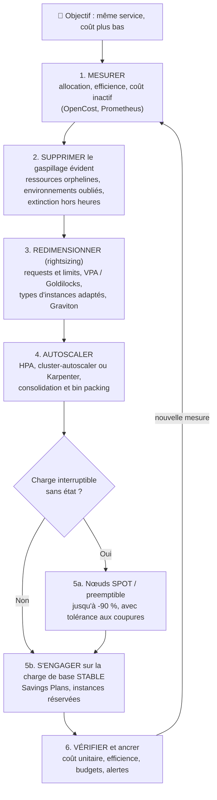

# Rightsizing et optimisation des coûts

## Pourquoi ce cours ?

La visibilité ([cours 3](03-kubecost-opencost.md)) montre **où** l'argent part ; reste à en **dépenser moins pour le même service**. Les gains les plus importants dans le cloud ne viennent pas de négociations tarifaires mais de **trois habitudes d'ingénierie** : **demander la bonne quantité de ressources** (*rightsizing*), **payer le bon prix** pour ce qui tourne en continu (engagements) ou qui peut être interrompu (Spot), et **ne payer que ce que la charge demande à l'instant** (autoscaling, extinction). Dans Kubernetes, tout commence par les **`requests`** : elles déterminent à la fois ce que le scheduler **réserve**, ce qui est **facturé** à la charge et le nombre de **nœuds** nécessaires. Ce cours donne la **méthode** et l'**ordre** des optimisations, avec leurs risques. Vous pratiquerez le rightsizing dans l'[atelier 2](../ateliers-killercoda/atelier-02-rightsizing-requests/intro.md).

> Prérequis : [OpenCost et Kubecost](03-kubecost-opencost.md), [Kubernetes](../../09-kubernetes-approfondi/README.md) (requests, limits, HPA) et [Coûts et FinOps du module AWS](../../14-cloud-aws/cours/06-aws-couts-finops-intro.md) (Savings Plans, Spot).

## 1. Une stratégie : mesurer, dimensionner, s'engager

L'ordre compte : **chaque étape change la base de calcul de la suivante**. S'engager (Savings Plans) avant de dimensionner fige le gaspillage pour un ou trois ans.



> 📌 **À retenir** : **mesurer → supprimer → redimensionner → autoscaler → (Spot) → s'engager**. Le dernier maillon (engagement) ne se décide qu'**après** les précédents, sur la **charge de base réellement observée**, pas sur la charge **gonflée par les requests surdimensionnées**.

## 2. Le rightsizing des requests et des limits

### Rappel : ce que font `requests` et `limits`

| | **`requests`** | **`limits`** |
|---|---|---|
| **Rôle** | Capacité **réservée** : le scheduler place le pod là où il y a de la place | **Plafond** : au-delà, le CPU est **bridé** (throttling) et la mémoire provoque un **OOMKill** |
| **Effet sur le coût** | **Direct** : c'est ce qui est **facturé** (règle `max(demandé, utilisé)`) | Aucun directement ; risque d'instabilité si trop bas |
| **Effet sur la fiabilité** | Trop bas : pod **évincé** ou placé sur un nœud saturé | CPU trop bas : **latence** ; mémoire trop basse : **OOMKilled** |

Les **classes de QoS** (qualité de service) en découlent : **Guaranteed** (requests = limits), **Burstable** (requests < limits), **BestEffort** (aucune valeur : évincés en premier, **à éviter** en production).

### La démarche

1. **Mesurer l'usage réel sur une période représentative** (au moins **7 jours**, incluant un pic : fin de mois, soldes) : percentiles **p95 / p99** du CPU et de la mémoire, pas la moyenne.
2. **Fixer les requests** près de l'usage typique (CPU : p90 à p95 + marge ; mémoire : p99 + marge, car la mémoire n'est **pas compressible**).
3. **Fixer les limits** avec discernement : **mémoire limit = request** (ou proche) pour la prévisibilité ; **CPU : souvent aucune limit** (ou large) pour éviter le throttling inutile, selon la politique de l'organisation.
4. **Déployer progressivement**, surveiller (OOMKills, redémarrages, latences), **ajuster**.
5. **Répéter** : l'usage évolue.

| Symptôme | Cause probable | Action |
|---|---|---|
| Efficience CPU **< 20 %** | Requests CPU bien trop hautes | Réduire (vers p95 + marge) |
| Efficience mémoire **< 40 %** | Requests mémoire trop hautes | Réduire avec prudence (p99 + 20-30 %) |
| `OOMKilled` | Mémoire trop basse (ou fuite) | **Augmenter** la limit ; chercher une fuite |
| Latence en pics, `container_cpu_cfs_throttled` élevé | **Limit CPU trop basse** | Relever ou supprimer la limit CPU |
| Pods `Pending` malgré des nœuds peu utilisés | Requests **trop grosses** pour le placement | Rightsizer ; **bin packing** |

> ⚠️ **Attention** : **réduire les requests trop agressivement** est la source n°1 d'incidents d'optimisation (OOMKill, latence, évictions). Procédez **par paliers**, une charge à la fois, **hors de la période de pointe**, avec un **retour arrière** simple (Git) et des **alertes** actives ([monitoring](../../10-monitoring-observabilite/README.md)). Pour les **bases de données** et les charges à mémoire variable, soyez particulièrement prudent.

### Les outils de recommandation

| Outil | Principe |
|---|---|
| **VPA** (*Vertical Pod Autoscaler*) | Observe l'usage et **recommande** (ou applique) des requests ; modes `Off` (recommandations seules), `Initial` (à la création), `Auto` (redémarre les pods pour appliquer) |
| **Goldilocks** (Fairwinds) | Crée des VPA en mode `Off` pour **chaque déploiement** et affiche les recommandations dans un tableau de bord |
| **KRR** (Robusta) | Recommandations **depuis Prometheus**, sans installer de VPA |
| **Kubecost** | Recommandations de requests intégrées |
| **Redimensionnement en place** | Les versions récentes de Kubernetes permettent d'ajuster CPU / mémoire d'un pod **sans le redémarrer** (fonction récente, vérifier la version et l'état de la fonction) |

```yaml
apiVersion: autoscaling.k8s.io/v1
kind: VerticalPodAutoscaler
metadata:
  name: boutique-api
spec:
  targetRef: { apiVersion: apps/v1, kind: Deployment, name: boutique-api }
  updatePolicy:
    updateMode: "Off"                  # recommandations seulement : on applique après revue (GitOps)
  resourcePolicy:
    containerPolicies:
      - containerName: "*"
        minAllowed: { cpu: 50m, memory: 64Mi }
        maxAllowed: { cpu: 2, memory: 2Gi }
```

> 💡 **Conseil** : en **GitOps**, utilisez VPA en mode **`Off`** : il **recommande**, vous **reportez** la valeur dans Git par une PR revue. Le mode `Auto` modifie les pods **hors de Git** et se bat avec la réconciliation ([cours GitOps](../../15-gitops-argocd/cours/03-application-et-sync-policies.md)). Ne combinez **jamais** VPA `Auto` et HPA sur la **même métrique** (CPU).

## 3. L'autoscaling

| Niveau | Outil | Rôle |
|---|---|---|
| **Pods : horizontal** | **HPA** (*Horizontal Pod Autoscaler*) | Ajuste le **nombre de réplicas** selon CPU, mémoire ou métriques personnalisées |
| **Pods : événementiel** | **KEDA** | Échelle selon des **événements** (longueur de file, planification) et **jusqu'à zéro** |
| **Pods : vertical** | **VPA** | Ajuste les requests |
| **Nœuds** | **Cluster Autoscaler** | Ajoute des nœuds quand des pods sont `Pending`, en retire quand ils sont sous-utilisés (groupes de nœuds prédéfinis) |
| **Nœuds : approche moderne** | **Karpenter** (AWS, et autres) | **Provisionne** des nœuds **adaptés à la demande** (type et taille choisis selon les pods en attente), **consolide** (remplace plusieurs nœuds peu remplis par moins de nœuds), gère Spot et expiration |

```yaml
# Karpenter : un pool de nœuds Spot et à la demande, avec consolidation (extrait)
apiVersion: karpenter.sh/v1
kind: NodePool
metadata: { name: general }
spec:
  template:
    spec:
      requirements:
        - { key: karpenter.sh/capacity-type, operator: In, values: ["spot", "on-demand"] }
        - { key: kubernetes.io/arch, operator: In, values: ["arm64", "amd64"] }
  disruption:
    consolidationPolicy: WhenEmptyOrUnderutilized
    consolidateAfter: 1m
  limits: { cpu: "200" }                 # plafond de coût : limite de sécurité
```

| Pratique | Détail |
|---|---|
| **Définir un plafond** (`limits`) | Empêche un emballement de nœuds (boucle d'autoscaling, erreur) |
| **PodDisruptionBudget** | Protège la disponibilité pendant la consolidation |
| **Réglage du délai de réduction** | Trop court = instabilité ; trop long = coût inutile |
| **Éteindre hors heures** | Les environnements non productifs à **zéro** la nuit et le week-end (KEDA cron, `kube-downscaler`) : jusqu'à **~65 %** d'économie sur ces environnements |

## 4. Le bin packing

Le **bin packing** consiste à **remplir au mieux** les nœuds : plus les pods sont **bien répartis** et **justes**, moins il faut de nœuds.

| Levier | Effet |
|---|---|
| **Requests justes** | Évite que des pods « réservent » de la place inutilisée |
| **Nœuds de taille adaptée** | De **gros nœuds** réduisent la perte par fragmentation (mais augmentent le rayon d'impact d'une panne) |
| **Consolidation** (Karpenter, descheduler) | Regroupe les pods sur moins de nœuds |
| **Stratégie de scheduler** | `MostAllocated` (remplir les nœuds) plutôt que `LeastAllocated` (répartir) pour réduire le nombre de nœuds, quand la disponibilité le permet |
| **Affinités et *taints* modérés** | Trop de contraintes **fragmentent** le placement |
| **Pods de tailles homogènes** | Évite les « trous » inutilisables |

> ⚠️ **Attention** : le bin packing agressif **concentre le risque** : moins de nœuds = **plus d'impact** à la perte d'un nœud. Gardez des **marges** (disponibilité, `topologySpreadConstraints`, PDB) ; c'est un **arbitrage coût / résilience**, à décider avec les équipes ([SRE](../../11-sre-pratiques/README.md)).

## 5. Les modèles de prix du calcul

| Modèle | Remise indicative* | Engagement | Convient à |
|---|---|---|---|
| **À la demande** | 0 % | Aucun | Charges **imprévisibles**, démarrage |
| **Savings Plans** (Compute / EC2 Instance) | jusqu'à ~**70 %** | 1 ou 3 ans, en **$ par heure** | Charge de base **stable**, flexibilité sur les services et régions (Compute) |
| **Instances réservées** | jusqu'à ~**70 %** | 1 ou 3 ans, type précis | Charges stables, services comme RDS |
| **Spot** (AWS), **Spot / preemptible** (GCP), **Spot** (Azure) | jusqu'à ~**90 %** | Aucun ; **interruption possible** (AWS : préavis de **2 minutes**) | Charges **sans état**, tolérantes aux coupures : CI, traitements par lots, nœuds de travail |
| **Graviton** (ARM, AWS) | ~**20 %** de mieux à performance égale | Aucun | Images **ARM64** disponibles |

\* Ordres de grandeur variables selon service, région et durée : vérifiez la tarification officielle ([cours AWS](../../14-cloud-aws/cours/06-aws-couts-finops-intro.md)).

### Utiliser le Spot sans danger dans Kubernetes

| Pratique | Détail |
|---|---|
| **Diversifier** les types d'instances | Plus de pools = moins d'interruptions simultanées |
| **Gérer l'interruption** | Écouter l'avis de préavis (AWS Node Termination Handler, Karpenter) ; **drainer** proprement |
| **Réserver le Spot aux charges adaptées** | Pods sans état avec `replicas ≥ 2`, **PDB**, `terminationGracePeriodSeconds` court |
| **Garder une base à la demande** | Composants critiques (bases, contrôleurs, un minimum de réplicas) sur nœuds **stables** ; étiquettes `capacity-type` + `tolerations` / `nodeSelector` |
| **Mélange** | Par exemple 70 % Spot, 30 % à la demande pour un service web |

### Engagements : à quel niveau ?

1. **Dimensionnez d'abord** (rightsizing, extinction, Spot) pour connaître la **charge de base stable**.
2. **Couvrez 60 à 80 %** de cette base par un **Savings Plan Compute** (flexible) plutôt qu'une réservation figée ; gardez le reste **à la demande** et **Spot**.
3. **Suivez** la couverture et l'utilisation de l'engagement (une sous-utilisation est une perte).
4. **Étagez** les échéances (ne pas tout renouveler le même jour).

## 6. Autres leviers

| Levier | Détail |
|---|---|
| **Stockage** | Supprimer **volumes et instantanés orphelins** ; **gp3** à la place de gp2 / io1 ; classes froides S3 ; **PVC** inutilisés ; durées de rétention des journaux ([cours stockage AWS](../../14-cloud-aws/cours/05-aws-stockage-s3-ebs-efs.md)) |
| **Réseau** | Garder le trafic **dans la même AZ / région**, **endpoints** pour S3, CDN, **réduire le NAT Gateway** ; le **transfert inter-AZ** d'un cluster maillé peut surprendre |
| **Observabilité** | Les journaux et métriques coûtent : **échantillonner**, limiter la **cardinalité**, réduire la rétention |
| **Images et CI** | Caches de build, runners **Spot**, nettoyage des artefacts |
| **Architecture** | Serverless pour le sporadique ; conteneurs pour le continu ; éviter la sur-ingénierie multi-région |
| **Licences et support** | Revoir les niveaux de support payants et les licences (bases commerciales) |
| **Écoconception** | Moins de ressources gaspillées = moins d'énergie |

## 7. Suivre l'effet et ne pas régresser

| Pratique | Détail |
|---|---|
| **Mesurer avant / après** | Efficience, coût par namespace, **coût unitaire** |
| **Objectifs d'efficience** | Par exemple **CPU > 50 %, mémoire > 60 %** pour les charges stables |
| **Garde-fous automatiques** | Politiques exigeant **requests et limits** ; **LimitRange** et **ResourceQuota** par namespace |
| **Revues régulières** | Mensuelles, par équipe, sur les 5 plus gros écarts |
| **Inclure le coût dans la PR** | Infracost pour l'IaC ; règles de revue pour les requests |
| **Automatiser** | Rapports de rightsizing automatiques, PR de recommandations |

```yaml
apiVersion: v1
kind: LimitRange
metadata: { name: valeurs-par-defaut, namespace: equipe-boutique }
spec:
  limits:
    - type: Container
      defaultRequest: { cpu: 100m, memory: 128Mi }
      default: { memory: 256Mi }
      max: { cpu: "2", memory: 2Gi }
---
apiVersion: v1
kind: ResourceQuota
metadata: { name: plafond-equipe, namespace: equipe-boutique }
spec:
  hard: { requests.cpu: "20", requests.memory: 40Gi, limits.memory: 60Gi }
```

## Résumé

- Ordre d'optimisation : **mesurer → supprimer le gaspillage → redimensionner → autoscaler → Spot → s'engager** ; s'engager **en dernier**, sur la charge de base **réelle**.
- Les **requests** sont **facturées** et **réservées** : le **rightsizing** vise **p95 / p99 d'usage + marge**, par paliers, avec retour arrière ; **réduire trop vite** cause OOMKill, throttling, évictions.
- **VPA** (de préférence en mode **`Off`** en GitOps), **Goldilocks**, **KRR**, Kubecost recommandent ; ne pas combiner VPA `Auto` et HPA sur le CPU.
- **Autoscaling** : HPA / KEDA (pods), **Cluster Autoscaler** ou **Karpenter** (nœuds, **consolidation**), plafonds et PDB ; **extinction hors heures** des environnements non productifs.
- **Bin packing** : requests justes, nœuds adaptés, consolidation ; arbitrage **coût / résilience**.
- **Spot** (jusqu'à ~90 %, charges sans état, interruptions gérées), **Savings Plans / réservations** (jusqu'à ~70 %, 60 à 80 % de la base), **Graviton**, stockage, réseau, observabilité.
- **Ancrer** par `LimitRange`, `ResourceQuota`, politiques, revues et objectifs d'efficience.

## Pour aller plus loin

- Kubernetes : <https://kubernetes.io/docs/concepts/configuration/manage-resources-containers/> ; VPA : <https://github.com/kubernetes/autoscaler/tree/master/vertical-pod-autoscaler> ; Karpenter : <https://karpenter.sh/> ; KEDA : <https://keda.sh/>.
- Goldilocks : <https://github.com/FairwindsOps/goldilocks> ; KRR : <https://github.com/robusta-dev/krr>.
- Pratique : [Atelier 2 — rightsizing des requests](../ateliers-killercoda/atelier-02-rightsizing-requests/intro.md).
- Cours suivant : [Culture FinOps et gouvernance](05-culture-finops-et-gouvernance.md).
