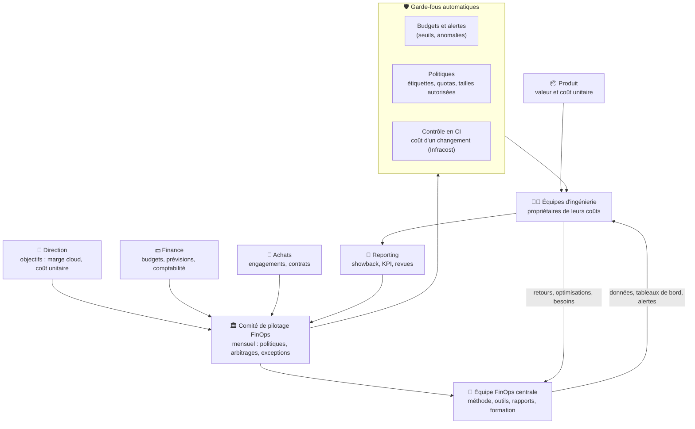

# Culture FinOps et gouvernance

## Pourquoi ce cours ?

Un tableau de bord, un outil d'allocation, un Savings Plan : tout cela **ne tient pas** sans organisation. Les optimisations sont faites une fois puis **se défont** (de nouvelles ressources, de nouvelles équipes, de nouveaux services) ; les budgets sont dépassés sans que personne soit prévenu ; les ingénieurs trouvent que le FinOps « freine » ; la finance trouve que l'ingénierie « dépense sans compter ». Le FinOps est avant tout une **pratique collective** : des **rôles** clairs, des **règles** (budgets, politiques, alertes) appliquées automatiquement, des **équipes formées**, des **indicateurs partagés** et des **rituels** de revue. Ce cours en décrit les composantes : l'équipe FinOps, la **gouvernance**, la formation, les **KPI** (coût par transaction, par client) et le **reporting**. C'est la phase **Operate** du [cycle FinOps](01-introduction-finops.md).

> Prérequis : [Introduction au FinOps](01-introduction-finops.md), [Étiquetage et showback](02-tagging-et-showback.md) et [Rightsizing](04-rightsizing-et-optimisation.md). Voir aussi la culture de [plateforme comme produit](../../17-platform-engineering/cours/06-team-topologies-et-culture.md).

## 1. Les rôles

Le FinOps Framework décrit des **personas** : ce ne sont pas forcément des postes, mais des **responsabilités**.

| Rôle | Responsabilité FinOps |
|---|---|
| **Équipe FinOps** (centrale) | **Anime la pratique** : outils, méthode, rapports, accompagnement ; **ne dépense pas** à la place des équipes |
| **Ingénierie / DevOps / Plateforme** | **Possède** ses coûts : dimensionnement, architecture, arrêt de ce qui est inutile ; implémente les optimisations |
| **Produit** | Relie **coût et valeur** : arbitre les fonctions selon leur rentabilité |
| **Finance** | Budgets, prévisions, **comptabilité** (CapEx / OpEx, amortissement des engagements), validation des méthodes d'allocation |
| **Direction** (technique et métier) | Fixe les **objectifs** (marge cloud, coût unitaire), arbitre, **soutient** la démarche |
| **Achats / contrats** | Négociation avec les fournisseurs, engagements pluriannuels, marketplace |
| **Sécurité / conformité** | Cohérence entre garde-fous de sécurité et de coût |

> 📌 **À retenir** : la **responsabilité** du coût reste **dans les équipes qui le génèrent** ; l'équipe FinOps **facilite**. Si l'équipe FinOps « fait les optimisations » à la place des ingénieurs, rien ne dure ; si elle se contente de produire des rapports que personne ne lit, rien ne bouge.

### Dimensionner l'équipe FinOps

| Taille de la dépense cloud | Organisation habituelle |
|---|---|
| Petite (quelques milliers d'euros par mois) | Un **référent** à temps partiel (souvent un ingénieur plateforme) |
| Moyenne | **1 à 2 praticiens FinOps** + relais dans les équipes (*FinOps champions*) |
| Grande | **Équipe dédiée** (praticiens, analystes de données, ingénieurs) et **Cloud Center of Excellence** |

Un **FinOps champion** est un ingénieur volontaire d'une équipe produit, formé aux bases, qui **relaie** les alertes, anime la revue de son équipe et remonte les besoins ([security champion](../../16-devsecops/cours/01-introduction-devsecops.md) du module DevSecOps : même idée).

## 2. La gouvernance

La gouvernance, ce sont les **règles du jeu** : qui décide, avec quels seuils, comment on les applique. Plus elles sont **automatisées**, moins elles sont conflictuelles.

| Domaine | Mécanisme | Exemple |
|---|---|---|
| **Budgets** | Budget par équipe / produit / environnement, avec **propriétaire** et **seuils** | Alerte à 50 %, 80 %, 100 % et sur **prévision** de dépassement |
| **Alertes d'anomalie** | Détection automatique (Cost Anomaly Detection, règles) | Un service dont le coût double en 24 h |
| **Étiquetage** | Politiques **obligatoires** ([cours 2](02-tagging-et-showback.md)) | Pas de ressource sans `team` ni `cost-center` |
| **Quotas** | `ResourceQuota`, quotas de comptes cloud | Plafond de CPU par équipe |
| **Catalogue de tailles autorisées** | Politiques d'admission, bornes dans les API de plateforme ([Crossplane](../../17-platform-engineering/cours/04-crossplane-control-plane.md)) | Pas d'instance de plus de 16 vCPU sans approbation |
| **Approbation des gros achats** | Seuil de dépense déclenchant une revue | Engagement de plus de 50 k€, GPU |
| **Cycle de vie** | Étiquette `expiry`, nettoyage automatique | Environnements de test supprimés après 7 jours |
| **Environnements non productifs** | Extinction nocturne, tailles réduites | Staging éteint de 20 h à 7 h |
| **Engagements** | Politique de couverture (60 à 80 % de la base) et de renouvellement | Revue trimestrielle |
| **Exceptions** | **Tracées**, motivées, **limitées dans le temps** | Dérogation de 30 jours pour un test de charge |

Une règle utile : **« guardrails, not gates »** : privilégier des **garde-fous** (les bonnes pratiques sont le chemin par défaut, les dépassements génèrent une alerte) plutôt que des **barrières** (approbation systématique) qui ralentissent tout le monde ([golden paths](../../17-platform-engineering/cours/05-golden-paths-et-templates.md)).

> ⚠️ **Attention** : une gouvernance qui **bloque** sans **expliquer** ni **proposer d'échappatoire rapide** est contournée (comptes parallèles, ressources non étiquetées). Mieux vaut une **alerte claire** et un **processus d'exception de 10 minutes** qu'un refus opaque. Et ne **punissez** pas le dépassement : cherchez la **cause** (changement de charge, erreur, absence d'outil).

### Les rituels

| Rituel | Fréquence | Participants | Contenu |
|---|---|---|---|
| **Revue de coûts d'équipe** | Mensuelle (30 min) | Équipe + FinOps champion | Tendance, **top 5 des lignes**, efficience, actions décidées |
| **Revue de gouvernance** | Mensuelle | Comité de pilotage | KPI globaux, exceptions, engagements, prévisions |
| **Prévision** (*forecast*) | Mensuelle / trimestrielle | Finance + FinOps | Ajuster budgets et engagements |
| **Revue des engagements** | Trimestrielle | FinOps + Achats | Couverture, utilisation, renouvellements |
| **Alerte d'anomalie** | Continue | Équipe propriétaire | Traitement sous 24 h |
| **Retour d'expérience** | À la demande | Équipe concernée | Explication d'un pic ; mise à jour de la règle |

## 3. Former et motiver

| Action | Détail |
|---|---|
| **Formation de base** | Tous les ingénieurs : lire une facture, comprendre le coût d'un service, `requests` et efficience (**1 h** pour démarrer) |
| **Certification** | *FinOps Certified Practitioner* pour l'équipe FinOps et les champions |
| **Documentation** | Guide « comment réduire le coût de mon service », dictionnaire d'étiquettes, FAQ |
| **Visibilité** | **Tableau de bord par équipe** ; coût affiché dans le **portail développeur** ([Backstage](../../17-platform-engineering/cours/03-backstage-portal.md)) |
| **Coût dans les outils** | Coût estimé d'un changement Terraform dans la PR ; badge d'efficience sur le service |
| **Reconnaissance** | Valoriser les **économies réalisées** et les bonnes pratiques (sans en faire un concours toxique) |
| **Objectifs partagés** | Intégrer l'**efficience** aux objectifs d'équipe (au même titre que la fiabilité : [SLO](../../11-sre-pratiques/README.md)) |
| **Hackathons / « cost days »** | Journées dédiées au nettoyage et au rightsizing |

> 💡 **Conseil** : traitez le coût comme **une exigence non fonctionnelle** au même titre que la performance et la sécurité : **objectif** (coût unitaire cible), **mesure** (tableau de bord), **revue** (régulière), **dette** (backlog d'optimisations priorisé). Un coût qui n'apparaît que dans le rapport de la finance n'est pas un sujet d'ingénierie.

## 4. Les indicateurs (KPI)

| Catégorie | KPI | Cible indicative | Lecture |
|---|---|---|---|
| **Économie unitaire** | **Coût par transaction**, par client actif, par requête | **Stable ou décroissant** avec l'échelle | La **mesure reine** : l'efficience en fonction de la valeur |
| | **Marge brute cloud** par produit | Selon la stratégie | Rentabilité d'un produit |
| **Allocation** | % du coût **alloué** à une équipe / produit | **> 90 %** | Fiabilité de tout le reste |
| | % de ressources **conformes** à l'étiquetage | **> 95 %** | Efficacité des politiques |
| **Efficience** | Efficience CPU / mémoire (Kubernetes) | **CPU > 50 %**, mémoire > 60 % (charges stables) | Gaspillage de requests |
| | **Coût inactif** (% du coût des nœuds) | **< 20 à 30 %** | Capacité non utilisée |
| | **% de ressources inutilisées** (volumes, IP, instances orphelines) | Proche de 0 | Hygiène |
| **Engagements** | **Taux de couverture** (part du calcul stable couvert) | 60 à 80 % | Remises captées |
| | **Taux d'utilisation** de l'engagement | **> 95 %** | Engagement bien dimensionné |
| **Prévision** | **Écart prévision / réel** | **< 5 à 10 %** | Prévisibilité (pour la finance) |
| **Réactivité** | Délai de traitement d'une **anomalie** | **< 24 h** | Gouvernance opérante |
| | Délai de **disponibilité des données** | **< 3 jours** | Fraîcheur du showback |
| **Adoption** | % d'équipes avec un **tableau de bord consulté** et un budget | **> 80 %** | Culture |
| **Économies** | Économies **réalisées** (€ évités) et **durables** | Suivi cumulé | Valeur de la pratique |

> ⚠️ **Attention** : attention à la **loi de Goodhart** (*quand une mesure devient un objectif, elle cesse d'être une bonne mesure*). Un objectif « réduire la facture de 20 % » pousse à **couper ce qui est utile** ; un objectif « **coût par transaction** » ou « **efficience CPU** » avec **garde-fou de fiabilité** (SLO respectés) oriente mieux. Associez toujours un indicateur de **coût** à un indicateur de **qualité de service**.

### Exemple de calcul d'économie unitaire

| | Janvier | Mars | Évolution |
|---|---|---|---|
| Coût cloud du service (€) | 40 000 | 52 000 | **+30 %** |
| Transactions (millions) | 2,0 | 3,2 | **+60 %** |
| **Coût par transaction (€)** | **0,0200** | **0,0163** | **−18,8 %** |

La facture a monté, **l'efficience s'est améliorée** : c'est le message à porter à la direction.

## 5. Le reporting

| Public | Contenu | Format | Fréquence |
|---|---|---|---|
| **Équipes d'ingénierie** | Coût de **leurs** services, tendance, **efficience**, **top optimisations**, anomalies | Tableau de bord (Grafana, portail), alertes | **Continu** + revue mensuelle |
| **Direction technique** | Coûts par produit, économie unitaire, **couverture**, **risques**, plan d'optimisation | Synthèse d'une page | Mensuelle |
| **Finance** | Prévision vs réel, **allocation** (showback / chargeback), engagements, écarts | Rapport structuré (rapprochement avec la comptabilité) | Mensuelle |
| **Direction générale** | Coût par unité de valeur, **marge cloud**, risques, économies | Indicateurs clés | Trimestrielle |

Principes d'un bon rapport :

1. **Une seule vérité** : mêmes chiffres partout (source de données unique, **FOCUS** si multi-cloud).
2. **Actionnable** : chaque rapport propose **trois actions** chiffrées (« gain estimé : 3 200 €/mois »).
3. **Contextualisé** : expliquer **pourquoi** un coût a bougé (lancement, migration, saisonnalité).
4. **Comparable** : coût **par unité**, pas seulement par total ; benchmarks entre équipes comparables.
5. **À temps** : des données de la semaine, pas d'il y a deux mois.

## 6. Démarrer et faire grandir la pratique

| Étape | Ce qu'on met en place | Durée indicative |
|---|---|---|
| **1. Sensibiliser** | Constater la facture, nommer un **référent**, présenter le cadre | 2 à 4 semaines |
| **2. Voir** | Étiquetage minimal, **allocation** d'au moins 80 % des coûts, premier **showback** | 1 à 3 mois |
| **3. Agir** | **Gains rapides** (ressources orphelines, extinction hors heures, rightsizing des plus gros), alertes budgétaires | 1 à 3 mois |
| **4. Industrialiser** | Politiques, quotas, **garde-fous**, rituels mensuels, formation | 3 à 6 mois |
| **5. Optimiser en continu** | Engagements, Spot, **économie unitaire**, prévision, **coût dans la plateforme** | Continu |

> 💡 **Conseil** : obtenez **un gain visible dans les 30 premiers jours** (par exemple l'arrêt des environnements non productifs la nuit). Il finance la crédibilité de la démarche et la **confiance** des équipes ; sans quoi le FinOps reste perçu comme une contrainte.

## Résumé

- **Rôles** : équipe FinOps **facilitatrice**, ingénierie **propriétaire** de ses coûts, produit, finance, direction, achats ; **FinOps champions** dans les équipes.
- **Gouvernance** : budgets avec propriétaire et seuils, **alertes d'anomalie**, étiquetage et quotas **imposés**, tailles autorisées, approbation des gros achats, **exceptions tracées** ; **garde-fous plutôt que barrières**.
- **Rituels** : revue d'équipe mensuelle, comité de pilotage, prévision, revue des engagements.
- **Former et motiver** : formation de base, certification, coût visible dans les outils et le portail, objectifs partagés ; le coût est une **exigence non fonctionnelle**.
- **KPI** : **coût par transaction / client**, % alloué, efficience, coût inactif, couverture et utilisation des engagements, écart de prévision, délai de réaction ; attention à **Goodhart** : coupler coût et qualité de service.
- **Reporting** adapté à chaque public, **actionnable**, à source unique ; démarrage en **5 étapes**, avec un **gain rapide** visible.

## Pour aller plus loin

- FinOps Foundation : <https://www.finops.org/> (Framework : capacités *Governance*, *Budgeting*, *Forecasting*, *Unit economics*, *FinOps Education*) ; *State of FinOps* (rapport annuel).
- Retour au [sommaire du module 18](../README.md), puis le module [Monitoring et observabilité](../../10-monitoring-observabilite/README.md) pour suivre ces indicateurs dans le temps.
- Pratique : refaites les [ateliers](../ateliers-killercoda/README.md) en vous demandant, pour chaque observation, **quel KPI** elle alimenterait et **qui** en serait responsable.
